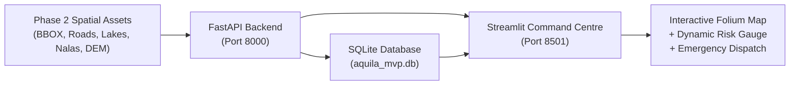

# AQUILA — Emergency MVP Overview & Quickstart

## 1. Executive Summary

The **AQUILA Emergency MVP** is a functional, integrated geospatial decision-support application built for urban flood intelligence, infrastructure monitoring, and emergency response coordination in the **Manikonda pilot area (Hyderabad, Telangana)**.

Developed under a strict two-day implementation plan, the MVP delivers an end-to-end demonstrable workflow connecting validated Phase 2 geospatial layers, a transparent 5-factor rule-based risk engine, incident lifecycle management, nearest-resource dispatch recommendations, and a controlled 120 mm synthetic design storm simulation.



---

## 2. Technology Stack

- **Backend Framework:** Python 3.13, FastAPI (0.161.1), Uvicorn (0.49.0), Pydantic (2.13.4)
- **Database & ORM:** SQLite (`aquila_mvp.db`), SQLAlchemy (2.1.6)
- **Dashboard & UI:** Streamlit (1.58.0), Folium (0.20.0), Streamlit-Folium (0.27.4), Plotly (6.8.0)
- **Geospatial Processing:** GeoPandas (1.2.0), Shapely (2.2.0), Rasterio (1.5.2), NetworkX (3.5)
- **Testing:** Pytest (9.1.1) — **53 automated tests passing**

---

## 3. Quickstart & How to Run Locally

### Prerequisites
- Python 3.10+ (System running Python 3.13.2)
- All requirements pre-installed in workspace

### Step 1: Initialize Database & Seed Baseline Data
```powershell
python app/db/seed.py
```
*Initializes SQLite schema and seeds 6 emergency fleet resources (pumps, rescue boats, ambulances, excavators) and baseline rainfall observations.*

### Step 2: Launch the FastAPI Backend
```powershell
uvicorn app.api.main:app --host 127.0.0.1 --port 8000 --reload
```
- Interactive API Documentation (Swagger UI): [http://127.0.0.1:8000/docs](http://127.0.0.1:8000/docs)
- Health Check: [http://127.0.0.1:8000/health](http://127.0.0.1:8000/health)

### Step 3: Launch the Streamlit Command-Centre Dashboard
```powershell
streamlit run app/dashboard/main.py --server.port 8501
```
- Open browser at: [http://localhost:8501](http://localhost:8501)

### Step 4: Run the Automated Test Suite
```powershell
pytest -v
```
*Executes all 53 automated tests covering geospatial layers, risk scoring, incident lifecycle, dispatch recommendation, scenario simulation, and audit logging.*

---

## 4. Key Demonstrable Workflows

1. **Interactive Geospatial Map:** Toggle between study area bounds (55.63 km²), lakes, drainage nalas, critical facilities (hospitals/schools), monitoring stations, and historical October 2020 inundation evidence.
2. **Dynamic Geographic Risk Index:** $R = 0.40P + 0.20T + 0.20D + 0.10L + 0.10H$ with live gauge and component score breakdowns.
3. **Incident Management Lifecycle:** Create flood incidents, view active queue, and transition statuses (`REPORTED` $\to$ `UNDER_REVIEW` $\to$ `ASSIGNED` $\to$ `IN_PROGRESS` $\to$ `RESOLVED`).
4. **Emergency Resource Recommendation:** Calculates Haversine distances to available compatible equipment and provides one-click approval and deployment.
5. **Scenario Simulation (`MANI-HEAVY-001`):** Step through the 120 mm / 3-hour storm hyetograph, observe live risk escalation, handle deterministic injected incidents, and cleanly reset simulated data without altering historical records.
6. **Immutable Audit Trail:** Real-time log of every operational action, state transition, and simulation event.

---

## 5. Documentation Directory

- [implementation_plan.md](file:///c:/AI/Rural_internship_project/docs/mvp/implementation_plan.md) — Two-day implementation plan and environment findings.
- [architecture.md](file:///c:/AI/Rural_internship_project/docs/mvp/architecture.md) — System architecture, database schema, and component design.
- [demo_guide.md](file:///c:/AI/Rural_internship_project/docs/mvp/demo_guide.md) — Step-by-step demonstration walkthrough guide (3-minute demo).
- [known_limitations.md](file:///c:/AI/Rural_internship_project/docs/mvp/known_limitations.md) — Honest analysis of technical trade-offs and deferred enterprise features.
- [mvp_completion_report.md](file:///c:/AI/Rural_internship_project/docs/mvp/mvp_completion_report.md) — Acceptance criteria sign-off audit.

