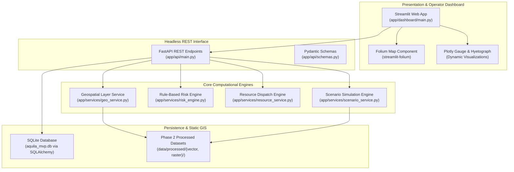
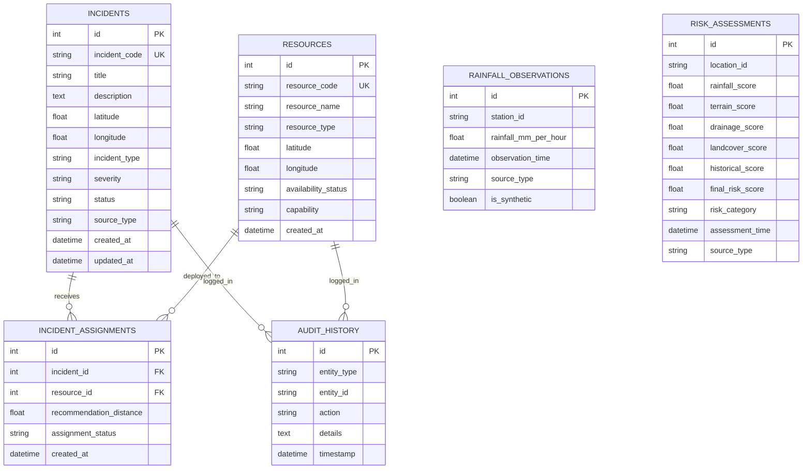

# AQUILA — MVP System Architecture & Database Design

## 1. High-Level Architecture Overview

The AQUILA Emergency MVP is structured as a modular, lightweight Python service architecture designed to operate entirely on a local machine without external cloud dependencies, paid third-party APIs, or live telemetry connections.

---

## 2. Database Schema Design (SQLite / SQLAlchemy)

The transactional database (`aquila_mvp.db`) comprises six core relational entities:

---

## 3. Core Engine Specifications

### 3.1 Rule-Based Geographic Risk Engine
- **Formula:**
  $$R = w_p P + w_t T + w_d D + w_l L + w_h H$$
  *Default Weights:* $w_p = 0.40$ (Rainfall), $w_t = 0.20$ (Terrain), $w_d = 0.20$ (Drainage), $w_l = 0.10$ (Land Cover), $w_h = 0.10$ (Historical Flood Evidence).
- **Categorization:**
  - $0.0 \le R < 40.0$: `LOW` (Green)
  - $40.0 \le R < 70.0$: `MODERATE` (Orange)
  - $70.0 \le R \le 100.0$: `HIGH` (Red)
- **Scientific Integrity:** The index is explicitly labeled as a *Geographic Vulnerability Risk Index*, not deterministic flood probability.

### 3.2 Emergency Resource Recommendation Engine
- **Distance Metric:** Haversine Great-Circle formula:
  $$d = 2r \arcsin\left(\sqrt{\sin^2\left(\frac{\Delta \phi}{2}\right) + \cos(\phi_1)\cos(\phi_2)\sin^2\left(\frac{\Delta \lambda}{2}\right)}\right)$$
  where $r = 6371.0$ km.
- **Capability Matching:**
  - `WATERLOGGING` / `CELLAR_FLOODING` $\to$ `PUMPING`, `ROAD_CLEARING`
  - `ROAD_SEVERANCE` $\to$ `ROAD_CLEARING`, `DEBRIS_CLEARING`
  - `DRAIN_OVERFLOW` $\to$ `DEBRIS_CLEARING`, `PUMPING`
  - `STRUCTURAL_HAZARD` $\to$ `WATER_RESCUE`, `MEDICAL_EVAC`
- **State Machine:**
  - `AVAILABLE` $\xrightarrow{\text{recommend}}$ `RECOMMENDED` $\xrightarrow{\text{operator approves}}$ `ASSIGNED` $\xrightarrow{\text{incident resolved}}$ `AVAILABLE`.

### 3.3 Heavy Rainfall Scenario Engine (`MANI-HEAVY-001`)
- **Profile:** 13-step synthetic Chicago hyetograph (180 minutes, peak 70 mm/hr).
- **Deterministic Incident Rules:**
  - Step 3 ($t=45$ min, peak onset): Injects `INC-SIM-001` (Alkapur Sector 1 Waterlogging).
  - Step 5 ($t=75$ min, continuing high runoff): Injects `INC-SIM-002` (Neknampur Lake Weir Overtopping).
- **Clean Reset Operation:**
  - Targeted SQL query deletes records where `source_type == "SIMULATED"` only.
  - Automatically restores any resources assigned to simulated incidents back to `AVAILABLE`.
  - Guarantees zero alteration of user-entered (`REPORTED`) or historical records.

---

## 4. API Endpoint Architecture

| Method | Endpoint | Description |
|---|---|---|
| `GET` | `/health` | Service health status and database backend check. |
| `GET` | `/api/summary` | Real-time command-centre KPI metrics. |
| `GET` | `/api/layers` | Geospatial layers metadata summary. |
| `GET` | `/api/layers/{name}` | GeoJSON feature collection payload for map rendering. |
| `GET` | `/api/rainfall` | Latest precipitation records. |
| `GET` / `POST` | `/api/risk` | Geographic risk index calculation with component breakdown. |
| `GET` | `/api/incidents` | Incident queue with status and provenance filters. |
| `POST` | `/api/incidents` | Register new flood incident (auto-generates incident code). |
| `PATCH` | `/api/incidents/{id}/status` | Update incident status (`REPORTED` $\to$ `RESOLVED`). |
| `GET` | `/api/resources` | Emergency response fleet status. |
| `POST` | `/api/incidents/{id}/recommend-resource` | Nearest compatible resource recommendation. |
| `POST` | `/api/incidents/{id}/assign-resource` | Approve and deploy resource. |
| `POST` | `/api/scenarios/start` | Initialize `MANI-HEAVY-001` simulation timeline. |
| `POST` | `/api/scenarios/advance` | Step 15 minutes forward in the design storm. |
| `POST` | `/api/scenarios/reset` | Safe purge of simulated artifacts. |
| `GET` | `/api/scenarios/status` | Current scenario step and cumulative rainfall. |
| `GET` | `/api/audit-history` | Immutable operational audit trail. |

