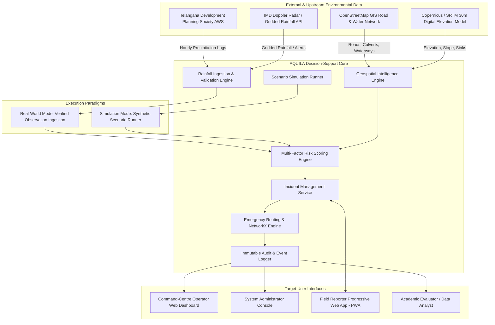

# AQUILA: Urban Flood Intelligence, Infrastructure Monitoring & Emergency Response Platform
## Phase 1: Problem Research, Requirement Analysis, and Project Specification Documentation Package

```
    ___     ____     __  __    ___    __       ___ 
   /   |   / __ \   / / / /   /  _/   / /      /   |
  / /| |  / / / /  / / / /    / /    / /      / /| |
 / ___ | / /_/ /  / /_/ /   _/ /    / /___   / ___ |
/_/  |_| \___\_\  \____/   /___/   /_____/  /_/  |_|
```

> **Document Status:** Complete & Verified Baseline  
> **Target Release:** Phase 1 Deliverable  
> **Case Study Location:** Hyderabad Metropolitan Area, Telangana, India  
> **Initial Pilot Catchment:** Manikonda (Gandipet Mandal, Ranga Reddy District)  
> **System Classification:** Academic Geospatial Decision-Support Prototype (Non-Authoritative)  

---

### Executive Overview

**AQUILA** is a research-backed, modular geospatial decision-support platform designed to address pluvial urban flooding, assess critical infrastructure vulnerability, streamline incident reporting, and optimize emergency response logistics. Focused on the hydrological and infrastructural dynamics of Hyderabad, Telangana—with Manikonda as its pilot implementation catchment—AQUILA bridges the operational gap between macroscopic hydrological forecasts and hyperlocal emergency dispatch workflows.

This documentation package constitutes the complete deliverable for **Phase 1: Problem Research and Requirement Analysis**. It establishes the empirical, hydrological, operational, and architectural foundation for the platform without introducing premature code implementations.

---

### Documentation Suite Navigation

The Phase 1 documentation is organized into 19 modular specifications, cross-referenced through unique requirement, risk, and use-case identifiers:

| Document | Primary Focus | Key Content & Linkage |
| :--- | :--- | :--- |
| **[01. README.md](file:///c:/AI/Rural_internship_project/docs/phase-1/README.md)** | Master Index & Architecture | Documentation structure, reading pathways, verification summary |
| **[02. problem_statement.md](file:///c:/AI/Rural_internship_project/docs/phase-1/problem_statement.md)** | Problem Statement & Motivation | Background, documented challenges, research motivation, proposed solution |
| **[03. background_and_research.md](file:///c:/AI/Rural_internship_project/docs/phase-1/background_and_research.md)** | Empirical Case-Study Analysis | Hyderabad October 2020 floods, Manikonda topography, drainage bottlenecks |
| **[04. existing_system_analysis.md](file:///c:/AI/Rural_internship_project/docs/phase-1/existing_system_analysis.md)** | Institutional & System Landscape | HYDRAA, GHMC, IMD, CWC, NRSC-NDEM capabilities, operational gaps, boundaries |
| **[05. literature_review.md](file:///c:/AI/Rural_internship_project/docs/phase-1/literature_review.md)** | Peer-Reviewed Literature Review | Hydrodynamic modeling (SWMM), GIS multi-criteria evaluation, flood routing |
| **[06. project_objectives.md](file:///c:/AI/Rural_internship_project/docs/phase-1/project_objectives.md)** | Measurable Project Objectives | 10 quantified engineering objectives with definitive acceptance metrics |
| **[07. stakeholder_analysis.md](file:///c:/AI/Rural_internship_project/docs/phase-1/stakeholder_analysis.md)** | Stakeholder & Actor Matrix | 5 user roles, RBAC matrix, institutional interactions, authority scopes |
| **[08. use_cases.md](file:///c:/AI/Rural_internship_project/docs/phase-1/use_cases.md)** | Structured System Use Cases | UC-01 to UC-10 detailed interaction flows, triggers, exception handling |
| **[09. functional_requirements.md](file:///c:/AI/Rural_internship_project/docs/phase-1/functional_requirements.md)** | Functional Specification | FR-001 to FR-076 across Modules A through H with acceptance criteria |
| **[10. non_functional_requirements.md](file:///c:/AI/Rural_internship_project/docs/phase-1/non_functional_requirements.md)** | Quality Attributes & SLAs | Performance, scalability, security, geospatial accuracy, data integrity |
| **[11. project_scope.md](file:///c:/AI/Rural_internship_project/docs/phase-1/project_scope.md)** | Scope & Boundary Definition | Strict In-Scope vs Out-of-Scope boundaries, academic disclaimer |
| **[12. data_availability_audit.md](file:///c:/AI/Rural_internship_project/docs/phase-1/data_availability_audit.md)** | Geospatial Data Feasibility Audit | Inventory across 9 spatial data layers, Manikonda coverage audit, formats |
| **[13. technology_stack_analysis.md](file:///c:/AI/Rural_internship_project/docs/phase-1/technology_stack_analysis.md)** | Technology Selection Rationale | React, TypeScript, MapLibre, FastAPI, PostGIS, NetworkX, Docker evaluation |
| **[14. assumptions_and_constraints.md](file:///c:/AI/Rural_internship_project/docs/phase-1/assumptions_and_constraints.md)** | Architectural Constraints | Hydrological, spatial, computational, and institutional boundaries |
| **[15. risk_register.md](file:///c:/AI/Rural_internship_project/docs/phase-1/risk_register.md)** | Risk Matrix & Mitigation Plans | Technical, operational, and data risks (RSK-01 to RSK-12) with fallbacks |
| **[16. initial_scenario_specification.md](file:///c:/AI/Rural_internship_project/docs/phase-1/initial_scenario_specification.md)** | Pilot Scenario Specification | Heavy Rainfall – Manikonda test scenario, step-by-step synthetic simulation |
| **[17. acceptance_criteria.md](file:///c:/AI/Rural_internship_project/docs/phase-1/acceptance_criteria.md)** | Verification & Sign-Off Matrix | Test methods, pass/fail thresholds, requirement mapping |
| **[18. references.md](file:///c:/AI/Rural_internship_project/docs/phase-1/references.md)** | Traceable Bibliography | Verified academic papers, government reports, DOIs, access status |
| **[19. phase_1_completion_report.md](file:///c:/AI/Rural_internship_project/docs/phase-1/phase_1_completion_report.md)** | Executive Sign-off & Phase 2 Gate | Synthesis audit, traceability verification, readiness sign-off for Phase 2 |

---

### Key Architectural Diagrams

#### 1. System Context Diagram
The following Mermaid diagram outlines the high-level boundary of AQUILA, illustrating its external data ingest sources, its dual operating modes, and its primary end-user interaction points:



---

### Reading Pathways by Evaluator Role

1. **For Project Guides & Academic Evaluators:**
   * Review `problem_statement.md`, `project_objectives.md`, and `literature_review.md`.
   * Inspect `acceptance_criteria.md` and `phase_1_completion_report.md`.
2. **For Software Architects & Technical Reviewers:**
   * Review `technology_stack_analysis.md`, `functional_requirements.md`, and `non_functional_requirements.md`.
   * Verify `data_availability_audit.md` and `risk_register.md`.
3. **For Field Domain & Disaster Management Specialists:**
   * Review `background_and_research.md`, `existing_system_analysis.md`, and `initial_scenario_specification.md`.
   * Inspect `use_cases.md` and `project_scope.md`.

---
*AQUILA Phase 1 Specification — Master Index*

