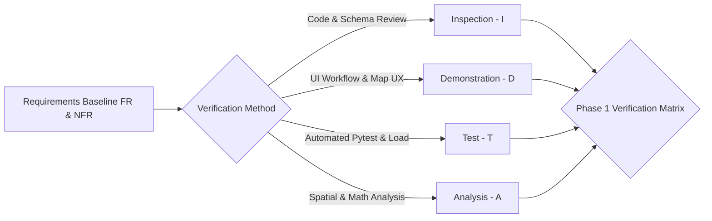

# AQUILA: System Acceptance Criteria and Verification Matrix
## Document Identifier: AQUILA-DOC-P1-017

---

### 1. Verification and Acceptance Methodology

To establish rigorous quality assurance across all project phases, AQUILA adopts the standardized IEEE/ISO verification taxonomy. Every functional requirement (FR-xxx) and non-functional quality attribute (NFR-xxx) is mapped to one or more primary verification methods:
1. **Inspection (I):** Visual and manual examination of documentation, schemas, code structures, or configuration files without software execution.
2. **Demonstration (D):** Observable operational execution of a feature or workflow in the user interface under qualitative evaluation.
3. **Test (T):** Automated or manual quantitative execution using automated test frameworks (`pytest`, Jest, Playwright) against measurable pass/fail assertions.
4. **Analysis (A):** Algorithmic verification, mathematical proof, computational profiling, or statistical evaluation of system telemetry.

---

### 2. Module-by-Module Acceptance Matrix

#### 2.1 Module A: User and Access Management

| Req ID | Requirement Summary | Verification Method | Verification Procedure / Test Case | Quantitative Pass/Fail Threshold |
| :---: | :--- | :---: | :--- | :--- |
| **FR-001** | User Authentication & JWT | **T** | Execute automated test `test_auth_login_valid_credentials` and `test_auth_invalid_credentials`. | Password validation $\le 300\text{ ms}$; JWT signed with HS256/RS256; 100% rejection of wrong passwords with HTTP 401. |
| **FR-002** | Role-Based Access Control | **T** | Test endpoint access with tokens for each of the 5 roles (ADM, OPR, REP, ERT, ANA). | 100% enforcement; unauthorized role requests receive HTTP 403 Forbidden. |
| **FR-003** | User Lifecycle Management | **D** | Admin user provisions a new Field Reporter account, updates role, and disables account. | Account creation $\le 200\text{ ms}$; deactivated account immediately barred from login. |
| **FR-004** | Audit Session Tracking | **I, T** | Query `auth_audit_logs` table after executing 10 login attempts (5 valid, 5 invalid). | 100% of attempts logged with timestamp, user ID, IP address, and success flag. |
| **FR-005** | PWA Persistent Session | **D** | Launch PWA, authenticate, refresh browser, and verify session persistence without prompt. | Session token persists across browser reloads for 7 days unless explicitly logged out. |

---

#### 2.2 Module B: Geographic Data Management

| Req ID | Requirement Summary | Verification Method | Verification Procedure / Test Case | Quantitative Pass/Fail Threshold |
| :---: | :--- | :---: | :--- | :--- |
| **FR-010** | Study Area Spatial Store | **A, T** | Query PostGIS boundary geometry for Manikonda pilot catchment. | Bounding box coordinates match ($17.380^\circ - 17.410^\circ\text{N}$, $78.360^\circ - 78.410^\circ\text{E}$); `ST_IsValid = TRUE`. |
| **FR-011** | Elevation Raster Ingestion | **T, A** | Extract elevation and slope for 100 random coordinates in Manikonda via PostGIS/GDAL. | Extraction latency $\le 50\text{ ms}$ per point; extracted elevations range within $510\text{ m} - 585\text{ m}$ AMSL. |
| **FR-012** | Drainage Network Vectors | **I, D** | Render digitized *nalas* and lake polygons in QGIS / MapLibre. | Centerlines continuous; Neknampur and Puppalaguda lakes present with valid closed polygons. |
| **FR-013** | Routable Road Graph Store | **A, T** | Parse OpenStreetMap road network into NetworkX; analyze strongly connected components. | Graph contains $\ge 3,000$ edges; $\ge 95\%$ of road nodes reside in the primary connected component. |
| **FR-014** | Critical Facilities Catalog | **I, T** | Spatial query retrieving all hospitals and fire stations within $5\text{ km}$ of Manikonda. | Hospital and emergency depot locations geocoded with valid EPSG:4326 coordinates. |
| **FR-015** | Spatial Layer Filtering API | **T** | Query `/api/v1/geo/layers` passing bounding box query parameters. | Returns valid GeoJSON FeatureCollection in $\le 100\text{ ms}$ for 10,000 entities. |

---

#### 2.3 Module C: Rainfall Data Management

| Req ID | Requirement Summary | Verification Method | Verification Procedure / Test Case | Quantitative Pass/Fail Threshold |
| :---: | :--- | :---: | :--- | :--- |
| **FR-020** | Rainfall Ingestion Endpoint | **T** | POST valid observation payload to `/api/v1/rainfall/ingest`. | Returns HTTP 201 Created in $\le 50\text{ ms}$; record written to database. |
| **FR-021** | Data Bounds Validation | **T** | POST payload with negative rainfall ($-5.0\text{ mm}$) and extreme rate ($300\text{ mm/hr}$). | Endpoint rejects payload with HTTP 422 Unprocessable Entity. |
| **FR-022** | Provenance Tagging | **T, I** | Query database after ingesting real and simulated feeds. | 100% of records have non-null `is_synthetic` boolean flag matching ingest source. |
| **FR-023** | Hyetograph Query API | **T** | Query `/api/v1/rainfall/history` for 24-hour time window. | Returns chronological time series in $\le 150\text{ ms}$; correctly computes cumulative sum. |
| **FR-024** | Automated Weather Poller | **D** | Configure poller cron; monitor scheduled database inserts over 2-hour window. | Poller executes on schedule; downloads and commits records without manual intervention. |
| **FR-025** | Rainfall Severity Tagging | **T** | Inject rainfall values ($1.0, 10.0, 45.0, 80.0, 150.0\text{ mm/hr}$). | Correctly tags records with IMD labels: Light, Moderate, Heavy, Very Heavy, Extremely Heavy. |

---

#### 2.4 Module D: Geospatial Intelligence Engine

| Req ID | Requirement Summary | Verification Method | Verification Procedure / Test Case | Quantitative Pass/Fail Threshold |
| :---: | :--- | :---: | :--- | :--- |
| **FR-030** | Static Terrain Vulnerability | **A, T** | Compute normalized static vulnerability raster across Manikonda grid cells. | 100% of cells output values in range $[0.00, 1.00]$; depressions have score $> 0.70$. |
| **FR-031** | Dynamic Flood Risk Scoring | **T, A** | Trigger risk recalculation with rainfall rate of $70\text{ mm/hr}$. | Full grid recalculation completes in $\le 500\text{ ms}$; risk values scale dynamically. |
| **FR-032** | Risk Tier Classification | **A, T** | Validate spatial query categorizing scores into 4 operational tiers. | Zero overlapping or unclassified cells; output GeoJSON matches standard color codes. |
| **FR-033** | Risk Factor Explainability | **T, D** | Click risk grid cell on map; query `/api/v1/risk/explain/{cell_id}`. | Returns decomposed percentage weights (Rainfall, Slope, Proximity) summing to exactly $100\%$. |
| **FR-034** | Infrastructure Intersection | **A, T** | Spatial query intersecting road network with High/Critical risk polygons. | Returns list of at-risk road segments and critical facilities in $\le 200\text{ ms}$. |
| **FR-035** | Dynamic Nala Buffer Sizing | **A** | Increase precipitation from $20\text{ mm/hr}$ to $60\text{ mm/hr}$; measure buffer geometry. | Buffer geometry automatically expands from $25\text{ m}$ to $75\text{ m}$. |

---

#### 2.5 Module E: Scenario Simulation Runner

| Req ID | Requirement Summary | Verification Method | Verification Procedure / Test Case | Quantitative Pass/Fail Threshold |
| :---: | :--- | :---: | :--- | :--- |
| **FR-040** | Scenario Configuration API | **T** | Create new synthetic scenario via POST `/api/v1/simulation/scenarios`. | Scenario persisted with unique UUID; parameter validation prevents negative duration. |
| **FR-041** | Interactive Controls | **D** | Click `Start`, `Pause`, `Resume`, `Reset` in the simulation dashboard. | Simulation clock halts on Pause, resumes on Resume, and resets state cleanly on Reset. |
| **FR-042** | Hyetograph Generation | **A, T** | Generate synthetic Chicago design storm (120 mm cumulative precipitation). | Cumulative rainfall volume matches mathematical target within $\pm 1.0\%$. |
| **FR-043** | Programmatic Incidents | **D, T** | Execute scenario to $T = 45\text{ min}$; observe incident feed. | Incident `INC-SIM-001` automatically appears in triage queue with `is_synthetic = TRUE`. |
| **FR-044** | Simulation Isolation | **T** | Run simulation while polling external field notification service. | Zero push notifications or live alerts transmitted to field reporter devices. |
| **FR-045** | Manikonda Pre-set | **D** | Select built-in "Heavy Rainfall – Manikonda" scenario and run to completion. | Scenario executes 180 simulation minutes within $180\text{ seconds}$ real time. |
| **FR-046** | Simulation Replay Export | **T, D** | Export simulation run; import into offline replay viewer. | Replay timeline re-renders spatial states identically to live execution. |

---

#### 2.6 Module F: Incident Management

| Req ID | Requirement Summary | Verification Method | Verification Procedure / Test Case | Quantitative Pass/Fail Threshold |
| :---: | :--- | :---: | :--- | :--- |
| **FR-050** | Incident Creation API | **T** | POST multipart incident payload (GPS, Category, Depth, Photo) to `/api/v1/incidents`. | Returns HTTP 201 Created with assigned Incident ID in $\le 200\text{ ms}$. |
| **FR-051** | Geotagged Photo Upload | **T** | Upload JPEG image; verify SHA256 checksum and image storage. | Image stored securely; served via authenticated media endpoint; MIME validated. |
| **FR-052** | State Machine Transitions | **T** | Attempt invalid transition (`Reported` $\rightarrow$ `Resolved` directly). | System rejects with HTTP 400 Bad Request; valid sequential transitions succeed. |
| **FR-053** | Incident Triage Dashboard | **D** | Operator reviews pending incident card, views photo, and clicks "Verify". | Incident marker transitions from yellow to orange/red in $\le 500\text{ ms}$. |
| **FR-054** | PWA Offline Caching | **D, T** | Disconnect mobile device from network, submit 5 incident reports, reconnect. | 100% of offline reports cached locally in IndexedDB and synchronized upon reconnection. |
| **FR-055** | Spatial Deduplication | **A, T** | Submit 2 incident reports with identical category within $30\text{ m}$ of each other. | System flags second report as potential duplicate in operator triage view. |
| **FR-056** | Resolution Documentation | **T** | Attempt to resolve incident without mandatory resolution notes. | System rejects update; succeeds when notes, team ID, and timestamp are provided. |

---

#### 2.7 Module G: Emergency Response and Routing

| Req ID | Requirement Summary | Verification Method | Verification Procedure / Test Case | Quantitative Pass/Fail Threshold |
| :---: | :--- | :---: | :--- | :--- |
| **FR-060** | Emergency Resource Store | **T** | Query registered emergency resources by capability and status. | Returns active resources with location coordinates and status (`Available`/`Assigned`). |
| **FR-061** | Resource Recommendation | **A, T** | Request resource recommendation for flooded culvert incident. | Returns top-3 ranked candidate units in $\le 200\text{ ms}$; de-watering pump ranked #1. |
| **FR-062** | Resource Locking | **T** | Approve dispatch of Resource #01; query available resources for second incident. | Resource #01 immediately excluded from available candidate pool; status = `Assigned`. |
| **FR-063** | Flood-Penalized Routing | **A, T** | Calculate route between Gachibowli Depot and Alkapur Township with flooded culvert. | Path calculation latency $\le 350\text{ ms}$; generated route avoids flooded culvert edge. |
| **FR-064** | Clearance Profile Routing | **A, T** | Compute route for Light Utility ($d_{\max}=0.20\text{ m}$) vs Heavy Truck ($d_{\max}=0.60\text{ m}$) through $0.35\text{ m}$ flood. | Light vehicle rerouted around edge; Heavy Truck permitted traversal with speed penalty. |
| **FR-065** | Manual Road Closure | **D, T** | Operator manually marks road segment as `SEVERED`; recalculate route. | NetworkX removes edge; subsequent routes immediately bypass severed segment. |
| **FR-066** | Destination Isolation Alert | **T** | Sever all road edges leading into destination node; request route. | Returns HTTP 422 with status `DESTINATION_ISOLATED` and coordinates of nearest open node. |

---

#### 2.8 Module H: Dashboard and Analytics

| Req ID | Requirement Summary | Verification Method | Verification Procedure / Test Case | Quantitative Pass/Fail Threshold |
| :---: | :--- | :---: | :--- | :--- |
| **FR-070** | MapLibre 60 FPS Render | **D, A** | Continuously pan and zoom map for 60 seconds with 5 active vector layers. | Sustained frame rate $\ge 50\text{ FPS}$; zero WebGL context losses. |
| **FR-071** | Real-Time Incident Pins | **D** | Create new incident via API; observe operator dashboard map. | Incident pin renders on map in $\le 500\text{ ms}$ without full-page browser reload. |
| **FR-072** | Dynamic Risk Overlay | **D** | Step simulation time; observe semi-transparent risk heatmap layer. | Heatmap polygons update smoothly; color transitions match risk tier thresholds. |
| **FR-073** | Rainfall Trend Charts | **D** | Verify time-series rainfall hyetograph against database records. | Chart renders historical and current rainfall with interactive zoom and tooltips. |
| **FR-074** | Fleet Status Tracker | **D** | Dispatch resource; verify status indicator updates in side panel. | Status indicator transitions from green (`Available`) to yellow (`Assigned`) in real time. |
| **FR-075** | Historical Scrubbing | **D** | Drag timeline scrubber across completed scenario; verify map state. | Map markers, road states, and risk polygons update dynamically to match timestamp. |
| **FR-076** | Post-Disaster Reporting | **T, D** | Trigger post-event report export for completed simulation run. | Generates structured PDF/CSV report containing incident counts, dispatch delays, and closures. |

---

### 3. Non-Functional Quality Attribute Verification

| NFR Identifier | Target Quality Attribute | Verification Method | Pass/Fail Verification Criterion |
| :---: | :--- | :---: | :--- |
| **NFR-PERF-01** | Spatial Query Latency | **T, A** | PostGIS `ST_Intersects` query over 10,000 entities executes in $\le 150\text{ ms}$. |
| **NFR-PERF-02** | Risk Scoring Recalculation | **A** | Manikonda grid risk score recalculation completes in $\le 500\text{ ms}$. |
| **NFR-PERF-03** | Route Calculation Speed | **T, A** | NetworkX path calculation completes in $\le 350\text{ ms}$ for any pilot pair. |
| **NFR-SCAL-01** | Concurrent User Load | **T** | Backend sustains 50 concurrent active users via Locust with error rate $< 0.1\%$. |
| **NFR-SEC-01** | Password Hashing Standard | **I, T** | 100% of stored passwords hashed using Argon2id/BCrypt; zero plaintext in logs. |
| **NFR-SEC-02** | Network Transport Security | **I, T** | TLS 1.3 enforced across all public endpoints; HTTP redirects to HTTPS. |
| **NFR-REL-01** | System Container Uptime | **A** | Docker container uptime maintained at $\ge 99.5\%$ during continuous testing. |
| **NFR-DATA-02** | Immutable Audit Trail | **T** | Database triggers prevent `UPDATE` or `DELETE` on audit log tables. |
| **NFR-GEO-01** | Geodetic Transformation | **T, A** | Metric buffer calculations in EPSG:32644 match geodesic ground-truth within $\pm 0.1\%$. |

---
*AQUILA Phase 1 Specification — System Acceptance Criteria*

