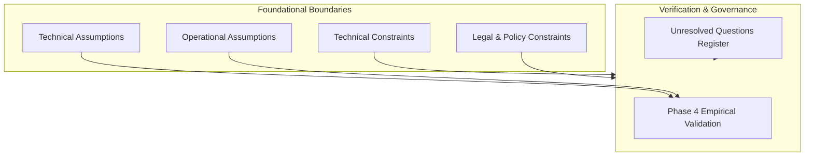

# AQUILA: Assumptions and Constraints Specification
## Document Identifier: AQUILA-DOC-P1-014

---

### 1. Architectural Philosophy on Engineering Assumptions

In systems engineering, unstated assumptions and unacknowledged constraints represent the primary failure mode of software prototypes. AQUILA explicitly identifies, categorizes, and bounds all technical, operational, and institutional assumptions. Where an operational question cannot be definitively verified in Phase 1, it is formally recorded as an **Unresolved Question** rather than silently absorbed into the code architecture.

---

### 2. Technical Assumptions

1. **Topological Completeness of OpenStreetMap (OSM) Networks:**
   * *Assumption:* It is assumed that the OpenStreetMap road network for the Manikonda pilot catchment contains sufficient geometric continuity and road classification tags (`highway = primary, secondary, tertiary, residential`) to form a strongly connected directed graph in NetworkX.
   * *Validation Risk:* Minor residential lanes or newly constructed bypass roads in peripheral colonies (e.g., Alkapur Township Sector 4) may possess topological disconnections or missing bridge/culvert tags.
   * *Mitigation:* A pre-processing graph validation script will identify disconnected subgraphs, automatically snapping isolated nodes within a $15\text{ m}$ threshold or logging them for manual inspection during Phase 2.

2. **Sufficiency of 30-Metre Elevation Grids for Relative Flood Vulnerability:**
   * *Assumption:* It is assumed that a 30-metre digital elevation model (Copernicus DEM GLO-30) provides adequate vertical and horizontal resolution to model macro-topographic gradients, hill ridges, and natural drainage depressions across the $15.5\text{ km}^2$ Manikonda catchment.
   * *Validation Risk:* A 30-metre grid cell cannot resolve micro-scale drainage features such as concrete roadside curbs ($0.15\text{ m}$ height), storm grate inlets, or subterranean parking garage ramps.
   * *Mitigation:* The platform explicitly treats DEM-derived metrics as a **relative topographic susceptibility proxy** (identifying regional accumulation sinks) rather than claiming to model sub-centimetre hydrodynamic water surface elevations.

3. **Spatial Representativeness of Peripheral Weather Stations:**
   * *Assumption:* It is assumed that rainfall observations logged by adjacent Automated Weather Stations (e.g., TGDPS Gachibowli, Serilingampally, and Rajendranagar) provide a valid meteorological proxy for precipitation intensity across Manikonda when direct municipal AWS data is unavailable.
   * *Validation Risk:* Convective summer/monsoon thunderstorms in Hyderabad often feature hyper-local microbursts spanning areas smaller than $2\text{ km} \times 2\text{ km}$, which may exhibit intensity differentials between Gachibowli and Manikonda.
   * *Mitigation:* The system supports multi-station spatial interpolation (Inverse Distance Weighting) and allows operators to adjust precipitation values manually or execute synthetic storm simulations.

4. **Linear Edge Penalty Approximation for Submerged Roads:**
   * *Assumption:* It is assumed that the operational risk of traversing a flood-affected road segment can be approximated using a hazard-scaled edge weight penalty function in NetworkX:
     $$W_{\text{effective}} = W_{\text{base}} \times (1 + \alpha \cdot \text{Risk})$$
     with edge severance applied when water depth exceeds $0.30\text{ m}$ for light vehicles or $0.60\text{ m}$ for heavy trucks.
   * *Validation Risk:* In reality, road impassability is also influenced by flow velocity, debris blockage, and road surface damage.
   * *Mitigation:* Operators and field response teams are provided an explicit UI control to manually mark any road segment as closed (`SEVERED`), overriding algorithmic calculations.

---

### 3. Operational Assumptions

1. **Human-in-the-Loop Verification Protocol:**
   * *Assumption:* It is assumed that all emergency resource dispatches and road closures must be verified and approved by a human **Command-Centre Operator (OPR)** before execution.
   * *Justification:* Prevents automated dispatch errors, false citizen alarms, and unauthorized vehicle movements during chaotic disaster events.

2. **Field Personnel Hardware Baseline:**
   * *Assumption:* It is assumed that accredited field reporters and emergency response team drivers possess modern Android or iOS smartphones equipped with GPS hardware, a modern web browser supporting Progressive Web Apps (Chrome, Safari, Firefox), and functional camera hardware.

3. **Cellular Connectivity Latency & Disconnection:**
   * *Assumption:* It is assumed that cellular network coverage may degrade or temporarily fail during severe flood conditions.
   * *Justification:* Mandates the requirement for local offline caching in the Field Reporter PWA (using IndexedDB/Workbox), guaranteeing that reports can be captured offline and synchronized once connectivity resumes.

---

### 4. Technical Constraints

1. **Single-Node Docker Compose Deployment:**
   * *Constraint:* The entire application suite (FastAPI backend, PostgreSQL/PostGIS, Redis, React frontend, Nginx reverse proxy) must execute cleanly on a single physical host or standard developer workstation (e.g., 8-core CPU, 16 GB RAM) via Docker Compose.
   * *Architectural Consequence:* Eliminates complex distributed systems (Kubernetes, Apache Kafka, Cassandra) that require dedicated DevOps teams and prohibitive hardware resources.

2. **Exclusively Open-Source & Zero-Cost Dependencies:**
   * *Constraint:* The platform must not depend on commercial, proprietary, or paid third-party APIs (e.g., Mapbox GL proprietary tokens, Google Maps Roads API, ArcGIS Server licenses).
   * *Architectural Consequence:* MapLibre GL is utilized for vector map rendering, OpenStreetMap for road graph networks, and open Copernicus DEMs for terrain analysis.

3. **Standardized Geodetic Projections:**
   * *Constraint:* All spatial data must be stored natively in WGS84 (EPSG:4326) for standardized GeoJSON exchange, and dynamically projected to UTM Zone 44N (EPSG:32644) for metric calculations (distance, area, buffers).

---

### 5. Legal, Policy and Ethical Constraints

1. **Academic Decision-Support Prototype Classification:**
   * *Constraint:* AQUILA is strictly an academic research prototype. The platform must include persistent, visible disclaimers across all dashboard views stating that it does not provide official government flood forecasts, statutory alerts, or legally binding emergency directives.
   * *Policy Mandate:* Statutory disaster management warnings remain the exclusive legal jurisdiction of the India Meteorological Department (IMD), the Hyderabad Disaster Response and Asset Protection Agency (HYDRAA), and the Greater Hyderabad Municipal Corporation (GHMC).

2. **No Direct Citizen Alert Broadcasting:**
   * *Constraint:* The platform is prohibited from broadcasting mass emergency sirens, SMS blasts, or cellular emergency broadcasts directly to citizen phones.

3. **Privacy and Sensitive Data Protection:**
   * *Constraint:* Field reporter personal telephone numbers and home addresses must be encrypted at rest and masked on public dashboard displays to comply with data privacy standards.

---

### 6. Unresolved Questions & Forward Engineering Register

The following open questions are formally documented for investigation during **Phase 2 (Data Collection and Geospatial Data Preparation)**:

| Question ID | Unresolved Operational / Technical Question | Current Working Assumption for Phase 1 | Planned Resolution Strategy in Phase 2 |
| :---: | :--- | :--- | :--- |
| **UQ-01** | Will the MA&UD / GHMC open data initiative release raw digital shapefiles for the Strategic Nala Development Programme (SNDP)? | Assume raw shapefiles are **Unavailable**; use digitized OSM waterways and static PDF georeferencing. | Submit formal academic data inquiry to GHMC/HUL; if unapproved, finalize manually digitized vector layer. |
| **UQ-02** | Does the local Gandipet Mandal office maintain an Automated Weather Station (AWS) closer to Manikonda than Gachibowli? | Assume **Gachibowli AWS ($3.8\text{ km}$)** is the primary spatial meteorological proxy. | Inspect TGDPS station directory during Phase 2 spatial harvest. |
| **UQ-03** | What exact vehicle chassis clearance threshold should trigger edge severance for standard 108 ambulance vans versus DRF pump trucks? | Assume $d_{\max} = 0.20\text{ m}$ for Light Vehicles and $d_{\max} = 0.60\text{ m}$ for Heavy Rescue Trucks. | Review Telangana Fire Services vehicular procurement specifications during Phase 2. |
| **UQ-04** | Are historical citizen complaint logs from the October 2020 floods accessible with exact latitude/longitude coordinates? | Assume raw geocoded complaint logs are **Restricted**; construct synthetic validation incidents based on published inundation locations. | Audit Hyderabad Urban Lab published research data and academic literature for geocoded flood incident points. |

---
*AQUILA Phase 1 Specification — Assumptions and Constraints*

