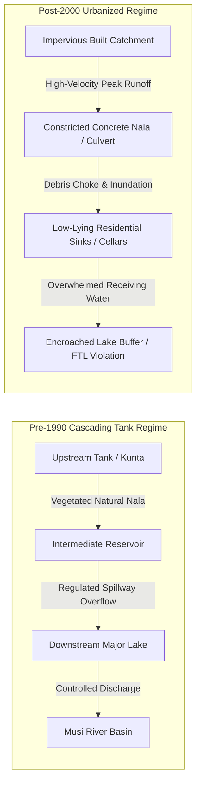
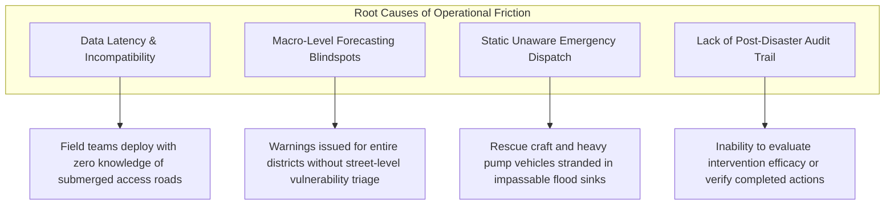

# AQUILA: Background Research and Problem Analysis
## Document Identifier: AQUILA-DOC-P1-003

---

### 1. The Hydrological Anatomy of Urban Flooding in Hyderabad

The Hyderabad Metropolitan Area presents a compelling and urgent case study in urban pluvial hydrology. Situated on the Deccan Plateau at an average elevation of 542 metres above mean sea level (MSL), the city’s natural drainage morphology consists of undulating granitic hills, ridges, and valleys that drain into two major hydrological sub-basins: the **Musi River** basin (which bisects the city from west to east) and the **Hussain Sagar** catchment (draining northern and central quarters).

Historically, Hyderabad's stormwater hydrology was governed by a sophisticated 400-year-old interconnected cascading tank system engineered during the medieval Qutb Shahi and Asaf Jahi dynasties. Under this system, excess surface runoff from upstream earthen reservoirs (*cheruvus* or *kuntas*) spilled over masonry weirs and traversed natural vegetative flood channels (*nalas*) into downstream retention tanks before discharging into the Musi. This interconnected cascade functioned as an effective decentralized flood attenuation network, dampening peak hydrographs and recharging the shallow granitic aquifer.



Over the past four decades, intensive, market-driven urbanization—spurred by Hyderabad's emergence as a global information technology hub—disrupted this hydrological equilibrium. Major transformations documented by remote sensing studies (NRSC, 2021) include:
1. **Loss of Surface Water Bodies:** Between 1970 and 2020, over 50% of small and intermediate water bodies (*kuntas*) within the GHMC area were reclaimed, filled, or converted into residential colonies, institutional campuses, and commercial layouts.
2. **Nala Narrowing and Channelization:** Historical flood channels exceeding 30 to 50 metres in width have been systematically narrowed into concrete box drains of 2 to 6 metres, or covered by road culverts and real-estate encroachments.
3. **Impervious Surface Surge:** Catchment impermeability in western peripheral zones increased from under 15% in 1990 to over 70–85% by 2022, driving run-off coefficients ($C$ in the Rational Formula $Q = C \cdot I \cdot A$) from 0.25 to nearly 0.85–0.90. Consequently, local precipitation translates into immediate, high-velocity flash runoff with minimal catchment lag time ($T_c < 20 \text{ minutes}$).

---

### 2. Empirical Examination: The October 2020 Floods

The catastrophic flood event of October 13–19, 2020, serves as the primary empirical baseline for AQUILA’s hazard models.

#### Meteorological Trigger
A deep depression formed over the west-central Bay of Bengal on October 11, 2020 (designated BOB 02 by the India Meteorological Department), made landfall near Kakinada, and tracked west-northwestward across Telangana. The system retained intense convective cloud clusters over Hyderabad for over 18 consecutive hours.

| Meteorological Observation Point | 24-Hour Rainfall Recorded (mm) | Historical Return Period Assessment |
| :--- | :--- | :--- |
| **Ghatkesar (Medchal-Malkajgiri)** | 324.5 mm | > 1-in-100 year event |
| **Hayathnagar (Ranga Reddy)** | 288.0 mm | > 1-in-75 year event |
| **Begumpet (IMD Observatory)** | 192.0 mm | Highest October 24-hr rainfall since 1916 (117.9 mm recorded on 13 Oct, 1916 surpassed) |
| **Singapur Township** | 306.0 mm | Record high daily downpour |
| **Bandlaguda / South Hyderabad** | 270.0 mm | > 1-in-50 year event |
| **Western Peripheral Zone (including Manikonda)** | 185.0 mm – 220.0 mm | High-intensity pulses peaking at 65 mm/hr |

*Source: India Meteorological Department (IMD) Monsoon Monograph 2020; Telangana State Development Planning Society (TGDPS) Weather Logs.*

#### Impacts and Cascading Failures
* **Casualties & Human Displacement:** Over 80 confirmed fatalities (primarily due to drowning, wall collapses, and electrocution from submerged distribution transformers). More than 40,000 households were evacuated or marooned.
* **Inundation Extent:** Over 200 colonies remained submerged under 1.5 to 3.5 metres of floodwater for 3 to 7 days. Critical zones included Nadeem Colony, Al-Jubail Colony, Tolichowki, Shaikpet, Begumpet, and Manikonda.
* **Infrastructure Breakdown:** 
  * The Musi River overflowed bankfull discharge; 13 out of 17 radial gates of Himayat Sagar and 10 gates of Osman Sagar were lifted simultaneously to release excess flood discharge, creating severe backwater inundation along low-elevation tributaries.
  * More than 2,000 electrical transformers suffered deep water immersion, plunging vast urban sectors into blackout conditions that crippled communication networks.
  * Arterial roads connecting the IT corridor (Hitec City, Gachibowli, Financial District) to central Hyderabad were severed due to flooded causeways, stranded vehicles, and collapsed culvert retaining walls.

---

### 3. Detailed Profile: Manikonda Demonstration Area

AQUILA selects **Manikonda** (a major urban municipality situated in Gandipet Mandal, Ranga Reddy District, within the western Outer Ring Road corridor) as its initial implementation, validation, and demonstration study area.

```
+---------------------------------------------------------------------------------+
|                                MANIKONDA CATCHMENT                              |
|                                                                                 |
|  [Khajaguda Hills] (Elev: ~575m)                                                |
|          |                                                                      |
|          v (Steep slope, high run-off velocity)                                 |
|  [Puppalaguda & Lanco Hills Corridor]                                           |
|          |                                                                      |
|          v (Submerged culvert / Nala bottleneck)                                |
|  [Alkapur Township & Golden Temple Sector] (Low-lying sink, Elev: ~525m)       |
|          |                                                                      |
|          v (Inundation buffer & weir overflow)                                  |
|  [Neknampur Lake / Ibrahim Cheruvu] (Elev: ~515m)                                |
|          |                                                                      |
|          v (Constricted urban outflow channel)                                  |
|  [Shaikpet Nala -> Musi River Confluence]                                       |
+---------------------------------------------------------------------------------+
```

#### Geographic & Morphological Attributes
* **Geographical Coordinates:** Latitude 17.3800° N to 17.4100° N; Longitude 78.3600° E to 78.4100° E.
* **Surface Area:** Approximately 15.5 km² covering Manikonda proper, Puppalaguda, Neknampur, and Alkapur Township.
* **Topographic Gradient:** Elevation drops steeply from 580 metres in the northern granitic ridges (adjacent to Khajaguda and Lanco Hills) down to 515 metres at the basin of Neknampur Lake (Ibrahim Cheruvu). This steep natural gradient produces rapid surface run-off concentration times, channeling millions of litres of water within 20 minutes directly into the flat, low-elevation residential depressions of Alkapur Township.
* **Hydrological Receptors:**
  * **Neknampur Lake (Ibrahim Cheruvu):** A historical 98-acre lake with a catchment area covering both Manikonda and Puppalaguda. In October 2020, extreme upstream runoff filled the lake beyond its Full Tank Level (FTL), causing extensive backwater inundation across surrounding apartment complexes.
  * **Puppalaguda Cheruvu & Manikonda Cheruvu:** Upstream detention tanks that have suffered siltation, narrowing of inlet channels, and residential buffer-zone encroachment.
  * **Shaikpet-Manikonda Trunk Drain (*Nala*):** The primary drainage artery that conveys discharge from Neknampur towards Tolichowki and the Musi River. This nala is heavily constricted by road culverts, utility pipe crossings, and retaining wall encroachments.

#### Specific Infrastructure Vulnerabilities in Manikonda
1. **Cellar and Sub-Surface Flooding:** Nearly all high-density apartment blocks built between 2012 and 2023 feature deep underground vehicular cellars. In October 2020, flood depths of 1.2 m on residential streets inundated hundreds of residential cellars, submerging thousands of vehicles and disabling backup generator sets, water treatment plants, and electrical panels.
2. **Arterial Route Severance:** The primary commercial corridors linking Manikonda to Shaikpet/Tolichowki and Puppalaguda to the Financial District cross low-lying culverts over natural nalas. During heavy rainfall, these culverts act as hydraulic dams due to insufficient cross-sectional flow area, submerging the roadway under 0.6 m to 1.0 m of turbulent water and cutting off emergency access.
3. **Unplanned Stormwater Integration:** Stormwater drainage lines frequently terminate abruptly or discharge directly onto low-lying vacant plots, converting entire residential sectors into artificial stagnant ponds during moderate showers (> 40 mm/hr).

---

### 4. Operational Gaps in Municipal Disaster Management

A critical review of the disaster management operations in Hyderabad during the 2020 event and subsequent monsoon seasons (2021–2024) reveals four structural deficiencies:



1. **Absence of Street-Level Spatial Triage:** While the India Meteorological Department (IMD) issues color-coded district bulletins (Yellow, Orange, Red alerts) for Ranga Reddy and Hyderabad districts, these alerts lack the spatial granularity required by ward-level engineers to identify which specific culvert will overflow or which residential lane requires immediate sandbagging.
2. **Blind Emergency Navigation:** During flash flood conditions, municipal Disaster Response Force (DRF) teams, police interceptors, and 108 medical ambulances rely on standard GPS mapping tools or localized driver memory. Standard navigation apps do not account for road closures caused by waterlogging, leading emergency vehicles directly into impassable flood sinks where they become stranded.
3. **Fragmented Incident Logging:** Distress requests arrive via municipal call centers (GHMC 040-21111111), emergency phone numbers (100, 112), and social media platforms. Because these reports lack verified geospatial coordinates, deduplication, and photo-evidence verification, response managers struggle to prioritize life-safety incidents over minor civic nuisances.
4. **Lack of an Integrated Digital Operational Record:** After floodwaters recede, there is no unified, timestamped digital record tracking when water rose, which roads were submerged, when emergency pumps were deployed, and when routes were cleared. This prevents municipal engineers from performing post-event hydrological audits to improve long-term infrastructure designs.

---

### 5. Synthetic vs. Real-World Execution Parity

A foundational research requirement for AQUILA is ensuring that the platform operates seamlessly across both real-world operations and controlled academic simulations:

```
[Real Data Feed]      \
 (AWS / Ingest API)    \
                        --> [Unified Risk Scoring Engine] --> [Dynamic Graph Router]
                       /    (PostGIS + Topographic Wetness)   (NetworkX Cost Evaluation)
[Simulation Engine]   /
 (Controlled Hyetograph)
```

By ensuring that the underlying geospatial algorithms, edge-penalty functions, and incident triage pipelines treat real-world and synthetic data identically, AQUILA enables rigorous academic testing, repeatable crisis simulations, and real-world deployment without architectural alterations.

---
*AQUILA Phase 1 Specification — Background and Research*

