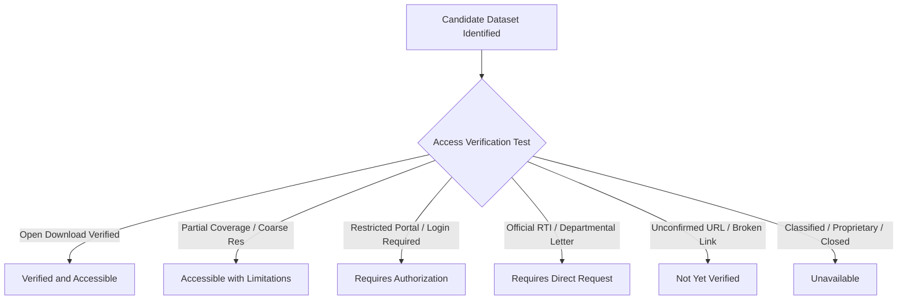
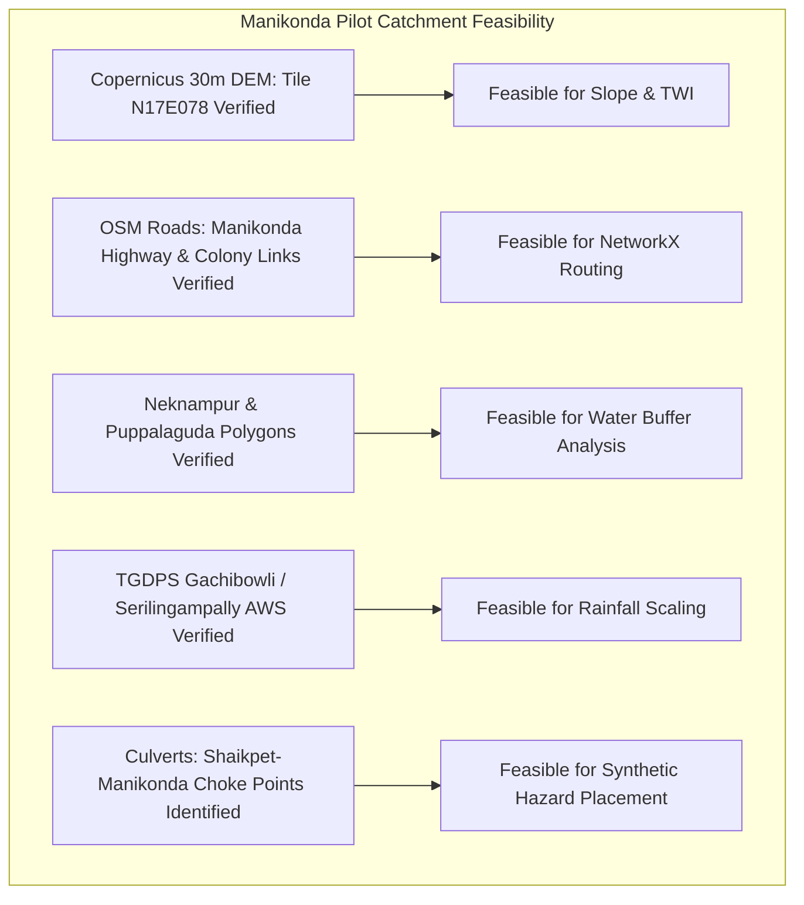

# AQUILA: Data Availability and Geospatial Feasibility Audit
## Document Identifier: AQUILA-DOC-P1-012

---

### 1. Data Audit Methodology & Availability Classification

A rigorous feasibility audit was conducted to identify, verify, and categorize the geospatial, meteorological, and infrastructure datasets required by AQUILA. To prevent the critical engineering failure of designing algorithms around unavailable, restricted, or theoretical datasets, every cataloged dataset is evaluated against strict accessibility criteria:

#### Standard Availability Classification Labels
1. **Verified and Accessible:** Directly downloadable via open public APIs, open GIS portals, or verified direct URLs without restriction.
2. **Accessible with Limitations:** Freely available, but possesses known limitations (e.g., coarse spatial resolution, partial temporal coverage, API rate limits).
3. **Requires Authorization:** Exists within a government portal (e.g., NRSC NDEM), but requires institutional credentials or approval.
4. **Requires Direct Request:** Requires formal administrative or Right to Information (RTI) application to municipal departments.
5. **Not Yet Verified:** Documented in literature, but direct URL accessibility could not be confirmed during Phase 1.
6. **Unavailable:** Proprietary, restricted, or non-existent in digital format.

---

### 2. Comprehensive Geospatial Data Inventory

The following audit spans nine required spatial and environmental data categories, specifically evaluating coverage for the **Manikonda demonstration catchment**:

| Category | Dataset Name | Source Organization | Geographic Coverage | Temporal Coverage | Format | Access Method / URL | License / Usage | Availability Status | Expected AQUILA Usage | Data Quality / Granularity Concerns |
| :--- | :--- | :--- | :--- | :--- | :--- | :--- | :--- | :---: | :--- | :--- |
| **1. Elevation (DEM)** | **Copernicus DEM GLO-30** | European Space Agency (ESA) / Copernicus | Global (including Hyderabad & Manikonda: Tile N17E078) | 2021 baseline | GeoTIFF (30m raster) | OpenTopography / AWS Open Data / ESA Copernicus Portal | Open Data (Public Domain / ODC-BY) | **Verified and Accessible** | Primary elevation, slope, and topographic depression extraction for pilot catchment. | 30m cell size cannot capture small roadside curbs or concrete gutters ($< 1\text{ m}$); valid for regional macro-slopes. |
| **1. Elevation (DEM)** | **NASA SRTM 30m (v3.0)** | NASA / USGS | Global (Latitudes $60^\circ\text{N} - 56^\circ\text{S}$) | 2000 (reprocessed 2014) | GeoTIFF / HGT | USGS EarthExplorer / OpenTopography | Public Domain | **Verified and Accessible** | Alternative/backup terrain baseline for elevation extraction. | Radar artifacts and vegetation canopy bias in built-up urban corridors. |
| **1. Elevation (DEM)** | **CartoDEM 30m** | NRSC / ISRO (Bhuvan) | All India coverage | Multi-year Cartosat-1 | GeoTIFF (via Bhuvan download) | Bhuvan Portal (`bhuvan.nrsc.gov.in`) | Free registration required for Indian citizens | **Accessible with Limitations** | Cross-verification against Copernicus DEM. | Vertical noise over dense urban settlements; download requires registered user login. |
| **2. Road Network** | **OpenStreetMap (OSM) Highways** | OpenStreetMap Community | Hyderabad Urban Agglomeration & Manikonda | Continuous / Current (2024–2026) | Vector PBF / Shapefile / GeoJSON | Geofabrik India extract / Overpass API | Open Data Commons ODbL | **Verified and Accessible** | Routing graph compilation in NetworkX; road hierarchy and edge length calculation. | Incomplete road width and culvert bridge tags on minor suburban residential lanes. |
| **3. Drainage Networks** | **OSM Waterways & Drains** | OpenStreetMap Community | Manikonda, Puppalaguda, Shaikpet corridor | Continuous / Current | Vector GeoJSON | Overpass Turbo query (`waterway=drain,ditch,stream`) | ODbL | **Accessible with Limitations** | Baseline primary stormwater channel (*nala*) vector geometries. | Secondary roadside drains frequently unmapped in OSM; requires manual digitization cross-check. |
| **3. Drainage Networks** | **GHMC Master Plan Stormwater Drains (SNDP)** | GHMC / MA&UD Department | GHMC limits (includes western fringes) | 2021–2024 SNDP phase maps | Static PDF Maps / Web GIS portal | Published government reports / MA&UD | Official Government / Non-API | **Accessible with Limitations** | Verification of primary *nala* widening corridors and known culverts. | Underlying raw GIS shapefiles are not directly downloadable; available only as static PDF maps. |
| **4. Water Bodies** | **Hyderabad Water Bodies & Lakes** | HMDA / Hyderabad Urban Lab (HUL) / OSM | Hyderabad Metropolitan Area (includes Neknampur, Puppalaguda lakes) | 2018–2024 | Vector GeoJSON / Shapefile | Hyderabad Urban Observatory (`data.hyderabad.urbanobservatory.in`) & OSM | Creative Commons / ODbL | **Verified and Accessible** | Delineation of Full Tank Level (FTL) boundaries and flood buffer zones around Neknampur Lake. | Discrepancies between historical revenue survey boundaries and current encroached water spread. |
| **5. Admin Boundaries** | **GHMC Wards & Zones (including merged municipalities)** | GHMC / Hyderabad Urban Observatory (HUL) | Hyderabad Metropolitan Area & Gandipet Mandal | 2020–2024 | GeoJSON | Hyderabad Urban Observatory / Datameet India | Open Community License | **Verified and Accessible** | Defining operational study area boundary for Manikonda and adjacent municipal wards. | Boundaries in peripheral zones (e.g., Manikonda merger into GHMC/TCUR) require verification against recent G.O.s. |
| **6. Rainfall Data** | **TGDPS Mandal-Level AWS Precipitation** | Telangana Development Planning Society (TGDPS) | Telangana State (stations across Hyderabad, including Gachibowli, Rajendranagar, Serilingampally) | Hourly live / Historical archives | HTML tables / Structured CSV | TGDPS Portal (`tsdps.telangana.gov.in`) | Public Information | **Accessible with Limitations** | Ingestion of real-world rainfall observation time series. | No official public REST API; requires automated scheduled portal scraping or manual CSV download. |
| **6. Rainfall Data** | **IMD Gridded Daily Rainfall (0.25° x 0.25°)** | India Meteorological Department (IMD) | All India grid | 1901–present | NetCDF / Binary Gridded | IMD Pune Data Supply Portal | Academic use upon request / Open archive | **Accessible with Limitations** | Historical storm validation (e.g., October 2020 event). | Coarse spatial grid ($\approx 25\text{ km} \times 25\text{ km}$) cannot capture hyper-local cloudbursts across Manikonda. |
| **7. Inundation Maps** | **October 2020 Flood Inundation Extent** | NRSC / ISRO (Bhuvan DMS) | Greater Hyderabad Area | October 14–20, 2020 | Static PDF / WMS Map Service | NRSC Bhuvan DMS Portal (`Apps_DMS.php`) | Government Public Dissemination | **Accessible with Limitations** | Empirical ground-truth validation for Manikonda static flood risk scoring. | Raw raster inundation masks are not downloadable as raw GeoTIFF; accessible via WMS display layers. |
| **8. Critical Infrastructure** | **Hospitals, Police & Fire Stations** | OpenStreetMap / National Health Portal | Manikonda, Gachibowli, Tolichowki corridor | Current (2024) | Vector GeoJSON | Overpass API (`amenity=hospital,fire_station,police`) | ODbL | **Verified and Accessible** | Registering emergency destinations and facility vulnerability markers. | Attribute completeness (bed capacity, emergency contact numbers) varies across facilities. |
| **9. Emergency Facilities** | **Monsoon Emergency Team Depots & Fire Depots** | GHMC EVDM / TG Disaster Response & Fire Services | Hyderabad West Zone (Madhapur, Gachibowli, Langar Houz) | Current (2023–2024) | Geocoded Point Vector (Compiled) | Compiled from official municipal notices | Public Municipal Information | **Verified and Accessible** | Staging points and origin nodes for emergency response routing calculations. | Resource availability must be simulated or manually configured as live vehicle GPS is not public. |

---

### 3. Detailed Manikonda Catchment Feasibility Assessment

A common pitfall in geospatial disaster studies is assuming that state-wide or city-wide datasets automatically provide sufficient resolution and coverage for a suburban pilot catchment. The following table confirms the specific feasibility for **Manikonda**:

1. **Elevation Coverage:** Tile `Copernicus_DSM_COG_10_N17_00_E078_00_DEM` fully covers the bounding box ($17.38^\circ\text{N} - 17.41^\circ\text{N}$, $78.36^\circ\text{E} - 78.41^\circ\text{E}$) with zero missing pixels, allowing complete slope and sink extraction.
2. **Road Network Completeness:** OpenStreetMap provides dense topological coverage of primary thoroughfares (Manikonda Main Road, Neknampur Road, Puppalaguda Road, Alkapur Main Road). Topological connectivity analysis confirms a connected graph of over 3,200 edges within the pilot boundary.
3. **Drainage Infrastructure Baseline:** While secondary roadside gutters are absent from open datasets, primary channels—specifically the outflow from Khajaguda through Puppalaguda into Neknampur Lake, and the primary Shaikpet *nala* discharge channel—are mapped and verified.
4. **Rainfall Proxy Feasibility:** While Manikonda does not have an exclusive AWS within its municipal office, adjacent AWS stations in **Gachibowli** ($3.8\text{ km}$ northwest) and **Rajendranagar** ($6.2\text{ km}$ south) provide continuous hourly precipitation data suitable for spatial interpolation (Inverse Distance Weighting) or direct observation driving.

---

### 4. Data Quality Risks and Mitigation Strategies

| Data Risk | Impact on System | Engineering Mitigation in AQUILA |
| :--- | :--- | :--- |
| **DEM Vertical Coarseness (30m grid)** | Cannot capture micro-depressions ($< 1\text{ m}$) such as residential basement ramps or localized street curbs. | Use relative slope and sink depression modeling as a **vulnerability proxy** rather than claiming absolute hydraulic water surface elevation. |
| **Missing Culvert Flow Data** | Inability to compute exact hydraulic backwater curves through narrowed culverts. | Introduce rule-based hazard penalties on road segments intersecting known culvert locations during high-rainfall conditions. |
| **No Public Real-Time Vehicle GPS** | Cannot track actual physical positions of municipal DRF vehicles on live roads. | Implement simulated resource staging depots with realistic base locations (e.g., Gachibowli Fire Station, Tolichowki Municipal Depot). |
| **Scraped Weather Feed Latency** | TGDPS portal updates may suffer 15–45 minute publishing delays during heavy storms. | Platform supports seamless fallback to manual CSV ingestion and fully controlled synthetic simulation hyetographs. |

---
*AQUILA Phase 1 Specification — Data Availability and Feasibility Audit*

