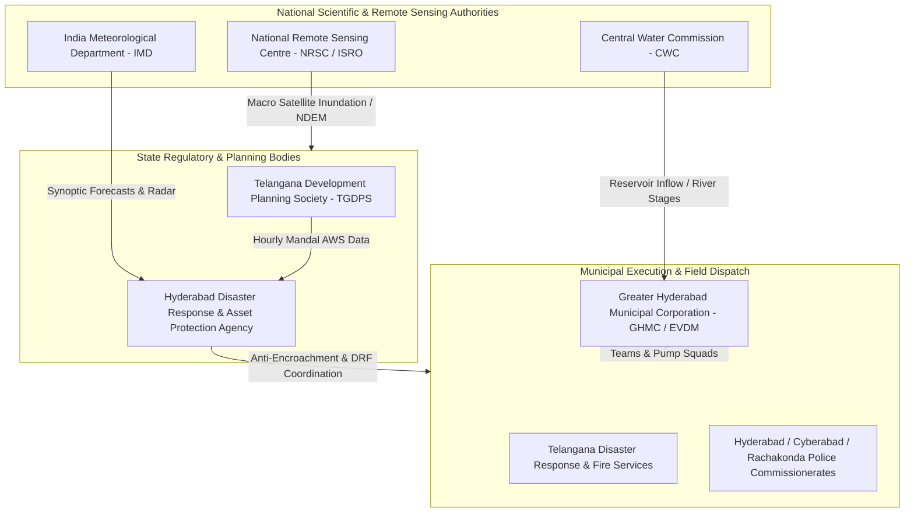
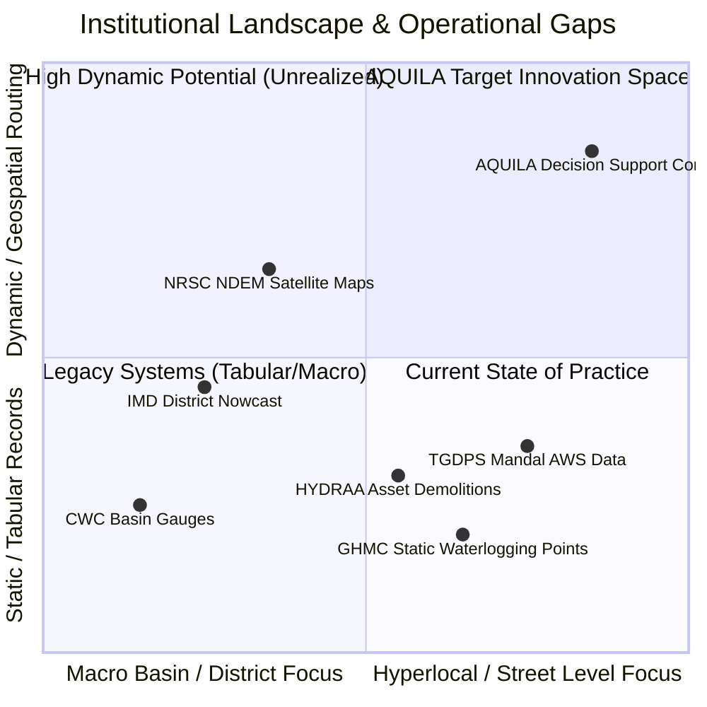

# AQUILA: Existing Systems and Institutional Landscape Analysis
## Document Identifier: AQUILA-DOC-P1-004

---

### 1. Institutional Landscape Mapping

Urban flood mitigation, meteorological forecasting, and disaster management across the Hyderabad metropolitan region involve a multi-tier governance structure comprising municipal bodies, state agencies, and national scientific institutions. Understanding the division of responsibilities, operational workflows, and technological baselines of these organizations is critical to defining AQUILA’s specific contribution.

---

### 2. Deep-Dive Organizational Capability Matrix

The following table provides a comprehensive evaluation of the systems currently operating in the Hyderabad region, documenting their existing capabilities, operational constraints, and technical baselines:

| Organization / System | Primary Jurisdictional Mandate | Capabilities Already Implemented | Documented Operational / Technical Challenges |
| :--- | :--- | :--- | :--- |
| **HYDRAA** *(Hyderabad Disaster Response and Asset Protection Agency)* | Formed in July 2024 via G.O.Ms.No.99 under MA&UD Department. Covers Telangana Core Urban Region (TCUR) up to Outer Ring Road (ORR). | • Anti-encroachment operations targeting illegal constructions in Lake Full Tank Levels (FTL) and *nala* buffer zones. • Coordination of the unified Disaster Response Force (DRF). • Dedicated police stations for investigating lake-bed violations. | • Primary focus is on regulatory enforcement and asset demolition rather than real-time dynamic hydrologic modeling. • Currently relies on conventional municipal phone helplines (1070) without an automated, flood-aware vehicle routing engine. |
| **GHMC / EVDM** *(Greater Hyderabad Municipal Corporation)* | Core municipal corporation governing civic infrastructure, stormwater maintenance, and primary emergency relief across 30 zones/wards. | • Identification of ~140 static waterlogging vulnerable points. • Monsoon Emergency Teams (METs) equipped with portable de-watering pumps. • Strategic Nala Development Programme (SNDP) civil engineering widening projects. • Centralized dial-in control room (040-21111111). | • Static vulnerability lists do not adjust dynamically to localized, moving convective storm cells. • Incident tickets are captured as tabular text entries, lacking direct coupling to real-time spatial graph routing for field squads. |
| **IMD** *(India Meteorological Department)* | National meteorological forecasting, Doppler radar operations, and severe weather warnings. | • Begumpet S-band Doppler Weather Radar (DWR). • 3-hour nowcasting bulletins and district-level color-coded weather warnings (Red, Orange, Yellow). • Vision 2047 roadmap prioritizing high-resolution urban flood warning systems (scaling IFLOWS models). | • Warnings are delivered at district scales (e.g., Hyderabad, Ranga Reddy) rather than hyper-local micro-catchments. • Urban Flood Early Warning Systems (similar to IFLOWS-Mumbai or IFLOWS-Chennai) are not yet operational for Hyderabad. |
| **CWC** *(Central Water Commission)* | National river basin water resources monitoring, reservoir regulation, and fluvial flood forecasting. | • Hydrological observation stations on the Musi River. • Inflow/outflow monitoring and reservoir capacity tracking for Osman Sagar and Himayat Sagar dams. | • Focuses strictly on fluvial (riverine) river flows and dam levels. • Provides zero monitoring or forecasting for pluvial (stormwater/surface runoff) inundation across city streets and culverts. |
| **NRSC / ISRO** *(National Remote Sensing Centre)* | Space-based disaster monitoring, satellite earth observation, and national emergency databases. | • National Database for Emergency Management (NDEM v5.0 and NDEM Lite app). • Bhuvan Disaster Management Support (DMS) publishing satellite-derived macro flood inundation maps. • Multi-hazard spatial atlases and integration of IMD/CWC data. | • Satellite optical sensors cannot penetrate dense cloud cover during active storm events. • Synthetic Aperture Radar (SAR) satellites (e.g., Sentinel-1, RISAT) have multi-day revisit intervals, making them unsuitable for flash flood events lasting 1–3 hours. • NDEM access is restricted to authorized government agencies. |
| **TGDPS** *(Telangana Development Planning Society)* | State planning department operating hyper-local weather observation networks. | • Dense Automated Weather Station (AWS) network logging rainfall, temperature, and humidity hourly down to mandal levels. • Public data dissemination via the TGDPS portal and mobile apps. | • Provides raw numerical rainfall data without hydrological modeling, surface runoff calculation, or infrastructure impact analysis. |

---

### 3. Systematic Gap Analysis

A critical technical gap exists at the intersection of **hyper-local terrain hydrology**, **infrastructure vulnerability**, and **tactical emergency dispatch**:

#### Gap 1: Disconnect Between Rainfall Ingestion and Road Passability
Currently, when a station in the TGDPS network records 60 mm/hr of rain, this number is displayed on a public dashboard. However, there is no automated system that determines which downstream roads (e.g., Alkapur Main Road or Shaikpet Underpass) have become impassable, or how that water depth impacts different classes of vehicles.

#### Gap 2: Inability to Route Emergency Vehicles Around Dynamic Flood Sinks
When a citizen calls the emergency helpline to report that an apartment cellar is flooding, the dispatch operator sends the nearest Monsoon Emergency Team. However, the driver uses standard commercial navigation apps that are unaware of flooded culverts, resulting in rescue vehicles becoming stranded in the very floodwaters they were dispatched to manage.

#### Gap 3: Absence of an Open, Auditable Simulation Environment
Municipal planners and academic researchers lack an open, reproducible platform where they can simulate synthetic extreme rainfall scenarios (e.g., "What happens if Manikonda receives 80 mm of rain in 45 minutes?") to test drainage improvements and resource allocation strategies before the monsoon begins.

---

### 4. What AQUILA Realistically Contributes

AQUILA fills this operational gap by functioning as a lightweight, open-source decision-support prototype:

1. **Micro-Catchment Multi-Factor Risk Scoring:** AQUILA integrates open digital elevation models (Copernicus DEM 30m), slope, distance to drainage channels, and live/synthetic rainfall rates to generate a normalized 0.0–1.0 risk score for every spatial grid cell in the target area.
2. **Dynamic Flood-Penalized Graph Routing:** Using NetworkX over OpenStreetMap road networks, AQUILA dynamically increases edge traversal weights or disables road segments that intersect high-risk flood zones or verified incident reports, providing safe navigation routes for emergency responders.
3. **Dual-Mode Simulation and Operational Parity:** AQUILA allows operators to run controlled synthetic storm scenarios (e.g., the Manikonda pilot scenario) using the exact same processing pipeline that handles real-world weather data, enabling risk-free training and planning.
4. **Structured Incident Verification Workflow:** AQUILA provides a Field Reporter PWA that allows on-ground teams to submit geolocated, photo-verified incident reports, standardizing the transition of incidents from `Reported` to `Verified`, `Dispatched`, and `Resolved`.

---

### 5. Architectural Boundaries: What Remains Strictly Out of Scope

To ensure academic honesty and operational safety, the following functions are strictly excluded from AQUILA’s architecture:

```mermaid
flowchart LR
    subgraph Within_AQUILA_Scope [AQUILA Realistic Contribution]
        S1[Micro-catchment geospatial risk scoring]
        S2[Dynamic flood-penalized route planning]
        S3[Controlled synthetic storm simulation]
        S4[Structured incident logging & PWA verification]
    end

    subgraph Strictly_Out_Of_Scope [Authoritative & Official Scope]
        O1[Official Public Flood Warning Issuance]
        O2[Direct Automated 112/100 Dispatch]
        O3[Authoritative Hydraulic Flood Guarantees]
        O4[Access to Classified Defense GIS Data]
    end

    Within_AQUILA_Scope -.->|Advisory Decision-Support Only| Strictly_Out_Of_Scope
```

* **No Official Warning Issuance:** AQUILA is an academic decision-support prototype. It does not issue public alerts, siren activations, or official evacuation notices. Official warnings remain the sole legal mandate of IMD, SDMA, and HYDRAA.
* **No Direct Emergency Personnel Dispatch:** AQUILA provides decision-support recommendations to operators. It does not automatically dispatch police, fire, or military assets without human operator verification and approval.
* **No Authoritative Hydraulic Guarantees:** AQUILA uses multi-criteria geospatial vulnerability indexing and rule-based heuristics. It does not replace full hydrodynamic 2D shallow water equation solvers (such as PCSWMM or HEC-RAS) for civil engineering design.
* **No Unauthorized Data Access:** AQUILA relies exclusively on open, publicly accessible data (OpenStreetMap, Copernicus DEM, public weather portals). It does not claim or require access to restricted military GIS layers or classified government databases.

---
*AQUILA Phase 1 Specification — Existing System Analysis*

