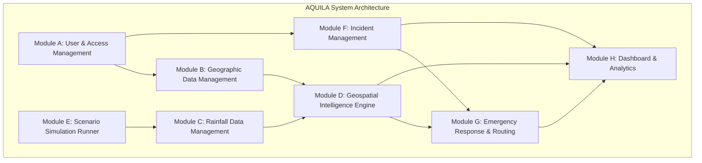

# AQUILA: Functional Requirements Specification
## Document Identifier: AQUILA-DOC-P1-009

---

### 1. Specification Framework

This document outlines the detailed functional requirements for the AQUILA platform. Requirements are organized across eight core functional modules (Modules A through H). Each requirement is assigned a permanent identifier, priority level (using MoSCoW notation: Must Have [M], Should Have [S], Could Have [C]), primary user role, architectural dependencies, and verifiable acceptance criteria.

---

### 2. Module Specifications

---

#### Module A: User and Access Management

| Req ID | Requirement Description | Priority | Target Role | Dependencies | Acceptance Criteria |
| :--- | :--- | :---: | :---: | :---: | :--- |
| **FR-001** | **User Authentication & Session Management:** System shall authenticate users via username/password, generate signed JWT bearer tokens with 8-hour expiry, and validate cryptographic password hashes (Argon2id). | **Must** | All Roles | None | System validates correct credentials in $\le 300\text{ ms}$, rejects incorrect credentials with HTTP 401, and issues valid signed JWT. |
| **FR-002** | **Role-Based Access Control (RBAC):** System shall enforce RBAC across all REST endpoints based on 5 roles: Administrator, Operator, Field Reporter, Response Team, and Evaluator. | **Must** | All Roles | FR-001 | Unauthorized endpoint requests return HTTP 403 Forbidden; authorized requests execute with verified claims. |
| **FR-003** | **User Lifecycle Provisioning:** System shall provide administrative APIs to create, read, update, deactivate, and reset passwords for user accounts. | **Must** | ADM | FR-001, FR-002 | Administrator can create, update role, and deactivate any account; deactivated accounts cannot obtain JWT tokens. |
| **FR-004** | **Audit Session Tracking:** System shall log all successful logins, failed attempts, and password changes with client IP, timestamp, and user agent. | **Should** | ADM, ANA | FR-001 | Audit log records 100% of authentication attempts; queryable via administrative API. |
| **FR-005** | **Field Reporter Device Authorization:** System shall support token persistence for the Field Reporter PWA to avoid repetitive re-authentications during emergency field operations. | **Should** | REP | FR-001 | Field Reporter PWA retains active valid session token in secure local storage for up to 7 days of field duty. |

---

#### Module B: Geographic Data Management

| Req ID | Requirement Description | Priority | Target Role | Dependencies | Acceptance Criteria |
| :--- | :--- | :---: | :---: | :---: | :--- |
| **FR-010** | **Study Area Boundary Management:** System shall store and manage the spatial boundary of the Manikonda pilot catchment (and broader Hyderabad area) as PostGIS polygon geometries in WGS84 (EPSG:4326). | **Must** | ADM, OPR | None | Querying study area boundary returns valid GeoJSON polygon covering Manikonda coordinates ($17.380^\circ\text{N} - 17.410^\circ\text{N}$, $78.360^\circ\text{E} - 78.410^\circ\text{E}$). |
| **FR-011** | **Elevation Raster Management:** System shall store and query digital elevation model (DEM) rasters (Copernicus 30m) with spatial querying capabilities for elevation and slope extraction. | **Must** | ADM, ANA | FR-010 | System extracts elevation (metres AMSL) and slope (degrees) for any coordinate in the study area in $\le 50\text{ ms}$. |
| **FR-012** | **Drainage Network Layer Management:** System shall maintain vector geometries for all primary and secondary stormwater channels (*nalas*), culverts, and water bodies (Neknampur Lake, Puppalaguda Cheruvu). | **Must** | ADM, OPR | FR-010 | Vector layer contains digitized centerlines and buffer polygons for all documented drainage channels in Manikonda. |
| **FR-013** | **Road Network Topology Store:** System shall ingest and maintain a routable graph representation of the OpenStreetMap road network, including road hierarchy, speed limits, and bridge/culvert locations. | **Must** | ADM, OPR | FR-010 | Road network parses into a valid connected NetworkX directed graph with node coordinates and edge traversal attributes. |
| **FR-014** | **Critical Infrastructure Catalog:** System shall store geocoded points of interest for critical facilities: hospitals, fire stations, electrical substations, municipal depots, and police stations. | **Must** | ADM, OPR | FR-010 | Facility points indexed with attributes (Name, Category, Operational Capacity, Emergency Phone) queryable via PostGIS. |
| **FR-015** | **Dynamic Spatial Layer Filtering:** System shall provide REST endpoints to query and filter spatial layers by bounding box (BBox), category, and buffer radius. | **Should** | OPR, ANA | FR-010, FR-012 | Bounding box spatial queries return GeoJSON FeatureCollections in $\le 100\text{ ms}$ for client map rendering. |

---

#### Module C: Rainfall Data Management

| Req ID | Requirement Description | Priority | Target Role | Dependencies | Acceptance Criteria |
| :--- | :--- | :---: | :---: | :---: | :--- |
| **FR-020** | **Rainfall Ingestion API:** System shall provide an ingestion endpoint (`/api/v1/rainfall/ingest`) accepting real-world observation payloads (Station ID, Timestamp, Precipitation Rate in mm/hr, Cumulative mm). | **Must** | ADM, System | None | Endpoint ingests structured JSON/CSV payloads; parses and stores valid records into `rainfall_observations` table. |
| **FR-021** | **Observation Data Validation:** System shall reject rainfall records with negative precipitation values, values exceeding physical limits ($> 250\text{ mm/hr}$), or non-chronological timestamps. | **Must** | System | FR-020 | Out-of-bounds records rejected with HTTP 422 Unprocessable Entity and descriptive validation error message. |
| **FR-022** | **Observation Source Tagging:** System shall explicitly tag every stored rainfall record with its provenance: `is_synthetic = FALSE` for real AWS feeds and `is_synthetic = TRUE` for simulation-generated pulses. | **Must** | System, ANA | FR-020 | Database query confirms 100% of records possess a non-null `is_synthetic` boolean flag. |
| **FR-023** | **Precipitation Time-Series Querying:** System shall provide endpoints to query historical and current hyetographs for any station over user-defined time windows. | **Must** | OPR, ANA | FR-020, FR-022 | Query returns chronological precipitation time series with min, max, mean, and cumulative metrics in $\le 150\text{ ms}$. |
| **FR-024** | **Automated External API Poller:** System shall support an optional scheduled task polling external public weather feeds (e.g., TGDPS/IMD open portal) at configurable intervals. | **Should** | ADM, System | FR-020, FR-021 | Scheduled poller executes on cron schedule, downloads new observations, and triggers downstream risk scoring without human intervention. |
| **FR-025** | **Rainfall Severity Level Classification:** System shall classify current rainfall intensity into standardized meteorological categories: Light ($< 2.5\text{ mm/hr}$), Moderate ($2.5 - 15\text{ mm/hr}$), Heavy ($15.6 - 64.4\text{ mm/hr}$), Very Heavy ($64.5 - 115.5\text{ mm/hr}$), and Extremely Heavy ($> 115.5\text{ mm/hr}$). | **Must** | OPR, System | FR-020 | System correctly tags incoming rainfall records with IMD standard severity classification strings. |

---

#### Module D: Geospatial Intelligence Engine

| Req ID | Requirement Description | Priority | Target Role | Dependencies | Acceptance Criteria |
| :--- | :--- | :---: | :---: | :---: | :--- |
| **FR-030** | **Static Topographic Vulnerability Indexing:** System shall compute a static vulnerability score for each $30\text{ m} \times 30\text{ m}$ grid cell based on normalized slope, depression sink depth, and distance to nearest drainage channel. | **Must** | System, ANA | FR-011, FR-012 | Static vulnerability layer pre-computed and stored in PostGIS; scores normalized strictly between 0.00 and 1.00. |
| **FR-031** | **Dynamic Composite Flood Risk Scoring:** System shall compute dynamic flood risk for each cell by multiplying static vulnerability with a dynamic rainfall scaling coefficient: $\text{Risk} = f(\text{Static Vulnerability}, \text{Current Rainfall Rate})$. | **Must** | OPR, System | FR-020, FR-030 | Composite risk layer recalculates across the Manikonda pilot grid in $\le 500\text{ ms}$ upon new rainfall event trigger. |
| **FR-032** | **Risk Level Categorization:** System shall classify dynamic risk scores into 4 operational tiers: Low ($0.00 - 0.25$), Moderate ($0.26 - 0.50$), High ($0.51 - 0.75$), and Critical ($0.76 - 1.00$). | **Must** | OPR, ERT | FR-031 | System outputs color-coded risk polygon layer corresponding exactly to defined numeric interval cutoffs. |
| **FR-033** | **Risk Factor Explainability API:** System shall expose an endpoint returning the decomposed factor weights and values contributing to any selected cell's risk score. | **Must** | OPR, ANA | FR-031 | Clicking any risk cell returns JSON payload showing exact contribution percentage of rainfall, slope, and drainage proximity. |
| **FR-034** | **Infrastructure Risk Intersection:** System shall identify and list all critical facilities and road segments intersecting High or Critical risk polygons. | **Must** | OPR, ERT | FR-013, FR-014, FR-032 | Query returns list of vulnerable roads and facilities within the pilot catchment in $\le 200\text{ ms}$. |
| **FR-035** | **Drainage Channel Backwater Hazard Buffer:** System shall dynamically expand the hazard risk buffer around primary *nalas* as rainfall intensity increases above $40\text{ mm/hr}$. | **Should** | System, ANA | FR-012, FR-031 | Buffer distance expands from default $25\text{ m}$ to $75\text{ m}$ when precipitation exceeds heavy rainfall threshold. |
| **FR-036** | **Optional Machine Learning Susceptibility Scoring:** System shall provide a modular architecture allowing pre-trained ML models (Random Forest / XGBoost) to output flood susceptibility scores alongside the rule-based engine. | **Could** | ANA, ADM | FR-030, FR-031 | Modular interface allows plugging in a Python scikit-learn model scoring pipeline without breaking rule-based engine fallback. |

---

#### Module E: Scenario Simulation Runner

| Req ID | Requirement Description | Priority | Target Role | Dependencies | Acceptance Criteria |
| :--- | :--- | :---: | :---: | :---: | :--- |
| **FR-040** | **Scenario Creation & Configuration:** System shall allow operators to create synthetic storm scenarios with custom parameters (Scenario Name, Total Duration, Peak Rainfall mm/hr, Hyetograph Profile). | **Must** | OPR, ADM | None | Scenario configuration stored in database with unique Scenario ID and validated simulation parameters. |
| **FR-041** | **Interactive Simulation Controls:** System shall provide controls to `Start`, `Pause`, `Resume`, `Reset`, and `Step Forward` an active simulation run. | **Must** | OPR, ANA | FR-040 | Simulation clock responds to operator control inputs with zero desynchronization or race conditions. |
| **FR-042** | **Synthetic Hyetograph Generation:** Simulation runner shall generate time-series rainfall pulses matching standard storm distributions (e.g., Chicago Design Storm, Triangular Peak, or Cloudburst Pulse). | **Must** | System | FR-040 | Generated synthetic rainfall series matches mathematical profile with specified total cumulative rainfall volume ($\pm 1\%$). |
| **FR-043** | **Programmatic Incident Injection:** Simulator shall inject pre-scripted synthetic field incidents at specific simulation timestamps (e.g., trigger "Culvert Submerged" at $T + 30\text{ min}$). | **Must** | System, OPR | FR-040, FR-050 | Synthetic incidents appear on command dashboard at designated time steps with explicit `is_synthetic = TRUE` tags. |
| **FR-044** | **Simulation Execution Isolation:** Simulation runs must be completely isolated from real-world operational logs and shall not send external notifications to active field personnel. | **Must** | System | FR-040, FR-043 | Zero synthetic alerts or taskings transmitted to field devices; database isolation verified by test suite. |
| **FR-045** | **Manikonda Baseline Scenario Pre-set:** System shall provide a built-in pre-set for the "Heavy Rainfall – Manikonda" demonstration scenario ($120\text{ mm}$ precipitation over 3 hours). | **Must** | OPR, ANA | FR-040, FR-042 | Operator can select and execute the pre-configured Manikonda demonstration scenario with a single click. |
| **FR-046** | **Simulation Replay Export:** System shall allow exporting the complete time-series execution of a simulation run as an animated GeoJSON/JSON package. | **Should** | ANA | FR-041, FR-045 | Exported package re-renders simulation timeline in analytics viewer identically to the live run. |

---

#### Module F: Incident Management

| Req ID | Requirement Description | Priority | Target Role | Dependencies | Acceptance Criteria |
| :--- | :--- | :---: | :---: | :---: | :--- |
| **FR-050** | **Incident Registration via REST API:** System shall accept incident submissions with attributes: Title, Category, Latitude, Longitude, Estimated Water Depth, Severity, Description, and Reporter ID. | **Must** | REP, OPR | FR-001 | Endpoint `/api/v1/incidents` validates payload, creates database record, and returns assigned Incident ID in $\le 200\text{ ms}$. |
| **FR-051** | **Geotagged Photographic Upload:** System shall accept photographic evidence attached to incident reports, validate image MIME types (JPEG, PNG, WebP), and store files securely with SHA256 checksums. | **Must** | REP, OPR | FR-050 | Photo uploaded and linked to incident record; served via authenticated media endpoint. |
| **FR-052** | **Incident State Machine Enforcement:** System shall enforce a strict 4-state lifecycle: `Reported` $\rightarrow$ `Verified` $\rightarrow$ `Dispatched` $\rightarrow$ `Resolved` (with support for `Rejected`). | **Must** | OPR, ERT | FR-050 | Invalid state transitions (e.g., `Reported` $\rightarrow$ `Resolved` bypassing verification) rejected with HTTP 400 Bad Request. |
| **FR-053** | **Incident Verification & Triage Interface:** Command dashboard shall display unverified incidents in a dedicated triage queue with attached photos and local risk scores. | **Must** | OPR | FR-050, FR-051, FR-052 | Operator can mark incident as `Verified` or `Rejected` with mandatory review comments. |
| **FR-054** | **PWA Offline Incident Caching:** Field Reporter PWA shall store up to 20 incident reports locally when device is offline and sync automatically upon network restoration. | **Must** | REP | FR-050 | Test confirms report created during simulated offline mode uploads cleanly when connectivity is toggled on. |
| **FR-055** | **Incident Spatial Clustering:** System shall cluster multiple incident reports originating within a $50\text{ m}$ radius into a single consolidated incident group to prevent duplicate dispatches. | **Should** | OPR, System | FR-050, FR-053 | Nearby reports flagged as potential duplicates on operator triage view. |
| **FR-056** | **Incident Resolution Documentation:** Marking an incident as `Resolved` shall require mandatory logging of resolution notes, resolving team ID, and timestamp. | **Must** | ERT, OPR | FR-052 | Incident cannot transition to `Resolved` without recording resolution notes and timestamp. |

---

#### Module G: Emergency Response and Routing

| Req ID | Requirement Description | Priority | Target Role | Dependencies | Acceptance Criteria |
| :--- | :--- | :---: | :---: | :---: | :--- |
| **FR-060** | **Emergency Resource Registry:** System shall maintain an inventory of emergency assets: Resource ID, Name, Category (Pump Squad, Boat Unit, Rescue Truck, Tree Crane), Base Depot Location, and Status (`Available`, `Assigned`, `Maintenance`). | **Must** | ADM, OPR | FR-014 | System supports CRUD operations on emergency resources; tracks real-time availability status. |
| **FR-061** | **Automated Resource Recommendation:** System shall recommend the top-3 optimal emergency resources for any verified incident based on capability matching and shortest travel distance. | **Must** | OPR | FR-052, FR-060 | Recommendation engine returns ranked candidate list in $\le 200\text{ ms}$ upon operator request. |
| **FR-062** | **Resource Assignment & Lock:** When an operator approves a resource dispatch, system shall lock the resource status to `Assigned` to prevent duplicate assignment to other incidents. | **Must** | OPR | FR-060, FR-061 | Assigned resource immediately disappears from available candidate pools until released. |
| **FR-063** | **Dynamic Flood-Penalized Route Calculation:** System shall compute optimal driving routes between origin and destination over OpenStreetMap graphs, avoiding flooded road segments and active incidents. | **Must** | OPR, ERT | FR-013, FR-032, FR-052 | Routing engine returns safe path in $\le 350\text{ ms}$; path cleanly skirts around road segments with water depth $> 0.30\text{ m}$. |
| **FR-064** | **Vehicle-Specific Clearance Profiles:** Routing engine shall support clearance thresholds for different vehicle types: Light Utility ($d_{\max} = 0.20\text{ m}$), Heavy Rescue Truck ($d_{\max} = 0.60\text{ m}$), Amphibious Craft (Unconstrained). | **Must** | OPR, ERT | FR-063 | Light utility route avoids roads passable by heavy rescue trucks under identical flood conditions. |
| **FR-065** | **Manual Road Closure Override:** Operators shall have the ability to manually close or reopen any road segment on the routing graph based on radio/police reports. | **Must** | OPR | FR-013, FR-063 | Closed road segment immediately severed in NetworkX graph; subsequent route calculations avoid that segment. |
| **FR-066** | **Destination Isolation Detection:** If all road paths to an incident destination are completely severed by floodwaters, system shall alert operator with `DESTINATION_ISOLATED` and indicate nearest staging point. | **Must** | OPR, ERT | FR-063 | System detects zero-path condition, returns descriptive error payload, and plots closest accessible road node. |

---

#### Module H: Dashboard and Analytics

| Req ID | Requirement Description | Priority | Target Role | Dependencies | Acceptance Criteria |
| :--- | :--- | :---: | :---: | :---: | :--- |
| **FR-070** | **MapLibre Interactive GIS Map:** Web dashboard shall provide an interactive MapLibre GL map view with pan, zoom, layer toggle (DEM, Drainage, Roads, Heatmap, Incidents), and coordinate inspection. | **Must** | OPR, ADM, ANA | FR-010 to FR-015 | Map maintains $\ge 50\text{ FPS}$ during continuous user interaction with 5 active layers rendered. |
| **FR-071** | **Real-Time Incident Map Markers:** Dashboard shall render geolocated incident markers color-coded by severity, with interactive popups showing photos, status, and assigned teams. | **Must** | OPR, ANA | FR-050, FR-052 | Marker updates render in $\le 500\text{ ms}$ of database state change without requiring full-page reload. |
| **FR-072** | **Dynamic Flood Risk Heatmap Overlay:** Dashboard shall render the composite risk grid as a semi-transparent, color-coded vector layer (Green = Low to Dark Red = Critical). | **Must** | OPR, ANA | FR-031, FR-032 | Risk overlay updates seamlessly when new rainfall observations or simulation steps occur. |
| **FR-073** | **Rainfall Hyetograph & Trend Visualizer:** Dashboard shall feature interactive time-series charts displaying current precipitation rates, cumulative rainfall, and severity thresholds. | **Must** | OPR, ANA | FR-020, FR-023 | Chart updates in real time using Chart.js / Recharts; supports time-window zoom and pan. |
| **FR-074** | **Resource Status & Fleet Tracker:** Dashboard shall display a side panel listing all registered emergency resources, current operational status, assigned incident, and base depot. | **Must** | OPR | FR-060, FR-062 | Status panel dynamically reflects resource assignments and releases in real time. |
| **FR-075** | **Historical Event Replay Interface:** Analytics suite shall provide an interactive playback timeline to scrub through historical or simulated storm events and inspect past operational states. | **Should** | ANA, OPR | FR-046, FR-070 | Scrubbing timeline updates map layers, incident markers, and risk heatmaps to match selected historical timestamp. |
| **FR-076** | **Comprehensive Incident & Dispatch Reporting:** System shall generate downloadable summary reports (PDF/CSV) covering total incidents reported, verification rate, mean dispatch time, and resolution duration. | **Should** | ADM, ANA | FR-052, FR-062 | System exports structured post-event statistical report covering all key performance metrics. |

---
*AQUILA Phase 1 Specification — Functional Requirements*

