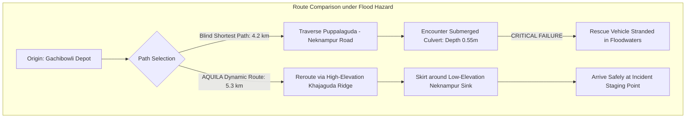

# AQUILA: Initial Demonstration Scenario Specification
## Document Identifier: AQUILA-DOC-P1-016
### Scenario Designation: "Heavy Rainfall – Manikonda, Hyderabad" (SCN-MKD-001)

---

### 1. Scenario Rationale and Controlled Testing Philosophy

The primary objective of the **Heavy Rainfall – Manikonda, Hyderabad** demonstration scenario is to validate the end-to-end integration of AQUILA’s data ingestion, geospatial risk scoring, incident management, dynamic graph routing, and audit tracking subsystems under controlled, repeatable conditions.

By injecting a synthetic, scientifically calibrated cloudburst rainfall hyetograph into the Manikonda pilot catchment, this scenario proves the operational viability of the platform without requiring an active storm event in the physical world.

> **CRITICAL ARCHITECTURAL SAFEGUARD:**  
> All precipitation rates, incident reports, photographic evidence, and dispatch movements generated during this scenario are strictly synthetic. The system enforces `is_synthetic = TRUE` across all generated database records and displays a prominent visual banner across all interfaces to prevent operational confusion.

---

### 2. End-to-End Demonstration Workflow

```mermaid
sequenceDiagram
    autonumber
    actor OPR as Command Operator
    participant SIM as Simulation Runner
    participant BACKEND as Ingestion & Risk Core
    participant GIS as PostGIS & Geospatial Engine
    participant ROUTE as Dynamic Routing Engine
    participant AUDIT as Immutable Audit Logger

    OPR->>SIM: Selects "Manikonda Catchment" & Launches Scenario SCN-MKD-001
    SIM->>BACKEND: Injects Synthetic Hyetograph (T=0 to T=180 min, Peak 70 mm/hr)
    BACKEND->>GIS: Computes Multi-Factor Risk Grid (Precipitation x Static Terrain)
    GIS->>BACKEND: Flags High-Hazard Hotspots (Alkapur Low Sink, Neknampur Culvert)
    BACKEND->>OPR: Pushes Real-Time Risk Heatmap Update via WebSocket
    Note over SIM,BACKEND: Simulation reaches T=45 min milestone
    SIM->>BACKEND: Injects Synthetic Incident #INC-SIM-01 ("Submerged Culvert at Neknampur Rd")
    BACKEND->>OPR: Displays Pending Incident with Synthetic Photo & 0.55m Depth
    OPR->>BACKEND: Reviews Evidence & Marks Incident as "Verified"
    BACKEND->>ROUTE: Applies Edge Penalty & Severance to Submerged Road Segment
    BACKEND->>OPR: Recommends Optimal Emergency Resource (Heavy Pump Squad #02)
    OPR->>BACKEND: Approves Dispatch of Pump Squad #02
    BACKEND->>ROUTE: Computes Flood-Safe Route (Gachibowli Depot -> Incident Site)
    ROUTE->>OPR: Renders Safe Polyline Bypassing Flooded Choke Point
    OPR->>BACKEND: Simulates Field Arrival & Updates Status to "Resolved"
    BACKEND->>AUDIT: Commits Complete Event Trail to Immutable Audit Log
    AUDIT->>OPR: Confirms Scenario Completed; Replay Ready for Academic Review
```

---

### 3. Scenario Parameter Specifications

The scenario models a high-intensity, short-duration convective precipitation event representative of severe monsoon storms in Hyderabad (such as the October 2020 cloudburst):

| Simulation Parameter | Configured Value | Engineering / Hydrological Rationale |
| :--- | :--- | :--- |
| **Catchment Extent** | Manikonda Pilot Bounding Box ($17.380^\circ\text{N} - 17.410^\circ\text{N}$, $78.360^\circ\text{E} - 78.410^\circ\text{E}$) | Matches pilot study boundary covering Manikonda, Puppalaguda, and Alkapur Township. |
| **Total Duration** | 180 minutes (3 hours simulated operational window) | Standard duration for mesoscale convective storm passage over Hyderabad. |
| **Time-Step Resolution** | 15 minutes per simulation tick (accelerated clock: 1 real second = 1 sim minute) | Provides high-resolution risk evolution while allowing full scenario execution in 3 minutes. |
| **Peak Rainfall Intensity** | $70.0\text{ mm/hr}$ at $T = 45\text{ min}$ | Surpasses IMD "Very Heavy Rainfall" threshold ($64.5\text{ mm/hr}$); triggers urban runoff surcharging. |
| **Cumulative Precipitation** | $120.0\text{ mm}$ over 3 hours | Realistic 1-in-25 year design storm depth for Hyderabad western sub-catchments. |
| **Hyetograph Profile** | Asymmetric Triangular Distribution (Chicago Design Storm pattern) | Steep rising limb modeling rapid convective cloudburst, followed by a gradual recession limb. |

#### Synthetic Hyetograph Progression Table

$$\begin{array}{|c|c|c|l|}
\hline
\textbf{Time Step } (T) & \textbf{Rainfall Rate (mm/hr)} & \textbf{Cumulative Depth (mm)} & \textbf{Hydrological & System State} \\
\hline
T + 00\text{ min} & 10.0\text{ mm/hr} & 2.5\text{ mm} & \text{Light drizzle; infiltration active; baseline risk.} \\
T + 15\text{ min} & 35.0\text{ mm/hr} & 11.2\text{ mm} & \text{Moderate downpour; soil saturation approaching capacity.} \\
T + 30\text{ min} & 55.0\text{ mm/hr} & 25.0\text{ mm} & \text{Heavy rain; surface runoff accelerates; nalas at bankfull.} \\
T + 45\text{ min} & \mathbf{70.0\text{ mm/hr}} & \mathbf{42.5\text{ mm}} & \textbf{Peak storm intensity; culverts surcharge; synthetic incident triggered.} \\
T + 60\text{ min} & 50.0\text{ mm/hr} & 55.0\text{ mm} & \text{High-risk plateau; road depressions submerge; dispatch active.} \\
T + 90\text{ min} & 30.0\text{ mm/hr} & 70.0\text{ mm} & \text{Receding rain; standing water depths persist in low-lying sinks.} \\
T + 120\text{ min} & 15.0\text{ mm/hr} & 81.2\text{ mm} & \text{Moderate showers; de-watering operations underway.} \\
T + 180\text{ min} & 5.0\text{ mm/hr} & 90.0\text{ mm} & \text{Storm dissipating; floodwaters recede; incident marked resolved.} \\
\hline
\end{array}$$

---

### 4. Synthetic Incident Profile: INC-SIM-001

* **Incident Identifier:** `INC-SIM-001` (Synthetic Field Incident)
* **Creation Timestamp:** Simulation clock $T + 45\text{ min}$
* **Geographical Location:** $17.3912^\circ\text{N}, 78.3845^\circ\text{E}$ (Low-lying culvert on Neknampur Main Road, adjacent to Alkapur Township Sector 1)
* **Incident Classification:** `Road Inundation & Culvert Surcharge`
* **Reported Water Depth:** $0.55\text{ metres}$ (Impasse threshold for light vehicles)
* **Attached Photo Evidence:** High-resolution synthetic test photograph displaying submerged residential culvert with stranded passenger car (water above wheel arches).
* **Initial Status:** `Reported` (tagged with `is_synthetic = TRUE`)
* **Expected Downstream Effect:** Road segment `OSM_WAY_4829104` flagged as impassable; edge severed in NetworkX road graph.

---

### 5. Recommended Resource & Safe Routing Execution

#### 1. Emergency Resource Selection
* **Target Incident:** `INC-SIM-001` (Neknampur Culvert Inundation, Depth $0.55\text{ m}$)
* **Candidate Pool:**
  * Candidate A: *Monsoon Emergency Squad #04 (De-watering Pump Truck)* stationed at Gachibowli Municipal Depot ($4.2\text{ km}$ distance).
  * Candidate B: *Disaster Response Force Boat Squad #01* stationed at Tolichowki Depot ($5.8\text{ km}$ distance).
  * Candidate C: *Tree Clearance Squad #02* stationed at Madhapur Depot ($6.5\text{ km}$ distance).
* **Automated System Recommendation:** Candidate A (Rank 1: Capability Match = High; Travel Distance = $4.2\text{ km}$; Estimated Travel Time = 12 minutes).

#### 2. Dynamic Flood-Aware Routing Comparison
* **Origin:** Gachibowli Municipal Depot ($17.4320^\circ\text{N}, 78.3610^\circ\text{E}$)
* **Destination:** Incident Site `INC-SIM-001` ($17.3912^\circ\text{N}, 78.3845^\circ\text{E}$)
* **Standard Commercial Shortest Path (Ignoring Flood):**
  * Traverses Puppalaguda Road directly across the Neknampur culvert.
  * *Result:* Vehicle encounters $0.55\text{ m}$ deep floodwater at the culvert; vehicle becomes flooded and immobilized.
* **AQUILA Flood-Penalized Dynamic Route:**
  * Identifies edge `OSM_WAY_4829104` as severed due to verified incident `INC-SIM-001` and high local risk score ($0.88$).
  * Reroutes the vehicle via the higher-elevation northern ridge: Gachibowli $\rightarrow$ Khajaguda Main Road $\rightarrow$ Lanco Hills Outer Road $\rightarrow$ Elevated Alkapur Northern Bypass.
  * *Result:* Total route distance increases by $1.1\text{ km}$ ($5.3\text{ km}$ vs $4.2\text{ km}$), but vehicle avoids the flooded culvert entirely, ensuring safe arrival at the incident staging point.



---

### 6. Acceptance Criteria for Scenario SCN-MKD-001

The demonstration scenario is considered successful if and only if all eleven steps pass the following formal acceptance checks:

1. **Deterministic Execution:** The scenario completes its 180-minute simulation timeline within $180\text{ seconds}$ of real execution time without container crashes or unhandled exceptions.
2. **Explicit Synthetic Provenance:** 100% of generated rainfall rows, incident tickets, and resource logs have `is_synthetic = TRUE`.
3. **Dynamic Risk Progression:** Risk scores across low-lying Alkapur cells increase monotonically from $< 0.20$ at $T = 00$ to $> 0.80$ at peak $T = 45\text{ min}$.
4. **Finite State Transition Verification:** Synthetic incident transitions through the complete state machine (`Reported` $\rightarrow$ `Verified` $\rightarrow$ `Dispatched` $\rightarrow$ `Resolved`) with immutable database timestamps.
5. **Dynamic Rerouting Verification:** Routing engine successfully computes an alternate safe path that completely excludes the severed Neknampur culvert edge.
6. **Replay Fidelity:** The complete scenario execution can be reconstructed and visually scrubbed via the historical replay interface.

---
*AQUILA Phase 1 Specification — Initial Scenario Specification*

