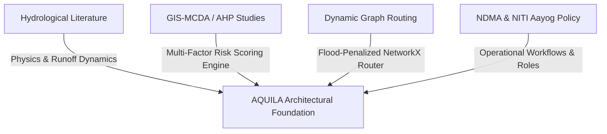
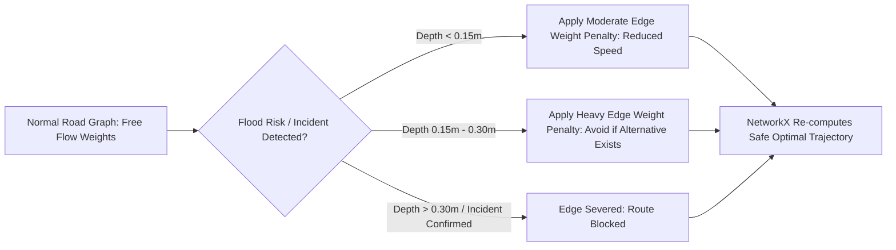

# AQUILA: Literature Review and Academic Grounding
## Document Identifier: AQUILA-DOC-P1-005

---

### 1. Thematic Structure of the Literature Review

To establish a defensible, research-backed foundation for AQUILA, this review examines peer-reviewed academic literature and authoritative government publications across four core domains:
1. **Urban Pluvial Hydrology and Drainage Modeling in Indian Metropolises**
2. **GIS-Based Multi-Criteria Decision Analysis (MCDA) for Urban Flood Susceptibility**
3. **Dynamic Emergency Vehicle Routing Under Natural Hazard Constraints**
4. **National Policy Guidelines on Urban Flood Risk Management**

---

### 2. Review of Core Studies & Methodological Findings

#### 2.1 Urban Drainage & Hydrological Modeling in Hyderabad
* **Key Study:** Manchikatla, S. K., & Umamahesh, N. V. (2022). *Simulation of flood hazard, prioritization of critical sub-catchments, and resilience study in an urban setting using PCSWMM: a case study*. **Water Policy**, 24(8), 1247–1268. [DOI: 10.2166/wp.2022.291](https://doi.org/10.2166/wp.2022.291).
  * **Core Methodology:** The authors employed PCSWMM (Personal Computer Storm Water Management Model)—a 1D/2D hydrodynamic model based on the Saint-Venant equations—to simulate urban runoff, junction surcharging, and conduit capacity exceedance across urbanized sub-catchments in Telangana under varying precipitation return periods (2-year to 100-year).
  * **Key Findings:** The study demonstrated that rapid increases in catchment imperviousness ($> 75\%$) reduce the time of concentration ($T_c$) by over 40%, generating peak discharges that exceed the hydraulic capacity of existing roadside stormwater drains by 150% to 300%. The research emphasized the critical need for **sub-catchment prioritization**, proving that flood risk is highly heterogeneous and concentrated within specific topographic depressions and culvert bottlenecks.
  * **Application to AQUILA:** While running full numerical 2D shallow-water equations in real time inside a web dashboard is computationally impractical (requiring hours of compute per storm simulation), Manchikatla & Umamahesh’s findings validate AQUILA’s approach: **using pre-computed topographic proxies (slope, sink depressions, drainage density) coupled with dynamic rainfall scaling to achieve near-instantaneous, street-level risk scoring**.

---

#### 2.2 GIS-Based Multi-Criteria Decision Analysis (MCDA) for Flood Vulnerability
* **Theoretical Foundation:** Saaty, T. L. (1980), *The Analytic Hierarchy Process (AHP)*; and Malczewski, J. (2004), *GIS-based land-use suitability analysis*.
* **Urban Flood Applications:** Extensive peer-reviewed research across South Asian urban basins (e.g., Roy et al., 2021; Samanta et al., 2018) confirms that pluvial flood vulnerability can be effectively modeled using spatial multi-criteria indexing combining:
  1. **Elevation & Slope:** Runoff accelerates on steep slopes ($> 5^\circ$) and accumulates in depressions with slopes $< 1.5^\circ$.
  2. **Topographic Wetness Index (TWI):** Defined as $\text{TWI} = \ln\left(\frac{\alpha}{\tan \beta}\right)$, where $\alpha$ is the specific upslope contributing area and $\beta$ is the local slope angle. High TWI values correspond directly to natural drainage sinks and stagnant pooling zones.
  3. **Proximity to Drainage Channels (*Nalas* & Lakes):** Areas located within 50 to 100 metres of choked urban channels experience the highest frequency of backwater flooding during storm surges.
  4. **Land Use & Land Cover (LULC) Runoff Coefficients:** High-density built-up environments with asphalt and concrete surfaces lack infiltration capacity, driving high runoff volumes.
* **Application to AQUILA:** AQUILA adopts a standardized multi-criteria risk scoring equation derived from this literature:

$$\text{Risk Score} = w_1 \cdot \text{Rainfall Intensity} + w_2 \cdot (1 - \text{Slope}) + w_3 \cdot \text{TWI} + w_4 \cdot \text{Proximity to Nala} + w_5 \cdot \text{Imperviousness}$$

where $\sum_{i=1}^{5} w_i = 1.0$, providing an interpretable, transparent scoring mechanism for operational decision-support.

---

#### 2.3 Graph-Based Emergency Routing in Flooded Road Networks
* **Theoretical Grounding:** Dijkstra, E. W. (1959), *A note on two problems in connexion with graphs*; and A* search optimization algorithms (Hart et al., 1968).
* **Hazard-Penalized Network Routing:** Recent studies on disaster transportation networks (e.g., Kermanshah & Derrible, 2017; Pyatkova et al., 2019) examine the resilience of urban road networks under pluvial inundation. Standard routing algorithms optimize for the shortest distance or free-flow travel time:

$$T = \sum_{e \in P} \frac{L_e}{V_e}$$

where $L_e$ is segment length and $V_e$ is vehicular speed. Under flood conditions, standing water introduces severe non-linear travel penalties:
* When water depth $d < 0.15\text{ m}$, vehicles experience speed reductions ($V_e' = V_e \cdot (1 - \gamma \cdot d)$).
* When water depth $0.15\text{ m} \le d \le 0.30\text{ m}$, light passenger vehicles and small utility vans risk engine stalling; traversal cost increases exponentially.
* When water depth $d > 0.30\text{ m}$ (for small vans) or $d > 0.60\text{ m}$ (for heavy rescue trucks), the road segment becomes **physically impassable**.
* **Application to AQUILA:** AQUILA uses **NetworkX** to implement dynamic edge-weight penalties and temporary edge removal (severance). When an incident report confirms a submerged road or when the geospatial intelligence engine flags a road segment as a high-risk flood sink, the platform updates the road graph in real time, routing emergency vehicles safely around hazardous corridors.

---

#### 2.4 Authoritative Policy Baselines
* **NITI Aayog Committee Report (2020–2023):** *Strategy for Flood Management Works in Entire Country and River Management Activities*.
  * **Documented Finding:** The report specifically analyzed the October 2020 Hyderabad floods, identifying unchecked encroachment over natural lake beds, structural narrowing of arterial *nalas*, and the lack of an integrated urban disaster management plan as primary root causes of catastrophic loss.
  * **Policy Recommendation:** Urges municipal administrations to deploy modern technological decision-support tools that integrate micro-meteorological radar observations with municipal GIS layers for rapid local response.
* **National Disaster Management Authority (NDMA, 2010):** *Management of Urban Flooding*.
  * **Policy Recommendation:** Formally declared urban flooding as a distinct disaster category requiring specialized treatment separate from rural riverine flooding. Mandated the creation of Urban Flood Cells, the establishment of comprehensive spatial databases of municipal storm drains, and the development of local decision-support systems.

---

### 3. Summary of Theoretical Foundations

| Component in AQUILA | Theoretical / Literature Source | Mathematical / Algorithmic Baseline |
| :--- | :--- | :--- |
| **Micro-Catchment Prioritization** | Manchikatla & Umamahesh (2022) [DOI: 10.2166/wp.2022.291] | Sub-catchment runoff concentration, hydraulic capacity thresholding |
| **Spatial Vulnerability Index** | Malczewski (2004); Roy et al. (2021) | Multi-Criteria Decision Analysis (AHP) weighted overlay: Slope, TWI, Nala Proximity |
| **Flood-Penalized Routing** | Pyatkova et al. (2019); Dijkstra (1959) | Dynamic edge cost modification & threshold-based graph severance in NetworkX |
| **Incident Verification Protocol** | NDMA Urban Flood Guidelines (2010) | Multi-tier incident validation (`Reported` $\rightarrow$ `Verified` $\rightarrow$ `Dispatched` $\rightarrow$ `Resolved`) |
| **Institutional Boundary Definition** | NITI Aayog (2020–2023); G.O.Ms.No.99 (HYDRAA) | Non-authoritative, open-source decision-support architecture |

---
*AQUILA Phase 1 Specification — Literature Review*

