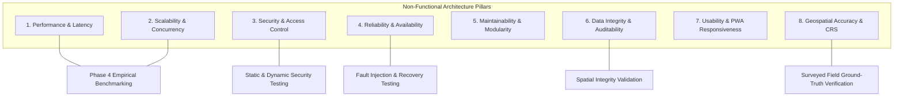

# AQUILA: Non-Functional Requirements Specification
## Document Identifier: AQUILA-DOC-P1-010

---

### 1. Specification Framework

This document defines the quality attributes, architectural constraints, and service level targets for AQUILA. All numerical performance thresholds are explicitly marked as **[Provisional Target]** and will undergo rigorous benchmarking and empirical validation during Phase 4 (System Integration and Performance Testing).

---

### 2. Non-Functional Requirements Catalog

#### 2.1 Performance & Latency Requirements

| Identifier | Requirement Statement | Metric / Verification Method | Target Status |
| :--- | :--- | :--- | :---: |
| **NFR-PERF-01** | **Spatial Query Latency:** Spatial lookup queries (e.g., bounding box retrieval, buffer intersection over 10,000 entities in PostGIS) shall execute within $\le 150\text{ ms}$ under local database load. | PostGIS query timing via `EXPLAIN ANALYZE`. | **Provisional Target** |
| **NFR-PERF-02** | **Risk Scoring Calculation Time:** Recalculation of the multi-factor flood risk grid across the Manikonda pilot catchment ($\approx 15.5\text{ km}^2$, $\sim 17,000$ cells at 30m resolution) shall complete within $\le 500\text{ ms}$. | End-to-end Python pipeline timing under 4 vCPU baseline. | **Provisional Target** |
| **NFR-PERF-03** | **Emergency Route Calculation Speed:** Path calculation over the Manikonda road graph using NetworkX (including edge hazard penalties) shall complete within $\le 350\text{ ms}$ for any origin-destination pair. | Python execution profiler over 1,000 simulated routes. | **Provisional Target** |
| **NFR-PERF-04** | **Map UI Frame Rate:** The MapLibre GL web client shall sustain a rendering frame rate of $\ge 50\text{ FPS}$ during continuous user panning, zooming, and layer toggling with 5 active layers rendered. | Chrome DevTools Performance Profiler. | **Provisional Target** |
| **NFR-PERF-05** | **Rainfall Ingestion Processing:** Single-station rainfall observation records shall be parsed, validated, and persisted within $\le 50\text{ ms}$ of receipt at the API gateway. | FastAPI request-response timing telemetry. | **Provisional Target** |

---

#### 2.2 Scalability & Concurrency Requirements

| Identifier | Requirement Statement | Metric / Verification Method | Target Status |
| :--- | :--- | :--- | :---: |
| **NFR-SCAL-01** | **Concurrent User Concurrency:** The backend API shall support at least 50 concurrent active sessions (operators, field reporters, evaluators) without request degradation exceeding $15\%$. | Locust / k6 load testing suite. | **Provisional Target** |
| **NFR-SCAL-02** | **Spatial Data Scaling:** The PostGIS storage schema and spatial indexing (GIST) shall scale to accommodate up to 500,000 road edges, 50,000 drainage segments, and 100,000 historical incident points without requiring architectural partitioning. | Database scaling stress tests. | **Provisional Target** |
| **NFR-SCAL-03** | **Simulation Stepping Throughput:** In simulation mode, the simulation runner shall support time-step progression intervals down to 1-second ticks without memory leakage or thread starvation. | Memory leak profiling via Valgrind / Memray. | **Provisional Target** |

---

#### 2.3 Security & Access Control Requirements

| Identifier | Requirement Statement | Metric / Verification Method | Target Status |
| :--- | :--- | :--- | :---: |
| **NFR-SEC-01** | **Cryptographic Password Storage:** User passwords shall be hashed using Argon2id (or BCrypt with minimum cost factor 12) with unique cryptographic salts. Plaintext passwords shall never be logged or persisted. | Static code analysis & database inspection. | **Mandatory Standard** |
| **NFR-SEC-02** | **API Transport Encryption:** All network communication between web clients, mobile PWAs, and backend REST endpoints shall be strictly encrypted using TLS 1.3 (HTTPS / WSS). | SSL Labs scanner / TLS cipher suite verification. | **Mandatory Standard** |
| **NFR-SEC-03** | **Input Sanitization & Injection Defense:** All incoming API parameters, GeoJSON uploads, and form inputs shall be sanitized to prevent SQL/Spatial injection, Cross-Site Scripting (XSS), and Path Traversal attacks. | OWASP ZAP automated vulnerability scan. | **Mandatory Standard** |
| **NFR-SEC-04** | **File Upload Security:** Uploaded incident photographs shall be validated for authorized MIME types (`image/jpeg`, `image/png`, `image/webp`), restricted to a maximum size of 5 MB, stripped of risky EXIF executable metadata, and stored with generated UUID filenames. | Unit tests with malformed and executable payloads. | **Mandatory Standard** |

---

#### 2.4 Reliability, Fault Tolerance & Availability

| Identifier | Requirement Statement | Metric / Verification Method | Target Status |
| :--- | :--- | :--- | :---: |
| **NFR-REL-01** | **Service Availability:** The core decision-support backend and database containers shall maintain an uptime availability of $\ge 99.5\%$ during continuous operational testing phases. | Container healthcheck telemetry. | **Provisional Target** |
| **NFR-REL-02** | **Graceful Offline PWA Operation:** The Field Reporter PWA shall maintain full incident capture capability when disconnected from the network, securely caching reports locally and guaranteeing zero data loss upon reconnection. | Network disconnection simulation in headless browser. | **Mandatory Standard** |
| **NFR-REL-03** | **Automated Container Recovery:** All core microservices (FastAPI, PostgreSQL/PostGIS, Redis, Frontend) shall execute under Docker container restart policies (`restart: unless-stopped`) to ensure automated recovery upon unexpected process crashes. | Process kill tests via Docker CLI. | **Mandatory Standard** |

---

#### 2.5 Maintainability, Code Quality & Modularity

| Identifier | Requirement Statement | Metric / Verification Method | Target Status |
| :--- | :--- | :--- | :---: |
| **NFR-MAINT-01** | **Strict Modular Decoupling:** Backend services shall be organized into strictly decoupled domain modules (Ingest, Risk, Routing, Incidents, Simulation) with distinct data access layers, preventing circular dependencies. | Import analysis via `flake8` and architectural linter. | **Mandatory Standard** |
| **NFR-MAINT-02** | **Automated Test Coverage:** Core algorithmic components (risk scoring mathematical functions, network routing graph penalties, state machine transitions) shall maintain $\ge 80\%$ unit and integration test coverage. | `pytest-cov` automated test runner. | **Mandatory Standard** |
| **NFR-MAINT-03** | **Containerized Reproducibility:** The entire development and execution environment shall be deployable on any standard x86_64 host running Linux or Windows via a single `docker compose up --build` command. | Fresh environment installation smoke test. | **Mandatory Standard** |

---

#### 2.6 Data Integrity, Auditability & Privacy

| Identifier | Requirement Statement | Metric / Verification Method | Target Status |
| :--- | :--- | :--- | :---: |
| **NFR-DATA-01** | **Spatial Topology Integrity:** All stored vector geometries shall pass topological validity checks (e.g., `ST_IsValid(geom) = TRUE`); self-intersecting lines, non-closed polygons, or invalid coordinates shall be rejected at ingestion. | Automated PostGIS validation trigger. | **Mandatory Standard** |
| **NFR-DATA-02** | **Immutable Operational Audit Trail:** State transitions for incidents (`Reported` $\rightarrow$ `Verified` $\rightarrow$ `Dispatched` $\rightarrow$ `Resolved`), resource dispatch approvals, and simulation runs shall be written to append-only audit tables with immutable timestamps. | Database constraint inspection (`NO UPDATE` / `NO DELETE` triggers). | **Mandatory Standard** |
| **NFR-DATA-03** | **Synthetic Data Isolation:** System shall guarantee that synthetic data generated in simulation mode is permanently tagged with `is_synthetic = TRUE` and can never contaminate real-world operational records. | Database query assertions across all operational tables. | **Mandatory Standard** |
| **NFR-PRIV-01** | **Citizen Reporter Privacy:** Personal citizen contact information (e.g., reporter phone numbers, private email addresses) shall be masked on public dashboard views and accessible only to authorized operators. | UI privacy masking inspection and API response filtering. | **Mandatory Standard** |

---

#### 2.7 Geospatial Data Accuracy & Coordinate Integrity

| Identifier | Requirement Statement | Metric / Verification Method | Target Status |
| :--- | :--- | :--- | :---: |
| **NFR-GEO-01** | **Coordinate Reference System Harmonization:** All spatial layers shall be stored natively in WGS84 (EPSG:4326) for global interoperability, with on-the-fly transformations to UTM Zone 44N (EPSG:32644) for accurate metric distance, area, and buffer calculations. | PyProj / PostGIS `ST_Transform` verification tests. | **Mandatory Standard** |
| **NFR-GEO-02** | **DEM Vertical Resolution Compliance:** Elevation and slope extraction shall explicitly acknowledge the limitations of open 30-metre DEMs (Copernicus / SRTM 30m), restricting elevation-based risk classifications to relative regional topographic depressions rather than sub-centimetre hydraulic heights. | Ground-truth benchmark comparison against known spot heights. | **Mandatory Standard** |
| **NFR-GEO-03** | **Graph Network Connectivity:** The routable OpenStreetMap network graph for Manikonda shall maintain at least $95\%$ strong topological connectivity, with dead ends and disconnected islands identified and logged during graph compilation. | NetworkX connected component analysis. | **Provisional Target** |

---
*AQUILA Phase 1 Specification — Non-Functional Requirements*

