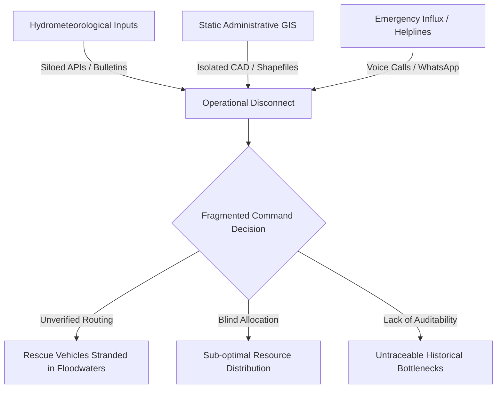
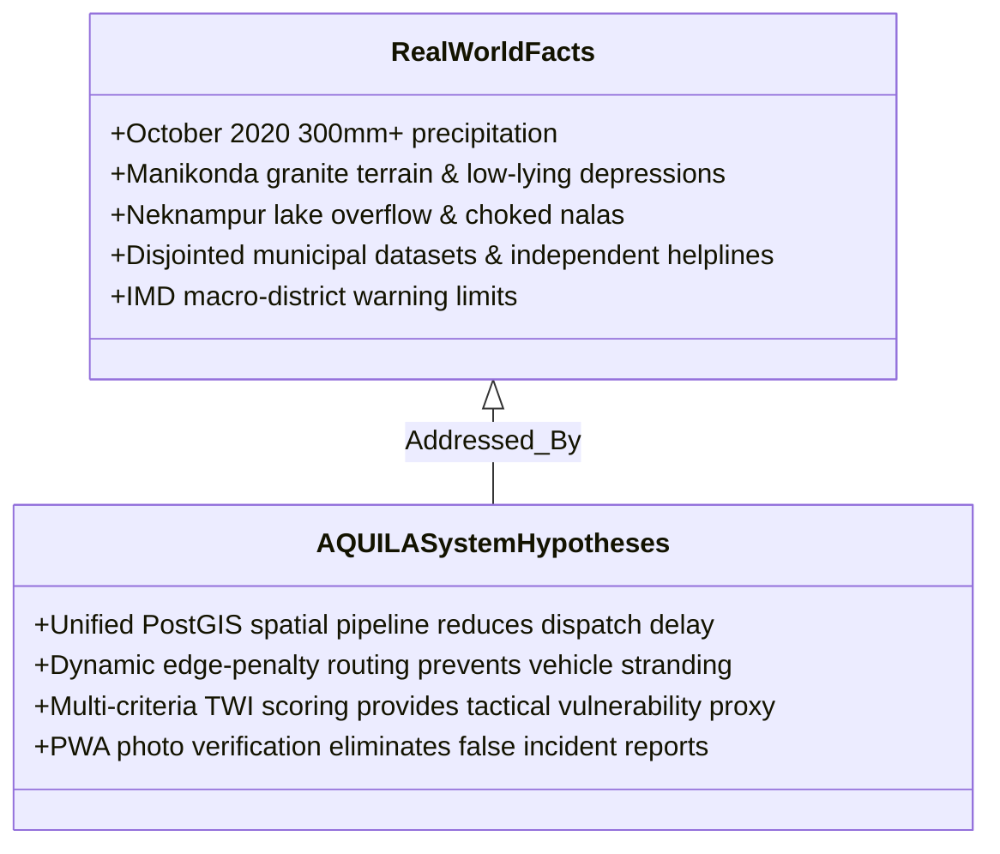

# AQUILA: Problem Statement Specification
## Document Identifier: AQUILA-DOC-P1-002

---

### 1. Executive Summary

Urban pluvial flooding has emerged as one of the most destructive and recurrent hazards in rapidly developing metropolises across the Global South. The Hyderabad Metropolitan Region in Telangana, India, characterized by undulating granitic topography and complex natural drainage basins draining into the Musi River, has witnessed catastrophic urban flooding events in recent years—most prominently the October 2020 floods. Rapid, semi-planned suburban sprawl has severely encroached upon natural stormwater channels (*nalas*), disrupted historical chain-tank lake networks, and expanded impervious surface cover. 

Current municipal disaster response operations remain fragmented: meteorological alerts, static municipal GIS layers, manual citizen distress calls, and field emergency deployment operate across isolated institutional silos. **AQUILA** proposes a unified, geospatial decision-support prototype that dynamically bridges rainfall observation, terrain-aware vulnerability indexing, verified incident logging, and flood-aware emergency dispatch routing.

---

### 2. Context & Background

The Hyderabad urban agglomeration spans over 650 km² under the Greater Hyderabad Municipal Corporation (GHMC), with outer suburban zones extending across the broader 7,257 km² Hyderabad Metropolitan Development Authority (HMDA) jurisdiction. The regional topography is dominated by the Deccan Plateau's granitic terrain, varying between 500 m and 600 m above mean sea level. Historically, this terrain was managed through an interconnected cascading tank system developed during the Kakatiya and Qutb Shahi periods, where excess runoff from upstream tanks flowed naturally via designated floodways into downstream reservoirs and eventually into the Musi River.

Over the past three decades, exponential urban expansion driven by the information technology sector has radically transformed the landscape. Sub-catchments in western Hyderabad—such as Gachibowli, Madhapur, and the municipal suburb of **Manikonda**—have transitioned from agrarian tank catchments to dense, multi-story commercial and residential complexes. This transition has led to:
1. Massive expansion of impervious concrete and asphalt surfaces, reducing natural infiltration capacity to near zero.
2. Direct encroachment, narrowing, and structural bridging over primary stormwater channels (*nalas*).
3. The fragmentation and isolation of retention water bodies, such as Neknampur Lake (Ibrahim Cheruvu) and Puppalaguda Cheruvu, which can no longer discharge floodwater freely into their downstream receiving corridors.

---

### 3. Current Situation & Empirical Grounding

During high-intensity convective rainfall events, stormwater runoff volumes rapidly outstrip the design capacity of local drains, creating severe pluvial flash inundation within 30 to 90 minutes.

#### The October 2020 Flash Floods
On October 13–14, 2020, a deep depression (BOB 02) made landfall over coastal Andhra Pradesh and traversed Telangana, delivering unprecedented torrential precipitation. Key documented figures include:
* **Precipitation Totals:** Begumpet IMD observatory registered 192 mm in 24 hours, while peripheral AWS stations recorded over 280 mm to 320 mm in 24 hours (with peak intensities exceeding 70 mm/hr in localized pockets).
* **Direct Human & Material Loss:** At least 80 fatalities across the metropolitan area, over 40,000 families displaced, and estimated direct economic infrastructure damages surpassing ₹5,000 Crore.
* **Inundation Hotspots:** Extensive inundation across low-lying layouts, lake buffer zones, and IT peripheral suburbs including Manikonda (Alkapur Township), Nadeem Colony (Tolichowki), Shaikpet, and Begumpet.
* **Drainage Backflows:** Water levels in major arterial *nalas* exceeded bankfull discharge, reversing flow into local storm networks and drowning residential basements, vehicular parking, and essential ground-level electrical distribution substations.

---

### 4. Documented Real-World Challenges

Rigorous post-event analyses published by government committees (notably NITI Aayog's Committee Report on Flood Management Works 2020–2023) and independent urban researchers (e.g., Hyderabad Urban Lab) document the following systemic bottlenecks:

#### Challenge 1: Fragmented Operational and Information Silos
* **State of Practice:** Rainfall data is captured by the Telangana Development Planning Society (TGDPS) automated weather station (AWS) network and IMD radar systems; spatial boundary layers reside with GHMC and HMDA; lake boundaries and anti-encroachment operations are governed by HYDRAA; and emergency dispatch is handled independently via police (Dial 100/112), fire services, and municipal monsoon squads.
* **Impact:** No single operational interface correlates real-time rainfall intensity with local terrain depressions and active field incidents simultaneously.

#### Challenge 2: Inability to Correlate Micro-Terrain with Localized Runoff Sinks
* **State of Practice:** Regional flood warnings issued by national agencies (such as IMD and CWC) operate at macro-district or sub-basin scales (scale > 25–50 km²), providing broad district-level alerts (e.g., "Heavy to very heavy rain likely over Ranga Reddy district").
* **Impact:** Tactical disaster managers cannot determine which specific street junctions, low-elevation underpasses, or residential blocks (e.g., Neknampur Road or Puppalaguda Junction in Manikonda) will experience impassable water depths (> 0.5 m).

#### Challenge 3: Lack of Real-Time Flood-Aware Routing
* **State of Practice:** Standard commercial navigation platforms (e.g., Google Maps) optimize routes based purely on historical and cellular telemetry traffic speeds.
* **Impact:** Emergency vehicles (fire tenders, de-watering pump carriers, Disaster Response Force boats) dispatched into waterlogged sectors frequently encounter impassable submerged roads, resulting in vehicles becoming stalled or stranded in flood sinks.

#### Challenge 4: Absence of Standardized Incident Triage and Auditability
* **State of Practice:** Citizen reports flood into multiple uncoordinated channels (Twitter/X, WhatsApp citizen groups, municipal telephone lines).
* **Impact:** Incident reports lack verified geospatial coordinates and timestamped photography, leading to duplicate resource deployments, unverified hoaxes, and no auditable timeline for post-event infrastructure review.

---

### 5. Research Motivation & The Case for AQUILA

The motivation behind developing AQUILA is grounded in software systems engineering and computational hydrology: **to synthesize multi-source geospatial information into an open, auditable, and modular operational decision-support tool tailored to urban catchments**.

Rather than attempting to build expensive, non-scalable full-city 3D computational fluid dynamics models or making unvalidated claims of long-range weather prediction, AQUILA focuses on the **tactical operational loop**:

$$\text{Observation Ingestion} \longrightarrow \text{Terrain Vulnerability Indexing} \longrightarrow \text{Incident Verification} \longrightarrow \text{Constraint-Based Routing} \longrightarrow \text{Resource Allocation}$$

By validating this platform on a high-density, complex pilot area—**Manikonda**—the architecture proves the feasibility of micro-catchment intelligence before expanding to larger urban areas.

---

### 6. Proposed Solution Architecture: Dual-Mode Paradigm

AQUILA implements a unified software architecture operating under two distinct operational paradigms:

| Capability | Real-World Operational Mode | Controlled Simulation Mode |
| :--- | :--- | :--- |
| **Precipitation Ingest** | Pulls verified, publicly available AWS records (TGDPS / IMD open data APIs or structured CSV). | Generates synthetic, mathematically controlled hyetographs (uniform, bell-shaped, or cloudburst pulses). |
| **Geospatial Processing** | Evaluates real terrain elevations (Copernicus DEM 30m), slope, distance to water bodies, and road layers. | Uses identical terrain and infrastructure graphs as the real-world pipeline to guarantee parity. |
| **Incident Pipeline** | Ingests verified ground observations submitted via the Field Reporter PWA with GPS and photos. | Programmatically generates synthetic incident triggers (e.g., "Submerged culvert at Neknampur Road"). |
| **Routing & Dispatch** | Computes emergency routes over OSM road graphs penalized dynamically by active verified flood points. | Computes emergency routes over the same OSM road graphs penalized by simulated flood inundation nodes. |
| **Core Architecture** | **Identical Core Pipeline:** Ingestion Engine $\rightarrow$ GeoEngine $\rightarrow$ Risk Engine $\rightarrow$ Dispatcher. |

---

### 7. Expected Outcomes and Key Deliverables

1. **Hyperlocal Geospatial Risk Index:** A multi-criteria spatial risk algorithm combining slope, topographic wetness index (TWI), distance to drainage channels, and real-time precipitation intensity into normalized grid-level risk scores (0.0 to 1.0).
2. **Dynamic Flood-Aware Routing Engine:** A graph-based pathfinding service (using NetworkX over OpenStreetMap topologies) that dynamically modifies edge traversal costs or severs impassable road segments when water depths or reported incidents exceed emergency vehicle clearance thresholds.
3. **Structured Incident Verification Workflow:** A progressive web app (PWA) client allowing field response personnel to register geolocated, photographic incident evidence, transitioning incidents through structured states (`Reported` $\rightarrow$ `Verified` $\rightarrow$ `Dispatched` $\rightarrow$ `Resolved`).
4. **Historical Event Replay & Audit Log:** An immutable audit log in PostgreSQL tracking all received sensor inputs, operator overrides, dispatched assets, and route recommendations to facilitate post-disaster accountability and infrastructure planning.

---

### 8. Target Users & System Stakeholders

The platform is designed to serve five clearly delineated operational personas:
1. **Command-Centre Operators:** Municipal and disaster monitoring desk officers managing the real-time operational map, verifying alerts, and overseeing resource allocation.
2. **System Administrators:** Technical staff managing GIS vector/raster layers, user permissions, API connectors, and system health.
3. **Field Reporters:** Accredited local ward personnel, community safety volunteers, and municipal staff on the ground submitting field incident observations.
4. **Emergency Response Teams:** Disaster Response Force (DRF) commanders and fire rescue drivers receiving assigned taskings and flood-penalized navigation routes.
5. **Academic Researchers & Project Evaluators:** Independent analysts reviewing system performance, algorithm fidelity, and historical event logs for academic evaluation.

---

### 9. Distinguishing Documented Facts from System Hypotheses

To maintain absolute academic and engineering integrity, the platform maintains a strict boundary between documented real-world observations and proposed architectural enhancements:

* **Documented Fact:** Floods in Hyderabad are primarily pluvial and flash-flood events driven by extreme local precipitation meeting compromised drainage channels and natural terrain depressions.
* **AQUILA Hypothesis:** A modular open-source software platform combining open GIS datasets with dynamic routing algorithms can measurably assist emergency managers in identifying impassable routes and optimizing resource deployment without requiring prohibitive proprietary software suites.

---
*AQUILA Phase 1 Specification — Problem Statement*

