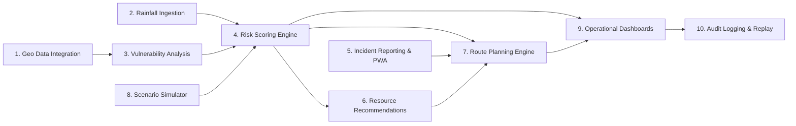

# AQUILA: Project Objectives Specification
## Document Identifier: AQUILA-DOC-P1-006

---

### 1. Architectural Philosophy and Objective Formulation

To prevent the common engineering pitfall of vague, unprovable disaster-management goals (such as *"leveraging cutting-edge AI to revolutionize disaster response"*), AQUILA’s project objectives are defined using strict, measurable criteria. Each objective specifies:
1. **Target Capability:** The technical subsystem to be engineered.
2. **Operational Function:** The specific algorithmic or architectural task performed.
3. **Measurable Completion Condition:** A verifiable quantitative or functional threshold required to confirm project completion.

---

### 2. Comprehensive Measurable Objectives

#### Objective 1: Geospatial Data Ingestion & Harmonization (OBJ-GEO-01)
* **Description:** Ingest, clean, harmonize, and store vector and raster geospatial datasets covering the Manikonda pilot area into a high-performance PostGIS spatial database.
* **Scope of Data:** Copernicus DEM 30m, OpenStreetMap road network topologies, digitized drainage networks (*nalas* and lake polygons), and critical infrastructure points (hospitals, fire stations, electrical substations).
* **Measurable Completion Condition:**
  * Successful ingestion of 100% of required study area spatial layers into PostgreSQL/PostGIS.
  * Spatial query latency (e.g., ST_Intersects, ST_DWithin over 10,000 entities) verified at $\le 150\text{ ms}$ under local database benchmarking.
  * All layers re-projected and verified in standard coordinate systems (WGS84 EPSG:4326 for storage, UTM Zone 44N EPSG:32644 for metric buffer calculations).

#### Objective 2: Dual-Source Rainfall Data Ingestion Engine (OBJ-RNF-02)
* **Description:** Implement a robust data ingestion pipeline capable of parsing real-world weather station observation feeds (TGDPS/IMD structured CSV/JSON) while supporting synthetic rainfall time-series injection.
* **Measurable Completion Condition:**
  * Pipeline successfully ingests and parses hourly/sub-hourly rainfall logs without data corruption.
  * Ingestion validation rejects malformed, out-of-range ($< 0\text{ mm}$ or $> 250\text{ mm/hr}$), or non-chronological records with descriptive error logs.
  * Zero-drift latency: real-world records processed and stored within $1.0\text{ second}$ of ingestion trigger.

#### Objective 3: Infrastructure Vulnerability Assessment (OBJ-VUL-03)
* **Description:** Develop an automated geospatial analysis service that extracts topographic attributes (elevation, slope, sink depressions, distance to natural drainage channels, and road elevations) to classify static infrastructure vulnerability.
* **Measurable Completion Condition:**
  * Automated extraction of slope and topographic wetness index (TWI) across the pilot catchment at a grid resolution of $\le 30\text{ m}$.
  * Spatial identification and tagging of all road segments and critical facilities located within a $50\text{ m}$ buffer of documented drainage channels.
  * 100% classification of pilot study infrastructure into low, medium, and high vulnerability tiers backed by reproducible PostGIS spatial queries.

#### Objective 4: Real-Time Multi-Factor Risk Scoring Engine (OBJ-RSK-04)
* **Description:** Construct a rule-based geospatial intelligence engine that dynamically computes a composite flood risk index ($0.0 \le \text{Risk} \le 1.0$) across spatial cells by synthesizing static terrain vulnerability with active rainfall intensity.
* **Measurable Completion Condition:**
  * End-to-end calculation and spatial rendering of risk scores across the pilot grid within $\le 500\text{ ms}$ of a new rainfall observation trigger.
  * Clear risk explainability: every generated risk score must provide a decomposed attribution vector (e.g., $\text{Rainfall Weight: } 40\%$, $\text{Slope Weight: } 25\%$, $\text{Nala Proximity Weight: } 35\%$).

#### Objective 5: Structured Incident Reporting & Tracking System (OBJ-INC-05)
* **Description:** Build a responsive Field Reporter Progressive Web App (PWA) and backend tracking service that allows field personnel to capture geolocated, timestamped, photographic incident reports.
* **Measurable Completion Condition:**
  * Incident creation flow successfully captures GPS coordinates, incident classification (e.g., Road Submerged, Drain Overflow, Cellar Flooded, Tree Fall), estimated water depth, and photo attachment.
  * System enforces a strict finite state machine: `Reported` $\rightarrow$ `Verified` $\rightarrow$ `Dispatched` $\rightarrow$ `Resolved`.
  * Offline resilience: PWA successfully caches up to 20 incident reports locally when offline and synchronizes automatically upon reconnecting.

#### Objective 6: Emergency Resource Allocation Engine (OBJ-RES-06)
* **Description:** Implement an operational recommendation engine that matches verified flood incidents with available emergency response resources (e.g., de-watering pump squads, rubber boats, Disaster Response Force teams, tree clearance cranes).
* **Measurable Completion Condition:**
  * Algorithm calculates and ranks the top-3 nearest, available, and capability-matched response resources for any verified incident within $\le 200\text{ ms}$.
  * System prevents over-allocation by locking assigned resources until formal incident closure or manual operator release.

#### Objective 7: Dynamic Flood-Penalized Route Planning Engine (OBJ-ROU-07)
* **Description:** Build a graph-based routing service using NetworkX over OpenStreetMap road networks that calculates optimal emergency travel paths while dynamically avoiding flooded roads and active high-hazard incidents.
* **Measurable Completion Condition:**
  * Routing calculation latency $\le 350\text{ ms}$ for origin-destination pairs across the Manikonda network.
  * Demonstrated dynamic re-routing: when a road segment is flagged as flooded ($d > 0.30\text{ m}$) or closed, the engine automatically re-calculates an alternate safe path, avoiding the hazard edge.
  * Output provides step-by-step turn coordinates, total distance (km), estimated traversal time (min), and safety hazard warnings.

#### Objective 8: Scenario-Based Flood Simulation Engine (OBJ-SIM-08)
* **Description:** Construct a controlled simulation runner capable of executing synthetic storm events, injecting variable hyetographs, triggering programmatic field incidents, and driving the entire decision-support pipeline for training and evaluation.
* **Measurable Completion Condition:**
  * Full execution of the "Heavy Rainfall – Manikonda" pilot scenario (120 mm cumulative precipitation over 3 hours) with interactive controls (`Start`, `Pause`, `Resume`, `Reset`, `Step`).
  * Absolute operational parity: the simulation engine feeds into the identical risk, routing, and incident APIs used by real-world mode, with all generated data explicitly tagged with `is_synthetic = TRUE`.

#### Objective 9: Unified Operational Dashboards (OBJ-DSH-09)
* **Description:** Deliver a high-performance web-based command-centre dashboard built with React, TypeScript, and MapLibre GL, providing interactive GIS layer toggling, rainfall telemetry, risk heatmaps, incident feeds, and resource tracking.
* **Measurable Completion Condition:**
  * Dashboard maintains a smooth 60 FPS rendering performance during map panning and zooming with over 5,000 rendered vector features.
  * Live updates: map pins and risk polygons refresh dynamically without full-page reloads using WebSocket or optimized polling.
  * Intuitive UI: operator can toggle between base satellite imagery, DEM contours, drainage vectors, risk overlays, and active incident markers with a single click.

#### Objective 10: Immutable Event & Audit Logging Service (OBJ-AUD-10)
* **Description:** Develop an auditable event logging service in PostgreSQL that records an immutable, chronological history of all sensor inputs, simulation runs, operator overrides, resource dispatches, and route calculations.
* **Measurable Completion Condition:**
  * Every state change (incident transition, resource dispatch, manual threshold override) is logged with an immutable timestamp, user ID, previous state, and new state.
  * Historical replay capability: system can reconstruct and visualize the exact operational map state for any historical or simulated event at any selected timestamp.

---

### 3. Summary of Measurable Metrics

| Objective Identifier | Key Target Parameter | Measurable Success Threshold |
| :--- | :--- | :--- |
| **OBJ-GEO-01** | Spatial Layer Query Latency | $\le 150\text{ ms}$ over 10,000 spatial features |
| **OBJ-RNF-02** | Observation Ingest Throughput | Parse and store record in $\le 1.0\text{ s}$; 100% rejection of corrupt data |
| **OBJ-VUL-03** | Topographic Extraction Grid | Spatial resolution $\le 30\text{ m}$; 100% buffer tagging for drainage features |
| **OBJ-RSK-04** | Dynamic Risk Scoring Latency | $\le 500\text{ ms}$ per grid update; 100% explainable weight attribution |
| **OBJ-INC-05** | Incident Lifecycle Integrity | 4-state finite state machine; offline sync support for $\ge 20$ reports |
| **OBJ-RES-06** | Resource Recommendation Speed | Top-3 ranked options in $\le 200\text{ ms}$; zero double-booking |
| **OBJ-ROU-07** | Flood-Aware Routing Latency | Path calculation $\le 350\text{ ms}$; 100% rerouting around severed edges |
| **OBJ-SIM-08** | Synthetic Simulation Parity | 100% API parity with real mode; strict `is_synthetic = TRUE` tagging |
| **OBJ-DSH-09** | Command Dashboard FPS | Sustained 60 FPS under 5,000 vector entities |
| **OBJ-AUD-10** | Historical Replay Fidelity | 100% reconstruction of past operational map states via immutable event log |

---
*AQUILA Phase 1 Specification — Project Objectives*

