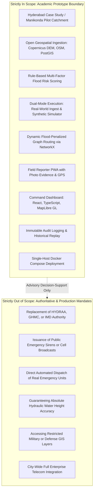

# AQUILA: Project Scope and Boundary Definition
## Document Identifier: AQUILA-DOC-P1-011

---

### 1. Architectural Scope Statement

The purpose of this document is to establish an unambiguous boundary around the engineering deliverables of the **AQUILA** project. To ensure technical defensibility, legal compliance, and project feasibility within academic research timelines, explicit boundaries are drawn between features that are strictly **In Scope** and operational capabilities that are formally **Out of Scope**.

---

### 2. In-Scope Deliverables

The following technical components, modules, and deliverables constitute the formal scope of AQUILA:

#### 1. Geographic Study Area & Spatial Grounding
* **Metropolitan Context:** Hyderabad Metropolitan Region, Telangana, India.
* **Demonstration Pilot Catchment:** The municipality of **Manikonda** (including Puppalaguda, Neknampur Lake catchment, and Alkapur Township).
* **Spatial Resolution:** Focus on catchment-level and street-corridor spatial intelligence using open 30-metre DEMs and OpenStreetMap road topologies.

#### 2. Geospatial Data Ingestion & Storage Architecture
* Integration of open digital elevation models (Copernicus DEM 30m / SRTM).
* Ingestion, cleaning, and storage of OpenStreetMap (OSM) road networks, lakes, and drainage channels (*nalas*).
* Storage and indexing within a containerized PostgreSQL 16 database with PostGIS 3.4 spatial extensions.
* Coordinate system harmonization supporting WGS84 (EPSG:4326) and UTM Zone 44N (EPSG:32644).

#### 3. Real-Time & Synthetic Rainfall Management
* Ingestion engine capable of parsing structured rainfall observation feeds (CSV/JSON).
* Data validation pipeline rejecting negative, extreme ($> 250\text{ mm/hr}$), or non-chronological records.
* Explicit provenance tagging (`is_synthetic = TRUE / FALSE`) on all stored precipitation records.

#### 4. Rule-Based Geospatial Intelligence & Risk Scoring
* Automated calculation of static terrain vulnerability (slope, topographic wetness index proxies, and distance to water channels).
* Dynamic multi-factor flood risk scoring combining static vulnerability with real-time or synthetic rainfall intensity.
* Four-tier risk categorization (Low, Moderate, High, Critical) with transparent, decomposed risk factor explainability.
* Architectural hook supporting optional machine learning flood susceptibility inference (Scikit-learn / XGBoost).

#### 5. Controlled Scenario Simulation Engine
* Simulation runner supporting the "Heavy Rainfall – Manikonda" pilot scenario (120 mm cumulative precipitation over 3 hours).
* Interactive simulation controls (`Start`, `Pause`, `Resume`, `Reset`, `Step Forward`).
* Programmatic injection of pre-scripted synthetic field incidents and automated decision pipeline triggering.

#### 6. Structured Incident Management & Field Reporter PWA
* Responsive Progressive Web App (PWA) allowing field personnel to capture GPS coordinates, water depths, and photo evidence.
* Offline caching supporting up to 20 local incident reports with automatic background synchronization upon reconnection.
* Strict four-state incident lifecycle enforcement: `Reported` $\rightarrow$ `Verified` $\rightarrow$ `Dispatched` $\rightarrow$ `Resolved`.

#### 7. Dynamic Flood-Aware Routing Engine
* Graph-based routing service using NetworkX over OSM road networks.
* Dynamic edge-cost penalties based on active flood hazard intersections.
* Edge severance for road segments with water depth exceeding vehicular clearance ($> 0.30\text{ m}$).
* Clearance profile support for Light Utility vehicles and Heavy Rescue Trucks.

#### 8. User Interfaces & Operational Dashboards
* Web-based Command-Centre Dashboard built with React, TypeScript, and MapLibre GL.
* Interactive GIS layer toggling, real-time incident pins, risk heatmap overlays, and rainfall trend charts.
* Incident triage interface with side-by-side photographic review.
* Resource fleet management and assignment view.

#### 9. Historical Replay & Audit Logging
* Append-only immutable audit logging in PostgreSQL tracking all state transitions, operator decisions, and dispatches.
* Interactive historical timeline scrubbing to reconstruct past operational map states.

#### 10. DevOps & Deployment
* Full containerization using Docker and multi-container orchestration via Docker Compose.
* CI/CD automation pipeline configured via GitHub Actions for linting and test execution.

---

### 3. Out-of-Scope Boundaries & Non-Goals

To maintain strict academic integrity and legal clarity, the following items are formally excluded from AQUILA’s deliverables:

#### 1. No Replacement of Authoritative Warning Systems
* **Boundary:** AQUILA is an academic decision-support prototype. It does not replace the statutory disaster management responsibilities of the Hyderabad Disaster Response and Asset Protection Agency (HYDRAA), the Greater Hyderabad Municipal Corporation (GHMC), the Telangana State Disaster Management Authority (TGSDMA), or the India Meteorological Department (IMD).
* **Legal Disclaimer:** AQUILA does not claim to issue official meteorological forecasts, government disaster warnings, or public evacuation mandates.

#### 2. No Direct Public Emergency Alert Broadcasting
* **Boundary:** AQUILA does not integrate with national cell broadcast networks, emergency sirens, or SMS blast gateways to send unverified emergency alerts to the general public.

#### 3. No Automated Physical Emergency Dispatch
* **Boundary:** AQUILA generates decision-support *recommendations* for human operators. It does not interface directly with computer-aided police dispatch systems (Dial 100/112) or physical fire/ambulance vehicle tracking hardware to automatically dispatch physical personnel without human verification.

#### 4. No Guarantee of Hydrodynamic Prediction Accuracy
* **Boundary:** AQUILA employs multi-criteria geospatial index modeling and heuristic topographic proxies. It does not execute computationally intensive, high-resolution 2D numerical shallow water equation solvers (such as full-domain PCSWMM or HEC-RAS 2D) in real time. It makes no legal or civil engineering guarantees regarding exact hydraulic water heights or flood extent boundaries.

#### 5. No Claim to Restricted Government Datasets
* **Boundary:** AQUILA operates exclusively on open, publicly accessible data (Copernicus DEM, OpenStreetMap, open weather portals). It does not claim, assume, or require unauthorized access to classified Survey of India military-grade topographic sheets, restricted intelligence layers, or private utility CAD drawings.

#### 6. No Full-Scale City-Wide Enterprise Deployment
* **Boundary:** The scope of AQUILA is focused on the **Manikonda demonstration area** and the broader Hyderabad case study. Building a high-availability, multi-region cloud infrastructure designed to handle millions of simultaneous citizen requests across the entire state of Telangana is outside the scope of this project.

---

### 4. Summary Scope Matrix

| Functional Area | In Scope (AQUILA Phase 1–4) | Out of Scope (Operational / Legal Boundary) |
| :--- | :--- | :--- |
| **Study Area** | Manikonda Catchment ($\approx 15.5\text{ km}^2$) + Hyderabad context. | Full state-wide or national deployment. |
| **Data Sources** | OpenStreetMap, Copernicus DEM 30m, public weather feeds. | Classified military rasters, restricted government CADs. |
| **Risk Modeling** | Multi-factor rule-based risk scoring; optional ML inference. | Real-time 2D hydrodynamic Navier-Stokes solvers. |
| **Emergency Dispatch** | Operator recommendation and internal tracking engine. | Direct automated triggering of 112/100 police squads. |
| **Alerts & Warnings** | Internal dashboard notifications for authenticated staff. | Public SMS blasts, siren triggers, official evacuation orders. |
| **Vehicle Routing** | Dynamic flood-penalized graph routing via NetworkX. | Live CAN-bus vehicle telemetry and proprietary GPS tracking. |
| **Incident Capture** | Field Reporter PWA with offline caching and photo upload. | Citizen-facing social media scraping or unverified mass calls. |
| **Deployment** | Single-host containerized stack via Docker Compose. | Multi-datacenter, geographically distributed Kubernetes cluster. |

---
*AQUILA Phase 1 Specification — Project Scope*

