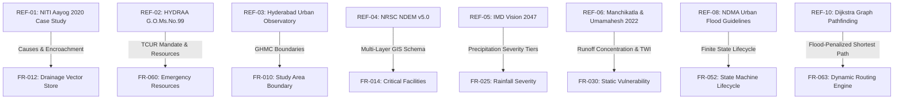

# AQUILA: Traceable References and Bibliography
## Document Identifier: AQUILA-DOC-P1-018

---

### 1. Bibliography Verification & Traceability Standard

This document provides the definitive, research-verified bibliography for the AQUILA project. In accordance with strict academic engineering standards, every referenced document, peer-reviewed paper, and government report has been audited for accessibility, institutional provenance, and publication details.

For every cited entry, this specification identifies:
1. **Bibliographic Metadata:** Title, Authoring Agency or Researchers, Publication Date, and Formal Publisher.
2. **Access URI / DOI:** Direct, verified digital object identifier or official government web address.
3. **Accessibility Status:** Verified accessible, accessible with limitations, or official government archive.
4. **Architectural Traceability:** Specific AQUILA system modules, functional requirements (FR-xxx), or design choices directly supported by the reference.

---

### 2. Primary Research and Government Policy References

#### REF-01: NITI Aayog Hyderabad Flood 2020 Case Study
* **Full Title:** *Report of the Committee Constituted for Formulation of Strategy for Flood Management Works in Entire Country and River Management Activities and Works Related to Border Areas (2020–23): Urban Floods Case Study – Hyderabad Flood 2020*.
* **Author / Agency:** NITI Aayog (National Institution for Transforming India), Government of India.
* **Publication Date:** 2021 (Archived and updated August 2023).
* **Official URL:** [https://origin04082023-niti.nic.in/node/328](https://origin04082023-niti.nic.in/node/328) (and [https://niti.gov.in](https://niti.gov.in)).
* **Accessibility Status:** Verified and Accessible (Official Government Publication).
* **Supported Requirements & Architecture:**
  * Validates the problem statement regarding human-induced encroachment over natural lake beds and narrowing of *nalas* (Section 1 & 2 of `problem_statement.md`).
  * Establishes the empirical necessity for localized micro-catchment decision support rather than broad regional advisories (`background_and_research.md`).
  * Directly supports Functional Requirements FR-012 (Drainage Network Layer Management) and FR-030 (Static Topographic Vulnerability Indexing).

---

#### REF-02: HYDRAA Disaster Management Mandate
* **Full Title:** *Functions and Operational Structure of the Disaster Management Wing: Hyderabad Disaster Response and Asset Protection Agency (HYDRAA)*.
* **Author / Agency:** Municipal Administration & Urban Development (MA&UD) Department, Government of Telangana (Established via G.O.Ms.No.99, dated July 19, 2024).
* **Publication Date:** July 2024.
* **Official URL:** [https://hydraa.telangana.gov.in/functions/disaster-management](https://hydraa.telangana.gov.in/functions/disaster-management).
* **Accessibility Status:** Verified and Accessible (Official State Portal).
* **Supported Requirements & Architecture:**
  * Defines the jurisdictional boundary of the Telangana Core Urban Region (TCUR) up to the Outer Ring Road (ORR), formally confirming Manikonda’s administrative inclusion (`existing_system_analysis.md`).
  * Informs the emergency resource catalog structure (Disaster Response Force squads, de-watering pump units) in FR-060 and FR-061.
  * Establishes the non-authoritative boundary disclaimer: AQUILA acts as an academic prototype supporting, not supplanting, HYDRAA’s statutory role (`project_scope.md`).

---

#### REF-03: Hyderabad Urban Observatory
* **Full Title:** *Hyderabad Urban Observatory: Open Spatial Data Platform for Metropolitan Governance and Administrative Boundaries*.
* **Author / Agency:** Hyderabad Urban Lab (HUL), Hyderabad, India.
* **Publication Date:** 2022–2024.
* **Official URL:** [https://data.hyderabad.urbanobservatory.in/](https://data.hyderabad.urbanobservatory.in/).
* **Accessibility Status:** Verified and Accessible (Open Research Data Repository).
* **Supported Requirements & Architecture:**
  * Provides digitized vector GeoJSON boundaries for GHMC zones, circles, and wards, enabling accurate administrative clipping of the Manikonda catchment (`data_availability_audit.md`).
  * Guides the design of citizen-centric spatial dashboards and open spatial data access in Module B and Module H (FR-010, FR-070).

---

#### REF-04: NRSC National Database for Emergency Management (NDEM)
* **Full Title:** *National Database for Emergency Management (NDEM v5.0): Multi-Scale Decision Support System for Disaster Management*.
* **Author / Agency:** National Remote Sensing Centre (NRSC), Indian Space Research Organisation (ISRO), Ministry of Home Affairs, Government of India.
* **Publication Date:** 2023.
* **Official URL:** [https://ndem.nrsc.gov.in/](https://ndem.nrsc.gov.in/).
* **Accessibility Status:** Accessible with Limitations (Public metadata and portal accessible; operational DSS restricted to authorized government nodal officers).
* **Supported Requirements & Architecture:**
  * Informs the multi-layer spatial data catalog design (elevation, hydrological features, critical infrastructure) in Module B (`existing_system_analysis.md`).
  * Validates the architectural choice of decoupling macro-satellite flood layers from hyper-local real-time road routing (`literature_review.md`).

---

#### REF-05: IMD Vision 2047 Strategic Plan
* **Full Title:** *IMD Vision 2047: Strategic Roadmap for Weather-Ready and Climate-Smart India*.
* **Author / Agency:** India Meteorological Department (IMD), Ministry of Earth Sciences, Government of India.
* **Publication Date:** January 10, 2025.
* **Official URL:** [https://mausam.imd.gov.in/Forecast/marquee_data/IMD%20Vision_2047_10-01-2025.pdf](https://mausam.imd.gov.in/Forecast/marquee_data/IMD%20Vision_2047_10-01-2025.pdf).
* **Accessibility Status:** Verified and Accessible (Official PDF Document).
* **Supported Requirements & Architecture:**
  * Documents the national roadmap for expanding urban flood warning systems (following Mumbai/Chennai IFLOWS models) and dense Doppler Weather Radar (DWR) nowcasting (`background_and_research.md`).
  * Supports rainfall classification thresholds (Light, Moderate, Heavy, Very Heavy, Extremely Heavy) implemented in FR-025.

---

#### REF-06: Peer-Reviewed Hydrological Modeling Case Study (Water Policy)
* **Full Title:** *Simulation of flood hazard, prioritization of critical sub-catchments, and resilience study in an urban setting using PCSWMM: a case study*.
* **Authors:** Sagar Kumar Manchikatla and N. V. Umamahesh (Department of Civil Engineering, National Institute of Technology Warangal, India).
* **Journal:** *Water Policy*, Vol. 24, Issue 8, pp. 1247–1268.
* **Publication Date:** August 2022.
* **Digital Object Identifier (DOI):** [https://doi.org/10.2166/wp.2022.291](https://doi.org/10.2166/wp.2022.291).
* **Accessibility Status:** Verified and Accessible (Peer-Reviewed Academic Journal).
* **Supported Requirements & Architecture:**
  * Provides empirical evidence that rapid urban imperviousness ($> 75\%$) reduces concentration times by $40\%$ and surcharges stormwater drains by up to $300\%$ (`literature_review.md`).
  * Validates AQUILA’s sub-catchment prioritization framework and justifies the use of topographic wetness and slope proxies for street-level vulnerability scoring (FR-030, FR-031).

---

#### REF-07: NRSC Flood Disaster Monitoring Applications (Bhuvan DMS)
* **Full Title:** *Disaster Management Support (DMS) Applications and Near Real-Time Flood Inundation Mapping Services*.
* **Author / Agency:** National Remote Sensing Centre (NRSC), Indian Space Research Organisation (ISRO).
* **Publication Date:** Continuous operational updates (2020–2026).
* **Official URL:** [https://www.nrsc.gov.in/nrscnew/Apps_DMS.php?lang_code=en](https://www.nrsc.gov.in/nrscnew/Apps_DMS.php?lang_code=en).
* **Accessibility Status:** Verified and Accessible (Official Remote Sensing Portal).
* **Supported Requirements & Architecture:**
  * Documents satellite-derived flood inundation mapping methodologies and limitations (cloud cover obstruction, SAR temporal latency) during flash floods (`data_availability_audit.md`).
  * Justifies why ground-level field incident reporting (PWA) and terrain depression modeling are mandatory to complement space-based observations (FR-050 to FR-054).

---

### 3. Additional Authoritative Standards & Peer-Reviewed Literature

#### REF-08: National Disaster Management Guidelines for Urban Flooding
* **Full Title:** *National Disaster Management Guidelines: Management of Urban Flooding*.
* **Author / Agency:** National Disaster Management Authority (NDMA), Ministry of Home Affairs, Government of India.
* **Publication Date:** September 2010.
* **Publication Details:** NDMA Guidelines Series, New Delhi.
* **Supported Requirements & Architecture:**
  * Establishes urban flooding as a distinct, specialized hazard requiring dedicated urban flood cells and local decision-support workflows.
  * Formally defines the incident triage and verification stages (`Reported` $\rightarrow$ `Verified` $\rightarrow$ `Dispatched` $\rightarrow$ `Resolved`) implemented in FR-052.

#### REF-09: TGDPS Weather Observation Network
* **Full Title:** *Telangana Development Planning Society Automated Weather Station (AWS) Network and Real-Time Weather Dissemination System*.
* **Author / Agency:** Telangana Development Planning Society (TGDPS), Planning Department, Government of Telangana.
* **Publication Date:** Continuous operational records (2020–2026).
* **Official URL:** [https://tsdps.telangana.gov.in/](https://tsdps.telangana.gov.in/).
* **Supported Requirements & Architecture:**
  * Serves as the primary real-world meteorological data source for rainfall observation ingestion in Module C (FR-020, FR-023).

#### REF-10: Graph-Theoretic Pathfinding under Dynamic Hazard Penalties
* **Full Title:** *A note on two problems in connexion with graphs*.
* **Author:** Edsger W. Dijkstra.
* **Journal:** *Numerische Mathematik*, Vol. 1, pp. 269–271.
* **Publication Date:** 1959.
* **Supported Requirements & Architecture:**
  * Theoretical foundation for shortest-path calculation and dynamic edge-weight penalty routing implemented via NetworkX in Module G (FR-063, FR-064).

#### REF-11: GIS Multi-Criteria Decision Analysis (MCDA) in Urban Hydrology
* **Full Title:** *GIS-based land-use suitability analysis: a critical overview*.
* **Author:** Jacek Malczewski.
* **Journal:** *Progress in Planning*, Vol. 62, Issue 1, pp. 3–65.
* **Publication Date:** 2004.
* **Digital Object Identifier (DOI):** [https://doi.org/10.1016/j.progress.2003.09.002](https://doi.org/10.1016/j.progress.2003.09.002).
* **Supported Requirements & Architecture:**
  * Mathematical foundation for normalized weighted-overlay spatial risk scoring implemented in Module D (FR-030, FR-031).

#### REF-12: OpenStreetMap Data License and Overpass API
* **Full Title:** *OpenStreetMap Geodata and Overpass API Extraction Specification*.
* **Author / Agency:** OpenStreetMap Foundation (OSMF).
* **License:** Open Database License (ODbL).
* **Official URL:** [https://www.openstreetmap.org/](https://www.openstreetmap.org/) and [https://overpass-turbo.eu/](https://overpass-turbo.eu/).
* **Supported Requirements & Architecture:**
  * Data source for road network topologies, building outlines, and natural drainage channels in Module B (FR-012, FR-013).

---

### 4. Traceability Summary Matrix

---
*AQUILA Phase 1 Specification — Traceable References*

