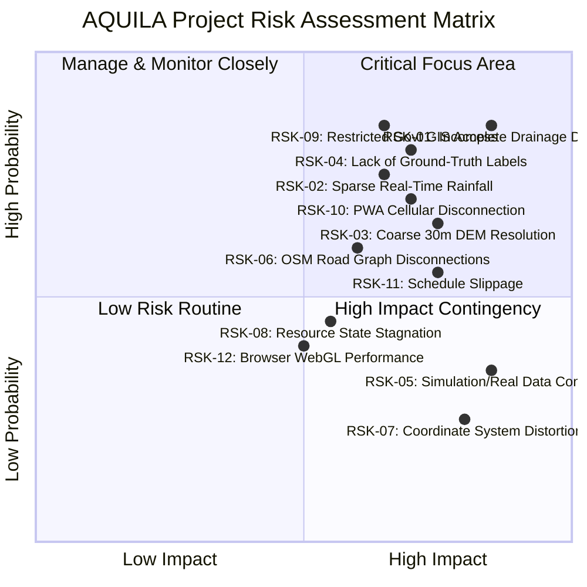

# AQUILA: Project Risk Register and Mitigation Specification
## Document Identifier: AQUILA-DOC-P1-015

---

### 1. Risk Governance and Assessment Framework

Urban geospatial disaster-response systems operate under severe data uncertainties, algorithmic approximations, and complex operational dependencies. To ensure proactive system resilience, AQUILA implements an active **Risk Register** evaluating potential hazards across four core dimensions:
1. **Data Availability & Integrity Risks (DAT)**
2. **Algorithmic & Modeling Risks (MOD)**
3. **Operational & Human-Machine Interface Risks (OPR)**
4. **Technical & Architectural Delivery Risks (TEC)**

---

### 2. Comprehensive Risk Register

| Risk ID | Risk Domain & Description | Prob. | Impact | Risk Level | Proactive Mitigation Strategy | Reactive Contingency Plan |
| :---: | :--- | :---: | :---: | :---: | :--- | :--- |
| **RSK-01** | **Incomplete Secondary Drainage Data:** OpenStreetMap and public municipal GIS layers lack detailed alignments of secondary roadside gutters and culvert cross-sections in residential sectors of Manikonda. | **High** | **High** | **Critical** | Focus primary modeling on verified primary *nalas* and lake catchments; manually digitize critical culverts from satellite imagery and field surveys during Phase 2. | Use topographic sink depressions derived from DEM as a mathematical proxy for missing local drainage conduits. |
| **RSK-02** | **Rainfall Observation Feed Latency & Outages:** Public TGDPS weather feeds may experience publishing delays (15–45 min) or temporary server downtime during extreme cloudburst events. | **Medium** | **High** | **High** | Implement automated data validation, connection retry loops with exponential backoff, and local caching of the latest known observation. | Provide seamless manual rainfall entry override in the operator UI; allow immediate switching to synthetic scenario mode. |
| **RSK-03** | **Vertical Precision Limits of 30m DEM:** Copernicus/SRTM 30m DEM cannot resolve sub-metre elevation variations such as sidewalk curbs ($0.15\text{ m}$) or underground parking ramps. | **High** | **Medium** | **High** | Treat elevation models strictly as a **relative topographic vulnerability proxy**; never display unverified absolute water depth millimetres. | Supplement DEM analysis with verified field incident reports that supply ground-truth water depth measurements. |
| **RSK-04** | **Scarcity of Historical Geocoded Flood Labels:** Historical flood extent polygons from the October 2020 floods are available only as static PDF maps or low-resolution imagery, lacking fine-grained training labels for machine learning. | **High** | **High** | **Critical** | Build the core decision-support engine using transparent, rule-based multi-criteria spatial formulas (Slope, TWI, Nala Proximity) rather than relying exclusively on data-hungry deep learning models. | Use published academic case studies (e.g., Manchikatla & Umamahesh, 2022) to calibrate rule-based weight coefficients. |
| **RSK-05** | **Operational Confusion Between Simulation and Real Modes:** Operators or field personnel might mistake synthetic training scenarios or simulated incidents for real-world emergencies. | **Low** | **High** | **High** | Enforce a strict architectural boundary: persistent bright-orange "SIMULATION ACTIVE" banner across UI; mandatory `is_synthetic = TRUE` database tag; hard block preventing simulation alerts from reaching field PWA devices. | Immediate database-level isolation trigger that terminates all simulation threads and resets UI to clean operational state. |
| **RSK-06** | **Topological Disconnections in OSM Road Graph:** OpenStreetMap road networks in newly developed suburban colonies may contain dead ends, unmapped connections, or missing bridges, causing route calculation failures. | **Medium** | **Medium** | **Medium** | Execute an automated NetworkX graph audit during Phase 2 ingestion; detect strongly connected components and flag isolated subgraphs. | Implement an automated node-snapping heuristic ($15\text{ m}$ threshold) for near-touching road segments; allow operator to manually open/close links. |
| **RSK-07** | **Coordinate System Distortion & Projection Errors:** Incorrect handling of WGS84 (angular degrees) versus UTM Zone 44N (metric metres) leading to distorted buffer distances or inaccurate area calculations. | **Low** | **High** | **Medium** | Enforce strict separation: store all data in EPSG:4326; perform all geometric operations (buffers, distances, areas) strictly within EPSG:32644 via automated PyProj/GeoPandas pipelines. | Automated unit test suite verifying that distance calculations between benchmark coordinates match geodesic ground-truth within $\pm 0.1\%$. |
| **RSK-08** | **Stale Emergency Resource Status:** Resources marked as `Available` in the database may be physically immobilized, broken down, or reassigned via external radio channels without operator logging. | **Medium** | **Medium** | **Medium** | Implement resource confirmation timers: system prompts operator to re-verify resource availability every 60 minutes during active storm operations. | Operator can override any resource status to `Maintenance` or `Unavailable` with a single click, immediately triggering route re-calculation. |
| **RSK-09** | **Restricted Government Portal Access:** Official portals such as NRSC NDEM or GHMC internal GIS repositories may refuse external API integration or academic data sharing. | **High** | **Medium** | **High** | Design AQUILA's core architecture to rely exclusively on publicly accessible open datasets (Copernicus DEM, OpenStreetMap, open weather portals). | Formal administrative requests submitted to HUL and municipal archives for academic validation datasets; project proceeds unaffected if denied. |
| **RSK-10** | **Field Reporter PWA Network Disconnection:** Cellular data networks may suffer severe degradation or blackouts in heavily flooded suburban sectors. | **High** | **High** | **High** | Architect the Field Reporter PWA with offline-first capabilities using Workbox and IndexedDB; allow full incident registration and local photo storage when offline. | PWA monitors connection state via `navigator.onLine`; automatically queues and transmits cached reports when connection resumes. |
| **RSK-11** | **Implementation Timeline & Scope Creep:** Attempting to build an overly complex multi-region microservice architecture leading to missed project deadlines. | **Medium** | **High** | **High** | Strictly enforce the **disciplined, modular monolith** architecture containerized via Docker Compose; restrict Phase 1–3 implementation strictly to the Manikonda pilot catchment. | Defer optional modules (e.g., advanced deep learning hydrodynamic models) to future extensions if core deadlines are pressured. |
| **RSK-12** | **Client-Side WebGL Map Rendering Bottlenecks:** Rendering tens of thousands of complex vector polygons simultaneously causing frame rate drops below 30 FPS on older operator laptops. | **Medium** | **Low** | **Low** | Optimize vector delivery: use simplified GeoJSON polygons, vector tile caching, and dynamic level-of-detail (LoD) rendering in MapLibre GL. | Fallback to server-side pre-rendered raster tile overlays for complex risk heatmaps if client GPU is constrained. |

---

### 3. Risk Monitoring and Review Protocol

1. **Phase Gate Review:** The Risk Register will be audited at the start of every implementation phase (Phase 2, Phase 3, Phase 4) to verify that mitigations are active and to adjust probability ratings based on empirical findings.
2. **Immediate Escalation Threshold:** Any risk event that threatens data integrity, simulation isolation, or container stability (e.g., RSK-05 or RSK-07) triggers an immediate architecture review before proceeding with downstream development.

---
*AQUILA Phase 1 Specification — Project Risk Register*

