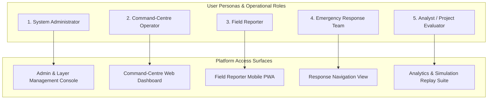
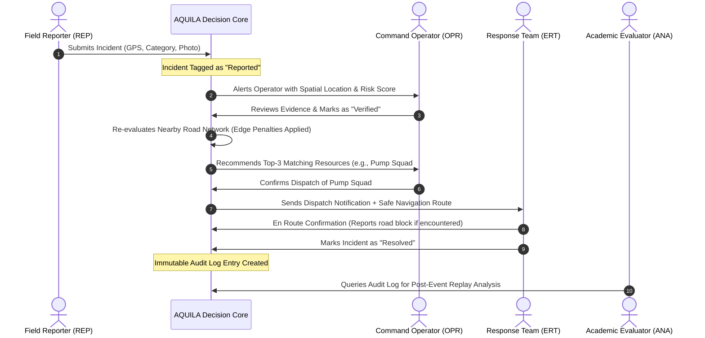

# AQUILA: Stakeholder Analysis and Role-Based Access Control
## Document Identifier: AQUILA-DOC-P1-007

---

### 1. Stakeholder Classification and Architectural Context

AQUILA is designed to interface with diverse user groups across municipal disaster management departments, technical administration teams, field response units, and academic evaluators. To maintain strict data integrity, auditability, and operational safety, the platform enforces a **Role-Based Access Control (RBAC)** architecture.

---

### 2. Comprehensive Stakeholder Role Profiles

#### Role 1: System Administrator (ADM)
* **Description:** Technical systems engineer responsible for system configuration, user provisioning, database health, GIS layer imports, and external API connector maintenance.
* **Core Responsibilities:**
  * Provisioning, activating, and deactivating user accounts.
  * Uploading, verifying, and updating spatial datasets (DEM rasters, OSM shapefiles, drainage vectors).
  * Configuring system thresholds (e.g., rainfall warning levels, risk scoring weights).
  * Monitoring database integrity, container health, and API connectivity.
* **Permissions Scope:** Full Read/Write/Execute across all system modules, configurations, and administrative consoles.
* **Key Interactions:** Uploading GeoJSON/GeoTIFF layers, setting RBAC permissions, reviewing system diagnostic logs, executing database migrations.
* **Information Accessed:** Full access to system logs, raw database tables, API credentials, user tables, and spatial catalogs.
* **Expected System Outputs:** System health metrics, spatial ingestion verification logs, user audit reports.

#### Role 2: Command-Centre Operator (OPR)
* **Description:** Municipal disaster monitoring desk officer or emergency coordination manager stationed at the central emergency control room.
* **Core Responsibilities:**
  * Monitoring live rainfall observations, weather alerts, and dynamic risk maps.
  * Reviewing, verifying, and triaging incident reports submitted by field teams and citizens.
  * Approving emergency resource recommendations generated by the system.
  * Overriding automated routing or risk parameters based on voice/radio communications.
  * Initiating and controlling synthetic training scenarios in simulation mode.
* **Permissions Scope:** Read access to all operational layers; Write access to incident status, resource assignments, and scenario simulation controls; No access to user administration or raw infrastructure configs.
* **Key Interactions:** Toggling map layers, clicking incident markers to review photo evidence, confirming resource dispatches, triggering route re-calculations.
* **Information Accessed:** Live risk heatmaps, real-time rainfall graphs, active incident feeds, resource location/availability tables, route recommendations.
* **Expected System Outputs:** Incident verification confirmations, approved resource dispatch orders, safe route vectors.

#### Role 3: Field Reporter (REP)
* **Description:** Accredited ward-level municipal staff, traffic police on duty, or designated community disaster volunteers on the ground.
* **Core Responsibilities:**
  * Submitting first-hand, geolocated incident observations from flood-affected areas.
  * Attaching timestamped photographs of submerged roads, overflowing drains, or stranded citizens.
  * Providing field updates on estimated water depths and traffic passability.
* **Permissions Scope:** Create access for new incident reports; Read access to own submitted incident tickets and local safety alerts; No access to dispatch planning, system configs, or administrative tables.
* **Key Interactions:** Capturing device GPS coordinates, selecting incident classification tags, uploading photographic evidence via the mobile PWA.
* **Information Accessed:** Localized danger alerts, status updates on own submitted incident reports.
* **Expected System Outputs:** Incident submission receipt with unique tracking ID, real-time sync confirmation.

#### Role 4: Emergency Response Team (ERT)
* **Description:** Operational disaster response crew (e.g., Disaster Response Force squad, fire rescue unit, de-watering pump vehicle crew).
* **Core Responsibilities:**
  * Receiving assigned emergency taskings from the command centre.
  * Navigating to incident sites using dynamic, flood-avoiding route instructions.
  * Executing field interventions (pumping floodwaters, clearing clogged culverts, rescuing stranded citizens).
  * Updating incident status from `Dispatched` to `Resolved` upon task completion.
* **Permissions Scope:** Read access to assigned incident details and turn-by-turn navigation paths; Write access to update assigned task status and report road blockages encountered en route.
* **Key Interactions:** Viewing assigned dispatch cards on mobile screens, following turn-by-turn route coordinates, marking task as resolved.
* **Information Accessed:** Incident description, target GPS coordinates, step-by-step turn coordinates, real-time road hazard alerts.
* **Expected System Outputs:** Task acknowledgment timestamps, route arrival confirmations, resolution completion logs.

#### Role 5: Academic Evaluator / Data Analyst (ANA)
* **Description:** Independent academic researcher, university guide, or post-disaster data analyst evaluating system fidelity and algorithmic behavior.
* **Core Responsibilities:**
  * Inspecting the mathematical transparency and explainability of the risk scoring engine.
  * Running historical event replays to evaluate routing efficiency and resource allocation latency.
  * Performing benchmark audits on spatial queries, graph re-calculation speeds, and simulation fidelity.
* **Permissions Scope:** Read-only access to historical event logs, audit tables, simulation scenarios, and performance telemetry; No access to live operational dispatch or system configuration writes.
* **Key Interactions:** Filtering historical incident logs, stepping through past scenario replays, downloading aggregated telemetry CSVs for external statistical modeling.
* **Information Accessed:** Historical hyetographs, immutable event audit logs, risk factor attribution vectors, benchmark performance metrics.
* **Expected System Outputs:** Replay visualization streams, audit validation summaries, exported performance reports.

---

### 3. Role-Based Access Control (RBAC) Matrix

The following matrix formally defines the granular permissions across all operational modules:

| System Module / Function | Administrator (ADM) | Command Operator (OPR) | Field Reporter (REP) | Response Team (ERT) | Evaluator / Analyst (ANA) |
| :--- | :---: | :---: | :---: | :---: | :---: |
| **User & Role Provisioning** | **CRUD** | — | — | — | — |
| **Spatial Layer Upload / Edit** | **CRUD** | Read | — | — | Read |
| **System Threshold Configuration** | **CRUD** | Read | — | — | Read |
| **Rainfall Data Ingestion (Real)** | **CRUD** | Read | — | — | Read |
| **Scenario Simulation Control** | Full | Full | — | — | Read / Replay |
| **View Live Risk Dashboard** | Read | Read | Read (Advisory) | Read (Advisory) | Read |
| **Submit New Incident Report** | **CRUD** | **CRUD** | **Create** | — | — |
| **Verify / Triage Incident** | **CRUD** | **Update** | — | — | Read |
| **Resource Allocation & Dispatch** | **CRUD** | **Update** | — | — | Read |
| **Generate Safe Emergency Route** | Full | Full | — | Read / Execute | Read |
| **Mark Incident as Resolved** | **CRUD** | **Update** | — | **Update (Assigned)** | Read |
| **Immutable Audit Log Inspection** | Full | Read | — | — | Full (Read-Only) |

*Legend: CRUD = Create, Read, Update, Delete; Full = Complete operational control; — = No Access.*

---

### 4. Stakeholder Interaction and Conflict Resolution

#### Conflict Resolution Protocols
1. **Operator Override Authority:** In cases where the automated routing algorithm or resource allocation recommendation conflicts with direct radio intelligence from police or field units, the **Command-Centre Operator (OPR)** retains the explicit authority to override system recommendations.
2. **Audit Preservation:** Every manual operator override is recorded in the immutable audit log with mandatory justification notes, ensuring that operational flexibility never compromises post-event accountability.
3. **Simulation Boundary Isolation:** Field Reporters (REP) and Emergency Response Teams (ERT) cannot interact with or receive notifications from synthetic simulation scenarios, preventing operational confusion between training exercises and real-world events.

---
*AQUILA Phase 1 Specification — Stakeholder Analysis*

