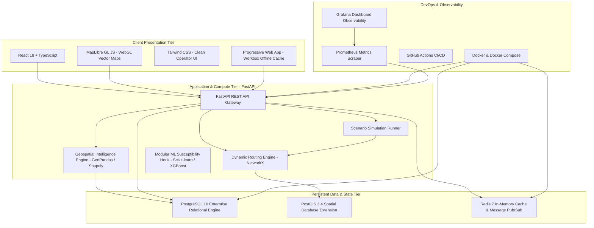

# AQUILA: Technology Stack Evaluation and Architectural Selection
## Document Identifier: AQUILA-DOC-P1-013

---

### 1. Architectural Philosophy and Technology Selection Principles

To prevent architectural bloat, excessive infrastructure overhead, and the unneeded complexity of microservice proliferation, AQUILA adopts a **disciplined, modular monolith** design:
1. **Cohesive & Pragmatic Core:** A unified Python/FastAPI backend paired with a high-performance PostgreSQL/PostGIS database, avoiding unnecessary distributed network latency.
2. **Standardized Open Geospatial Ecosystem:** Leveraging mature, battle-tested open-source libraries (PostGIS, GeoPandas, Shapely, NetworkX, MapLibre GL) that guarantee standards compliance (OGC GeoJSON, WGS84/UTM).
3. **Reproducibility & Zero Host Friction:** The entire platform must compile, configure, and execute locally or on any standard Linux/Windows server via a single `docker compose up --build` command.



---

### 2. Comprehensive Technology Component Evaluation

#### 2.1 Frontend Presentation Tier

| Technology Component | Architectural Role in AQUILA | Evaluation & Justification | Alternatives Evaluated | Rejection Rationale for Alternatives |
| :--- | :--- | :--- | :--- | :--- |
| **React 18** | Core single-page application (SPA) framework for the Command-Centre Dashboard. | Component-driven architecture, massive open-source ecosystem, virtual DOM performance, and excellent state management libraries (Zustand / TanStack Query). | Angular, Vue.js, Vanilla JS | Angular introduces heavy framework overhead; Vue has a smaller GIS integration ecosystem; Vanilla JS lacks declarative state synchronization for complex interactive maps. |
| **TypeScript** | Strict compile-time type safety across all frontend components and API client models. | Eliminates runtime `undefined` errors; provides strict type interfaces matching backend Pydantic schemas (GeoJSON types, Incident models, Resource cards). | Plain JavaScript | JavaScript lacks type guarantees, increasing regression risks during rapid UI state updates and complex GIS payload parsing. |
| **MapLibre GL JS** | High-performance WebGL-based vector and raster map visualization engine. | Fully open-source (free fork of Mapbox GL JS v1), GPU-accelerated rendering, smooth 60 FPS panning/zooming, native GeoJSON and vector tile support without proprietary billing or API keys. | Leaflet, OpenLayers, Mapbox GL JS (v2/v3), CesiumJS | Leaflet struggles with rendering $> 2,000$ vector polygons simultaneously (DOM overhead); Mapbox requires proprietary payment tokens; CesiumJS 3D globe adds unnecessary 3D GPU bloat. |
| **Tailwind CSS** | Utility-first styling framework for the responsive command interface and field views. | Rapid prototyping of clean, dark-mode/light-mode emergency dashboards without custom CSS file fragmentation; optimized purge builds reduce bundle sizes to $< 50\text{ KB}$. | Bootstrap, Material-UI, Pure CSS | Material-UI has heavy runtime CSS-in-JS performance costs; Bootstrap requires overriding complex opinionated themes. |
| **Workbox (PWA)** | Service worker caching and background synchronization for the Field Reporter app. | Enables offline-first incident capture, local caching of emergency UI assets, and reliable queuing of reports when cellular connectivity drops in flood zones. | Native Android/iOS, Pure Responsive Web | Native mobile apps require separate Java/Kotlin and Swift codebases and app-store approvals; non-PWA web apps fail completely when disconnected from cellular networks. |

---

#### 2.2 Backend Application & Compute Tier

| Technology Component | Architectural Role in AQUILA | Evaluation & Justification | Alternatives Evaluated | Rejection Rationale for Alternatives |
| :--- | :--- | :--- | :--- | :--- |
| **Python 3.11+** | Primary server-side programming language for logic, spatial analytics, and routing. | Standard language of geospatial science and computational hydrology; unmatched native bindings for GDAL, GEOS, PROJ, and NetworkX. | Node.js (TypeScript), Go, Java | Node.js lacks mature scientific geospatial and graph analytics ecosystems; Go lacks deep spatial analysis and raster modeling libraries. |
| **FastAPI** | High-throughput asynchronous REST API framework. | Native asynchronous (`async`/`await`) request handling, automatic OpenAPI/Swagger documentation generation, automatic request validation via Pydantic, and high throughput on Uvicorn. | Django, Flask, Express.js | Django is overly monolithic with heavy ORM overhead ill-suited for raw spatial math; Flask requires manual assembly of validation and OpenAPI libraries. |
| **Pydantic v2** | Data parsing, schema validation, and serialization across all endpoints. | High-speed C-based validation engine (written in Rust); enforces strict coordinate ranges, rainfall thresholds, and incident enum schemas with zero boilerplate. | Marshmallow, Cerberus | Significantly slower execution speeds; lacks native integration with FastAPI route signatures. |
| **SQLAlchemy 2.0 + GeoAlchemy2** | Object-Relational Mapping (ORM) and spatial query abstraction for PostgreSQL/PostGIS. | Modern type-safe query syntax (SQLAlchemy 2.0 style), robust connection pooling, and seamless spatial query support via GeoAlchemy2. | Tortoise ORM, Raw SQL | Tortoise ORM lacks comprehensive spatial function support; raw SQL lacks structured migration management and type safety. |

---

#### 2.3 Database, Caching & Spatial Tier

| Technology Component | Architectural Role in AQUILA | Evaluation & Justification | Alternatives Evaluated | Rejection Rationale for Alternatives |
| :--- | :--- | :--- | :--- | :--- |
| **PostgreSQL 16** | Primary relational database engine for operational and audit persistence. | Industry-standard ACID-compliant open-source relational database; rock-solid data integrity, declarative constraints, and extensible index engines. | MySQL 8.0, MongoDB | MySQL spatial functions are incomplete compared to PostGIS; MongoDB lacks native topological and spatial index maturity required for complex GIS queries. |
| **PostGIS 3.4** | Spatial database extension enabling high-speed geospatial indexing and queries. | The global gold standard for spatial storage: GIST spatial indexes, native OGC geometry support, spatial joins (`ST_Intersects`, `ST_DWithin`, `ST_Buffer`), and metric coordinate re-projection. | SpatiaLite, ElasticSearch Spatial | SpatiaLite is single-user file-based; ElasticSearch spatial indexing lacks advanced geometric topological operations. |
| **Redis 7** | In-memory key-value cache, session store, and WebSocket Pub/Sub broker. | Sub-millisecond read/write latency; ideal for caching computed risk layers, storing active user sessions, and broadcasting simulation ticks to connected clients. | Memcached, RabbitMQ, Kafka | Memcached lacks pub/sub capabilities; RabbitMQ and Apache Kafka introduce massive operational overhead for a local/academic prototype. |

---

#### 2.4 Geospatial Science & Graph Analytics

| Technology Component | Architectural Role in AQUILA | Evaluation & Justification | Alternatives Evaluated | Rejection Rationale for Alternatives |
| :--- | :--- | :--- | :--- | :--- |
| **NetworkX** | Routable graph network analysis and dynamic flood-penalized shortest path calculations. | Pure-Python graph library; trivial to dynamically update edge weights, sever impassable links, and compute Dijkstra/A* paths over OSM road topologies. | pgRouting, OSRM, Valhalla | OSRM/Valhalla are high-performance C++ engines but extremely rigid and difficult to dynamically update with live flood depth penalties in real time; pgRouting requires heavy SQL orchestration. |
| **GeoPandas & Shapely 2.0** | Vector geospatial data manipulation, geometric intersection, and buffer calculations. | Pythonic interface wrapping GEOS and PROJ; high-speed vectorized spatial operations, spatial indexing, and seamless GeoJSON input/output. | PySAL, Raw GDAL/OGR | Raw GDAL has complex, non-pythonic memory semantics; GeoPandas provides clean, high-level DataFrame abstraction. |
| **PyProj** | Cartographic projection transformations between WGS84 (EPSG:4326) and UTM 44N (EPSG:32644). | Python interface to PROJ; delivers sub-centimetre geodetic coordinate transformation accuracy. | Manual trigonometric formulas | Custom formulas introduce cartographic distortion and projection errors over large urban extents. |
| **QGIS (Offline)** | Desktop GIS software for offline data cleaning, validation, and thematic verification. | Visual inspection of DEM rasters, digitizing missing drainage channels, and validating OSM road connectivity before database ingestion. | ArcGIS Pro | ArcGIS requires expensive proprietary commercial licenses; QGIS is completely open-source and cross-platform. |

---

#### 2.5 Machine Learning (Optional & Modular)

| Technology Component | Architectural Role in AQUILA | Evaluation & Justification | Alternatives Evaluated | Rejection Rationale for Alternatives |
| :--- | :--- | :--- | :--- | :--- |
| **Scikit-learn** | Baseline supervised flood susceptibility classification (Random Forest, Logistic Regression). | Lightweight, highly interpretable tabular ML algorithms; minimal dependency footprint; runs efficiently on standard CPU without GPU requirements. | PyTorch, TensorFlow | Deep neural networks (CNNs/RNNs) require massive labeled training datasets and dedicated GPU hardware, which are unavailable for hyper-local urban flood points. |
| **XGBoost** | Gradient-boosted decision trees for multi-factor susceptibility scoring. | State-of-the-art performance on tabular geospatial feature matrices (slope, elevation, distance to nala, rainfall); provides native feature importance rankings. | LightGBM, CatBoost | LightGBM is comparable, but XGBoost has broader compatibility and robust serialization across Python versions. |

---

#### 2.6 DevOps, Containerization & Observability

| Technology Component | Architectural Role in AQUILA | Evaluation & Justification | Alternatives Evaluated | Rejection Rationale for Alternatives |
| :--- | :--- | :--- | :--- | :--- |
| **Docker & Docker Compose** | Multi-container application packaging, environment isolation, and single-command startup. | Standard container virtualization; encapsulates all Python libraries, PostGIS extensions, and Node dependencies, ensuring identical behavior across Windows and Linux. | Kubernetes, Bare-Metal Virtualenv | Kubernetes introduces extreme cluster management complexity unnecessary for an academic prototype; bare-metal environments suffer from OS-level GDAL dependency conflicts. |
| **GitHub Actions** | Automated Continuous Integration (CI) pipeline for code quality, linting, and unit tests. | Direct integration with code repository; automatically runs `flake8`, `mypy`, `pytest`, and build checks on every pull request. | Jenkins, GitLab CI | Jenkins requires hosting and maintaining a dedicated server; GitHub Actions runs natively in the cloud with zero infrastructure management. |
| **Prometheus & Grafana** | System metrics harvesting and visual infrastructure observability. | Prometheus scrapes API request latency, database query times, and memory usage; Grafana visualizes system health metrics for academic performance audits. | Datadog, ELK Stack | Datadog is an expensive proprietary SaaS; ELK Stack consumes prohibitive memory resources ($> 4\text{ GB}$ RAM) on developer machines. |

---

### 3. Summary of Selected Technology Stack

```
+-----------------------------------------------------------------------------------+
|                                 AQUILA STACK MATRIX                               |
+-------------------+---------------------------------------------------------------+
| Frontend Layer    | React 18, TypeScript 5, MapLibre GL 4, Tailwind CSS, Workbox  |
| Backend Layer     | Python 3.11+, FastAPI 0.110+, Pydantic v2, SQLAlchemy 2.0     |
| Spatial & Storage | PostgreSQL 16, PostGIS 3.4, GeoAlchemy2, Redis 7              |
| Analytics & Graph | NetworkX 3.2, GeoPandas 0.14, Shapely 2.0, PyProj 3.6         |
| Machine Learning  | Scikit-learn, XGBoost (CPU Inference Mode)                   |
| DevOps & Tooling  | Docker, Docker Compose v2, GitHub Actions, Prometheus/Grafana |
+-------------------+---------------------------------------------------------------+
```

---
*AQUILA Phase 1 Specification — Technology Stack Analysis*

