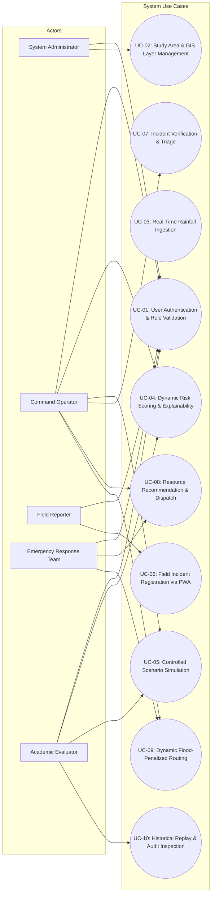

# AQUILA: System Use Cases Specification
## Document Identifier: AQUILA-DOC-P1-008

---

### 1. Use Case Model Overview

This document formally specifies the core operational workflows and actor interactions within AQUILA. Use cases cover system administration, spatial visualization, rainfall monitoring, real-time risk evaluation, scenario simulation, field reporting, emergency dispatch, and historical auditing.

---

### 2. Detailed Use Case Specifications

---

#### UC-01: User Authentication and Role Validation
* **Use Case ID:** UC-01
* **Primary Actor:** All Users (ADM, OPR, REP, ERT, ANA)
* **Preconditions:** User account provisioned in the PostgreSQL user database with an assigned cryptographic password hash and active status.
* **Trigger:** User launches the AQUILA web portal or Field Reporter PWA and submits credentials.
* **Main Success Scenario:**
  1. User enters username and password in the login view.
  2. Frontend sends an authentication request to the `/api/v1/auth/login` endpoint.
  3. Backend validates password hash using Argon2/BCrypt.
  4. Backend retrieves user role, generates a JSON Web Token (JWT) with role claims, and returns it with session metadata.
  5. Frontend stores token securely and redirects user to their role-specific landing interface (e.g., Command Dashboard for OPR, Mobile Incident Form for REP).
* **Extensions / Alternate Flows:**
  * *3a. Invalid Credentials:* Backend returns HTTP 401 Unauthorized; frontend displays "Invalid credentials" error and increments failed login counter.
  * *3b. Deactivated Account:* Backend returns HTTP 403 Forbidden; frontend notifies user to contact the System Administrator.
* **Postconditions:** User session authenticated; RBAC claims verified for subsequent API requests.

---

#### UC-02: Study Area and GIS Layer Management
* **Use Case ID:** UC-02
* **Primary Actor:** System Administrator (ADM)
* **Secondary Actor:** Command-Centre Operator (OPR), Academic Evaluator (ANA)
* **Preconditions:** Administrator authenticated with valid ADM role token.
* **Trigger:** Administrator navigates to the GIS Layer Management panel to import or update spatial layers for the Manikonda study area.
* **Main Success Scenario:**
  1. Administrator selects target study area (e.g., "Manikonda Pilot Catchment").
  2. Administrator uploads vector layer (GeoJSON/Shapefile: Road Network, Drainage Channels, Lakes) or raster dataset (GeoTIFF: Copernicus DEM 30m).
  3. Backend validates coordinate reference system (CRS); re-projects to WGS84 (EPSG:4326) for storage and UTM 44N (EPSG:32644) for metric calculations.
  4. PostGIS stores entities with spatial indexes (GIST index on geometry columns).
  5. Backend generates vector tiles/GeoJSON endpoints; MapLibre viewer updates and renders the new layer.
* **Extensions / Alternate Flows:**
  * *3a. Invalid Geometry / Unprojected CRS:* Ingestion engine detects geometry invalidity (self-intersecting polygon); logs error and rejects upload with detailed diagnostic message.
* **Postconditions:** New spatial layer successfully registered, indexed, and available for visualization and risk processing.

---

#### UC-03: Real-Time Rainfall Ingestion and Monitoring
* **Use Case ID:** UC-03
* **Primary Actor:** Automated System Service
* **Secondary Actor:** Command-Centre Operator (OPR)
* **Preconditions:** External weather API connection configured (TGDPS/IMD feed) or structured CSV file placed in the ingestion queue.
* **Trigger:** Scheduled cron job triggers hourly ingestion or new data file is posted to `/api/v1/rainfall/ingest`.
* **Main Success Scenario:**
  1. Ingestion service polls external weather endpoint or reads queued payload.
  2. Service parses rainfall records (Station ID, Timestamp, Precipitation Rate in mm/hr, Cumulative mm).
  3. Service validates numerical values ($0.0 \le \text{Rainfall} \le 250.0\text{ mm/hr}$).
  4. Ingestion service tags record with `is_synthetic = FALSE` and commits to `rainfall_observations` table.
  5. System triggers a dynamic risk score re-calculation event via an internal message bus.
  6. Operator dashboard updates rainfall chart and precipitation gauges via WebSocket stream.
* **Extensions / Alternate Flows:**
  * *3a. Out-of-Range or Corrupt Value:* Record has negative value or missing timestamp; service flags record as invalid, writes to error log, and discards without halting pipeline.
* **Postconditions:** Verified rainfall observation committed to database; downstream risk scoring engine notified.

---

#### UC-04: Dynamic Risk Scoring and Explainability
* **Use Case ID:** UC-04
* **Primary Actor:** Command-Centre Operator (OPR)
* **Secondary Actor:** Academic Evaluator (ANA)
* **Preconditions:** Terrain layers (slope, TWI, nala buffers) loaded; latest rainfall observation available.
* **Trigger:** System receives new rainfall observation or operator manually triggers a risk re-evaluation.
* **Main Success Scenario:**
  1. Geospatial Intelligence Engine retrieves current rainfall intensity and queries underlying terrain vulnerability grid.
  2. Engine applies the weighted multi-criteria risk formula across all grid cells.
  3. Engine normalizes composite scores into a 0.0 to 1.0 range and classifies cells into risk tiers (Low, Medium, High, Extreme).
  4. Engine produces a spatial GeoJSON risk layer and pushes updates to the active map view.
  5. Operator clicks any grid cell on the map; system displays a decomposed risk explanation popup showing exact component contributions (e.g., Rainfall: 42%, Slope: 28%, Drainage Proximity: 30%).
* **Extensions / Alternate Flows:**
  * *1a. Missing Rainfall Observation:* If no active observation exists within the last 2 hours, system uses the most recent valid observation and displays a "Stale Weather Data" warning badge.
* **Postconditions:** Spatial risk layer updated; risk attribution vector accessible for transparent operational decision-support.

---

#### UC-05: Controlled Scenario Simulation Execution
* **Use Case ID:** UC-05
* **Primary Actor:** Command-Centre Operator (OPR)
* **Secondary Actor:** Academic Evaluator (ANA)
* **Preconditions:** System set to Simulation Mode; "Heavy Rainfall – Manikonda" scenario configuration loaded.
* **Trigger:** Operator clicks "Start Scenario" in the Simulation Control Panel.
* **Main Success Scenario:**
  1. Operator selects simulation parameters (Duration: 3 hours, Peak Intensity: 70 mm/hr, Time Step: 15 minutes).
  2. Operator initiates execution; simulation clock begins ticking.
  3. Simulation engine generates synthetic rainfall pulses according to the configured hyetograph.
  4. Generated synthetic observations enter the standard ingestion pipeline with `is_synthetic = TRUE`.
  5. Geospatial intelligence engine dynamically recalculates risk scores at each time step.
  6. At pre-configured simulation milestones ($T = 45\text{ min}$), the simulator injects synthetic field incidents (e.g., "Neknampur culvert overtopped, depth 0.6 m").
  7. Operator uses simulation controls (`Pause`, `Resume`, `Step Forward`, `Reset`) to analyze system response and evaluate resource dispatch recommendations.
* **Extensions / Alternate Flows:**
  * *2a. Operator Pauses Simulation:* Clock halts; current spatial state and risk heatmaps remain static for operator inspection.
* **Postconditions:** Controlled simulation executed; all synthetic events logged with immutable audit markers for academic evaluation.

---

#### UC-06: Field Incident Registration via PWA
* **Use Case ID:** UC-06
* **Primary Actor:** Field Reporter (REP)
* **Preconditions:** Field reporter authenticated on the mobile PWA; device GPS location services enabled.
* **Trigger:** Reporter encounters waterlogging, flooded culvert, or infrastructure failure on the ground.
* **Main Success Scenario:**
  1. Reporter taps "Report New Incident" in the PWA.
  2. PWA queries mobile hardware for high-accuracy GPS coordinates (Latitude, Longitude, Accuracy in metres).
  3. Reporter selects incident category (e.g., "Road Inundation", "Drainage Choked", "Vehicle Submerged").
  4. Reporter inputs estimated water depth (e.g., "0.45 metres") and enters descriptive notes.
  5. Reporter captures a live photograph using the device camera.
  6. Reporter taps "Submit Incident".
  7. PWA packages data as multipart/form-data and posts to `/api/v1/incidents`.
  8. Backend stores incident in state `Reported`, creates an audit log entry, and broadcasts an alert to the command dashboard.
* **Extensions / Alternate Flows:**
  * *7a. Device Offline:* Network connection unavailable; PWA stores report in local browser IndexedDB storage and queues for background synchronization upon reconnection.
* **Postconditions:** Incident registered with initial status `Reported`; incident marker displayed on the command dashboard.

---

#### UC-07: Incident Verification and Triage
* **Use Case ID:** UC-07
* **Primary Actor:** Command-Centre Operator (OPR)
* **Preconditions:** One or more incidents exist with status `Reported`.
* **Trigger:** New incident badge alerts operator on the Command Dashboard.
* **Main Success Scenario:**
  1. Operator clicks pending incident card on the triage panel.
  2. Dashboard focuses map view on incident coordinates, displays attached photo evidence, reporter details, and local terrain risk score.
  3. Operator verifies that photo evidence matches the reported waterlogging condition and coordinates.
  4. Operator marks incident status as `Verified` and selects severity level (Low, Medium, Critical).
  5. System updates incident state in database; triggers dynamic road network update (applying edge penalty or road closure to adjacent road segments).
  6. System triggers automated emergency resource recommendation for the verified incident.
* **Extensions / Alternate Flows:**
  * *3a. False or Duplicate Report:* Operator determines report is a duplicate or hoax; operator marks status as `Rejected` with mandatory rejection comment; incident marker removed from active dispatch map.
* **Postconditions:** Incident transitions to `Verified`; nearby road graph updated; resource recommendation engine engaged.

---

#### UC-08: Emergency Resource Recommendation and Dispatch Approval
* **Use Case ID:** UC-08
* **Primary Actor:** Command-Centre Operator (OPR)
* **Secondary Actor:** Emergency Response Team (ERT)
* **Preconditions:** Incident verified with status `Verified`; available emergency resources registered in system database.
* **Trigger:** Operator clicks "Recommend Resources" for a verified incident.
* **Main Success Scenario:**
  1. System queries database for available resources matching incident requirements (e.g., Heavy De-watering Pump Squad for cellar flooding; DRF Rubber Boat for high-depth rescue).
  2. System computes straight-line and network travel distance from resource base to incident site.
  3. System ranks and presents the top-3 optimal resource candidates with estimated arrival times.
  4. Operator selects the preferred candidate and clicks "Approve Dispatch".
  5. System locks selected resource status to `Assigned` to prevent double-booking.
  6. System transitions incident status to `Dispatched`.
  7. System transmits dispatch notification with turn-by-turn flood-safe route to the designated Emergency Response Team.
* **Extensions / Alternate Flows:**
  * *1a. No Matching Resource Available:* All compatible units currently engaged; system alerts operator: "Zero matching units available; recommend reallocating lower-priority asset or requesting mutual aid."
* **Postconditions:** Resource assigned and locked; incident transitions to `Dispatched`; safe route transmitted to field crew.

---

#### UC-09: Dynamic Flood-Penalized Route Planning
* **Use Case ID:** UC-09
* **Primary Actor:** Command-Centre Operator (OPR) / Emergency Response Team (ERT)
* **Preconditions:** OpenStreetMap road network loaded into NetworkX graph; verified incidents and high-risk flood polygons registered.
* **Trigger:** Operator requests a route between an emergency depot (e.g., Gachibowli Fire Station) and a verified incident site (e.g., Alkapur Township).
* **Main Success Scenario:**
  1. Client sends origin coordinates, destination coordinates, and vehicle profile (Light Utility, Heavy Truck, Amphibious) to `/api/v1/routing/calculate`.
  2. Routing engine extracts subgraph covering origin and destination.
  3. Engine checks for intersections between road edges and active flood hazard zones or verified incident locations.
  4. For road segments with water depth $> 0.30\text{ m}$ (or confirmed impassable incidents), engine severs the edge (removes from graph).
  5. For road segments with moderate water risk, engine multiplies edge traversal cost by hazard penalty factor.
  6. Engine computes optimal path using Dijkstra's / A* algorithm over the penalized graph.
  7. Engine returns GeoJSON route polyline, total distance (km), estimated travel time (min), and safety hazard warnings.
  8. Dashboard and field view render the safe path avoiding flooded choke points.
* **Extensions / Alternate Flows:**
  * *4a. Complete Route Isolation:* All road paths to destination are completely flooded; engine returns HTTP 422 with status `DESTINATION_ISOLATED` and highlights nearest passable staging point.
* **Postconditions:** Safe navigation route generated avoiding flooded corridors; navigation instructions delivered to operator/ERT.

---

#### UC-10: Historical Event Replay and Audit Log Inspection
* **Use Case ID:** UC-10
* **Primary Actor:** Academic Evaluator / Data Analyst (ANA)
* **Secondary Actor:** System Administrator (ADM)
* **Preconditions:** Event session (real or simulated) completed and logged in PostgreSQL audit tables.
* **Trigger:** Evaluator selects "Historical Replay & Audit" in the Analytics console.
* **Main Success Scenario:**
  1. Evaluator selects past event date/time or specific simulation run ID.
  2. System displays event timeline showing key milestones (Storm Start, Peak Intensity, Incident Influx, Resource Dispatches, Incident Closures).
  3. Evaluator drags timeline slider to a specific timestamp (e.g., $T + 45\text{ min}$).
  4. MapLibre view reconstructs the exact spatial state at that moment: active rainfall rate, risk heatmap distribution, open/closed road segments, and incident markers.
  5. Evaluator inspects immutable audit log table to review operator decisions, dispatch approval timestamps, and route calculation metrics.
  6. Evaluator exports event audit summary as a structured JSON/CSV report for academic evaluation.
* **Extensions / Alternate Flows:**
  * *1a. Empty Search Range:* No logged events found for specified date; system prompts user to adjust search range.
* **Postconditions:** Historical operational state reconstructed and analyzed; audit report exported without altering operational records.

---
*AQUILA Phase 1 Specification — System Use Cases*

