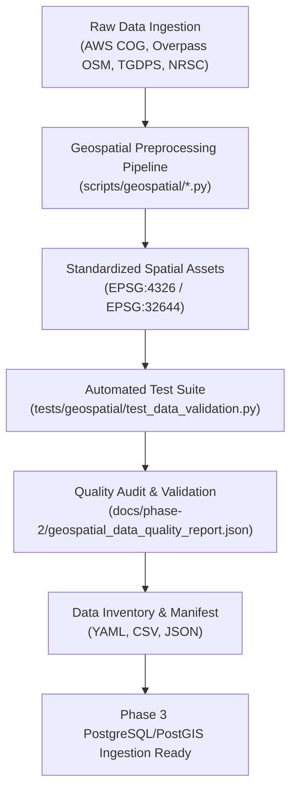

# AQUILA — Phase 2: Data Collection, Geospatial Preparation & Data Validation

## 1. Overview

Phase 2 establishes the validated, reproducible geospatial foundation for **AQUILA (Urban Flood Intelligence, Infrastructure Monitoring and Emergency Response Platform)** for the pilot area of Manikonda, Hyderabad, Telangana, India.

AQUILA operates as an academic decision-support prototype. It does not replace statutory forecasting, monitoring, or emergency response agencies (such as HYDRAA, GHMC, IMD, CWC, or NRSC).

This phase transitions the research requirements and architectural blueprints defined in Phase 1 into concrete, verified spatial data artifacts, preprocessing pipelines, quality audits, and machine-readable metadata.



---

## 2. Document Navigation & Index

The documentation in `docs/phase-2/` provides a complete, defensible audit of all geospatial data engineering work completed during Phase 2:

| # | Document | Primary Scope | Status |
|---|---|---|---|
| 01 | [README.md](file:///c:/AI/Rural_internship_project/docs/phase-2/README.md) | Phase 2 structure, execution instructions, navigation | Complete |
| 02 | [phase_1_corrections.md](file:///c:/AI/Rural_internship_project/docs/phase-2/phase_1_corrections.md) | Empirical audit and corrections of Phase 1 claims | Complete |
| 03 | [data_source_inventory.md](file:///c:/AI/Rural_internship_project/docs/phase-2/data_source_inventory.md) | Full audit of 12 registered geospatial data sources | Complete |
| 04 | [data_availability_report.md](file:///c:/AI/Rural_internship_project/docs/phase-2/data_availability_report.md) | Access mechanisms, licensing, API restrictions, gaps | Complete |
| 05 | [study_area_definition.md](file:///c:/AI/Rural_internship_project/docs/phase-2/study_area_definition.md) | Distinction: Administrative vs Catchment vs Envelope | Complete |
| 06 | [dem_processing_report.md](file:///c:/AI/Rural_internship_project/docs/phase-2/dem_processing_report.md) | Copernicus GLO-30 DEM, slope derivation, elevation stats | Complete |
| 07 | [road_network_report.md](file:///c:/AI/Rural_internship_project/docs/phase-2/road_network_report.md) | OSM road topology, 94.7% connectivity, hierarchy | Complete |
| 08 | [drainage_and_waterbody_report.md](file:///c:/AI/Rural_internship_project/docs/phase-2/drainage_and_waterbody_report.md) | Waterways, lakes, critical stormwater coverage gaps | Complete |
| 09 | [landcover_report.md](file:///c:/AI/Rural_internship_project/docs/phase-2/landcover_report.md) | ESA WorldCover 10m 2021 analysis, imperviousness audit | Complete |
| 10 | [rainfall_data_report.md](file:///c:/AI/Rural_internship_project/docs/phase-2/rainfall_data_report.md) | TGDPS/IMD historical proxy stations, synthetic design storm | Complete |
| 11 | [historical_flood_evidence_report.md](file:///c:/AI/Rural_internship_project/docs/phase-2/historical_flood_evidence_report.md) | October 2020 ground truth points, satellite limitations | Complete |
| 12 | [infrastructure_inventory.md](file:///c:/AI/Rural_internship_project/docs/phase-2/infrastructure_inventory.md) | 65 OSM facilities, hospitals, schools, verification limits | Complete |
| 13 | [monitoring_locations_inventory.md](file:///c:/AI/Rural_internship_project/docs/phase-2/monitoring_locations_inventory.md) | Multi-tier monitoring stations (Official, Proposed, Demo) | Complete |
| 14 | [geospatial_data_quality_report.md](file:///c:/AI/Rural_internship_project/docs/phase-2/geospatial_data_quality_report.md) | Complete audit results, topology, geometry checks | Complete |
| 15 | [preprocessing_pipeline.md](file:///c:/AI/Rural_internship_project/docs/phase-2/preprocessing_pipeline.md) | Step-by-step reproducible pipeline execution guide | Complete |
| 16 | [phase_2_completion_report.md](file:///c:/AI/Rural_internship_project/docs/phase-2/phase_2_completion_report.md) | Sign-off audit against 17 Phase 2 acceptance criteria | Complete |

### Machine-Readable Metadata Files
- [data_inventory.yaml](file:///c:/AI/Rural_internship_project/docs/phase-2/data_inventory.yaml) — Formal YAML metadata catalogue.
- [data_inventory.csv](file:///c:/AI/Rural_internship_project/docs/phase-2/data_inventory.csv) — Tabular dataset inventory.
- [processing_manifest.json](file:///c:/AI/Rural_internship_project/docs/phase-2/processing_manifest.json) — Full JSON manifest with provenance distribution.
- [geospatial_data_quality_report.json](file:///c:/AI/Rural_internship_project/docs/phase-2/geospatial_data_quality_report.json) — Automated validation test summary.

---

## 3. Data Provenance Standards

Every geospatial record, feature, raster cell, and tabular row in AQUILA must adhere to a strict 5-tier provenance taxonomy:

1. `OBSERVED`: Direct physical or satellite observations (e.g., Copernicus DEM, ESA WorldCover, OpenStreetMap highways, TGDPS AWS telemetry).
2. `HISTORICAL`: Verified post-disaster field reports, traffic police logs, or historical event records (e.g., October 2020 flood evidence).
3. `MANUALLY_SEEDED`: Manually configured modeling parameters, analysis bounds, or proposed sensor locations (e.g., study area bounding box, proposed culvert gauges).
4. `SIMULATED`: Generated purely by synthetic scenario engines for testing and validation (e.g., Chicago 120 mm / 3-hour storm hyetograph).
5. `MODEL_ESTIMATE`: Derived via computational modeling, terrain analysis, or spatial interpolation (e.g., slope raster, runoff coefficients).

> [!CAUTION]
> Under no circumstances may `SIMULATED` or `MANUALLY_SEEDED` records be labelled as `OBSERVED`. Strict simulation isolation is verified by automated regression tests.

---

## 4. Quick Execution Instructions

To execute the entire preprocessing and validation pipeline from a clean environment:

```powershell
# 1. Activate Python virtual environment (Python 3.10+ required)
# 2. Run data processing scripts in order:
python scripts/geospatial/process_dem.py
python scripts/geospatial/process_roads.py
python scripts/geospatial/process_drainage.py
python scripts/geospatial/process_rainfall.py
python scripts/geospatial/process_landcover.py
python scripts/geospatial/process_infrastructure.py

# 3. Generate dataset inventories and manifests:
python scripts/geospatial/generate_inventory.py

# 4. Run automated test suite:
pytest tests/geospatial/test_data_validation.py -v

# 5. Run master validation audit:
python scripts/geospatial/validate_data.py
```

