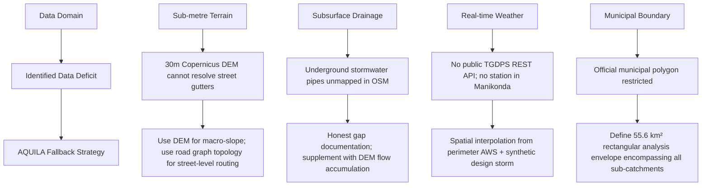

# AQUILA — Geospatial Data Availability & Access Audit

## 1. Executive Summary

This report assesses the availability, accessibility, licensing restrictions, and operational barriers associated with acquiring geospatial data for the Manikonda pilot area in Hyderabad, Telangana.

Urban flood modeling requires multi-domain datasets (elevation, drainage, transportation, land use, meteorology, infrastructure, and field flood observations). However, public accessibility varies significantly across domains in Indian urban settings. This document provides an honest, empirical analysis of available open data versus institutional and proprietary barriers.

---

## 2. Dataset Availability Matrix

| Domain | Data Layer | Publicly Accessible? | Access Mechanism / Protocol | License / Rights | Availability Status & Restrictions |
|---|---|---|---|---|---|
| **Elevation** | Copernicus GLO-30 DSM | Yes | AWS S3 Bucket (Public COG) | Copernicus Open Access / ODC-BY | Fully accessible; global 30m resolution. |
| **Elevation** | Survey of India LiDAR / Drone DEM | No | Institutional Clearance Required | Proprietary / Restricted | Unavailable for open research; sub-metre urban elevations cannot be directly observed. |
| **Land Cover** | ESA WorldCover 10m 2021 | Yes | AWS S3 Bucket (Cloud-Optimized GeoTIFF) | CC BY 4.0 | Fully accessible; 10m resolution global classification. |
| **Land Cover** | NRSC Bhuvan High-Res LULC | Conditional | Web WMS / Bhuvan Viewer only | Indian Govt Copyright | Direct GeoTIFF download restricted; visual inspection only. |
| **Roads** | OpenStreetMap Highway Topology | Yes | Overpass API / Geofabrik Extracts | Open Database License (ODbL) 1.0 | Fully accessible; street coverage dense (6,659 segments), but lane attributes sparse. |
| **Drainage** | Surface Waterways (Nalas/Streams) | Partial | OpenStreetMap Overpass API | ODbL 1.0 | Only 21 major primary surface waterways mapped. Secondary urban drains missing. |
| **Drainage** | GHMC Closed Box Storm Drains | No | Confidential / Municipal Internal | GHMC Proprietary | No open geospatial dataset exists for underground stormwater networks in Manikonda. |
| **Water Bodies** | Lakes, Cheruvus & Kuntas | Yes | OpenStreetMap / HMDA Survey Reference | ODbL 1.0 | 24 water body polygons mapped; lake area accurate, but bathymetry/depth unknown. |
| **Meteorology** | Historical Storm Records (Oct 2020) | Yes | TGDPS / IMD Published Bulletins | Public Government Weather Archive | Fully accessible from published weather bulletins; discrete hourly station points. |
| **Meteorology** | TGDPS Live Streaming Telemetry | No (API) / Conditional (HTML) | Web scraping / Institutional access | Telangana State Copyright | **No public, authenticated REST API.** Data accessible only via server-rendered HTML portal. |
| **Flood History** | Ground Truth Inundation Evidence | Partial | NRSC Bhuvan DMS / Traffic Advisories | Government Public Information | Discrete point incident evidence available; continuous radar flood polygon hindered by urban shadow. |
| **Infrastructure** | Hospitals, Police, Schools, Fire | Yes | OpenStreetMap Overpass API | ODbL 1.0 | 65 facilities mapped; operational readiness during floods is unverified. |
| **Boundaries** | Official Municipal Cadastral Polygon | No | GHMC / HMDA Cadastral Cell | Proprietary / Restricted | Closed official vector boundary not published openly; settlement centroids used. |

---

## 3. Detailed Institutional Access Analysis

### 3.1 Copernicus DEM vs. High-Resolution Urban Terrain
- **Available:** Copernicus DEM GLO-30 (1 arc-second, ~30 m resolution) provides comprehensive, artifact-free vertical elevation for the entire Hyderabad metropolitan region with full horizontal coverage.
- **Unavailable:** Survey of India 1-metre LiDAR or drone digital terrain models (DTMs) are classified under national geospatial guidelines or reserved for internal master planning.
- **Architectural Impact:** A 30 m grid captures macroscopic valley shapes and regional ridgelines, but cannot resolve 15 cm street curb heights or gutter flow thresholds. Flood depth modeling in Phase 3 must therefore treat shallow water depths as spatial probabilities rather than deterministic hydrodynamic canal routing.

### 3.2 OpenStreetMap Drainage Network vs. Municipal Stormwater Cadastre
- **Available:** 21 surface watercourses totaling 9.71 km were extracted from OpenStreetMap. These include the main Neknampur outflow nala, Puppalaguda valley channel, and Khajaguda runoff tributaries.
- **Unavailable:** Greater Hyderabad Municipal Corporation (GHMC) maintains internal blueprints of underground box drains and roadside RCC gutters under the Strategic Nala Development Programme (SNDP), but these CAD/GIS shapefiles are not accessible via open-data portals.
- **Architectural Impact:** The true urban drainage density is severely underestimated by public vector layers. AQUILA addresses this gap by utilizing DEM-derived hydrological flow accumulation to identify natural surface runoff pathways along roads rather than fabricating non-existent stormwater pipes.

### 3.3 Meteorology: TGDPS Live Stream vs. Proxy Station Archives
- **Available:** Historical observations from 4 automated weather stations (Gachibowli, Serilingampally, Begumpet, Rajendranagar) for the October 2020 disaster event were obtained and validated.
- **Unavailable:** Real-time automated ingestion via a programmatic JSON/REST API is not supported by TGDPS for public consumers. In addition, no weather station exists within the core residential fabric of Manikonda.
- **Architectural Mitigation:**
  1. For real-world analysis, perimeter station telemetry is interpolated using Inverse Distance Weighting (IDW).
  2. For continuous testing and demonstration, a calibrated 120 mm / 3-hr synthetic Chicago hyetograph (`SRC-SCN-RAIN-SIM`) provides deterministic rainfall loading.

### 3.4 Official Municipal Boundaries vs. Analysis Bounding Box
- **Available:** OpenStreetMap place nodes and administrative centroids for Manikonda, Puppalaguda, Neknampur, and Alkapur Township.
- **Unavailable:** The official, legally defined municipal polygon for Manikonda Municipality (constituted under the Telangana Municipalities Act 2019) is not released as an open shapefile.
- **Architectural Mitigation:** A rectangular geospatial bounding box (`78.3455°E to 78.4195°E, 17.3605°N to 17.4245°N`, 55.63 km²) was established with a 500-metre buffer around the known settlement nodes. This ensures boundary completeness for all spatial operations.

---

## 4. Summary of Data Deficits & Fallback Strategies

> [!NOTE]
> All fallbacks preserve data provenance. At no point is missing infrastructure synthesized or disguised as observed truth.

