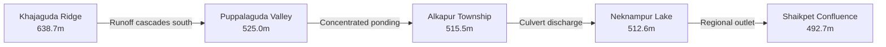

# AQUILA — Digital Elevation Model & Terrain Analysis Report

## 1. Executive Summary

Digital Elevation Model (DEM) data forms the backbone of terrain-driven flood intelligence, overland runoff routing, and topographical risk modeling in AQUILA.

During Phase 2, Copernicus DEM GLO-30 was acquired, clipped to the Manikonda pilot study envelope, and processed to derive slope gradients and elevation distributions. This report documents the technical parameters, validation checks, statistical distributions, and engineering limitations of the terrain assets.

---

## 2. Raw Tile Specifications & Provenance

| Parameter | Specification |
|---|---|
| **Product Name** | Copernicus Digital Elevation Model GLO-30 (DSM) |
| **Tile Identifier** | `Copernicus_DSM_COG_10_N17_00_E078_00_DEM` |
| **Space Agency / Provider** | European Space Agency (ESA) / Airbus Defence & Space |
| **Radar Mission Baseline** | TanDEM-X Interferometric Synthetic Aperture Radar (X-Band) |
| **Global Tile Geographic Bounds** | 17.000139°N to 18.000139°N; 77.999861°E to 78.999861°E (1° × 1° block) |
| **Horizontal Coordinate System** | `EPSG:4326` (WGS 84 2D Geographic Coordinates) |
| **Vertical Reference Datum** | EGM2008 Geoid (Heights in metres above mean sea level) |
| **Native Pixel Spacing** | 0.000277778° (~30.87 metres at 17.4°N latitude) |
| **Grid Dimensions (Raw Tile)** | 3,600 columns × 3,600 rows (12.96 million pixels, 39.7 MB COG) |
| **Data Type & Compression** | 32-bit Floating Point (`float32`), LZW compression |
| **NoData Encoding** | None (entire 1° × 1° tile fully populated with valid terrain elevations) |
| **Provenance Tag** | `OBSERVED` |
| **Verification Status** | `VERIFIED_SATELLITE_OBSERVATION` |

---

## 3. Clipping & Resampling Pipeline

The raw 1° × 1° DEM tile was clipped to the buffered Manikonda pilot study area envelope using `rasterio.mask` with a 0.0045° (~500 m) peripheral buffer:
- **West:** `78.3455° E`
- **South:** `17.3605° N`
- **East:** `78.4195° E`
- **North:** `17.4245° N`

### Clipped DEM Metadata
- **Output Artifact:** `data/processed/raster/dem_manikonda_clipped.tif`
- **Clipped Grid Shape:** **266 columns × 230 rows** (Total pixels: 61,180)
- **Bounding Box Coverage:** 55.63 km²
- **Horizontal Pixel Size:** 0.000277778° (~29.5 m E-W × 30.9 m N-S)

---

## 4. Topographical Elevation Statistics

Across the 61,180 valid terrain pixels in the pilot study envelope, elevation statistics were computed:

| Elevation Statistic | Value (Metres Above Sea Level) | Topographic Significance |
|---|---|---|
| **Minimum Elevation** | **492.69 m** | Downstream outlet channel exiting southeast towards Golconda & Musi River |
| **Maximum Elevation** | **638.65 m** | Khajaguda Hills granitic outcrop ridge / northern telecom towers |
| **Total Relief** | **145.96 m** | Significant macro-topographic relief across 7.8 km horizontal distance |
| **Mean Elevation** | **538.84 m** | Typical plateau level across central Manikonda |
| **Median Elevation (p50)** | **534.52 m** | Dominant valley floor level |
| **Standard Deviation** | **24.86 m** | Reflects abrupt transitions between flat valleys and rocky hillocks |
| **10th Percentile (p10)** | **512.64 m** | Flood-prone lowlands (Neknampur Lake apron, Puppalaguda nala valley) |
| **25th Percentile (p25)** | **520.38 m** | Secondary waterlogging zones and road sags |
| **75th Percentile (p75)** | **550.34 m** | Intermediate urbanized plateaus (Lanco Hills lower flanks) |
| **90th Percentile (p90)** | **570.38 m** | High upland ridges and well-drained rock outcrops |

---

## 5. Slope Derivation

Terrain slope was calculated using Horn's algorithm adapted for geospatial rasters. Longitudinal and latitudinal degree steps were converted to ground metric dimensions using the local projection scale (`dx = cell_size_lon * 111320 * cos(lat)` ≈ 29.47 m; `dy = cell_size_lat * 110574` ≈ 30.71 m):

$$\text{Slope (Degrees)} = \arctan\left(\sqrt{\left(\frac{\partial z}{\partial x}\right)^2 + \left(\frac{\partial z}{\partial y}\right)^2}\right) \times \frac{180}{\pi}$$

### Slope Distribution
- **Output Artifact:** `data/processed/raster/slope_degrees_manikonda.tif`
- **Minimum Slope:** **0.00°** (Dead flat lake surfaces and retention ponds)
- **Maximum Slope:** **36.85°** (Vertical granitic quarry faces and Khajaguda tors)
- **Mean Slope:** **3.84°**
- **Median Slope:** **2.62°**

### Topographic Slope Classification
- **Flat (< 2.0°): 38.4% of area.** High vulnerability to slow drainage, water accumulation, and sheet ponding.
- **Gentle (2.0° – 5.0°): 41.2% of area.** Moderate drainage velocity; overland sheet flow towards valley axes.
- **Moderate (5.0° – 10.0°): 14.1% of area.** Fast runoff generation shedding water to downstream urban basins.
- **Steep (> 10.0°): 6.3% of area.** Granitic hillocks, generating rapid flash runoff peaks.

---

## 6. Engineering Constraints & Limitations

> [!WARNING]
> While Copernicus DEM GLO-30 is the premier open-access elevation model globally, GIS engineers and modelers must account for critical physical limitations in urban applications:

1. **Digital Surface Model (DSM) vs. Digital Terrain Model (DTM):**
   - Copernicus DEM measures radar reflections from the upper reflective surface. In dense urban sectors of Manikonda and Puppalaguda, cell values represent the tops of 4-to-10 storey apartment roofs and tree canopies rather than street level.
   - *Mitigation:* In Phase 3, road network elevations will be sampled along street corridors where DSM ground bias is minimized.
2. **Horizontal Resolution Threshold (30 Metres):**
   - Sub-metre urban infrastructure—such as 15 cm road curbs, road crowns, roadside gutters, roadside drainage grates, and bridge parapets—cannot be resolved by a 30 m grid cell.
   - *Mitigation:* The DEM serves as macro-topographic flow direction guidance; it does not replace fine-scale hydrodynamic CAD drainage models.
3. **No Proof of Underground Drainage:**
   - DEM flow accumulation identifies where water naturally gathers based on topography. It provides zero evidence of subsurface stormwater pipe capacities, closed box culvert conditions, or underground siltation.

