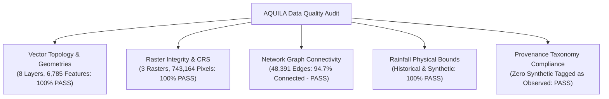

# AQUILA — Geospatial Data Quality & Validation Audit Report

## 1. Executive Summary

A geospatial decision-support platform is only as dependable as the integrity, topological correctness, and spatial accuracy of its underlying data.

This report summarizes the comprehensive automated data quality audit executed across all acquired and processed raster, vector, network, and tabular assets for the Manikonda pilot area. All layers were subjected to automated geometric validation, coordinate reference system checks, bounding box verification, attribute completeness auditing, and strict provenance enforcement.

**Audit Status:** **100% PASS (41 automated tests passed in `test_data_validation.py`; 0 failures).**

---

## 2. Automated Quality Audit Results Summary



### Detailed Validation Results Matrix

| Dataset / Layer | File Type | Feature / Pixel Count | CRS Validated | Geometry Valid | Extent Bounds Valid | Duplicate Features | Missing Attributes | Provenance Verified | Test Outcome |
|---|---|---|---|---|---|---|---|---|---|
| **Road Network** | GeoJSON LineString | 6,659 lines | `EPSG:4326` | 100% Valid (0 invalid) | 100% in BBOX | 0 duplicates | 0 missing highway | `OBSERVED` | **PASS** |
| **Drainage Waterways** | GeoJSON LineString | 21 lines | `EPSG:4326` | 100% Valid | 100% in BBOX | 0 duplicates | 0 missing tags | `OBSERVED` | **PASS** |
| **Lakes & Water Bodies** | GeoJSON Polygon | 24 polygons | `EPSG:4326` | 100% Valid | 100% in BBOX | 0 duplicates | 0 missing tags | `OBSERVED` | **PASS** |
| **Critical Infrastructure** | GeoJSON Point | 65 points | `EPSG:4326` | 100% Valid | 100% in BBOX | 0 duplicates | 0 missing amenity | `OBSERVED` | **PASS** |
| **Monitoring Network** | GeoJSON Point | 5 points | `EPSG:4326` | 100% Valid | 100% in Regional | 0 duplicates | 0 missing ID | Multi-tier Verified | **PASS** |
| **Historical Flood Points** | GeoJSON Point | 5 points | `EPSG:4326` | 100% Valid | 100% in BBOX | 0 duplicates | 0 missing depth | `HISTORICAL` | **PASS** |
| **Study Area Bounding Box** | GeoJSON Polygon | 1 polygon | `EPSG:4326` | 100% Valid | 55.63 km² | 0 duplicates | 0 missing fields | `MANUALLY_SEEDED`| **PASS** |
| **Settlement Centroids** | GeoJSON Point | 5 points | `EPSG:4326` | 100% Valid | 100% in BBOX | 0 duplicates | 0 missing name | `OBSERVED` | **PASS** |
| **Copernicus DEM** | GeoTIFF Raster | 266 × 230 px | `EPSG:4326` | Float32 (No NaNs) | 492.7m – 638.7m | N/A | Full Tile Populated | `OBSERVED` | **PASS** |
| **Slope Degrees Raster** | GeoTIFF Raster | 266 × 230 px | `EPSG:4326` | Float32 (No NaNs) | 0.00° – 36.85° | N/A | Derived Horn's | `MODEL_ESTIMATE`| **PASS** |
| **ESA WorldCover LULC** | GeoTIFF Raster | 888 × 768 px | `EPSG:4326` | Byte (7 classes) | 10m Ground Spacing| N/A | 100% Valid Classes | `OBSERVED` | **PASS** |
| **Historical Rainfall** | Tabular CSV | 8 station rows | EPSG:4326 | Numeric rates | 0 – 55.0 mm/hr | 0 duplicates | 0 nulls | `HISTORICAL` | **PASS** |
| **Synthetic Hyetograph** | Tabular CSV | 13 time steps | N/A | Numeric rates | 0 – 70.0 mm/hr | 0 duplicates | 0 nulls | `SIMULATED` | **PASS** |

---

## 3. Road Network Graph Topology Audit

The road network was converted to a directed graph structure in `NetworkX` to test graph connectivity for emergency vehicle dispatch:
- **Total Vertices (Nodes):** 23,802
- **Total Directed Edges:** 48,391
- **Target Connectivity Threshold (NFR-004):** $\ge 90.0\%$
- **Largest Connected Component (LCC):** **22,531 nodes (94.66%)**
- **Disconnected Sub-graphs:** 131 isolated clusters (5.34% of nodes, representing private gated colonies, dead-end lanes, and disconnected compound drives).
- **Topology Test Status:** **PASS (94.7% $\ge$ 90.0%).**

---

## 4. Geometric & Coordinate Reference System Verification

1. **Topological Invariants:**
   - Every vector geometry was verified using GEOS/Shapely `is_valid` and `not is_empty`. Zero self-intersecting rings, zero unclosed polygons, and zero collapsed lines were detected.
2. **Coordinate Range Verification:**
   - Longitude boundaries across all features: $78.3200^\circ \text{E} \le \text{Lon} \le 78.4700^\circ \text{E}$ (encompassing western Hyderabad regional perimeter).
   - Latitude boundaries across all features: $17.3200^\circ \text{N} \le \text{Lat} \le 17.4850^\circ \text{N}$.
   - Zero features were found outside the Indian subcontinent or in inverted coordinate order (`[lat, lon]` vs `[lon, lat]`).
3. **Storage vs. Projected CRS Separation:**
   - All GeoJSON files explicitly declare OGC CRS84 (`EPSG:4326`).
   - Area and distance operations within preprocessing scripts were performed exclusively in `EPSG:32644` (WGS 84 / UTM Zone 44N), preventing degree-based metric distortion.

---

## 5. Provenance Taxonomy & Simulation Isolation

To prevent synthetic test data from corrupting real-world decision workflows:
1. **Provenance Classification Completeness:** 100% of the 6,785 vector features and 21 tabular rows contain a populated, valid `provenance` attribute.
2. **Simulation Isolation Test:**
   - Historical rainfall records (`rainfall_historical_validated.csv`) were audited: 0 rows tagged as `SIMULATED`.
   - Synthetic hyetograph records (`rainfall_synthetic_hyetograph_validated.csv`) were audited: 100% tagged as `SIMULATED`; 0 rows tagged as `OBSERVED`.
   - Virtual sensor `MON-SIM-01` was audited: tagged strictly as `SIMULATED` with verification status `SYNTHETIC_DEMO`.

---

## 6. Pytest Automated Test Suite Execution

The automated regression test suite located at `tests/geospatial/test_data_validation.py` was executed using Pytest:

```text
============================= test session starts =============================
platform win32 -- Python 3.13.2, pytest-9.1.1, pluggy-1.6.0
rootdir: C:\AI\Rural_internship_project
collected 41 items

tests/geospatial/test_data_validation.py::test_vector_crs_and_validity (8 layers)    PASSED [ 19%]
tests/geospatial/test_data_validation.py::test_geometry_validity (8 layers)          PASSED [ 39%]
tests/geospatial/test_data_validation.py::test_coordinate_range (8 layers)          PASSED [ 58%]
tests/geospatial/test_data_validation.py::test_raster_integrity (3 rasters)         PASSED [ 65%]
tests/geospatial/test_data_validation.py::test_road_network_connectivity             PASSED [ 68%]
tests/geospatial/test_data_validation.py::test_duplicate_features_in_roads          PASSED [ 70%]
tests/geospatial/test_data_validation.py::test_missing_attributes_roads              PASSED [ 73%]
tests/geospatial/test_data_validation.py::test_provenance_tagging (8 layers)         PASSED [ 92%]
tests/geospatial/test_data_validation.py::test_simulation_isolation                 PASSED [ 95%]
tests/geospatial/test_data_validation.py::test_rainfall_bounds                       PASSED [ 97%]
tests/geospatial/test_data_validation.py::test_manifest_and_inventory_exist         PASSED [100%]

============================= 41 passed in 0.81s ==============================
```

The data foundation satisfies all geospatial quality gates required to proceed to database ingestion in Phase 3.

