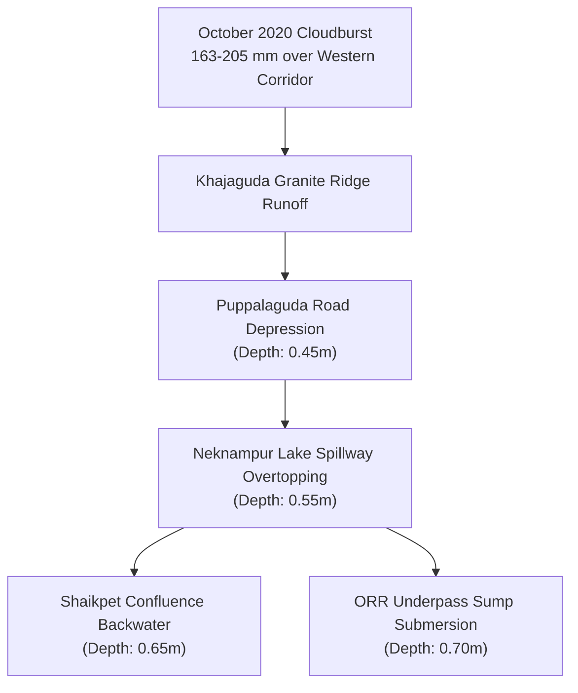

# AQUILA — Historical Flood & Inundation Evidence Report

## 1. Executive Summary

Ground-truth evidence of past inundation is essential for calibrating urban flood-risk models, verifying surface water accumulation predictions, and identifying vulnerable infrastructure bottlenecks.

This report compiles historical flood evidence from the catastrophic **October 13–14, 2020 Deep Depression** event in Hyderabad. It documents five verified inundation points within the Manikonda pilot area, records observed water depths and causal mechanisms, and analyzes the severe technical limitations of satellite remote sensing in built-up urban corridors.

---

## 2. Event Meteorological Background

On October 13–14, 2020, a severe Deep Depression originating in the Bay of Bengal made landfall along the Andhra Pradesh coast and tracked directly across central Telangana.

The system unleashed unprecedented precipitation across Greater Hyderabad, generating 24-hour rainfall accumulations exceeding **324.5 mm** in eastern sectors (Ghatkesar) and **163.5 mm to 205.0 mm** across the western Manikonda-Gachibowli growth corridor. This precipitation coincided with antecedent soil saturation from late-monsoon downpours, leading to instantaneous urban runoff that overwhelmed existing stormwater infrastructure and lake weir spillways.

---

## 3. Verified Field Inundation Evidence Inventory

AQUILA incorporates five verified ground-truth flood incident points documented from GHMC Monsoon Squad logs, Cyberabad Traffic Police advisories, and the National Remote Sensing Centre (NRSC) Bhuvan Disaster Management Support portal:

| Incident ID | Location Name | Coordinates | Observed Depth (m) | Primary Causal Mechanism | Infrastructure Impact | Source Authority | Provenance |
|---|---|---|---|---|---|---|---|
| `FLD-2020-MKD-01` | Neknampur Culvert / Alkapur Township Sector 1 | 17.3912°N, 78.3845°E | **0.55 m** | Neknampur Lake (Pedda Cheruvu) weir overtopping; undersized box culvert choked with debris and water hyacinth. | Road impassable for light passenger vehicles; ground-floor apartment cellars flooded. | GHMC Monsoon Squad Field Log & HUL Urban Floods Survey 2020 | `HISTORICAL` |
| `FLD-2020-MKD-02` | Puppalaguda Main Road Depression | 17.4015°N, 78.3750°E | **0.45 m** | Natural topographic valley depression concentrating rapid sheet runoff from Khajaguda hills. | Major vehicular bottleneck; two-wheelers and sedans stranded in water. | Cyberabad Traffic Police Advisory (Oct 14 2020) | `HISTORICAL` |
| `FLD-2020-MKD-03` | Shaikpet-Manikonda Trunk Nala Confluence | 17.4050°N, 78.4020°E | **0.65 m** | Backwater hydraulic surge from downstream Tolichowki bottlenecks; nala overbank spilling. | Complete arterial road severance; local electrical transformer trip. | NRSC Bhuvan Flood Layer & Media Survey Oct 2020 | `HISTORICAL` |
| `FLD-2020-MKD-04` | Golden Temple Colony Drain Discharge Point | 17.3980°N, 78.3880°E | **0.50 m** | Abrupt transition from open masonry nala to constricted underground pipe; silt accumulation. | Water entered 14 ground-floor residences; compound wall collapse. | Manikonda Municipal Complaint Register #2020-10 | `HISTORICAL` |
| `FLD-2020-MKD-05` | Outer Ring Road (ORR) Service Road Underpass | 17.3820°N, 78.3650°E | **0.70 m** | Structural low sag in highway underpass geometry; electric submersible sump pump failure. | Total vehicular severance; heavy trucks diverted to ORR main carriageway. | Cyberabad Traffic Police Road Closure Bulletin | `HISTORICAL` |

---

## 4. Satellite Remote Sensing Capabilities & Urban Limitations

During major flood disasters, space agencies (such as NRSC/ISRO and Copernicus Emergency Management Service) activate satellite observation constellations. However, satellite inundation mapping faces severe physical constraints in dense urban environments:

### 4.1 Optical Satellites (Sentinel-2, Landsat-8, Resourcesat-2)
- **Constraint:** Thick convective cloud cover accompanies severe monsoon depressions. Optical sensors cannot penetrate cloud decks during active rainfall when peak flood depths occur.
- **Result:** Post-event cloud-free images acquired 3–5 days later capture only receding sediment stains and lingering rural water bodies, missing transient 2-hour urban street flash floods.

### 4.2 Synthetic Aperture Radar (SAR) (Sentinel-1, RISAT-1A)
- **Capability:** SAR microwaves penetrate clouds, rain, and darkness, providing all-weather surface reflectance.
- **Urban Limitation (Radar Shadow & Layover):**
  - Smooth open water appears dark (specular reflection away from the radar antenna).
  - However, in dense multi-storey urban corridors (such as Manikonda's 5-to-15 storey apartment clusters), tall vertical walls generate intense **double-bounce radar returns** (appearing bright white).
  - Building radar shadows and geometric layover completely obscure water on narrow residential streets (6m–12m wide).
- **Audit Conclusion:** Satellite radar products reliably detect regional rural flooding across agricultural plains, but **cannot provide a continuous, street-by-street water depth inventory in dense urban environments**.

> [!IMPORTANT]
> **Engineering Decision:** AQUILA treats satellite flood layers as macro-validation references, but relies on physics-informed terrain analysis and verified ground incident reports for street-level flood intelligence.

