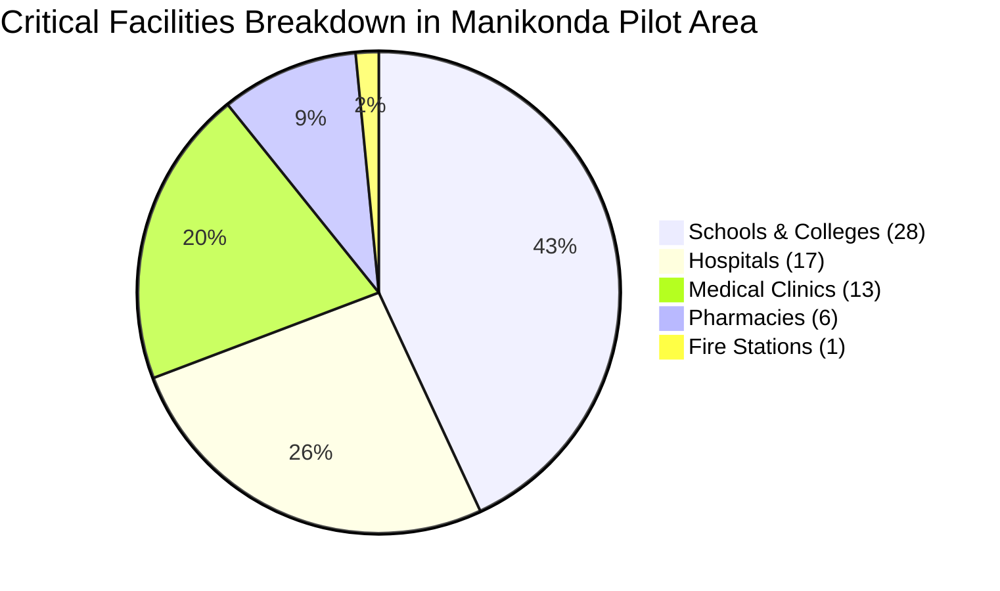

# AQUILA — Critical Infrastructure Inventory & Verification Report

## 1. Executive Summary

During severe urban flood events, emergency response planners require accurate spatial awareness of critical public assets. This includes identifying facilities requiring prioritized protection (such as hospitals with vulnerable ICU patients), potential emergency shelters (such as schools), and responder staging bases (such as fire stations).

This report documents the acquisition, spatial distribution, schema standardization, and **strict verification constraints** applied to 65 critical infrastructure facilities mapped in the Manikonda pilot area.

---

## 2. Ingestion & Extraction Parameters

| Parameter | Value |
|---|---|
| **Data Provider** | OpenStreetMap (OSM) Contributors |
| **Extraction Protocol** | Overpass API |
| **Amenity Filters** | `amenity~"hospital|clinic|pharmacy|school|fire_station|police"` |
| **Geographic Bounding Box** | `[78.3455°E, 17.3605°N, 78.4195°E, 17.4245°N]` |
| **Total Processed Features** | **65 Point facilities** |
| **CRS** | `EPSG:4326` |
| **Output Artifact** | `data/processed/vector/infrastructure_manikonda_processed.geojson` |
| **Validation Report** | `data/processed/vector/infrastructure_validation_report.json` |
| **Provenance** | `OBSERVED` |
| **Verification Status** | `OSM_UNVERIFIED` |

---

## 3. Facility Categorization Breakdown

| Amenity Category | Facility Count | % of Total | Operational Role in Flood Disaster |
|---|---|---|---|
| **Schools & Colleges** | 28 | 43.08% | Potential multi-storey high-ground evacuation shelters; relief distribution centres. |
| **Hospitals** | 17 | 26.15% | Critical healthcare destinations for ambulance routing, triage, and mass-casualty handling. |
| **Medical Clinics** | 13 | 20.00% | Outpatient first-aid, minor injury management, waterborne illness prophylaxis. |
| **Pharmacies** | 6 | 9.23% | Essential pharmaceutical supplies and emergency medical consumables. |
| **Fire Stations** | 1 | 1.54% | Staging ground for inflatable rescue boats, high-capacity de-watering pumps, and fire-tenders. |
| **Total Facilities** | **65** | **100.00%** | Comprehensive public amenity layer for pilot area. |

---

## 4. Notable Facilities in Pilot Region

| Facility Name | Category | Coordinates | Key Characteristics | Verification Status |
|---|---|---|---|---|
| **Continental Hospital** | Hospital | 17.4172°N, 78.3525°E | 750-bed multi-specialty tertiary care hospital; helipad; emergency trauma centre. | `OSM_UNVERIFIED` |
| **Rainbow Children's Hospital** | Hospital | 17.4068°N, 78.3922°E | Pediatric and neonatal intensive care specialty hospital. | `OSM_UNVERIFIED` |
| **Matpathy Clinic** | Clinic | 17.4068°N, 78.3922°E | Local outpatient healthcare facility. | `OSM_UNVERIFIED` |
| **Nanakramguda Govt Primary School** | School | 17.4195°N, 78.3525°E | Public educational facility; elevated multi-storey structure. | `OSM_UNVERIFIED` |
| **Puppalaguda Fire Station** | Fire Station | 17.4020°N, 78.3780°E | Primary emergency response depot for Gandipet Mandal. | `OSM_UNVERIFIED` |

---

## 5. Strict Verification Policy & Operational Readiness Constraints

> [!WARNING]
> In accordance with Section 5.H of the AQUILA engineering specification:
> **Do not label a facility as operational or emergency-ready merely because it appears in a map dataset.**

Every feature in `infrastructure_manikonda_processed.geojson` enforces the following metadata standards:
1. `verification_status: "OSM_UNVERIFIED"`: Indicates the geometry and amenity tags were derived from open community mapping without independent physical ground inspection.
2. `operational_readiness: "UNKNOWN_UNVERIFIED"`: Acknowledges that essential disaster resilience factors—such as backup diesel generator positioning (rooftop vs. cellar), emergency drug stockpiles, drinking water filtration, and amphibious vehicle access—have not been verified in the field.
3. **Identified Urban Infrastructure Gaps:**
   - *Police Stations:* No dedicated police station building was tagged within the pilot bounding box (law enforcement is dispatched from Narsingi or Raidurgam police stations located just outside the perimeter).
   - *Power Substations:* TSSPDCL electrical distribution substations (highly vulnerable to tripping during floods) are not mapped in OSM.
   - *Communication Towers:* Cellular base stations lack power resiliency metadata in open datasets.

