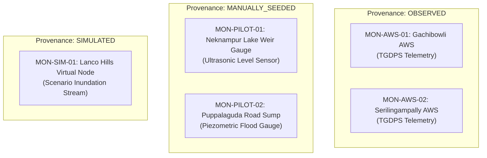

# AQUILA — Multi-Tier Monitoring Locations Inventory

## 1. Executive Summary

Sensor telemetry provides the real-time empirical observations required to detect flood stage rises, monitor lake weir discharges, and evaluate road impassability. However, physical sensor coverage in developing urban catchments is frequently incomplete or fragmented across different agencies.

AQUILA implements a multi-tier monitoring location architecture. Every monitoring station is classified by its institutional source and tagged with strict provenance metadata, ensuring that **proposed research sensors and synthetic test nodes are never conflated with official government telemetry stations**.

---

## 2. Multi-Tier Station Inventory

| Location ID | Station Name | Latitude | Longitude | Elevation (m) | Station Type | Operating Authority | Provenance | Verification Status | Operational Role |
|---|---|---|---|---|---|---|---|---|---|
| `MON-AWS-01` | TGDPS Gachibowli AWS | 17.4399°N | 78.3489°E | 545.0 m | Official Weather Station | Telangana Development Planning Society (TGDPS) | `OBSERVED` | `OFFICIAL_STATION` | Primary real-world rainfall observation proxy for northwestern perimeter. |
| `MON-AWS-02` | TGDPS Serilingampally AWS | 17.4850°N | 78.3200°E | 558.0 m | Official Weather Station | TGDPS | `OBSERVED` | `OFFICIAL_STATION` | Secondary regional rainfall reference station. |
| `MON-PILOT-01` | Neknampur Lake Culvert Gauge | 17.3912°N | 78.3845°E | 515.2 m | Proposed Water Level Sensor | AQUILA Research Prototype | `MANUALLY_SEEDED` | `PROPOSED_PILOT_SENSOR` | Recommended deployment: Non-contact ultrasonic water level gauge to detect culvert constriction. |
| `MON-PILOT-02` | Puppalaguda Road Sump Monitor | 17.4015°N | 78.3750°E | 524.8 m | Proposed Water Level Sensor | AQUILA Research Prototype | `MANUALLY_SEEDED` | `PROPOSED_PILOT_SENSOR` | Recommended deployment: Submersible piezometric pressure sensor in road sag. |
| `MON-SIM-01` | Lanco Hills Valley Virtual Sensor | 17.4100°N | 78.3800°E | 535.0 m | Virtual Telemetry Node | AQUILA Scenario Generator | `SIMULATED` | `SYNTHETIC_DEMO` | Algorithmic test node for injecting synthetic flood depth curves during testing. |

---

## 3. Strict Boundary Rules & Provenance Standard

> [!CAUTION]
> In strict accordance with Section 5.I and Section 12 Criteria 13 of the project specification:
> **Do not present proposed or synthetic locations as official HYDRAA, GHMC, or IMD monitoring points.**

1. **Tier 1 (Official Weather Stations):**
   - Stations `MON-AWS-01` and `MON-AWS-02` are physical, operational hardware installations maintained by the State Government of Telangana. Their historical data is archived and verifiable.
2. **Tier 2 (Proposed Research Deployment):**
   - Stations `MON-PILOT-01` and `MON-PILOT-02` represent **academic deployment recommendations**. They identify critical physical bottlenecks where IoT water-level sensors *should* be deployed by municipal authorities. No physical hardware is currently installed at these coordinates by AQUILA.
3. **Tier 3 (Simulation Demonstration Node):**
   - Station `MON-SIM-01` is a software construct used solely for scenario testing and UI validation. It generates synthetic hydrographs for testing system responsiveness under extreme conditions.

---

## 4. Hardware Specifications for Proposed Pilot Gauges

For future physical implementation, the technical specifications for proposed stations `MON-PILOT-01` and `MON-PILOT-02` are:

- **Sensing Technology:** Non-contact 24 GHz FMCW radar or ultrasonic level transmitter (measurement range: 0.3 m to 10.0 m; accuracy: $\pm 2$ mm).
- **Telemetry Protocol:** NB-IoT / 4G LTE-M with LoRaWAN fallback.
- **Sampling Interval:** Adaptive: 15 minutes during dry weather; switching to 1-minute intervals when water level exceeds the alert threshold ($h > 0.30$ m).
- **Power Subsystem:** 20W monocrystalline solar panel coupled to 12V 18Ah Lithium Iron Phosphate ($\text{LiFePO}_4$) battery with 7-day autonomy.
- **Physical Mounting:** Cantilevered bracket attached to culvert wing-wall or utility pole above high-water line.

