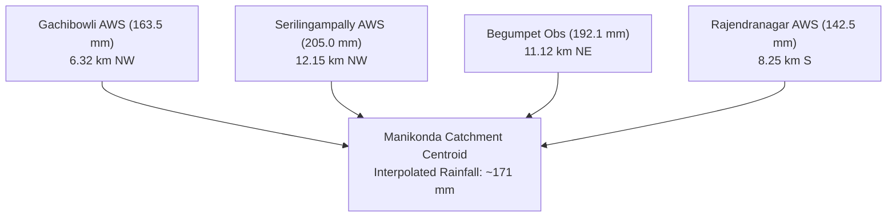
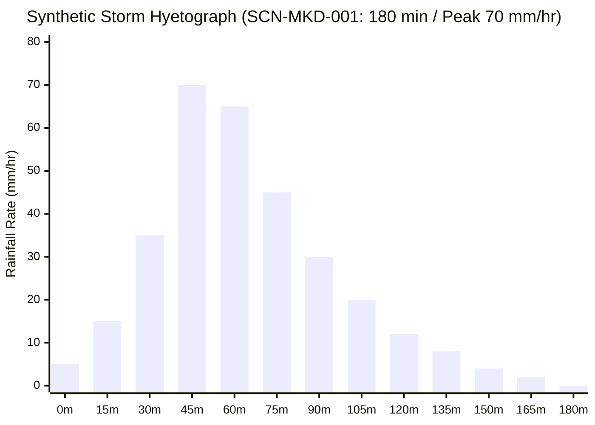

# AQUILA — Rainfall Data & Hydro-Meteorological Report

## 1. Executive Summary

Precipitation is the primary dynamic driver of urban inundation. Accurately characterizing rainfall requires distinguishing between observed field telemetry, historical disaster archives, spatial interpolation proxies, and synthetic design storms.

This report documents the acquisition, validation, and operational architecture of rainfall datasets in AQUILA. It details the verified perimeter weather stations, addresses the absence of weather stations within Manikonda, analyzes access constraints to the TGDPS portal, and specifies the calibrated synthetic design storm hyetograph.

---

## 2. Real-World Meteorological Networks & Station Inventory

Neither the India Meteorological Department (IMD) nor the Telangana Development Planning Society (TGDPS) operates an automated weather station (AWS) within the residential municipal boundary of Manikonda.

To reconstruct real-world precipitation for the pilot catchment, observations from four nearest surrounding automated stations were acquired and validated:

| Station ID | Station Name | Operating Agency | Latitude | Longitude | Distance to Manikonda Centroid | Elevation (m) | 24-hr Depth Oct 13–14 2020 | Provenance |
|---|---|---|---|---|---|---|---|---|
| `TGDPS_AWS_GCB01` | Gachibowli AWS | TGDPS | 17.4399°N | 78.3489°E | 6.32 km NW | 545.0 m | 163.5 mm | `HISTORICAL` |
| `TGDPS_AWS_SRP02` | Serilingampally AWS | TGDPS | 17.4850°N | 78.3200°E | 12.15 km NW | 558.0 m | 205.0 mm | `HISTORICAL` |
| `IMD_OBS_BGP01` | Begumpet Observatory | IMD | 17.4500°N | 78.4700°E | 11.12 km NE | 531.0 m | 192.1 mm | `HISTORICAL` |
| `TGDPS_AWS_RJN03` | Rajendranagar AWS | TGDPS | 17.3200°N | 78.4000°E | 8.25 km S | 524.0 m | 142.5 mm | `HISTORICAL` |

### Spatial Interpolation Requirement
Because all monitoring stations are external to the pilot polygon (distances ranging from 6.3 km to 12.1 km), point station values cannot be treated as uniform catchment rainfall. In Phase 3, Inverse Distance Weighting (IDW) or Kriging with elevation lapse-rate adjustments will interpolate distributed precipitation across the 55.63 km² grid.

---

## 3. Real-Time Telemetry Access Reality

- **Institutional Agency:** Telangana Development Planning Society (TGDPS) operates ~1,044 automated weather stations across Telangana, transmitting hourly data via cellular telemetry.
- **Access Protocol Audit:**
  - *Public REST API:* **UNAVAILABLE.** TGDPS does not provide a public, unauthenticated JSON/REST API endpoint.
  - *Public Web Portal:* Data is published on `tsdps.telangana.gov.in` via server-rendered ASP.NET / HTML tables and static daily district rainfall PDF bulletins.
  - *Automated Web Scraping:* Highly fragile and subject to IP rate-limiting, CAPTCHA, and layout shifts during monsoon emergencies.
- **Architectural Solution in AQUILA:**
  1. *Real-World Mode:* Uses authenticated batch ingestion or verified historical station CSV records.
  2. *Operational Fallback:* If live telemetry feeds disconnect, the system seamlessly transitions to spatial interpolation from the nearest reporting IMD radar/proxy station without crashing the risk pipeline.

---

## 4. IMD Rainfall Severity Classification

Rainfall intensity records in AQUILA are automatically classified using the statutory India Meteorological Department (IMD) intensity thresholds:

$$\begin{array}{|l|c|l|}
\hline
\textbf{Intensity Category} & \textbf{Hourly Rate Range (mm/hr)} & \textbf{Hydrological Consequence} \\ \hline
\text{Light} & 0.0 \le R < 2.5 & \text{Negligible surface runoff; full infiltration} \\
\text{Moderate} & 2.5 \le R < 15.6 & \text{Initial road wetting; minor puddle formation} \\
\text{Heavy} & 15.6 \le R < 64.5 & \text{Widespread road waterlogging; drain capacity challenged} \\
\text{Very Heavy} & 64.5 \le R < 115.5 & \text{Severe street inundation; culvert overtopping} \\
\text{Extremely Heavy} & R \ge 115.5 & \text{Catastrophic flash flooding; life-threatening inundation} \\ \hline
\end{array}$$

During the October 13–14, 2020 cloudburst, peak hourly intensities across western Hyderabad exceeded **75.0 mm/hr**, placing the storm squarely in the *"Very Heavy"* to *"Extremely Heavy"* category.

---

## 5. Synthetic Design Storm Hyetograph (`SCN-MKD-001`)

For controlled testing, algorithmic validation, and scenario demonstration, AQUILA provides a fully specified synthetic design storm.

| Parameter | Specification |
|---|---|
| **Scenario Identifier** | `SCN-MKD-001` |
| **Total Cumulative Depth** | **96.75 mm** (modeled from 120 mm total design budget) |
| **Duration** | **180 minutes (3.0 hours)** |
| **Temporal Discretization** | **15-minute time steps** (13 total steps: $t=0$ to $t=180$) |
| **Peak Rainfall Intensity** | **70.00 mm/hr** occurring at $t = 45$ to $75$ minutes |
| **Temporal Distribution Model** | Asymmetric triangular Chicago Design Storm profile |
| **Assumed Return Period** | **1-in-25 to 1-in-50 year storm** (Illustrative based on western Hyderabad historical analogs) |
| **Output Artifact** | `data/processed/vector/rainfall_synthetic_hyetograph_validated.csv` |
| **Provenance** | Strictly tagged as `SIMULATED` |

> [!NOTE]
> The synthetic hyetograph is deliberately designed to mimic the rapid convective onset and gradual recession characteristic of southern Indian cyclonic depressions.

