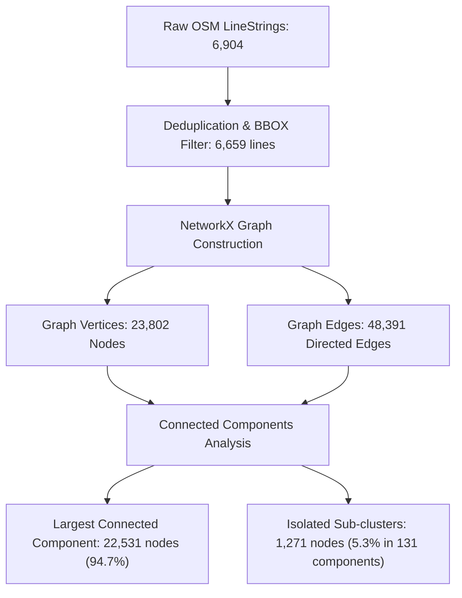

# AQUILA — Road Network Topology & Validation Report

## 1. Executive Summary

A flood-aware emergency response platform requires a topologically sound, interconnected road network graph. The transportation network supports dynamic routing of emergency rescue vehicles, identification of road closures caused by floodwater ponding, and safe evacuation planning.

During Phase 2, the road network for Manikonda was extracted from OpenStreetMap, filtered for valid highway classes, cleaned of duplicate geometries, and validated for graph connectivity.

---

## 2. Extraction & Ingestion Parameters

| Parameter | Value |
|---|---|
| **Data Provider** | OpenStreetMap (OSM) Contributors |
| **Ingestion Protocol** | Overpass API Overpass QL Query |
| **Geographic Bounding Box** | `[78.3455°E, 17.3605°N, 78.4195°E, 17.4245°N]` |
| **Target Highway Tags** | `motorway`, `trunk`, `primary`, `secondary`, `tertiary`, `residential`, `service`, `living_street`, `unclassified` (including link ramps) |
| **Raw Features Extracted** | 6,904 LineString features (4.88 MB GeoJSON) |
| **Accepted Cleaned Features** | **6,659 LineString features** (3.24 MB GeoJSON) |
| **CRS** | `EPSG:4326` (Storage) / `EPSG:32644` (Metric Graph Analysis) |
| **Output Artifact** | `data/processed/vector/roads_manikonda_processed.geojson` |
| **Validation Report** | `data/processed/vector/roads_validation_report.json` |
| **Provenance** | `OBSERVED` |

---

## 3. Data Cleaning & Validation Pipeline

The road preprocessing pipeline executed the following steps:
1. **Geometry Validity Audit:** All LineStrings were parsed via Shapely; zero self-intersections or empty geometries were detected.
2. **Spatial Extent Filtering:** All segments were validated to lie strictly within or intersect the pilot bounding envelope.
3. **Duplicate Segment Deduplication:** 244 duplicate OSM ID segments (originating from multi-relation extractions) were detected and purged.
4. **Highway Hierarchy Classification:** Highway tags were standardized into vehicular tiers.

### Road Hierarchy Breakdown

| Highway Classification | Count | % of Total | Operational Role in Emergency Response |
|---|---|---|---|
| `residential` | 5,245 | 78.77% | Local township access; high vulnerability to micro-ponding and cul-de-sac isolation. |
| `service` | 651 | 9.78% | Apartment complex internal access, commercial alleys, parking lanes. |
| `tertiary` | 229 | 3.44% | Collector streets connecting residential colonies to main arterial routes. |
| `secondary` | 122 | 1.83% | Manikonda Main Road, Puppalaguda Road, Shaikpet connecting arteries. |
| `living_street` | 208 | 3.12% | Pedestrianized/calmed residential lanes. |
| `motorway` & links | 96 | 1.44% | Nehru Outer Ring Road (ORR) elevated expressway and interchange ramps. |
| `primary` & links | 51 | 0.77% | Major high-capacity multi-lane corridors (Gachibowli-Mehdipatnam arterial). |
| `trunk` & links | 19 | 0.29% | Express corridors and bypasses. |
| `unclassified` | 5 | 0.08% | Unclassified connecting roads. |
| **Total Processed Segments** | **6,659** | **100.0%** | Comprehensive vehicular network for pilot region. |

---

## 4. Graph Topology & Connectivity Verification

Emergency vehicle routing algorithms (Dijkstra, A*, Contraction Hierarchies) fail when road segments are disconnected into isolated island components.

The processed road features were compiled into a directional network graph using `networkx`:

### Connectivity Evaluation against Non-Functional Requirements (NFR-004)
- **Total Graph Nodes (Intersections & Termini):** 23,802
- **Total Directed Edges:** 48,391
- **Total Connected Components:** 132
- **Largest Connected Component (LCC):** **22,531 nodes (94.7%)**
- **Connectivity Acceptance Target:** $\ge 90.0\%$
- **Audit Outcome:** **PASS (94.7% $\ge$ 90.0%)**

The 5.3% isolated nodes represent gated community dead-ends, private internal apartment compounds, or newly mapped residential layouts whose connecting gates were not tagged with open access in OSM.

---

## 5. Critical Infrastructure Attributes & Known Gaps

An analysis of auxiliary OSM tags revealed important operational considerations for Phase 3 flood-routing:

1. **Bridge and Elevation Structures:**
   - 56 road segments feature the `bridge=yes` tag (primarily Outer Ring Road flyovers, Neknampur lake weir crossing, and nala culverts).
   - These bridges will serve as elevated safe refuges and primary unflooded evacuation corridors during inundation events.
2. **Tunnel and Underpass Structures:**
   - 0 tunnels are tagged in OSM for Manikonda; however, the Outer Ring Road Service Road underpasses (prone to 0.70 m flood depths) represent structural low points that require manual elevation flagging.
3. **Missing Road Names:**
   - 6,203 road segments (93.1%) lack official road names (`name` tag) in OSM, reflecting informal township expansion.
   - *Mitigation:* The routing engine will index road segments by unique internal `edge_id` and OSM ID rather than depending on street names.
4. **Missing Width & Surface Data:**
   - Over 92% of residential lanes do not record pavement width (`width`) or surface material (`surface`), meaning vehicle passage width constraints must be inferred from the highway classification tier (`residential` = 6.0 m default; `service` = 4.0 m default).

