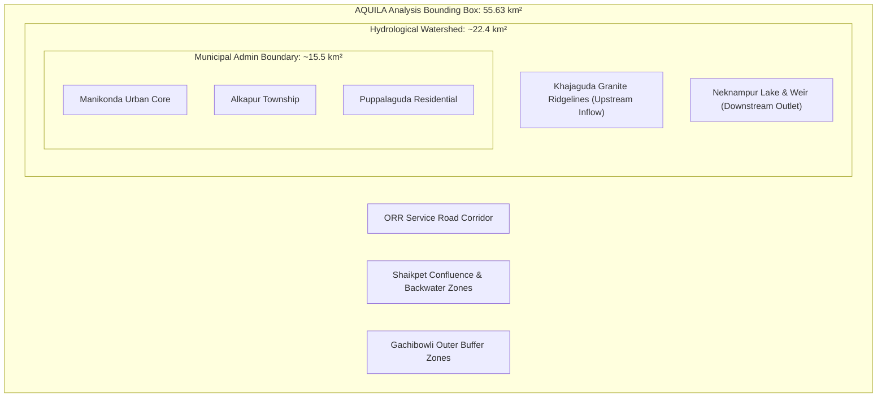

# AQUILA — Pilot Study Area & Spatial Reference Definition

## 1. Geographical Context

The pilot implementation area for AQUILA is located in the western growth corridor of the Hyderabad Metropolitan Development Authority (HMDA) region, Telangana, India.

Centred around the suburban agglomeration of **Manikonda**, the pilot zone encompasses rapidly urbanized residential townships, commercial IT peripheral zones, remaining agricultural lands, and granitic outcrop ridges.

```text
Western Hyderabad Regional Orientation:
               [HITEC City / Gachibowli IT Corridor]
                             ▲
                             │ (Runoff flows southwards)
   [Khajaguda Ridge] ────────┼──────────────── [Shaikpet / Golconda]
       (El: 638m)            │
                             ▼
                    [Manikonda Pilot Area]
                     - Puppalaguda
                     - Alkapur Township
                     - Neknampur Lake (El: 512m)
                             │
                             ▼
                    [Mir Alam Tank / Musi River Basin]
```

---

## 2. Distinction: Administrative Entity vs. Hydrological Catchment vs. Analysis Envelope

A foundational geospatial principle established in Phase 2 is that **administrative boundaries do not correspond to hydrological catchments**, and neither should be arbitrarily substituted for an analysis envelope.

AQUILA rigorously defines and maintains separate spatial representations for these three concepts:

| Entity | Category | Approx. Extent | Definition & Characterization | Source / Status |
|---|---|---|---|---|
| **Manikonda Municipal Boundary** | Administrative Jurisdiction | ~15.5 km² | Statutory municipal council boundary established in 2019 (comprising Manikonda, Puppalaguda, and Alkapur areas). Delineated by political and fiscal boundaries, completely independent of watershed hydrology. | Official Cadastral Shapefile restricted by GHMC/HMDA; settlement centroids used as OSM reference. |
| **Manikonda-Neknampur Catchment** | Natural Hydrological Watershed | ~22.4 km² | Topographic surface drainage basin bounded by the northern granite ridges of Khajaguda and western Gandipet uplands, naturally draining surface runoff south-southeast through Puppalaguda into Neknampur Lake (Pedda Cheruvu) and Chinna Cheruvu. | Derived from Copernicus DEM ridgeline analysis; crosses municipal boundaries into Gandipet Mandal and Golconda. |
| **AQUILA Pilot Analysis Envelope** | Geospatial Modeling Bounding Box | **55.63 km²** | Rectangular geospatial bounding box established with a 500-metre buffer around all pilot settlements and hydrological inflows/outflows: `[78.3455°E, 17.3605°N, 78.4195°E, 17.4245°N]`. | Configured in `config/geospatial/project.yaml`; artifact in `data/processed/vector/study_area_bbox.geojson`. |



> [!IMPORTANT]
> Modeling flood inundation strictly within the 15.5 km² municipal polygon would truncate upstream runoff arriving from the Khajaguda hills and omit downstream backwater effects from Shaikpet. The 55.63 km² rectangular analysis envelope guarantees hydrological continuity.

---

## 3. Spatial Reference Systems (SRS)

To ensure spatial precision, avoid distortion, and satisfy strict GIS engineering standards, AQUILA employs a dual-CRS architecture:

### 3.1 Storage and Interoperability CRS: `EPSG:4326`
- **Name:** WGS 84 (Geographic 2D Coordinates).
- **Units:** Decimal degrees (latitude, longitude).
- **Usage:** All raw and processed vector GeoJSON assets, GeoTIFF rasters, external API payloads, and web visualization layers are persisted in `EPSG:4326`.
- **Vertical Datum:** EGM2008 (heights above mean sea level in metres for elevation data).

### 3.2 Projected Computational CRS: `EPSG:32644`
- **Name:** WGS 84 / UTM Zone 44N.
- **Units:** Metres (m).
- **Usage:** All planar spatial operations—including polygon area calculations, stream segment length measurements, slope gradient computations, road buffer generation, and nearest-facility routing distance calculations—are transformed dynamically into `EPSG:32644`.

> [!CAUTION]
> Geographic coordinates (`EPSG:4326`) must never be used directly for planar distance or area measurements. In Hyderabad (~17.4°N latitude), 1 degree of longitude is approximately 106.1 km, whereas 1 degree of latitude is approximately 110.7 km. Direct planar math in degrees causes severe spatial distortion.

---

## 4. Formal Geospatial Extent Coordinates

The active AQUILA analysis bounding box coordinates:

| Parameter | Decimal Degrees | UTM Zone 44N Metres (Approx.) |
|---|---|---|
| **Western Boundary (Min Longitude)** | `78.345500° E` | `218,120 m E` |
| **Southern Boundary (Min Latitude)** | `17.360500° N` | `1,921,800 m N` |
| **Eastern Boundary (Max Longitude)** | `78.419500° E` | `225,950 m E` |
| **Northern Boundary (Max Latitude)** | `17.424500° N` | `1,928,950 m N` |
| **Centroid Coordinates** | `78.382500° E, 17.392500° N` | `222,035 m E, 1,925,375 m N` |
| **Horizontal Span** | 0.074000° (~7.85 km) | 7,830 m |
| **Vertical Span** | 0.064000° (~7.08 km) | 7,150 m |
| **Total Enclosed Area** | — | **55.63 km²** |

---

## 5. Artifact Verification

The spatial boundary definitions are codified in the following project files:
- Vector Polygon GeoJSON: `data/processed/vector/study_area_bbox.geojson`
- Boundary Distinctions Metadata: `data/processed/vector/study_area_notes.json`
- Settlement Centroids: `data/processed/vector/manikonda_settlements_processed.geojson`
- Project Configuration: `config/geospatial/project.yaml`

