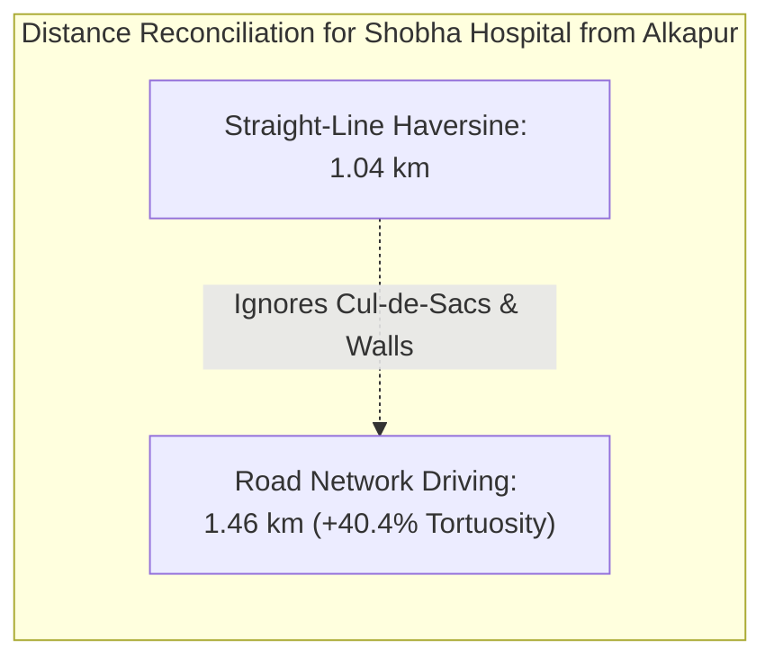

# AQUILA — Phase 4: Critical Facility Accessibility & Provenance Governance

**Project:** AQUILA — Urban Flood Intelligence, Infrastructure Monitoring and Emergency Response Platform  
**Target Pilot Area:** Manikonda, Hyderabad, Telangana, India  
**Document Type:** Emergency Infrastructure Accessibility & Data Governance Specification  
**Location:** `docs/phase-4/facility_accessibility.md`  

---

## 1. Operational Rationale

During urban flood emergencies, citizens and municipal operators need to know:
1. Which medical facilities are closest to an incident or residential colony?
2. Is the road corridor leading to that facility passable or inundated?
3. What is the real driving distance compared to the straight-line distance?

AQUILA's **Accessibility Service** ([`app/services/accessibility_service.py`](file:///C:/AI/Rural_internship_project/app/services/accessibility_service.py)) pairs the validated critical infrastructure dataset with the flood-aware road network service to provide realistic accessibility assessments.

---

## 2. Infrastructure Inventory & Provenance

The service queries 65 critical facilities compiled from OpenStreetMap in Phase 2 (`infrastructure_manikonda_processed.geojson`):

```
+----------------------------------------------------------------------------------------------------+
|                               CRITICAL INFRASTRUCTURE CLASSIFICATION                               |
+-------------------+---------------+--------------------+-------------------------------------------+
| Category          | Mapped Count  | Verification Status| Sample Facilities                         |
+-------------------+---------------+--------------------+-------------------------------------------+
| Hospitals         | 8 facilities  | OSM_UNVERIFIED     | Shobha Hospital, Prolife Hospital         |
| Clinics & Doctors | 14 facilities | OSM_UNVERIFIED     | Matpathy Clinic, Sri Sri Holistic Clinic  |
| Pharmacies        | 22 facilities | OSM_UNVERIFIED     | MedPlus, Apollo Pharmacy, Medlife         |
| Public Emergency  | 21 facilities | OSM_UNVERIFIED     | Puppalaguda Fire Station, Ward Office     |
+-------------------+---------------+--------------------+-------------------------------------------+
```

### Strict Ethical Guardrails
> [!CAUTION]
> 1. **No Unverified Field Claims:** All facility records carry the metadata tag `verification_status: "OSM_UNVERIFIED"`. The prototype does not claim on-site municipal verification of operating hours, emergency trauma capability, or generator backup status.
> 2. **No Automatic Shelter Classification:** Public facilities (schools, community halls, government offices) are **not** labeled as certified flood evacuation shelters unless formally designated by GHMC disaster authorities.

---

## 3. Straight-Line vs. Real Road-Network Driving Distance

A critical capability demonstrated by the Accessibility Service is the reconciliation between **Straight-Line Distance (Haversine)** and **Real Road Driving Distance (Dijkstra)**:



### The Urban Tortuosity Factor
In Manikonda, residential townships feature gated community compound walls, winding avenues, and railway/canal divides:
$$\text{Tortuosity Factor} = \frac{\text{Road Network Distance}}{\text{Straight-Line Haversine Distance}} \approx 1.35 - 1.65$$
Reporting straight-line distance alone leads dispatchers to severely underestimate emergency travel times. AQUILA computes both metrics simultaneously.

---

## 4. Accessibility Classification Scheme

For every queried facility, the service returns an operational status based on route vulnerability:

| Status Code | Operational Meaning | Dispatch Recommendation |
| :--- | :--- | :--- |
| **`ACCESSIBLE`** | Average route risk $< 40.0$; zero incident or disruption corridors. | **Optimal Choice.** Roadway clear and elevated. |
| **`MODERATE_RISK_ACCESSIBLE`** | Average route risk between $40.0$ and $69.9$; minor roadside waterlogging possible. | **Recommended with Caution.** Suitable for emergency fleet vehicles. |
| **`HIGH_RISK_ROUTE`** | Average route risk $\ge 70.0$; passes through low-lying depression basins. | **Precautionary Detour Advised.** High-clearance vehicles only. |
| **`CAUTION_DISRUPTED_CORRIDOR`** | Route intersects an active flood incident zone ($\ge 3$ segments) or road disruption. | **Hazardous Corridor.** Consider secondary facility. |
| **`UNREACHABLE_BY_ROAD`** | Road network severed by disruptions or located in a disconnected graph component. | **Do Not Dispatch.** Seek alternate destination. |

---

## 5. Sample API Response (`GET /api/v1/accessibility/facilities`)

```json
{
  "origin": {"latitude": 17.3912, "longitude": 78.3845},
  "requested_category": "hospital",
  "facilities_found_count": 3,
  "accessible_count": 3,
  "unreachable_count": 0,
  "facilities": [
    {
      "facility_id": "node/2354679489",
      "facility_name": "Shobha Hospital",
      "facility_category": "hospital",
      "latitude": 17.3980,
      "longitude": 78.3920,
      "straight_line_distance_km": 1.04,
      "road_network_distance_km": 1.46,
      "road_network_distance_meters": 1456.2,
      "route_average_risk_score": 48.5,
      "route_risk_category": "MODERATE",
      "incident_affected_segments": 0,
      "disruption_affected_segments": 0,
      "accessibility_status": "MODERATE_RISK_ACCESSIBLE",
      "data_provenance": "MANUALLY_SEEDED",
      "verification_status": "OSM_UNVERIFIED",
      "disclaimer": "Facility sourced from OpenStreetMap; operational readiness not verified on ground."
    }
  ]
}
```

