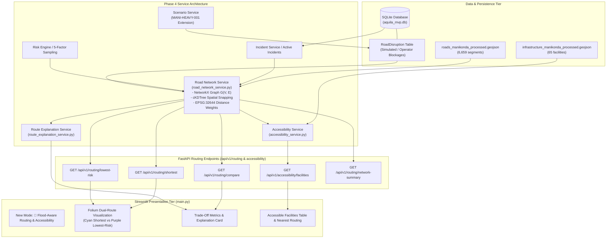

# AQUILA — Phase 4 Implementation Plan: Flood-Aware Routing, Safe Accessibility & Intelligent Navigation

**Project:** AQUILA — Urban Flood Intelligence, Infrastructure Monitoring and Emergency Response Platform  
**Target Pilot Area:** Manikonda, Hyderabad, Telangana, India  
**Document Type:** Architectural Blueprint & Phase 4 Implementation Specification  
**Status:** Approved for Implementation  
**Date:** November 2026  

---

## 1. Executive Summary & Purpose

Phase 4 extends the AQUILA platform from a static geographic flood-risk and point-based emergency resource decision-support prototype into an **intelligent, explainable, flood-aware transportation routing and accessibility platform**.

In urban flash floods, Euclidean straight-line distance (Haversine) fails to capture street-level navigability: a response depot 800 meters away across an inundated culvert may be completely unreachable, whereas a depot 2.5 kilometers away along dry elevated ridges is immediately accessible. Phase 4 bridges this operational gap by introducing:
1. **Dynamic Road Network Graph Modeling:** Converting 6,659 processed OpenStreetMap road segments into an indexed, projected NetworkX topological graph.
2. **Dual-Cost Pathfinding (Dijkstra / A\*):** Computing both pure shortest paths (distance-optimal) and risk-weighted paths (safety-optimal) using the formula:
   $$C(e) = L(e) \cdot \left(1 + \lambda \cdot \frac{R(e)}{100}\right)$$
3. **Incident-Based Edge Penalization:** Proximity-driven cost amplification for road segments near active flood incidents (`REPORTED`, `UNDER_REVIEW`, `ASSIGNED`, `IN_PROGRESS`) and simulated road disruptions.
4. **Accessible Critical Facility Recommendation:** Evaluating accessibility from any incident or user location to mapped hospitals and medical centers with explicit provenance attribution (`OSM_UNVERIFIED`).
5. **Explainable Route Decision-Support:** Automatically synthesizing human-readable trade-off explanations comparing distance penalties against risk avoidance.
6. **Integrated Scenario Stress-Testing:** Injecting deterministic simulated road disruptions during scenario `MANI-HEAVY-001` with clean, isolated reset rollback.

---

## 2. Review of Existing Capabilities (Baseline State)

| System Domain | Existing Capabilities (Phases 1–3 + Final Audit) | Limitations Addressed in Phase 4 |
| :--- | :--- | :--- |
| **Road Network** | 6,659 segments in GeoJSON; offline connectivity check (94.7% connected) in `process_roads.py`. | No runtime graph service; roads rendered statically in Leaflet without pathfinding. |
| **Emergency Dispatch** | Great-Circle Haversine straight-line distance ranking in `resource_service.py`. | Ignores road network topology, winding street layouts, and flooded impassable links. |
| **Incident Management**| Full FSM (`REPORTED` $\to$ `ASSIGNED` $\to$ `IN_PROGRESS` $\to$ `RESOLVED`) with append-only audit trail. | Active incidents do not alter surrounding road accessibility. |
| **Simulation Engine**  | Stepwise hyetograph progression (`MANI-HEAVY-001`) with automated incident injection. | Does not model simulated road blockages or dynamic route re-computation. |
| **Facility Data**      | 65 critical infrastructure points tagged `OSM_UNVERIFIED` in GeoJSON. | No automated routing to nearest accessible medical or emergency facility. |
| **Automated Testing**  | 57 passing automated Pytest tests in 2.31s. | Zero routing path tests or facility accessibility tests. |

---

## 3. Proposed Architecture & Component Changes



---

## 4. Key Datasets & Database Extensions

### 4.1 Reused Geospatial Assets
- `data/processed/vector/roads_manikonda_processed.geojson`: 6,659 cleaned road segments with geometry, highway classification, and OSM ID.
- `data/processed/vector/infrastructure_manikonda_processed.geojson`: 65 critical facilities with coordinates, facility type, and `OSM_UNVERIFIED` provenance.
- `data/processed/raster/dem_manikonda_clipped.tif` and `slope_degrees_manikonda.tif`: Used for localized segment elevation and slope sampling.

### 4.2 Database Entity: `RoadDisruption`
In [`app/db/models.py`](file:///C:/AI/Rural_internship_project/app/db/models.py), add a dedicated model for storing active road blockages:
```python
class RoadDisruption(Base):
    __tablename__ = "road_disruptions"
    id = Column(Integer, primary_key=True, index=True)
    disruption_code = Column(String(50), unique=True, nullable=False)
    description = Column(String(255), nullable=False)
    latitude = Column(Float, nullable=False)
    longitude = Column(Float, nullable=False)
    radius_meters = Column(Float, default=150.0)
    penalty_factor = Column(Float, default=10.0)  # Cost multiplier or closure flag
    status = Column(String(30), default="ACTIVE")  # ACTIVE, CLEARED
    provenance = Column(String(30), default="SIMULATED")
    created_at = Column(DateTime, default=utc_now)
```
*Isolation Rule:* When `scenario_manager.reset_scenario()` runs, all rows where `provenance == "SIMULATED"` are purged.

---

## 5. Algorithm Selection & Mathematical Formulations

### 5.1 Spatial Snapping & Graph Construction
- **Coordinate Precision:** Nodes are indexed by rounding $(\text{lon}, \text{lat})$ to 6 decimal places ($~0.1\text{m}$).
- **Spatial Indexing:** A SciPy `cKDTree` is constructed on node coordinates transformed to UTM Zone 44N (`EPSG:32644`) to find the nearest valid road intersection for any arbitrary GPS query coordinate in $< 1\text{ ms}$.
- **Planar Edge Length:** Segment lengths $L(e)$ are calculated in meters using projected UTM coordinates:
  $$L(e) = \sqrt{\Delta x^2 + \Delta y^2}$$

### 5.2 Shortest vs. Lowest-Risk Cost Formulations
1. **Shortest Route Objective:**
   $$\min \sum_{e \in \text{Path}} L(e)$$
2. **Lowest-Risk Route Objective:**
   $$\min \sum_{e \in \text{Path}} C(e)$$
   Where:
   $$C(e) = L(e) \cdot \left(1 + \lambda \cdot \frac{R(e)}{100} + P_{\text{incident}}(e)\right)$$
   - $L(e)$: Edge length in meters ($\ge 0$).
   - $R(e)$: Segment flood risk score ($0 - 100$) evaluated from the 5-factor risk engine.
   - $\lambda$: Configurable risk-aversion penalty multiplier (Default $\lambda = 3.0$).
   - $P_{\text{incident}}(e)$: Proximity penalty ($0 - 20$) derived from nearby active flood incidents within a $200\text{m}$ buffer.
3. **Graph Traversal Algorithm:**
   Executed via NetworkX's standard Dijkstra solver `nx.shortest_path(G, source, target, weight=cost_field)`. Non-negative weights guarantee algorithmic convergence without negative cycle anomalies.

---

## 6. Route Explanation & Accessibility Methodology

### 6.1 Explainable Recommendation Engine
The explanation service compares the Shortest Route ($P_{\text{short}}$) and Lowest-Risk Route ($P_{\text{risk}}$):
- Length Delta: $\Delta L = \frac{L(P_{\text{risk}}) - L(P_{\text{short}})}{L(P_{\text{short}})} \times 100\%$
- Risk Exposure Score: Cumulative length-weighted risk:
  $$\bar{R} = \frac{\sum_{e \in P} L(e) \cdot R(e)}{\sum_{e \in P} L(e)}$$
- Avoided Hazards: Counts the number of high-risk segments ($R \ge 70$) and incident zones avoided by taking the alternative detour.
- Human-Readable Output: Generates concise, plain-English justifications suitable for municipal dispatchers.

### 6.2 Facility Recommendation
Queries hospitals and clinics from `infrastructure_manikonda_processed.geojson`, calculates both straight-line Haversine and road network shortest path, evaluates total route risk, and returns status: `ACCESSIBLE` or `UNREACHABLE`.

---

## 7. Testing & Quality Assurance Strategy

A dedicated test suite in `tests/phase4/` will validate:
1. **Graph Invariants:** Graph loading, node/edge counts, UTM projected lengths, connected components.
2. **Pathfinding Accuracy:** Shortest path optimality, risk avoidance detour behavior, identical start/end handling, disconnected node handling (raising clear 404/unreachable exceptions without crashing).
3. **Incident Impact:** Adding an active incident raises nearby edge weights and reroutes traffic around the obstruction; resolving the incident restores normal weights.
4. **Facility Accessibility:** Correctly ranks facilities by network distance and attaches `OSM_UNVERIFIED` provenance badges.
5. **Scenario Determinism & Isolation:** Step 3 of `MANI-HEAVY-001` injects a simulated disruption; resetting scenario purges the disruption and restores baseline graph weights.
6. **Regression Invariants:** All existing 57 tests must continue to pass with 0 failures.

---

## 8. Technical Risks, Boundaries & Engineering Constraints

| Potential Risk | Technical Mitigation |
| :--- | :--- |
| **Disconnected Island Nodes (5.3% of network)** | Queries snapping to an isolated component cannot reach the main network. Mitigation: Snapping logic verifies whether the candidate node belongs to the largest connected component; if not, snaps to the nearest node within the largest component. |
| **Slow Graph Construction at Runtime** | Building the graph from GeoJSON takes ~400ms. Mitigation: Singleton caching pattern ensures graph is built once at application startup. |
| **Negative Edge Weights** | Risk multipliers must never introduce negative weights. Mitigation: Clamping enforces $C(e) \ge L(e) \ge 0$. |
| **Misrepresenting Safety** | Users might assume lowest-risk route is 100% dry. Mitigation: Explanations clearly state: *"Based on relative empirical risk score; does not guarantee real-world water depth or structural passability."* |

---

## 9. Implementation Milestones

1. **Phase 4 Implementation Plan & Architecture Docs** (`docs/phase-4/`)
2. **Database Extension** (`RoadDisruption` in `app/db/models.py`)
3. **Road Network Service** (`app/services/road_network_service.py`)
4. **Explanation Service** (`app/services/route_explanation_service.py`)
5. **Facility Accessibility Service** (`app/services/accessibility_service.py`)
6. **Scenario Service Enhancement** (Disruptions in `scenario_service.py`)
7. **FastAPI Endpoints & Schemas** (`app/api/schemas.py`, `app/api/main.py`)
8. **Streamlit Command Centre Extension** (`app/dashboard/main.py`)
9. **Automated Test Suite** (`tests/phase4/test_routing.py`)
10. **Phase 4 Verification & Completion Documentation**

