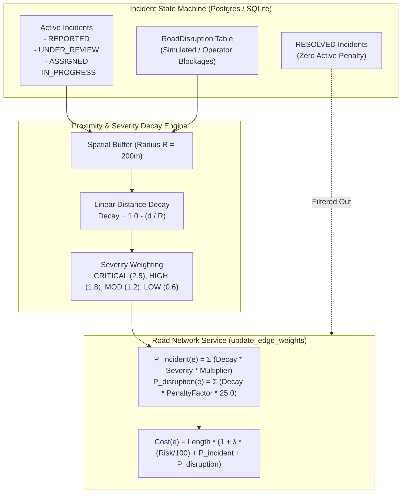

# AQUILA — Phase 4: Incident-Based Road Penalties & Disruption Model

**Project:** AQUILA — Urban Flood Intelligence, Infrastructure Monitoring and Emergency Response Platform  
**Target Pilot Area:** Manikonda, Hyderabad, Telangana, India  
**Document Type:** Dynamic Edge Penalization & Road Severance Specification  
**Location:** `docs/phase-4/incident_road_penalty_model.md`  

---

## 1. Operational Rationale

Urban flood incidents do not simply exist as isolated point markers on a map; they actively impair adjacent road infrastructure:
* Waterlogging on an arterial street slows traffic to a crawl, stalls low-clearance vehicles, and presents hydroplaning hazards.
* Culvert breaches or nala overtopping can deposit mud and debris, rendering a 150-meter street corridor impassable.

To ensure routing algorithms divert emergency vehicles away from active flood sites, AQUILA dynamically couples the **Incident Management System** and the **Road Network Service** through a continuous proximity-decay penalization model.

---

## 2. Dynamic Penalty Formulation



---

### 2.1 Active Incident Proximity Penalty ($P_{\text{incident}}$)

When an incident is in an active state (`REPORTED`, `UNDER_REVIEW`, `ASSIGNED`, or `IN_PROGRESS`), it broadcasts an impedance field within a configurable influence radius $R_{\text{influence}} = 200.0\text{ meters}$:

$$P_{\text{incident}}(e) = \sum_{k \in \text{Active Incidents}} w_k \cdot \left(1.0 - \frac{d(e, k)}{R_{\text{influence}}}\right) \cdot \mu_{\text{incident}}$$

Where:
* $d(e, k)$: Planar distance in meters from road segment midpoint $(\lambda_{\text{mid}}, \phi_{\text{mid}})$ to incident coordinates $(\lambda_k, \phi_k)$.
* $w_k$: Severity multiplier reflecting hazard intensity:
  - `CRITICAL`: $w_k = 2.5$
  - `HIGH`: $w_k = 1.8$
  - `MODERATE`: $w_k = 1.2$
  - `LOW`: $w_k = 0.6$
* $\mu_{\text{incident}} = 12.0$: Base penalty scaling factor.
* If $d(e, k) > R_{\text{influence}}$, the term is $0$.

---

### 2.2 Lifecycle Invariant: Resolved Incidents
When an operator marks an incident status as `RESOLVED`, the incident is excluded by the database query:
```python
active_incidents = db.query(Incident).filter(
    Incident.status.in_(["REPORTED", "UNDER_REVIEW", "ASSIGNED", "IN_PROGRESS"])
).all()
```
The edge penalty immediately drops back to $P_{\text{incident}} = 0.0$, reopening the street to normal lowest-risk routing without requiring a server reboot.

---

### 2.3 Road Disruption Model (`RoadDisruption`)

For physical blockages (such as an overtopped culvert, collapsed tree, or municipal barrier), AQUILA introduces the `RoadDisruption` database entity in [`app/db/models.py`](file:///C:/AI/Rural_internship_project/app/db/models.py):

$$P_{\text{disruption}}(e) = \sum_{m \in \text{Active Disruptions}} \text{factor}_m \cdot \left(1.0 - \frac{d(e, m)}{R_m}\right) \cdot 25.0$$

* Unlike an incident report (which indicates waterlogging nearby), a `RoadDisruption` applies severe impedance ($\text{factor} \ge 25.0$), multiplying edge cost by up to $100\times$, forcing Dijkstra to navigate completely around the affected corridor.

---

## 3. Disruption Taxonomy & Provenance Governance

To ensure clear communication in emergency operations, AQUILA distinguishes three operational disruption tiers:

| Disruption Class | Provenance Tag | Operational Meaning | System Behavior |
| :--- | :--- | :--- | :--- |
| **Incident Nearby** | `REPORTED` / `OBSERVED` | Waterlogging reported along street; road may be passable with caution. | Applies moderate cost penalty ($P_{\text{inc}} \in [2, 15]$); induces detour only if a dry alternative is nearby. |
| **Simulated Disruption** | `SIMULATED` | Deterministically injected during scenario `MANI-HEAVY-001` (e.g., `DISR-SIM-001`). | Applies severe impedance ($P_{\text{dis}} \ge 50$); purged cleanly upon scenario reset. |
| **Operator Confirmed Closure** | `MANUALLY_SEEDED` / `VERIFIED` | Municipal or police barrier confirmed on site. | Segment effectively closed; routing actively diverts all emergency vehicles. |

---

## 4. Scenario Lifecycle Integration & Clean Rollback

During scenario `MANI-HEAVY-001` execution in [`app/services/scenario_service.py`](file:///C:/AI/Rural_internship_project/app/services/scenario_service.py):

1. **Step 3 Injection (T = 45 min, 70 mm/hr):**
   The scenario engine automatically injects:
   - Incident `INC-SIM-001` (*Alkapur Township Sector 1 Roadway Inundation*)
   - Disruption `DISR-SIM-001` (*Puppalaguda Main Road Culvert Backwater Blockage*, radius $200\text{m}$, factor $25.0$)
   - Calls `road_network_service.update_edge_weights(db_session=db, rainfall_rate_mm_hr=70.0)`
   - Lowest-risk routes dynamically divert away from Puppalaguda Main Road.

2. **Scenario Reset Rollback:**
   Executing `scenario_manager.reset_scenario(db)` triggers:
   ```python
   # Purge only simulated disruptions
   db.query(RoadDisruption).filter(RoadDisruption.provenance == "SIMULATED").delete()
   # Restore graph edge weights to dry baseline
   road_network_service.update_edge_weights(db_session=db, rainfall_rate_mm_hr=0.0)
   ```
   - Real-world records, manually confirmed incidents, and historical baseline datasets remain completely untouched.

