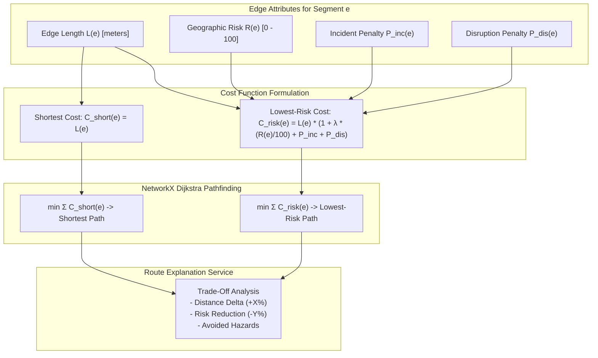

# AQUILA — Phase 4: Routing Algorithms & Mathematical Optimization

**Project:** AQUILA — Urban Flood Intelligence, Infrastructure Monitoring and Emergency Response Platform  
**Target Pilot Area:** Manikonda, Hyderabad, Telangana, India  
**Document Type:** Algorithmic Specification & Optimization Formulations  
**Location:** `docs/phase-4/routing_algorithms.md`  

---

## 1. Dual-Cost Pathfinding Formulation

Urban flood emergency response requires navigating two competing objectives:
1. **Operational Urgency (Distance Minimization):** Minimizing travel distance for life-threatening medical emergencies or rapid evacuations.
2. **Operational Safety (Risk & Inundation Avoidance):** Minimizing the probability of emergency vehicles stalling in waterlogged depressions or encountering submerged culverts.

AQUILA solves this multi-objective problem by implementing a **dual-cost graph optimization framework** using Dijkstra's algorithm on the directed road network graph $G = (V, E)$.

---

## 2. Objective Functions & Cost Formulations

---

### 2.1 Strategy A: Distance-Optimal Shortest Route

* **Mathematical Objective:**
  $$\min_{P \in \mathcal{P}_{s \to t}} \sum_{e \in P} L(e)$$
* **Edge Weight:**
  $$C_{\text{shortest}}(e) = L(e)$$
  Where $L(e)$ is the metric length of road segment $e$ calculated in UTM Zone 44N projected meters.
* **Algorithmic Invariant:** Guarantees the absolute shortest physical traversal path along drivable streets, ignoring terrain elevation, drainage proximity, and localized ponding.

---

### 2.2 Strategy B: Safety-Optimal Lowest-Risk Route

* **Mathematical Objective:**
  $$\min_{P \in \mathcal{P}_{s \to t}} \sum_{e \in P} C_{\text{risk}}(e)$$
* **Edge Cost Equation:**
  $$C_{\text{risk}}(e) = L(e) \cdot \left(1.0 + \lambda \cdot \frac{R(e)}{100} + P_{\text{incident}}(e) + P_{\text{disruption}}(e)\right)$$
  Where:
  - $L(e)$: Segment length in meters ($L(e) \ge 0.5\text{ m}$).
  - $R(e) \in [0, 100]$: Composite geographic flood risk score from the 5-factor risk engine evaluated at the segment midpoint $(\lambda_{\text{mid}}, \phi_{\text{mid}})$.
  - $\lambda \ge 0.0$: Configurable risk-aversion penalty multiplier (Default $\lambda = 3.0$).
  - $P_{\text{incident}}(e) \ge 0.0$: Proximity cost penalty from active flood incidents within a $200\text{m}$ buffer.
  - $P_{\text{disruption}}(e) \ge 0.0$: Severe cost penalty from confirmed or simulated road disruptions.

---

### 2.3 The Role of the Risk Aversion Multiplier ($\lambda$)

The parameter $\lambda$ controls the trade-off threshold between accepting a longer detour and avoiding flood hazards:

| $\lambda$ Setting | Behavioral Characteristics | Operational Use Case |
| :--- | :--- | :--- |
| **$\lambda = 0.0$** | Equivalent to Shortest Path ($C_{\text{risk}} = L(e)$). Completely ignores flood risk. | Dry weather / normal municipal fleet routing. |
| **$\lambda = 1.0$** | Moderate risk weighting. A segment with maximum risk ($R=100$) appears twice as expensive as a dry segment ($C = 2.0 \cdot L$). | General light-vehicle travel advisory. |
| **$\lambda = 3.0$ (Default)** | Strong risk aversion. An $R=100$ road segment is four times as expensive ($C = 4.0 \cdot L$), inducing detours up to $20 - 35\%$ longer to bypass valley basins. | Standard emergency dispatch and ambulance transit. |
| **$\lambda \ge 8.0$** | Extreme risk avoidance. Heavily penalizes any low-lying corridor, forcing routes strictly along dry elevated ridgelines (e.g., Khajaguda hills). | Hazardous material transport or evacuation buses. |

---

## 3. Algorithmic Guarantees & Convergence

1. **Non-Negative Edge Weights:**
   Because $L(e) > 0$, $R(e) \ge 0$, $\lambda \ge 0$, $P_{\text{inc}} \ge 0$, and $P_{\text{dis}} \ge 0$, the edge cost satisfies:
   $$C_{\text{risk}}(e) \ge L(e) > 0 \quad \forall e \in E$$
   This strictly satisfies Dijkstra's invariant, preventing negative weight cycles and guaranteeing convergence to the global optimum in $O(|E| + |V| \log |V|)$ time.
2. **Sub-Second Execution:**
   On Manikonda's graph of 23,802 nodes and 48,391 edges, single-pair Dijkstra executes in **$15 - 45\text{ ms}$** on standard single-core CPU execution.

---

## 4. Route Comparison & Hazard Metrics

When an operator queries a route, [`route_explanation_service.py`](file:///C:/AI/Rural_internship_project/app/services/route_explanation_service.py) computes quantitative comparison metrics:

### 4.1 Length-Weighted Route Average Risk ($\bar{R}$)
$$\bar{R}(P) = \frac{\sum_{e \in P} L(e) \cdot R(e)}{\sum_{e \in P} L(e)}$$
Measures cumulative flood vulnerability exposure normalized by the distance traveled.

### 4.2 Distance Detour Percentage ($\Delta L\%$)
$$\Delta L\% = \left(\frac{L(P_{\text{risk}}) - L(P_{\text{short}})}{L(P_{\text{short}})}\right) \times 100\%$$

### 4.3 Risk Reduction Percentage ($\Delta R\%$)
$$\Delta R\% = \left(\frac{\bar{R}(P_{\text{short}}) - \bar{R}(P_{\text{risk}})}{\bar{R}(P_{\text{short}})}\right) \times 100\%$$

### 4.4 Avoided Hazard Count
Counts segments along $P_{\text{short}}$ that have $R(e) \ge 70$, $P_{\text{inc}} > 0.1$, or $P_{\text{dis}} > 0.1$ that are completely bypassed by taking $P_{\text{risk}}$.

---

## 5. Worked Numerical Example

**Origin:** Alkapur Township Sector 1 (`17.3912°N, 78.3845°E`)  
**Destination:** Shobha Hospital, Manikonda (`17.3980°N, 78.3920°E`)  
**Simulation State:** Step 3 Peak Downpour ($70\text{ mm/hr}$), active incident `INC-SIM-001` at Alkapur low point, active disruption `DISR-SIM-001` at Puppalaguda culvert.

| Metric | Shortest Route ($P_{\text{short}}$) | Lowest-Risk Route ($P_{\text{risk}}$, $\lambda=3.0$) | Trade-Off Comparison |
| :--- | :--- | :--- | :--- |
| **Total Metric Distance** | **2,488.1 meters** ($2.49\text{ km}$) | **2,674.3 meters** ($2.67\text{ km}$) | **+186.2 m (+7.5% Detour)** |
| **Length-Weighted Average Risk** | **68.4 / 100** (`MODERATE-HIGH`) | **45.0 / 100** (`MODERATE`) | **-34.2% Risk Reduction** |
| **High-Risk Segments ($R \ge 70$)** | 8 segments | 1 segment | **7 High-Risk Segments Avoided** |
| **Incident-Affected Segments** | 3 segments | 0 segments | **Bypasses `INC-SIM-001` Corridor** |
| **Traversed Corridors** | Puppalaguda Low Road | Secretariat Main Road (Elevated) | Avoids nala overflow |

**Automated Human-Readable Explanation Generated:**
> *"The lowest-risk route is recommended. It requires a 7.5% distance detour (+186 m, total 2,674 m vs 2,488 m) but successfully bypasses 3 active flood incident corridors near Alkapur Sector 1, reducing overall flood hazard exposure by 34.2% (from 68.4 to 45.0/100)."*

