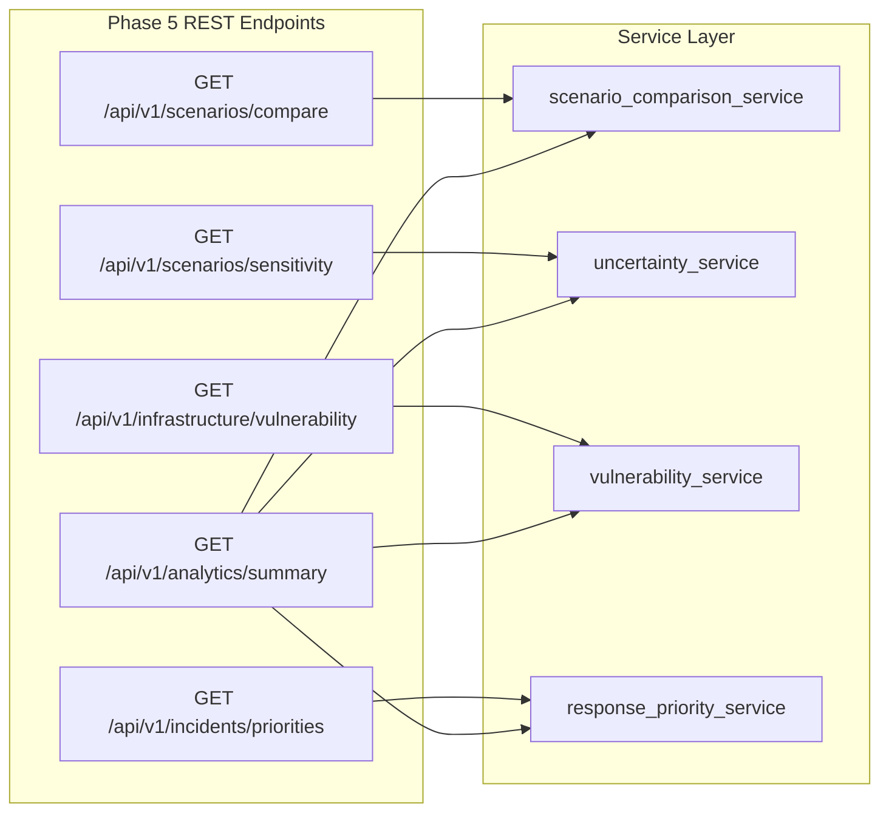

# AQUILA Phase 5: REST API Documentation

## 1. API Architecture & Versioning

- **Base URL**: `http://localhost:8000`
- **Specification**: OpenAPI 3.1.0 / FastAPI Swagger UI at `http://localhost:8000/docs`
- **Application Version**: `0.5.0`
- **Data Serialization**: Pydantic V2 schemas with strict typing and automatic validation.
- **Cross-Origin Resource Sharing (CORS)**: Enabled for all origins (`allow_origins=["*"]`).

---

## 2. Phase 5 Endpoint Catalog

The following five analytical and decision-support endpoints are exposed under `/api/v1/...`:



---

## 3. Endpoint Specifications

### 1. GET `/api/v1/scenarios/compare`
Returns side-by-side comparative KPI matrix across the five operational flood scenarios.

- **Tags**: `Scenario Intelligence`
- **Query Parameters**: None
- **Response Model**: `ScenarioComparisonResponse`
- **HTTP Status**: `200 OK`

#### Example Response:
```json
{
  "baseline_scenario_id": "SCEN-DRY-000",
  "total_scenarios_compared": 5,
  "comparison_matrix": [
    {
      "scenario_id": "SCEN-DRY-000",
      "scenario_name": "Baseline Dry Condition",
      "rainfall_rate_mm_hr": 0.0,
      "mean_catchment_risk": 43.4,
      "risk_category": "MODERATE",
      "delta_risk_score": 0.0,
      "risk_pct_increase": 0.0,
      "high_risk_edges": 967,
      "delta_high_risk_edges": 0,
      "inaccessible_road_segments": 0,
      "facilities_at_risk": 2,
      "delta_facilities_at_risk": 0,
      "facilities_isolated": 0,
      "dewatering_pumps_needed": 0,
      "rescue_boats_needed": 0,
      "monsoon_squad_teams_needed": 1
    },
    {
      "scenario_id": "SCEN-HVY-002",
      "scenario_name": "Heavy Cloudburst Storm",
      "rainfall_rate_mm_hr": 70.0,
      "mean_catchment_risk": 73.8,
      "risk_category": "HIGH",
      "delta_risk_score": 30.4,
      "risk_pct_increase": 70.0,
      "high_risk_edges": 11613,
      "delta_high_risk_edges": 10646,
      "inaccessible_road_segments": 85,
      "facilities_at_risk": 21,
      "delta_facilities_at_risk": 19,
      "facilities_isolated": 4,
      "dewatering_pumps_needed": 5,
      "rescue_boats_needed": 1,
      "monsoon_squad_teams_needed": 3
    }
  ],
  "methodology": "Deterministic Multi-Scenario Synthesis across calibrated Manikonda catchment points and topological road graph",
  "disclaimer": "Scenario outcomes are deterministic planning benchmarks; real-world hydraulic inundation extents depend on drainage maintenance, unmodeled blockages, and live rainfall variability."
}
```

---

### 2. GET `/api/v1/scenarios/sensitivity`
Returns One-At-a-Time parameter sensitivity, non-linear rainfall response, and missing-layer elasticity.

- **Tags**: `Uncertainty & Sensitivity`
- **Query Parameters**:
  - `perturbation_fraction` (*float*, optional, default: `0.20`, range: $[0.05, 0.50]$): Perturbation fraction to apply to factor weights.
- **Response Model**: `SensitivityAnalysisResponse`
- **HTTP Status**: `200 OK`

#### Example Response Snippet:
```json
{
  "report_title": "AQUILA Uncertainty & Sensitivity Analysis Suite",
  "study_area": "Manikonda Pilot Region, Hyderabad",
  "weight_sensitivity": {
    "analysis_type": "One-At-a-Time (OAT) Weight Sensitivity",
    "base_risk_score": 65.2,
    "perturbation_percent": 20.0,
    "factor_sensitivities": [
      {
        "factor": "rainfall",
        "base_weight": 0.40,
        "risk_swing": 2.80,
        "pct_swing": 4.29,
        "elasticity": 0.107
      },
      {
        "factor": "drainage",
        "base_weight": 0.20,
        "risk_swing": 2.40,
        "pct_swing": 3.68,
        "elasticity": 0.092
      }
    ],
    "most_sensitive_factor": "rainfall"
  },
  "rainfall_sweep": {
    "moderate_risk_entry_mm_hr": 0.0,
    "high_risk_entry_mm_hr": 45.0
  },
  "disclaimer": "Uncertainty metrics evaluate mathematical sensitivity of the deterministic rule-based algorithms. These results do NOT constitute empirical Monte Carlo hydraulic depth confidence bounds."
}
```

---

### 3. GET `/api/v1/infrastructure/vulnerability`
Evaluates and ranks all 65 critical facilities by the multi-criteria vulnerability index $V$.

- **Tags**: `Infrastructure Intelligence`
- **Query Parameters**:
  - `rainfall_rate_mm_hr` (*float*, optional, default: `25.0`, range: $[0.0, 200.0]$): Precipitation intensity in mm/hr for context.
  - `category` (*string*, optional, default: `"all"`): Category filter (`hospital`, `clinic`, `pharmacy`, `all`).
- **Response Model**: `FacilityVulnerabilityResponse`
- **HTTP Status**: `200 OK`

#### Example Response Snippet:
```json
{
  "total_facilities_evaluated": 65,
  "rainfall_rate_applied_mm_hr": 25.0,
  "category_filter": "all",
  "vulnerability_distribution": {
    "CRITICAL": 6,
    "HIGH": 19,
    "MODERATE": 28,
    "LOW": 12
  },
  "ranked_facilities": [
    {
      "facility_id": "node/698705213",
      "name": "MedPlus Alkapur",
      "category": "pharmacy",
      "latitude": 17.3912,
      "longitude": 78.3845,
      "vulnerability_score": 85.1,
      "vulnerability_category": "CRITICAL",
      "component_scores": {
        "geographic_risk_r_geo": 78.4,
        "historical_flood_prox_score": 100.0,
        "drainage_prox_score": 95.0,
        "access_route_risk_score": 68.2
      },
      "verification_status": "OSM_UNVERIFIED",
      "provenance": "MANUALLY_SEEDED"
    }
  ],
  "formula": "V = 0.35*R_geo + 0.25*S_flood_prox + 0.20*S_drain_prox + 0.20*S_access_risk"
}
```

---

### 4. GET `/api/v1/incidents/priorities`
Returns active incidents ranked by explainable priority score with human-in-the-loop governance.

- **Tags**: `Emergency Prioritization`
- **Query Parameters**: None
- **Response Model**: `IncidentPrioritiesResponse`
- **HTTP Status**: `200 OK`

#### Example Response Snippet:
```json
{
  "total_active_incidents": 2,
  "current_rainfall_mm_hr": 25.0,
  "ranked_incidents": [
    {
      "incident_id": 1,
      "incident_code": "INC-SIM-001",
      "title": "Alkapur Township Sector 1 Roadway Inundation",
      "severity": "HIGH",
      "priority_score": 82.4,
      "priority_level": "P1_IMMEDIATE",
      "priority_rank": 1,
      "candidate_resource": {
        "resource_code": "PUMP-MKD-01",
        "resource_name": "Alkapur Township Mobile Dewatering Unit",
        "distance_km": 1.25
      },
      "explainable_justification": "HIGH severity WATERLOGGING (Sev=75); local flood risk 76.8; Secondary road arterial (Tier=80); 350m from Sri Sri Clinic (MedProx=80); pending for 24.0m (AgeEsc=36).",
      "requires_operator_approval": true,
      "auto_dispatched": false
    }
  ],
  "governance_policy": "HUMAN_OPERATOR_REQUIRED"
}
```

---

### 5. GET `/api/v1/analytics/summary`
Returns high-level synthesis of multi-scenario metrics, vulnerability distribution, and priority queue.

- **Tags**: `Analytics Overview`
- **Query Parameters**: None
- **Response Model**: `AnalyticsSummaryResponse`
- **HTTP Status**: `200 OK`

#### Example Response:
```json
{
  "generated_at": "2026-11-03T18:05:00Z",
  "pilot_area": "Manikonda, Hyderabad, Telangana",
  "total_scenarios_available": 5,
  "critical_facilities_total": 65,
  "critical_facilities_vulnerable_count": 25,
  "active_incidents_count": 2,
  "top_priority_incident": {
    "incident_code": "INC-SIM-001",
    "priority_score": 82.4,
    "priority_level": "P1_IMMEDIATE"
  },
  "most_sensitive_parameter": "rainfall",
  "historical_consistency_pct": 100.0,
  "governance_status": "HUMAN_OPERATOR_REQUIRED"
}
```

