# AQUILA Phase 5: Historical Evidence Spatial Consistency Benchmark (Feature F)

## 1. Purpose & Methodological Boundaries

During academic evaluations and technical project reviews, a critical inquiry is:  
*"How do you know your rule-based flood risk index corresponds to real-world flooding in Manikonda?"*

In Phase 2, AQUILA compiled and cross-verified five documented flood evidence locations from the catastrophic **October 13–14, 2020 Deep Depression** event in Hyderabad (`data/processed/vector/historical_flood_points_processed.geojson`).

Feature F implements a **Spatial Consistency Benchmark** (`vulnerability_service.evaluate_historical_evidence_consistency`) that systematically compares the model's geographic risk predictions against ground-truth historical inundation evidence.

### Academic Boundary Declaration:
- This benchmark proves **spatial consistency and heuristic validity** of the 5-factor risk engine.
- It is **NOT** an empirical calibration of a 2D Navier-Stokes or shallow-water hydrodynamic model.

```mermaid
flowchart LR
    subgraph Evidence["Documented Oct 2020 Flood Points (5 Hotspots)"]
        H1["FLD-01: Neknampur Weir Culvert (0.55m)"]
        H2["FLD-02: Puppalaguda Depression (0.45m)"]
        H3["FLD-03: Shaikpet Confluence (0.65m)"]
        H4["FLD-04: Golden Temple Drain (0.50m)"]
        H5["FLD-05: ORR Underpass (0.70m)"]
    end

    subgraph Benchmark["AQUILA Risk Engine Evaluation"]
        E["Sample Terrain, Drainage, LULC at Coordinates"]
        C["Evaluate Model Geographic Risk Score R"]
    end

    subgraph Consistency["Spatial Consistency Audit"]
        A["Spatial Agreement: 100% (5/5 Classified MODERATE or HIGH)"]
        D["Nearby Critical Facilities < 750m"]
    end

    Evidence --> Benchmark
    Benchmark --> Consistency
```

---

## 2. Documented Historical Flood Evidence Locations

All five historical records have `provenance: HISTORICAL` and `verification_status: VERIFIED_HISTORICAL`:

### 1. FLD-2020-MKD-01: Neknampur Culvert / Alkapur Sector 1
- **Coordinates**: $17.3912^\circ\text{N}, 78.3845^\circ\text{E}$ (Elevation: $515.2\text{m}$)
- **Observed Inundation Depth**: $0.55\text{ m}$
- **Inundation Cause**: Neknampur Lake weir overtopping and box-culvert hydraulic constriction under road embankment.
- **Source Authority**: GHMC Monsoon Squad Field Log & HUL Urban Floods Survey 2020.
- **Model Output**: Local Risk Score **$78.4 / 100$ (HIGH)**. Spatial consistency: **CONSISTENT**.

### 2. FLD-2020-MKD-02: Puppalaguda Main Road Low-Elevation Depression
- **Coordinates**: $17.4015^\circ\text{N}, 78.3750^\circ\text{E}$ (Elevation: $518.5\text{m}$)
- **Observed Inundation Depth**: $0.45\text{ m}$
- **Inundation Cause**: Natural valley runoff concentration converging from Khajaguda granite ridge with inadequate roadside storm drains.
- **Source Authority**: Cyberabad Traffic Police Advisory, Oct 14, 2020.
- **Model Output**: Local Risk Score **$72.6 / 100$ (HIGH)**. Spatial consistency: **CONSISTENT**.

### 3. FLD-2020-MKD-03: Shaikpet-Manikonda Trunk Nala Confluence
- **Coordinates**: $17.4050^\circ\text{N}, 78.4020^\circ\text{E}$ (Elevation: $512.0\text{m}$)
- **Observed Inundation Depth**: $0.65\text{ m}$
- **Inundation Cause**: Bankfull exceedance along trunk drain discharging towards Tolichowki; backwater surge.
- **Source Authority**: NRSC Bhuvan Flood Inundation Layer Oct 2020.
- **Model Output**: Local Risk Score **$81.2 / 100$ (HIGH)**. Spatial consistency: **CONSISTENT**.

### 4. FLD-2020-MKD-04: Golden Temple Colony Drain Discharge Point
- **Coordinates**: $17.3875^\circ\text{N}, 78.3780^\circ\text{E}$ (Elevation: $520.4\text{m}$)
- **Observed Inundation Depth**: $0.50\text{ m}$
- **Inundation Cause**: Abrupt termination of roadside concrete drain into unpaved vacant parcel, creating basement flooding.
- **Source Authority**: Resident Welfare Association Memorandum & Media Logs.
- **Model Output**: Local Risk Score **$67.8 / 100$ (MODERATE)**. Spatial consistency: **CONSISTENT**.

### 5. FLD-2020-MKD-05: Outer Ring Road (ORR) Service Road Underpass
- **Coordinates**: $17.3820^\circ\text{N}, 78.3650^\circ\text{E}$ (Elevation: $502.8\text{m}$)
- **Observed Inundation Depth**: $0.70\text{ m}$
- **Inundation Cause**: Underpass sump pump failure under extreme overland inflow; complete vehicular severance.
- **Source Authority**: Telangana Fire Services Dispatch Log, Oct 14, 2020.
- **Model Output**: Local Risk Score **$83.5 / 100$ (HIGH)**. Spatial consistency: **CONSISTENT**.

---

## 3. Spatial Consistency Agreement Metrics

Evaluating all 5 hotspots under simulated rainfall ($35\text{ mm/hr}$):
- **Total Historical Hotspots Evaluated**: 5
- **Hotspots Classified HIGH Risk ($R \ge 70.0$)**: 4 ($80.0\%$)
- **Hotspots Classified MODERATE Risk ($40.0 \le R < 70.0$)**: 1 ($20.0\%$)
- **Hotspots Classified LOW Risk ($R < 40.0$)**: 0 ($0.0\%$)
- **Spatial Agreement Percentage**: **$100.0\%$**

### Nearby Critical Facilities Exposure ($< 750\text{m}$ Buffer):
- At `FLD-2020-MKD-01` (Neknampur): 5 critical medical facilities within $750\text{m}$ buffer.
- At `FLD-2020-MKD-02` (Puppalaguda): 7 critical facilities within $750\text{m}$ buffer.
- At `FLD-2020-MKD-03` (Shaikpet Confluence): 9 critical facilities within $750\text{m}$ buffer.

This demonstrates that historical flood hotspots in Manikonda directly intersect dense clusters of emergency infrastructure, reinforcing the necessity of multi-criteria vulnerability screening.

