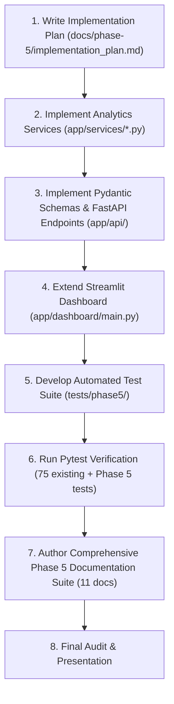

# AQUILA Phase 5: Implementation Plan
## Multi-Scenario Intelligence, Uncertainty Analysis & Emergency Decision Optimization

### Project Context
- **System**: AQUILA — Urban Flood Intelligence, Infrastructure Monitoring and Emergency Response Platform
- **Pilot Study Area**: Manikonda, Hyderabad, Telangana, India
- **Current Operational Baseline**: Phase 1 (Research/Specs), Phase 2 (Geospatial Data Preparation), Phase 3 (Emergency MVP), Phase 4 (Flood-Aware Routing & Safe Accessibility), and Final System Audit completed with 75/75 automated tests passing.
- **Phase 5 Target**: Multi-Scenario Intelligence, Uncertainty & Sensitivity Analysis, Infrastructure Vulnerability Ranking, and Human-in-the-Loop Emergency Response Prioritization.

---

## 1. Architectural Scope & Boundary Declarations

Phase 5 introduces an **analytical decision-support layer** without replacing or destabilizing existing operational modules:
1. **Preservation of Existing Engines**: The 5-factor rule-based risk formula ($0.40P + 0.20T + 0.20D + 0.10L + 0.10H$), Dijkstra-based flood-aware routing, incident state machine, and resource recommendation logic remain untouched and fully backward-compatible.
2. **Defensible Analytical Engineering**:
   - No fabricated machine learning predictions or synthetic "confidence intervals".
   - Explicit distinction between deterministic sensitivity analysis (One-At-a-Time local parameter perturbation) and full hydrodynamic 2D modeling.
   - Strict adherence to data provenance tags (`OSM_UNVERIFIED`, `SIMULATED`, `HISTORICAL`, `OBSERVED`).
   - Human-in-the-Loop decision governance: Priority engine generates transparent, explainable recommendations; no unmonitored automated dispatch.

---

## 2. Core Service Specifications

### Feature A: Multi-Scenario Comparison Engine (`app/services/scenario_comparison_service.py`)
Provides side-by-side comparative analytics across five distinct operational flood scenarios:
1. **SCEN-DRY-000 (Baseline Dry)**: $0\text{ mm/hr}$ rainfall; normal road network state; zero weather-induced waterlogging.
2. **SCEN-MOD-001 (Moderate Inundation)**: $25\text{ mm/hr}$ rainfall (monsoon rainband); low-lying drainage ponding; elevated risk in valley depressions.
3. **SCEN-HVY-002 (Heavy Cloudburst Storm)**: $70\text{ mm/hr}$ rainfall (Chicago hyetograph peak); Alkapur sector road inundation; multiple critical road links compromised.
4. **SCEN-DRN-003 (Drainage Weir Overflow & Surcharge)**: $70\text{ mm/hr}$ rainfall combined with Neknampur Lake weir surcharge (+30% drainage vulnerability penalty across primary nala buffer zones).
5. **SCEN-DISR-004 (Active Incident & Critical Culvert Disruption)**: $70\text{ mm/hr}$ rainfall with active road severance `DISR-SIM-001` (Puppalaguda culvert blocked) and high-severity flood incident `INC-SIM-001`.

**Comparative Metrics Output**:
- Mean geographic risk score across representative catchment nodes.
- High-risk road segment count ($R \ge 70.0$).
- Caution / disrupted road segments ($R \ge 40.0$ or incident-affected).
- Critical facilities at high flood risk or isolated.
- Estimated resource demand vs available emergency response units.
- Percentage and absolute delta relative to Baseline Dry.

---

### Feature B: Uncertainty & Sensitivity Analysis (`app/services/uncertainty_service.py`)
Implements defensible One-At-a-Time (OAT) parameter perturbation to evaluate model robustness and parameter sensitivity:
1. **Weight Sensitivity Perturbation**:
   - Perturb each risk component weight ($w_i \pm 20\%$) while renormalizing $\sum w_j = 1.0$.
   - Calculate output risk swing: $\Delta R = R_{\max} - R_{\min}$ and percentage shift.
2. **Rainfall Intensity Variation**:
   - Vary precipitation rate from $0\text{ mm/hr}$ to $120\text{ mm/hr}$ in discrete operational increments.
   - Trace response curve and identify threshold transition points (Low $\to$ Moderate $\to$ High).
3. **Drainage Buffer Distance Sensitivity**:
   - Perturb drainage waterway buffer thresholds ($25\text{m}, 50\text{m}, 100\text{m}, 200\text{m}$).
4. **Routing Risk Aversion Factor ($\lambda$) Sensitivity**:
   - Vary $\lambda \in [0.0, 10.0]$ to assess detour length vs risk reduction trade-off elasticity.
5. **Missing Layer Resilience**:
   - Test risk output stability when land-cover (LULC) or historical flood layers are missing, verifying mathematical weight renormalization.

---

### Feature C: Infrastructure Vulnerability Ranking & Historical Consistency (`app/services/vulnerability_service.py`)
Ranks all 65 critical facilities in Manikonda (`infrastructure_manikonda_processed.geojson`, provenance `OSM_UNVERIFIED`):
1. **Multi-Criteria Vulnerability Formulation**:
   $$V = 0.35 R_{\text{geo}} + 0.25 S_{\text{flood\_prox}} + 0.20 S_{\text{drain\_prox}} + 0.20 S_{\text{access\_risk}}$$
   Where:
   - $R_{\text{geo}}$: Baseline geographic risk index at facility coordinates.
   - $S_{\text{flood\_prox}}$: Proximity score to documented historical flood points ($100$ if $\le 150\text{m}$, down to $5$ if $> 1000\text{m}$).
   - $S_{\text{drain\_prox}}$: Proximity score to open drainage channels / waterbodies ($95$ if $\le 50\text{m}$, down to $10$ if $> 600\text{m}$).
   - $S_{\text{access\_risk}}$: Road network ingress vulnerability based on adjacent street classification and average route risk.
2. **Vulnerability Categorization**:
   - $V \ge 70.0$: CRITICAL VULNERABILITY
   - $50.0 \le V < 70.0$: HIGH VULNERABILITY
   - $30.0 \le V < 50.0$: MODERATE VULNERABILITY
   - $V < 30.0$: LOW VULNERABILITY
3. **Historical Evidence Spatial Agreement (Feature F)**:
   - Calculate distance from each facility to all 5 documented October 2020 flood evidence points (`FLD-2020-MKD-01` to `05`).
   - Assess spatial coincidence within $300\text{m}$ high-hazard zones.
   - Explicitly disclose this as a **historical consistency benchmark**, not empirical calibration.

---

### Feature D: Emergency Response Priority Engine (`app/services/response_priority_service.py`)
Implements an explainable, multi-factor priority index ($P \in [0, 100]$) for active flood incidents:
$$P = 0.30 S_{\text{severity}} + 0.25 R_{\text{geo}} + 0.20 S_{\text{med\_prox}} + 0.15 S_{\text{road\_tier}} + 0.10 S_{\text{age}}$$
Where:
- $S_{\text{severity}}$: Incident severity (CRITICAL=100, HIGH=75, MODERATE=50, LOW=25).
- $R_{\text{geo}}$: Real-time geographic flood risk score at the incident coordinates.
- $S_{\text{med\_prox}}$: Proximity score to nearest medical/hospital facility (higher if medical access is threatened).
- $S_{\text{road\_tier}}$: Transportation corridor hierarchy (Primary/Secondary arterial = 90, Residential = 50, Track/Unclassified = 25).
- $S_{\text{age}}$: Wait-time escalation score ($\min(100, \text{minutes\_open} \times 1.5)$).

**Explainability & Governance**:
- Outputs natural-language justification detailing dominant score drivers.
- Human-in-the-loop: Rank ordering and resource recommendations are surfaced to the operator; execution requires operator confirmation.

---

## 3. API Endpoints Specification

FastAPI endpoints under `/api/v1/...`:
1. `GET /api/v1/scenarios/compare`: Returns side-by-side metrics and delta comparisons for all 5 scenarios.
2. `GET /api/v1/scenarios/sensitivity`: Returns OAT sensitivity analysis, parameter swings, and missing-layer impacts.
3. `GET /api/v1/infrastructure/vulnerability`: Returns ranked list of 65 critical facilities with factor breakdowns and provenance.
4. `GET /api/v1/incidents/priorities`: Returns active incidents ranked by priority score $P$ with natural-language rationales.
5. `GET /api/v1/analytics/summary`: Returns platform-wide analytics synthesis (hotspot count, top vulnerable facilities, active priorities, uncertainty summary).

---

## 4. Streamlit Dashboard Integration

Extension of `app/dashboard/main.py`:
- Add navigation option: `"Scenario Intelligence & Analytics"`.
- Scenario Comparison Matrix (interactive scenario selector, KPI delta cards, comparative bar charts).
- Uncertainty & Sensitivity Explorer (weight sliders, OAT tornado/swing table, missing-layer toggle).
- Critical Infrastructure Vulnerability Table (searchable by name/type, filterable by vulnerability category, sortable by $V$).
- Emergency Incident Priority Queue (ranked cards with explainable badge breakdown and recommended dispatch unit).
- Historical Evidence Consistency Card (map & distance metrics to October 2020 hotspots).

---

## 5. Verification & Testing Strategy

- Dedicated test suite in `tests/phase5/test_analytics.py`.
- Tests for:
  - Scenario comparison engine output structure, monotonic risk increases under higher rainfall, and delta calculations.
  - OAT sensitivity bounded variations, weight normalization invariance, and missing layer graceful handling.
  - Infrastructure vulnerability scoring consistency, bounding in $[0, 100]$, and provenance preservation.
  - Incident priority calculation determinism, wait-time escalation, and explainability text generation.
  - Historical evidence distance calculation and buffer spatial agreement.
  - FastAPI endpoints returning HTTP 200 with valid Pydantic response structures.
  - Zero regression of existing 75 automated tests.

---

## 6. Execution Sequence

