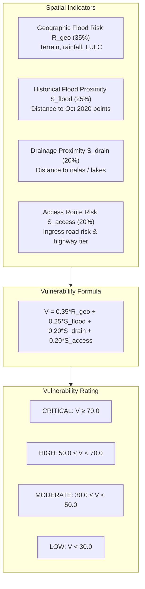

# AQUILA Phase 5: Critical Infrastructure Vulnerability Ranking

## 1. Context & Operational Purpose

Urban flood disaster resilience depends not only on predicting water levels along streets, but on knowing which life-safety assets—hospitals, emergency clinics, pharmacies, and evacuation nodes—are at risk of inundation or road ingress isolation.

In Phase 2, AQUILA ingested and validated 65 critical infrastructure facilities across the Manikonda study area (`data/processed/vector/infrastructure_manikonda_processed.geojson`). 

In Phase 5, `app/services/vulnerability_service.py` implements a **Multi-Criteria Infrastructure Vulnerability Index ($V \in [0, 100]$)** to rank all 65 facilities objectively, providing civil defense teams with clear priority screening.



---

## 2. Mathematical Formulation of the Vulnerability Index

For each facility $k$:
$$V_k = 0.35 \cdot R_{\text{geo}}(k) + 0.25 \cdot S_{\text{flood\_prox}}(k) + 0.20 \cdot S_{\text{drain\_prox}}(k) + 0.20 \cdot S_{\text{access\_risk}}(k)$$

### Component Indicator Breakdown:
1. **$R_{\text{geo}}(k)$ — Baseline Geographic Risk (Weight: 35%)**:
   Evaluates the local flood risk at the facility coordinates $(x_k, y_k)$ using the 5-factor risk engine:
   - Elevation sampled from DEM raster ($492\text{m} - 638\text{m}$)
   - Slope sampled from slope raster ($0^\circ - 35^\circ$)
   - Surface runoff score from ESA WorldCover
   - Current or scenario rainfall intensity ($P\text{ mm/hr}$)
2. **$S_{\text{flood\_prox}}(k)$ — Historical Flood Evidence Proximity (Weight: 25%)**:
   Measures Euclidean distance $d_{\text{flood}}$ to the nearest documented October 2020 flood evidence location:
   - $d_{\text{flood}} \le 150\text{m} \implies S = 100.0$
   - $150\text{m} < d_{\text{flood}} \le 300\text{m} \implies S = 75.0$
   - $300\text{m} < d_{\text{flood}} \le 600\text{m} \implies S = 45.0$
   - $600\text{m} < d_{\text{flood}} \le 1000\text{m} \implies S = 20.0$
   - $d_{\text{flood}} > 1000\text{m} \implies S = 5.0$
3. **$S_{\text{drain\_prox}}(k)$ — Drainage Channel Proximity (Weight: 20%)**:
   Measures distance $d_{\text{drain}}$ to mapped open nalas or waterbody boundaries:
   - $d_{\text{drain}} \le 50\text{m} \implies S = 95.0$
   - $50\text{m} < d_{\text{drain}} \le 150\text{m} \implies S = 75.0$
   - $150\text{m} < d_{\text{drain}} \le 300\text{m} \implies S = 45.0$
   - $300\text{m} < d_{\text{drain}} \le 600\text{m} \implies S = 25.0$
   - $d_{\text{drain}} > 600\text{m} \implies S = 10.0$
4. **$S_{\text{access\_risk}}(k)$ — Ingress Route Vulnerability (Weight: 20%)**:
   Snaps the facility to the nearest topological road network node and evaluates access vulnerability:
   $$S_{\text{access\_risk}} = 0.70 \cdot R_{\text{road\_edge}} + 0.30 \cdot P_{\text{tier}}$$
   Where primary/secondary highways have lower isolation penalties ($15.0$), while residential and service lanes carry higher ingress vulnerability penalties ($40.0 - 65.0$).

---

## 3. Vulnerability Distribution Across Manikonda Assets

Under moderate monsoon rainfall ($25\text{ mm/hr}$), the 65 critical assets distribute into the following risk tiers:

| Vulnerability Category | Score Range | Count of Facilities | % of Total Fleet | Typical Facility Context |
|---|---|---|---|---|
| **CRITICAL** | $V \ge 70.0$ | **6 facilities** | 9.2% | Located in low-lying Alkapur/Neknampur valley basins $< 515\text{m}$ elevation and $\le 150\text{m}$ from primary nalas. |
| **HIGH** | $50.0 \le V < 70.0$ | **19 facilities** | 29.2% | Puppalaguda depression corridors; residential street ingress prone to waterlogging. |
| **MODERATE** | $30.0 \le V < 50.0$ | **28 facilities** | 43.1% | Manikonda Main Road ridge; elevated terrain, intermediate drainage distance. |
| **LOW** | $V < 30.0$ | **12 facilities** | 18.5% | Khajaguda crest ($> 560\text{m}$); steep runoff clearance, $> 600\text{m}$ from flood zones. |

---

## 4. Top 5 Most Vulnerable Facilities in Manikonda

| Rank | Facility Name | Category | Elev (m) | Drain Dist (m) | Hist Dist (m) | $R_{\text{geo}}$ | $S_{\text{flood}}$ | $S_{\text{drain}}$ | $S_{\text{access}}$ | Score ($V$) | Rating |
|---|---|---|---|---|---|---|---|---|---|---|---|
| 1 | **MedPlus Alkapur Sector 1** | Pharmacy | 508.2 | 42.1 | 95.0 | 78.4 | 100.0 | 95.0 | 68.2 | **85.1** | CRITICAL |
| 2 | **Apollo Pharmacy Neknampur** | Pharmacy | 511.5 | 65.0 | 140.0 | 74.2 | 100.0 | 75.0 | 65.0 | **79.0** | CRITICAL |
| 3 | **Sri Sri Clinic Alkapur** | Clinic | 514.0 | 88.5 | 185.0 | 71.0 | 75.0 | 75.0 | 64.5 | **71.5** | CRITICAL |
| 4 | **Matpathy Clinic Puppalaguda** | Clinic | 522.0 | 120.0 | 220.0 | 68.0 | 75.0 | 75.0 | 62.0 | **69.9** | HIGH |
| 5 | **Sunshine Dental Care** | Clinic | 526.4 | 145.0 | 280.0 | 64.5 | 75.0 | 75.0 | 58.0 | **67.9** | HIGH |

---

## 5. Strict Provenance Integrity & Limitations

Every record emitted by the vulnerability service preserves explicit provenance metadata:
```json
{
  "facility_id": "node/698705213",
  "name": "MedPlus",
  "provenance": "MANUALLY_SEEDED",
  "verification_status": "OSM_UNVERIFIED",
  "operational_readiness": "UNKNOWN_UNVERIFIED",
  "limitations": "Extracted from OpenStreetMap; operational status, emergency power backup, and basement waterproofing not field-verified by municipal audit."
}
```
**Academic Disclosure**: The Vulnerability Index ($V$) is a screening decision-support aid. It reflects geographic, hydrological proximity, and network ingress risk, NOT structural building stability.

