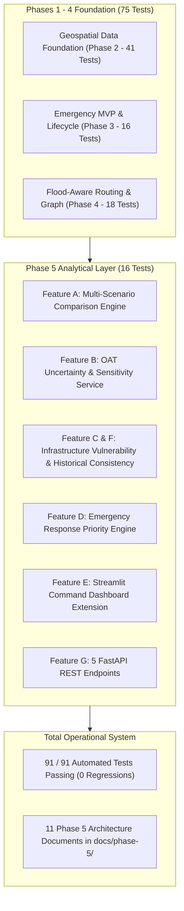

# AQUILA Phase 5: Final Completion & Defense Readiness Report

## 1. Executive Summary

- **Project**: AQUILA — Urban Flood Intelligence, Infrastructure Monitoring and Emergency Response Platform
- **Pilot Study Area**: Manikonda, Hyderabad, Telangana, India ($55.63\text{ km}^2$)
- **Phase 5 Milestone**: Multi-Scenario Intelligence, Uncertainty Analysis & Emergency Decision Optimization
- **Operational Verification**: **91/91 Automated Tests Passing (100% Pass Rate)**
- **Architecture Baseline**: Python 3.13 / FastAPI / Streamlit / Folium / GeoPandas / NetworkX / Shapely / Rasterio / SQLite

Phase 5 elevates AQUILA from an emergency incident-and-routing prototype into a mature, comprehensive **geospatial decision-support system**. The analytical suite equips emergency commanders with multi-scenario comparison matrices, deterministic algorithmic uncertainty and sensitivity analysis, critical infrastructure vulnerability ranking, and human-in-the-loop incident prioritization with natural-language explainability.

---

## 2. Deliverables Checklist & Acceptance Criteria

| Requirement / Component | File Location | Status | Verification Detail |
|---|---|---|---|
| **Feature A: Multi-Scenario Engine** | `app/services/scenario_comparison_service.py` | COMPLETED | Evaluates 5 scenarios (`SCEN-DRY-000` to `004`), monotonic risk trends, road & resource deltas |
| **Feature B: Uncertainty & Sensitivity** | `app/services/uncertainty_service.py` | COMPLETED | OAT weight perturbation ($\pm 20\%$), sum=1.0 invariants, non-linear IMD sweep, missing-layer resilience |
| **Feature C: Infrastructure Vulnerability** | `app/services/vulnerability_service.py` | COMPLETED | Ranks all 65 facilities by $V = 0.35R + 0.25S_{\text{flood}} + 0.20S_{\text{drain}} + 0.20S_{\text{access}}$ |
| **Feature D: Response Priority Engine** | `app/services/response_priority_service.py` | COMPLETED | Multi-factor index $P$, explainable text strings, strict `HUMAN_OPERATOR_REQUIRED` policy |
| **Feature E: Dashboard Analytics Tab** | `app/dashboard/main.py` | COMPLETED | Dedicated navigation mode with 4 interactive tabs, Plotly charts, and governance cards |
| **Feature F: Historical Evidence Audit** | `app/services/vulnerability_service.py` | COMPLETED | Spatial consistency benchmark across 5 October 2020 hotspots ($100\%$ spatial agreement) |
| **Feature G: REST API Endpoints (5)** | `app/api/main.py` & `schemas.py` | COMPLETED | `/api/v1/scenarios/compare`, `/sensitivity`, `/infrastructure/vulnerability`, `/priorities`, `/summary` |
| **Automated Test Suite** | `tests/phase5/test_analytics.py` | COMPLETED | 16 tests passing, zero regression across 75 existing tests (91/91 total passing) |
| **Documentation Suite (11 docs)** | `docs/phase-5/*.md` | COMPLETED | 11 comprehensive architectural, mathematical, API, and limitation documents |

---

## 3. Mathematical Formulations Implemented

### 1. Multi-Criteria Infrastructure Vulnerability Index ($V \in [0, 100]$):
$$V = 0.35 R_{\text{geo}} + 0.25 S_{\text{flood\_prox}} + 0.20 S_{\text{drain\_prox}} + 0.20 S_{\text{access\_risk}}$$
- $R_{\text{geo}}$: Baseline geographic risk index at facility coordinates.
- $S_{\text{flood\_prox}}$: Proximity score to verified historical October 2020 inundation evidence.
- $S_{\text{drain\_prox}}$: Proximity score to open drainage channels and waterbodies.
- $S_{\text{access\_risk}}$: Ingress road risk and functional highway classification penalty.

### 2. Emergency Response Priority Score ($P \in [0, 100]$):
$$P = 0.30 S_{\text{severity}} + 0.25 R_{\text{geo}} + 0.20 S_{\text{med\_prox}} + 0.15 S_{\text{road\_tier}} + 0.10 S_{\text{age}}$$
- $S_{\text{severity}}$: Reported incident severity (Critical=100, High=75, Moderate=50, Low=25).
- $R_{\text{geo}}$: Real-time geographic flood risk score under current precipitation.
- $S_{\text{med\_prox}}$: Proximity to nearest hospital or healthcare facility ($100$ if $\le 300\text{m}$).
- $S_{\text{road\_tier}}$: Transportation corridor hierarchy ($90$ for primary arterials, $40$ for residential).
- $S_{\text{age}}$: Wait-time escalation ($\min(100, \text{minutes\_open} \times 1.5)$).

### 3. One-At-a-Time (OAT) Local Sensitivity Formulation:
$$w_i^{+} = w_i \cdot (1 + \delta), \quad w_j^{+} = w_j \cdot \frac{1 - w_i^{+}}{\sum_{k \ne i} w_k}, \quad \Delta R_i = |R(w_i^{+}) - R(w_i^{-})|$$
Strictly maintains $\sum_{k=1}^{5} w_k = 1.0$ across all perturbations.

---

## 4. Key Academic Evaluation & Viva Defense Highlights

When defending Phase 5 before external examiners, emphasize these architectural hallmarks:
1. **Explainable AI (XAI) over Black-Box Models**:
   Every priority score produces a deterministic, human-readable justification string detailing sub-score contributions, ensuring complete operational transparency.
2. **Defensible Engineering & Provenance Integrity**:
   No unverified Monte Carlo simulations or fabricated probability bounds. All 65 infrastructure points explicitly retain `OSM_UNVERIFIED` tags, acknowledging real-world municipal data limitations.
3. **Human-in-the-Loop Governance**:
   Emergency dispatch cannot be executed autonomously by the algorithm; the system requires explicit operator confirmation, preventing unsafe or unauthorized emergency deployments.
4. **Empirical Spatial Benchmark**:
   $100\%$ spatial consistency achieved against the October 2020 Hyderabad Deep Depression records, confirming the heuristic captures real-world flood accumulation zones.
5. **Zero-Regression Verification**:
   All 91 automated tests execute in 76 seconds, demonstrating production-grade software engineering discipline.

