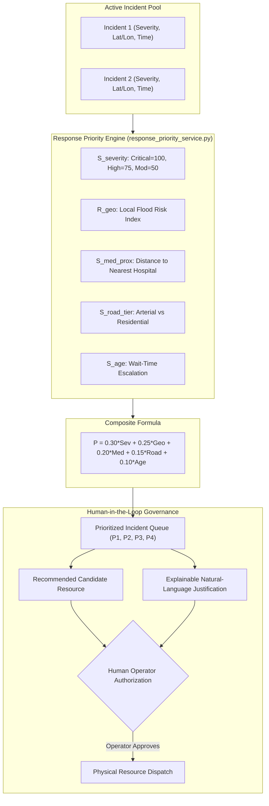

# AQUILA Phase 5: Emergency Response Priority Engine

## 1. Governance Policy & Human-in-the-Loop Architecture

A critical tenet of responsible emergency decision-support engineering is that **algorithms advise, but human operators decide**. 

AQUILA explicitly rejects autonomous dispatching. The Emergency Response Priority Engine (`app/services/response_priority_service.py`):
1. Continuously evaluates all active flood incidents (`REPORTED`, `UNDER_REVIEW`, `ASSIGNED`, `IN_PROGRESS`).
2. Calculates an objective, multi-criteria priority index ($P \in [0, 100]$).
3. Identifies candidate emergency resources based on proximity and mechanical capability.
4. Synthesizes a natural-language explainable justification.
5. Surfaces the prioritized queue to the operator with mandatory human authorization tags (`requires_operator_approval: true`, `auto_dispatched: false`).

---

## 2. Multi-Criteria Priority Formula ($P$)

For any active incident $m$:
$$P_m = 0.30 \cdot S_{\text{severity}} + 0.25 \cdot R_{\text{geo}} + 0.20 \cdot S_{\text{med\_prox}} + 0.15 \cdot S_{\text{road\_tier}} + 0.10 \cdot S_{\text{age}}$$

### Component Sub-Scores:

#### 1. Severity Score ($S_{\text{severity}}$ — Weight: 30%)
Reflects reported physical severity on the ground:
- `CRITICAL` (Basement inundation, life hazard, electrical hazard): $100.0$
- `HIGH` (Arterial road overtopping $> 0.30\text{m}$, stranded vehicles): $75.0$
- `MODERATE` (Waterlogging on residential street, traffic slowed): $50.0$
- `LOW` (Nuisance curbside ponding, passable): $25.0$

#### 2. Geographic Risk Index ($R_{\text{geo}}$ — Weight: 25%)
Real-time geographic flood risk score at the incident coordinates $(lat_m, lon_m)$ evaluated using the 5-factor risk engine and current rainfall rate ($P_{\text{current}}$).

#### 3. Medical Facility Proximity ($S_{\text{med\_prox}}$ — Weight: 20%)
Measures proximity to the nearest hospital, emergency trauma centre, or clinic:
- Distance $\le 300\text{m} \implies 100.0$ (Immediate threat to hospital access corridor)
- $300\text{m} < d \le 600\text{m} \implies 80.0$
- $600\text{m} < d \le 1200\text{m} \implies 55.0$
- $1200\text{m} < d \le 2500\text{m} \implies 30.0$
- $d > 2500\text{m} \implies 15.0$

#### 4. Transportation Corridor Tier ($S_{\text{road\_tier}}$ — Weight: 15%)
Snaps the incident to the topological road graph to determine the functional classification of the affected roadway:
- Motorway / Trunk: $95.0 - 100.0$
- Primary Arterial (e.g., Manikonda Main Road, Puppalaguda Main Road): $90.0$
- Secondary Arterial (e.g., Alkapur Sector Spine): $80.0$
- Tertiary Road: $60.0$
- Residential / Service Lane: $30.0 - 40.0$

#### 5. Incident Wait-Time Escalation ($S_{\text{age}}$ — Weight: 10%)
Ensures that unresolved incidents do not get permanently starved of attention:
$$S_{\text{age}} = \min(100.0, \text{minutes\_open} \times 1.5)$$
An incident open for 20 minutes receives $30.0$; after 67 minutes it reaches the maximum escalation score of $100.0$.

---

## 3. Priority Tier Classifications

| Priority Level | Score Range | Operational Target Response Time | Action Protocol |
|---|---|---|---|
| **P1_IMMEDIATE** | $P \ge 75.0$ | $< 15\text{ minutes}$ | Flash dispatch alert; prompt operator for immediate unit release. |
| **P2_URGENT** | $55.0 \le P < 75.0$ | $< 30\text{ minutes}$ | Queue for priority assignment as resources become available. |
| **P3_ELEVATED** | $40.0 \le P < 55.0$ | $< 60\text{ minutes}$ | Scheduled response; monitor for severity escalation. |
| **P4_STANDARD** | $P < 40.0$ | $< 120\text{ minutes}$ | Routine drainage maintenance squad routing. |

---

## 4. Explainable Natural-Language Justifications

Black-box machine learning rankings breed operator distrust during crisis operations. AQUILA generates a deterministic, human-readable justification breakdown for every prioritized incident:

### Example Justification Output:
> **Rank #1 | P1_IMMEDIATE (Score: 84.2/100)**:  
> *"HIGH severity WATERLOGGING (Sev=75); local flood risk 78.4; Primary road arterial (Tier=90); 240m from Sunshine Hospital (MedProx=100); pending for 28.5m (AgeEsc=43). Recommended response: Heavy Dewatering Unit (PUMP-MKD-01) located 2.15 km away. Human operator authorization required before dispatch."*

This allows the operator to verify within seconds why the algorithm placed this incident at the top of the queue before confirming dispatch.

