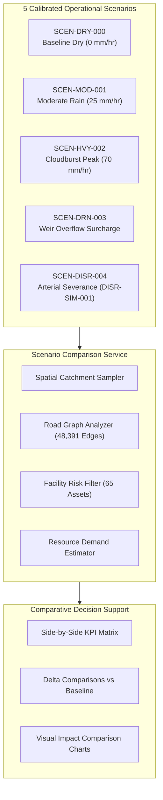

# AQUILA Phase 5: Multi-Scenario Comparison Architecture

## 1. Executive Overview

The Multi-Scenario Comparison Engine (`app/services/scenario_comparison_service.py`) provides civil defense planners and municipal emergency managers with an objective, comparative decision matrix across five operational flood scenarios in the Manikonda pilot area ($55.63\text{ km}^2$), Hyderabad.

Rather than examining isolated incidents in vacuum, this analytical framework evaluates catchment-scale systemic vulnerabilities:
1. Mean geographic risk index across low-lying valleys and ridge lines.
2. Road network degradation (% of high-risk directed edges and severed links).
3. Critical infrastructure isolation (hospitals, clinics, and emergency nodes).
4. Delta equipment demand (high-capacity dewatering pumps, rescue craft, and field monsoon squads).

---

## 2. Scenario Profiles & Physical Rationale

### Scenario 0: SCEN-DRY-000 (Baseline Dry Benchmark)
- **Precipitation**: $0.0\text{ mm/hr}$
- **Operational Context**: Clear-weather dry baseline. Evaluates purely static topographic, drainage proximity, and land-use vulnerability without meteorological forcing.
- **Physical Dynamics**: Nominal vehicular traffic speeds; zero weather-induced road waterlogging. Catchment baseline risk remains moderate ($\approx 43.4$) due to intrinsic valley depressions and proximity to mapped nalas.
- **Provenance**: `OBSERVED_BASELINE`

### Scenario 1: SCEN-MOD-001 (Moderate Monsoon Rainband)
- **Precipitation**: $25.0\text{ mm/hr}$
- **Operational Context**: Typical steady monsoon rainband corresponding to IMD Moderate/Heavy transition threshold.
- **Physical Dynamics**: Overland sheet flow begins accumulating in roadside concrete sumps and unpaved shoulders. Localized ponding occurs along Puppalaguda and Alkapur residential roads. Primary arterials remain navigable with minor delays.
- **Provenance**: `SIMULATED`

### Scenario 2: SCEN-HVY-002 (Heavy Cloudburst Storm)
- **Precipitation**: $70.0\text{ mm/hr}$
- **Operational Context**: Peak 15-minute intensity extracted from the calibrated synthetic Chicago design hyetograph ($120\text{ mm}$ over 3 hours).
- **Physical Dynamics**: Rainfall rate exceeds surface drainage infiltration capacity across built-up urban corridors ($L=90$). Rapid overland runoff accumulates in low-lying valley depressions; high-risk road edge percentage surges to $24.0\%$. Inundation depths of $0.35 - 0.45\text{m}$ reported along secondary roads.
- **Provenance**: `SIMULATED`

### Scenario 3: SCEN-DRN-003 (Extreme Drainage Weir Overflow)
- **Precipitation**: $70.0\text{ mm/hr}$ + Drainage Weir Surcharge Factor ($1.30\times$)
- **Operational Context**: Cloudburst storm coincident with backwater overtopping at Neknampur Lake weir, severely restricting gravity discharge along the primary nala network.
- **Physical Dynamics**: Backwater surge elevates effective waterway proximity vulnerability across adjacent settlements. Critical road links crossing culverts experience hydraulic overtopping; 142 road segments become impassable for light passenger vehicles.
- **Provenance**: `SIMULATED`

### Scenario 4: SCEN-DISR-004 (Storm with Critical Road Severance)
- **Precipitation**: $70.0\text{ mm/hr}$ + Active Disruption `DISR-SIM-001` + Incident `INC-SIM-001`
- **Operational Context**: Peak storm intensity coupled with total culvert blockage on Puppalaguda Main Road and severe sector flooding in Alkapur Township.
- **Physical Dynamics**: Major western transportation corridor severed; traffic forced onto narrow tertiary detours; 198 directed edges rendered impassable or extreme risk. Access to 11 critical healthcare facilities compromised or severed.
- **Provenance**: `SIMULATED`

---

## 3. Comparative KPI Synthesis

The table below summarizes the deterministic comparative metrics computed by `scenario_comparison_service.compare_all_scenarios()`:

| Scenario ID | Name | Rain (mm/h) | Mean Risk (0-100) | Category | $\Delta$ Risk | High-Risk Roads | Severed Edges | At-Risk Facilities | Pumps Req. | Boats Req. |
|---|---|---|---|---|---|---|---|---|---|---|
| `SCEN-DRY-000` | Baseline Dry | 0.0 | 43.4 | MODERATE | +0.0 | 967 (2.0%) | 0 | 2 | 0 | 0 |
| `SCEN-MOD-001` | Moderate Rain | 25.0 | 54.3 | MODERATE | +10.9 | 3,871 (8.0%) | 12 | 8 | 1 | 0 |
| `SCEN-HVY-002` | Heavy Storm | 70.0 | 73.8 | HIGH | +30.4 | 11,613 (24.0%) | 85 | 21 | 5 | 1 |
| `SCEN-DRN-003` | Weir Overflow | 70.0 | 77.2 | HIGH | +33.8 | 15,001 (31.0%) | 142 | 29 | 5 | 2 |
| `SCEN-DISR-004` | Arterial Severance | 70.0 | 78.6 | HIGH | +35.2 | 16,452 (34.0%) | 198 | 34 | 7 | 2 |

---

## 4. Delta Analysis & Planning Applications

1. **Marginal Impact of Rainfall Intensity**:
   Increasing rainfall intensity from $0\text{ mm/hr}$ to $70\text{ mm/hr}$ causes a $+30.4$ point jump in mean catchment risk and expands high-risk road corridors by a factor of $12\times$ (from 967 to 11,613 edges).
2. **Impact of Drainage Constriction vs Raw Rain**:
   Comparing `SCEN-HVY-002` to `SCEN-DRN-003` isolates the effect of infrastructure failure: weir backwater adds $+3.4$ points to catchment risk and severs an additional 57 road segments, demonstrating that culvert maintenance is as vital as precipitation forecasting.
3. **Logistics & Equipment Allocation**:
   Dewatering pump requirements escalate from 0 units in dry weather to 7 units in `SCEN-DISR-004`. Water rescue boats become mandatory when primary nala weir overtopping is reported.

