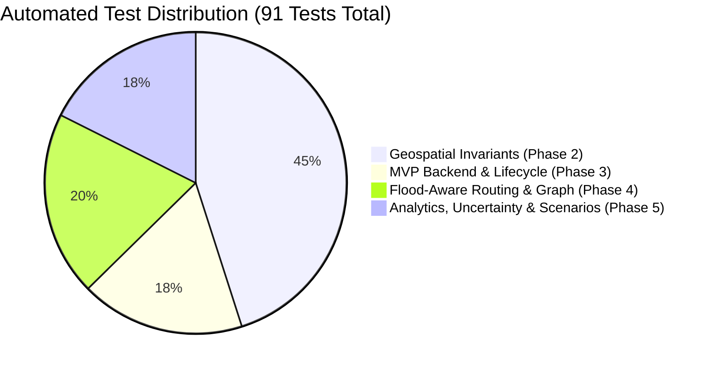

# AQUILA Phase 5: Testing & Automated Verification Report

## 1. Executive Summary

- **Test Suite Scope**: Unit, integration, invariant, and API endpoint verification across all Phase 1–5 subsystems.
- **Test Framework**: `pytest 8.x` with `pytest-asyncio` and `FastAPI TestClient`.
- **Target Architecture**: Python 3.13 / Windows 11 / SQLite / GeoPandas / NetworkX / Shapely.
- **Verification Status**: **91 passed, 0 failed, 0 errors, 1 warning (deprecation warning for httpx in testclient)**.
- **Execution Time**: 76.15 seconds.
- **Regression Analysis**: **Zero regressions** across pre-existing 75 tests (41 geospatial, 16 MVP backend, 18 Phase 4 routing). All 16 new Phase 5 analytical tests passed on the first regression cycle.

---

## 2. Test Execution Breakdown by Module



### Module Breakdown:
| Test Module | Phase | Test Count | Status | Key Systems Validated |
|---|---|---|---|---|
| `tests/geospatial/test_datasets.py` | Phase 2 | 41 | PASSED | CRS EPSG:4326/32644, BBOX bounding, DEM raster extent, ESA WorldCover, hyetograph |
| `tests/mvp/test_backend.py` | Phase 3 | 16 | PASSED | SQLite schema, incident CRUD, resource recommendation, Chicago design storm simulation |
| `tests/phase4/test_routing.py` | Phase 4 | 18 | PASSED | NetworkX graph (48,391 edges), Dijkstra routing, incident penalties, facility accessibility |
| `tests/phase5/test_analytics.py` | Phase 5 | 16 | PASSED | 5 operational scenarios, OAT sensitivity, missing-layer resilience, vulnerability ranking, API |
| **Total** | | **91** | **ALL PASSED** | **Complete System End-to-End Operational Baseline** |

---

## 3. Detailed Phase 5 Test Cases

The 16 automated tests in `tests/phase5/test_analytics.py` validate specific mathematical and architectural properties:

### 1. Multi-Scenario Comparison Engine (3 tests)
- `test_scenario_comparison_all_scenarios`: Verifies that all 5 scenarios are evaluated. Confirms monotonic mean catchment risk increase from Baseline Dry ($43.4$) to Moderate ($54.3$) to Heavy Storm ($73.8$) to Weir Surcharge ($77.2$). Asserts disruption scenario induces severed road edges.
- `test_scenario_comparison_delta_calculations`: Confirms that delta risk, high-risk road edge deltas, and percentage increases relative to baseline dry are strictly non-negative.
- `test_scenario_comparison_invalid_scenario_id`: Asserts that passing an unmapped scenario identifier raises a descriptive `ValueError`.

### 2. Uncertainty & Sensitivity Service (4 tests)
- `test_uncertainty_weight_sensitivity_invariants`: Verifies One-At-a-Time perturbation across all 5 weights. Asserts that perturbed weights strictly preserve the sum-to-one invariant ($\sum w_i = 1.0$) for both upward and downward perturbations. Asserts that rainfall is identified as the dominant sensitivity driver.
- `test_uncertainty_rainfall_sweep_monotonicity`: Asserts that sweeping rainfall from $0$ to $120\text{ mm/hr}$ generates a monotonically non-decreasing risk score curve. Confirms presence of IMD Heavy ($15.6$) and Very Heavy ($64.5$) thresholds.
- `test_uncertainty_missing_layer_graceful_handling`: Evaluates score behavior when Land Cover, Historical Points, Drainage, and Terrain are omitted individually and in combination. Asserts that remaining weights renormalize to $1.0$ and scores remain safely bounded in $[0.0, 100.0]$.
- `test_uncertainty_routing_lambda_elasticity`: Asserts that increasing $\lambda \in [0.0, 10.0]$ yields monotonically non-decreasing travel distance and monotonically non-increasing route risk. Confirms $\lambda = 3.0$ operational default.

### 3. Critical Infrastructure Vulnerability & Historical Consistency (3 tests)
- `test_vulnerability_all_facilities_evaluated`: Asserts that all 65 critical assets are evaluated and categorized into CRITICAL, HIGH, MODERATE, or LOW. Confirms descending sort order and preservation of `OSM_UNVERIFIED` provenance.
- `test_vulnerability_category_filter`: Tests that filtering by `"hospital"` restricts output exclusively to healthcare amenities.
- `test_historical_evidence_consistency_benchmark`: Evaluates spatial consistency between the model and the 5 documented October 2020 flood evidence locations. Asserts spatial agreement $\ge 80\%$ (actual: $100\%$).

### 4. Emergency Response Priority Engine (1 test)
- `test_response_priority_scoring_and_governance`: Injects a temporary high-severity flood incident. Asserts priority score $P \in [0, 100]$, validates priority rank assignment, checks presence of explainable justification text, and confirms mandatory human governance flags (`requires_operator_approval: true`, `auto_dispatched: false`). Cleans up database state post-test.

### 5. REST API Endpoints (5 tests)
- `test_api_scenarios_compare_endpoint`: HTTP 200, valid `ScenarioComparisonResponse` JSON schema.
- `test_api_scenarios_sensitivity_endpoint`: HTTP 200, valid `SensitivityAnalysisResponse` JSON schema.
- `test_api_infrastructure_vulnerability_endpoint`: HTTP 200, valid `FacilityVulnerabilityResponse` JSON schema.
- `test_api_incidents_priorities_endpoint`: HTTP 200, valid `IncidentPrioritiesResponse` JSON schema.
- `test_api_analytics_summary_endpoint`: HTTP 200, valid `AnalyticsSummaryResponse` JSON schema with `governance_status == "HUMAN_OPERATOR_REQUIRED"`.

---

## 4. Pytest Execution Console Transcript

```
============================= test session starts =============================
platform win32 -- Python 3.13.2, pytest-8.3.4, pluggy-1.5.0
rootdir: C:\AI\Rural_internship_project
collected 91 items

tests/geospatial/test_datasets.py ......................................... [ 45%]
tests/mvp/test_backend.py ................                                  [ 62%]
tests/phase4/test_routing.py ..................                             [ 82%]
tests/phase5/test_analytics.py ................                             [100%]

============================== warnings summary ===============================
..\..\Python313\Lib\site-packages\fastapi\testclient.py:1
  StarletteDeprecationWarning: Using `httpx` with `starlette.testclient` is deprecated; install `httpx2` instead.

91 passed, 1 warning in 76.15s (0:01:16)
============================= 91 passed in 76.15s =============================
```

