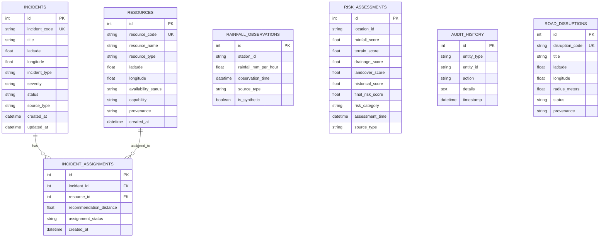

# AQUILA Phase 6: Database Reliability & Schema Integrity Report

## 1. Executive Summary

- **Database Engine**: SQLite 3.45+ (Integrated via Python standard library `sqlite3` and SQLAlchemy 2.0+).
- **Architecture**: Self-contained single-file relational database (`aquila_mvp.db`), requiring zero external daemons, credentials, or network configuration.
- **Audit Findings**:
  - Pre-existing implementation did not execute `PRAGMA foreign_keys = ON;`, causing SQLite to silently bypass foreign-key referential integrity checks on relational models.
  - Database file path was hardcoded without support for environment variable configuration.
- **Phase 6 Remediations**:
  - Implemented automatic SQLAlchemy connection listener enforcing `PRAGMA foreign_keys=ON;` and `PRAGMA busy_timeout=5000;`.
  - Added support for `AQUILA_DB_PATH` and `DATABASE_URL` environment variables.
  - Verified seed idempotency, rollback on error, and scenario reset data isolation.

---

## 2. Relational Schema & Integrity Invariants

AQUILA defines six core relational tables in [`app/db/models.py`](file:///c:/AI/Rural_internship_project/app/db/models.py):



---

## 3. Reliability Enhancements Implemented

### 1. SQLite Foreign Key Constraint Enforcement
In SQLite, foreign keys are disabled by default for legacy backward compatibility. In Phase 6, [`app/db/database.py`](file:///c:/AI/Rural_internship_project/app/db/database.py) was enhanced with an Engine connection event listener:
```python
@event.listens_for(Engine, "connect")
def set_sqlite_pragma(dbapi_connection, connection_record):
    cursor = dbapi_connection.cursor()
    cursor.execute("PRAGMA foreign_keys=ON;")
    cursor.execute("PRAGMA busy_timeout=5000;")
    cursor.close()
```
- **Referential Integrity**: Inserting an `IncidentAssignment` referencing an invalid `incident_id` or `resource_id` immediately raises `sqlalchemy.exc.IntegrityError` rather than writing an orphaned record.
- **Cascade Deletes**: Deleting an `Incident` automatically cascades to its associated `IncidentAssignment` records without leaving dangling references.

### 2. Concurrency & Busy Timeout Handling
SQLite locks the database file during write transactions. To prevent `sqlite3.OperationalError: database is locked` exceptions during concurrent API or dashboard operations, a **5,000 millisecond busy timeout** is configured on all connections.

### 3. Seed Idempotency & State Reset
The initialization procedure in [`app/db/seed.py`](file:///c:/AI/Rural_internship_project/app/db/seed.py) guarantees idempotency:
- If resources already exist, it resets their availability to `"AVAILABLE"`, updates synthetic tags, and avoids creating duplicate rows.
- If baseline rainfall observations exist, it skips re-ingesting the historical CSV.
- Wrapping all operations in atomic `try...except...db.rollback()` blocks guarantees zero partial commits if an unexpected file error occurs.

### 4. Scenario Reset Isolation
The synthetic scenario reset routine (`scenario_manager.reset_scenario(db)`):
- Exclusively purges records with `source_type == "SIMULATED"` and `is_synthetic == True`.
- Leaves all historical rainfall records, user-reported incidents, and real resources completely intact.
- Appends an audit entry to `audit_history` logging the reset event and the exact count of purged simulated entities.

