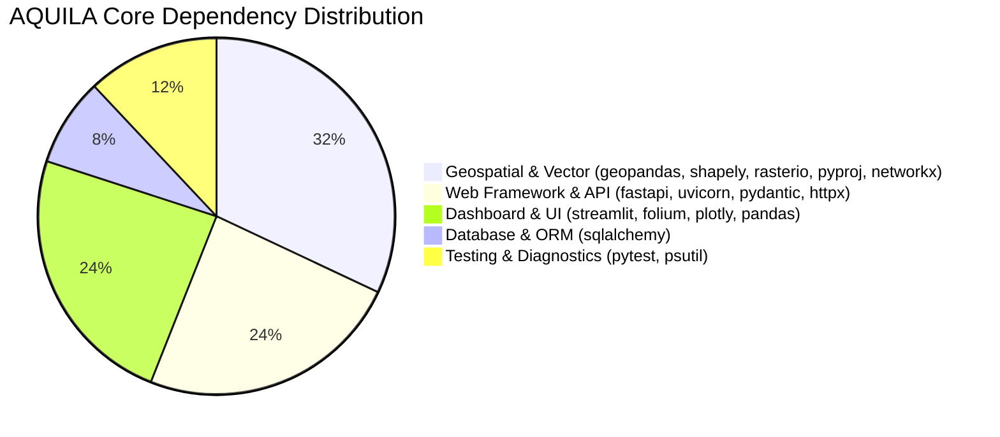

# AQUILA Phase 6: Dependency & Environment Audit

## 1. Overview & Objectives

This document details the dependency audit, runtime requirements, and environment isolation strategy for the **AQUILA Platform**.

The objective is to guarantee that any academic evaluator, student, or technical reviewer can reconstruct the exact operational runtime on Windows or Linux from scratch without encountering package conflicts or missing binary extensions.

---

## 2. Target Platform Specifications

- **Operating System**: Windows 11 (64-bit) / Windows 10 (64-bit); also compatible with Ubuntu 22.04+ LTS.
- **Python Runtime**: **Python 3.13.2 (x86_64)**
- **Architecture**: AMD64 / x86_64
- **Database Engine**: SQLite 3.45+ (Standard library `sqlite3`, zero external database daemon required)
- **C/C++ Geospatial Wheels**: Pre-compiled binary wheels for `rasterio`, `shapely`, `pyproj`, and `pyogrio` via PyPI.

---

## 3. Audited Core Dependencies vs Excluded Global Packages

During the initial audit of the workstation, 130+ packages were present in the global Python environment. AQUILA strictly isolates and requires only **26 direct packages** organized into functional clusters:



### Direct Core Dependencies:
1. **Web Framework & API**:
   - `fastapi` ($\ge 0.115.0$): High-performance asynchronous REST API framework.
   - `uvicorn` ($\ge 0.30.0$): ASGI web server.
   - `pydantic` ($\ge 2.10.0$): Strict schema validation and serialization.
   - `pydantic-settings` ($\ge 2.6.0$): Environment variable configuration management.
   - `python-multipart`: Form data parsing.
   - `httpx`: Synchronous and asynchronous HTTP client for API verification.
2. **Database & ORM**:
   - `SQLAlchemy` ($\ge 2.0.30$): Relational database toolkit and ORM.
3. **Geospatial & Network Analysis**:
   - `geopandas` ($\ge 1.0.0$): Spatial operations on vector GeoDataFrames.
   - `shapely` ($\ge 2.0.0$): Computational geometry engine (GEOS bindings).
   - `pyproj` ($\ge 3.7.0$): Cartographic projections (EPSG:4326 to EPSG:32644 UTM).
   - `rasterio` ($\ge 1.4.0$): GDAL-based raster sampling of clipped DEM and slope geotiffs.
   - `networkx` ($\ge 3.4.0$): Graph theory data structures for the 48,391-edge road topology.
   - `scipy` ($\ge 1.15.0$): Spatial indexing via `cKDTree` for nearest-neighbor snapping.
   - `numpy` ($\ge 2.0.0$): Vectorized array math.
   - `affine`: Affine transformation matrix calculations.
4. **Interactive Dashboard**:
   - `streamlit` ($\ge 1.40.0$): Reactive operational command centre.
   - `streamlit-folium` & `folium`: Leaflet.js interactive geospatial map rendering.
   - `plotly`: Responsive comparative charts, sensitivity curves, and histograms.
   - `pandas`: Tabular data processing.
5. **Configuration & Testing**:
   - `python-dotenv`: Automated `.env` parsing.
   - `PyYAML`: YAML configuration parser.
   - `pytest` ($\ge 8.2.0$): Automated unit and regression test runner.
   - `psutil`: Real-time system memory and CPU resource profiling.

### Explicitly Excluded Packages (Audited & Discarded):
The following packages were detected in the global environment but are **not** imported or used by AQUILA:
- `torch`, `torchvision`, `torchaudio`: Deep learning frameworks (AQUILA uses deterministic rule-based algorithms).
- `tensorflow`, `keras`: Neural network libraries.
- `opencv-python`, `dlib`: Computer vision libraries.
- `catboost`, `xgboost`, `shap`: Tree-based machine learning libraries.
- `transformers`, `huggingface-hub`: Large language model tooling.
- `Django`, `Flask`, `channels`: Competing web frameworks.
- `psycopg2-binary`: PostgreSQL driver (AQUILA runs self-contained SQLite).

---

## 4. Environment Artifacts

To guarantee reproducibility, three environment files are maintained in the project root:

1. [`requirements.txt`](file:///c:/AI/Rural_internship_project/requirements.txt): Pinned semantic version ranges allowing non-breaking patch updates.
2. [`requirements-lock.txt`](file:///c:/AI/Rural_internship_project/requirements-lock.txt): Exact pinned freeze of all 75 direct and transitive packages verified on Python 3.13.2.
3. [`.python-version`](file:///c:/AI/Rural_internship_project/.python-version): Pins the runtime to `3.13`.
4. [`.env.example`](file:///c:/AI/Rural_internship_project/.env.example): Complete configuration template with safe academic defaults.

---

## 5. Verified Clean Installation Procedure (Windows)

To reproduce the environment from scratch on a clean workstation:

```powershell
# 1. Clone or extract repository
cd c:\AI\Rural_internship_project

# 2. Create isolated Python 3.13 virtual environment
python -m venv venv

# 3. Activate virtual environment
.\venv\Scripts\Activate.ps1

# 4. Upgrade pip and wheel
python -m pip install --upgrade pip setuptools wheel

# 5. Install locked dependencies
pip install -r requirements-lock.txt

# 6. Initialize environment configuration
Copy-Item .env.example .env

# 7. Verify release integrity
python scripts/verify_release.py
```

