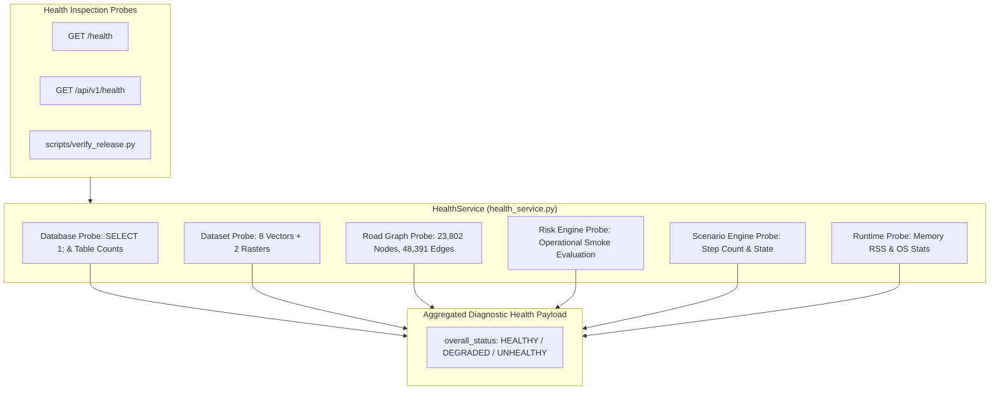

# AQUILA Phase 6: Observability, Diagnostics & Health Monitoring

## 1. Executive Summary

Operational observability in emergency decision-support software ensures that human dispatchers and technical evaluators can immediately determine whether all underlying services—spatial indexes, topological graphs, database connections, and raster datasets—are functional before relying on algorithmic outputs.

In Phase 6, AQUILA introduces:
1. **Health & Operational Diagnostics Service** ([`app/services/health_service.py`](file:///c:/AI/Rural_internship_project/app/services/health_service.py)): Probes the database, vector/raster datasets, road topology, risk engine, and scenario engine.
2. **REST Health Endpoints**: `/health` and `/api/v1/health` providing standardized JSON diagnostic payloads.
3. **Structured Application Logging** ([`app/core/logging_config.py`](file:///c:/AI/Rural_internship_project/app/core/logging_config.py)): Leveled, contextual log formatting with automatic sanitization of local filesystem paths.



---

## 2. Health Diagnostic Response Specification

### Endpoint: `GET /api/v1/health`
- **Access**: Public, unauthenticated, read-only.
- **Cache**: Live probe on each invocation.
- **HTTP Status**: `200 OK` (when overall status is `HEALTHY` or `DEGRADED`); `503 Service Unavailable` if core database is unreachable.

#### Example Production Diagnostic Payload:
```json
{
  "overall_status": "HEALTHY",
  "platform": "AQUILA — Urban Flood Intelligence & Emergency Response Platform",
  "pilot_area": "Manikonda, Hyderabad, Telangana, India",
  "version": "0.6.0",
  "timestamp": "2026-11-03T18:20:15Z",
  "environment": {
    "python_version": "3.13.2",
    "os": "Windows 11 (AMD64)",
    "memory_rss_mb": 248.5
  },
  "subsystems": {
    "database": {
      "status": "HEALTHY",
      "engine": "SQLite",
      "foreign_keys_enabled": true,
      "counts": {
        "incidents": 2,
        "resources": 6,
        "rainfall_observations": 12
      }
    },
    "geospatial_datasets": {
      "status": "HEALTHY",
      "total_required": 10,
      "available_count": 10,
      "missing_count": 0,
      "missing_files": []
    },
    "road_network_graph": {
      "status": "HEALTHY",
      "total_nodes": 23802,
      "total_directed_edges": 48391,
      "largest_connected_component_nodes": 22531,
      "connectivity_percentage": 94.7,
      "spatial_kdtree_indexed": true
    },
    "geographic_risk_engine": {
      "status": "HEALTHY",
      "operational_probe_score": 64.5,
      "formula": "0.40P + 0.20T + 0.20D + 0.10L + 0.10H"
    },
    "scenario_engine": {
      "status": "HEALTHY",
      "scenario_id": "MANI-HEAVY-001",
      "is_active": false,
      "current_step": 0,
      "total_steps": 13
    }
  }
}
```

---

## 3. Structured Logging Architecture

Implemented in [`app/core/logging_config.py`](file:///c:/AI/Rural_internship_project/app/core/logging_config.py):

### Log Format:
```
[2026-11-03T18:20:15Z] [INFO ] [ROAD_NET  ] [build_graph] Initialized road network graph: 23802 nodes, 48391 edges.
[2026-11-03T18:20:16Z] [INFO ] [DB        ] [init_db    ] Resources verified (6 records found).
[2026-11-03T18:20:17Z] [WARN ] [SECURITY  ] [get_layer  ] Layer 'invalid_name' not found. Available: ['drainage', ...]
```

### Key Logging Safeguards:
1. **Timestamp**: UTC ISO-8601 representation.
2. **Component Tag**: Dedicated subsystem identifiers (`ROAD_NET`, `DB`, `RISK_ENG`, `DISPATCH`, `SECURITY`).
3. **Path Sanitization**: Intercepts log strings and replaces host filesystem paths (e.g., `C:\AI\Rural_internship_project\...`) with relative project markers, preventing host information disclosure in stdout or application logs.
4. **Zero Secret Logging**: No passwords, database connection strings with credentials, or user-identifiable contact information are logged.

