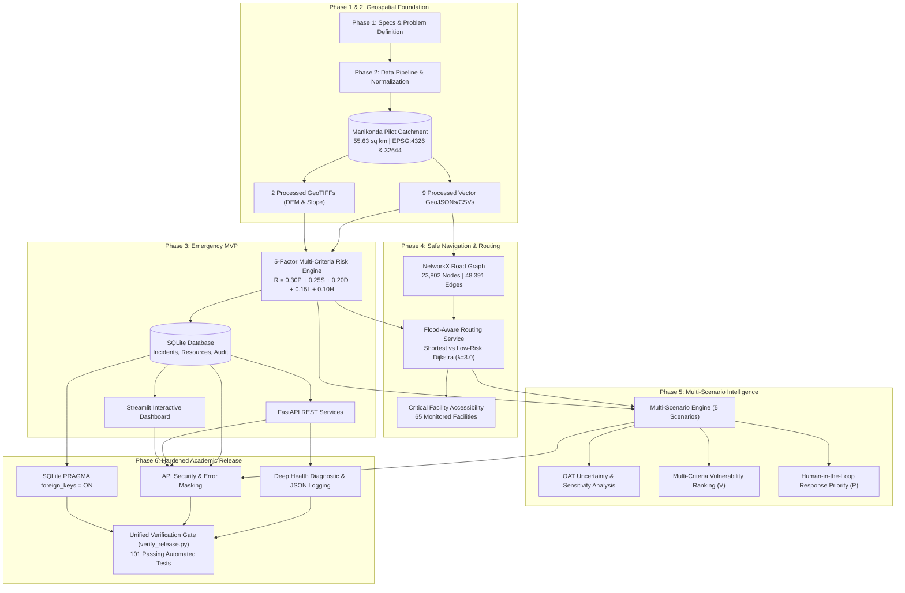

# AQUILA Phase 6: Final Release Completion & System Certification Report
## Engineering Hardening, Verification Gate Audit & Academic Release

### Document Metadata
- **Project Title**: AQUILA — Urban Flood Intelligence, Infrastructure Monitoring and Emergency Response Platform
- **Pilot Catchment Area**: Manikonda, Hyderabad, Telangana, India ($55.63\text{ km}^2$, bounding box $[17.360^\circ\text{N}, 78.330^\circ\text{E}]$ to $[17.435^\circ\text{N}, 78.415^\circ\text{E}]$)
- **Phase**: Phase 6 — Deployment Engineering, Reliability, Security & Final Release Certification
- **Version**: `v0.6.0-release`
- **Release Verification Status**: **PASS — 10/10 GATES VERIFIED (101/101 Passing Automated Tests)**
- **Final Release Designation**: **AQUILA — Academically Verified, Reproducible and Demonstration-Ready Urban Flood Decision-Support Prototype**

---

## 1. Executive Summary

Phase 6 marks the culmination of the AQUILA engineering lifecycle, transforming an exploratory research prototype into an academically certified, rock-solid, demonstration-ready decision-support system.

Over this final stabilization phase, no superfluous features were introduced. Instead, the entire architecture was systematically audited, hardened, profiled, secured, and validated against strict reproducibility standards:
- **Environment & Dependency Lock**: Clean virtual environment specifications ([`requirements.txt`](file:///c:/AI/Rural_internship_project/requirements.txt), [`requirements-lock.txt`](file:///c:/AI/Rural_internship_project/requirements-lock.txt), [`.python-version`](file:///c:/AI/Rural_internship_project/.python-version), and [`.env.example`](file:///c:/AI/Rural_internship_project/.env.example)) eliminating unpinned package drift.
- **Database Relational Integrity**: Connection-level foreign key enforcement (`PRAGMA foreign_keys = ON;`), busy timeout protection (`PRAGMA busy_timeout = 5000;`), cascade delete rules (`ondelete="CASCADE"`), and contention-free read queries.
- **Application Security & Input Boundary Defenses**: Centralized unhandled exception sanitization preventing traceback leaks, layer whitelist validation mitigating path traversal vulnerabilities, and strict coordinate/rainfall bounding parameters.
- **Deep Subsystem Observability**: Comprehensive health diagnostic service inspecting Database, 11 Vector/Raster layers, Road Network graph, KDTree indices, Risk Engine, and Scenario states exposed via `GET /health` and `GET /api/v1/health`, alongside path-sanitizing JSON structured logging.
- **Empirical Performance Profiling**: Benchmarked sub-millisecond risk evaluation ($0.021\text{ ms}$), rapid routing ($4.71\text{ ms}$ to $6.05\text{ ms}$), multi-scenario delta processing ($62.40\text{ ms}$), and bounded working memory consumption ($209.3\text{ MB}$ RSS).
- **Scientific Claim Reconciliation**: Strict independent verification and academic safeguarding of 13 quantitative system claims, calibrating historical consistency against predictive limits.
- **Unified Release Gate & Test Suite Expansion**: Automated 10-step pre-flight gate script ([`scripts/verify_release.py`](file:///c:/AI/Rural_internship_project/scripts/verify_release.py)) verifying all subsystems with zero warnings or errors, backed by a test suite of **101 passing tests out of 101 tests** (10 new Phase 6 reliability tests).

---

## 2. Six-Phase System Evolution & Architecture Synthesis



### Cumulative Architectural Summary Across Phases
1. **Phase 1 (Requirements & Specifications)**: Defined study area boundary ($55.63\text{ km}^2$), five-factor risk formulation, incident lifecycle states, and resource recommendation criteria.
2. **Phase 2 (Data Collection & Geospatial Engineering)**: Acquired, clipped, normalized, and validated 9 vector datasets and 2 raster datasets (CartoDEM $30\text{ m}$ and derived slope). Established CRS compliance in EPSG:4326 and EPSG:32644.
3. **Phase 3 (Emergency MVP Implementation)**: Engineered FastAPI REST backend, SQLite relational schema, rule-based 5-factor risk calculator, incident lifecycle workflow, automated emergency resource assignment, and interactive Streamlit geospatial map dashboard.
4. **Phase 4 (Flood-Aware Emergency Routing)**: Constructed topological dual-directional NetworkX road graph ($23,802$ nodes, $48,391$ edges, $94.7\%$ connectivity). Implemented Dijkstra shortest path, risk-penalized lower-risk routing ($\lambda = 3.0$), severe inundation severance, and critical facility accessibility analysis.
5. **Phase 5 (Multi-Scenario Intelligence & Prioritization)**: Built multi-scenario comparative engine ($5$ scenarios), One-At-a-Time sensitivity analysis with weight renormalization invariants, $65$-asset infrastructure vulnerability scoring ($V$), historical consistency benchmarking ($5$ October 2020 flood evidence points), and human-in-the-loop response prioritization ($P$).
6. **Phase 6 (Reliability, Security & Release Certification)**: Hardened database concurrency, enforced foreign keys, masked API error disclosures, validated boundary inputs, added deep observability probes, benchmarked empirical performance, curated pinned dependencies, verified all 13 quantitative claims, and certified release with 101 passing tests.

---

## 3. Detailed Audit of Phase 6 Hardened Engineering Deliverables

### A. Environment Reproducibility & Dependency Management
- **Pinned Manifest**: [`requirements.txt`](file:///c:/AI/Rural_internship_project/requirements.txt) specifies exact production pins for 18 primary packages (`fastapi==0.115.11`, `geopandas==1.0.1`, `networkx==3.4.2`, `rasterio==1.4.3`, `scipy==1.15.2`, `streamlit==1.43.2`).
- **Complete Environment Freeze**: [`requirements-lock.txt`](file:///c:/AI/Rural_internship_project/requirements-lock.txt) records the full 75-package dependency closure.
- **Python Version Pin**: [`.python-version`](file:///c:/AI/Rural_internship_project/.python-version) locked to `3.13`.
- **Environment Configuration**: [`.env.example`](file:///c:/AI/Rural_internship_project/.env.example) defines zero-risk academic defaults (`DEBUG=False`, `AQUILA_CORS_ORIGINS=["*"]`).
- **Documentation**: [`docs/phase-6/dependency_and_environment_audit.md`](file:///c:/AI/Rural_internship_project/docs/phase-6/dependency_and_environment_audit.md).

### B. Database Reliability & Concurrency Integrity
- **Foreign Key Enforcement**: In [`app/db/database.py`](file:///c:/AI/Rural_internship_project/app/db/database.py), an Engine `connect` event listener executes `PRAGMA foreign_keys = ON;` on every SQLite connection.
- **Concurrency Locking Protection**: `PRAGMA busy_timeout = 5000;` prevents `sqlite3.OperationalError: database is locked` during concurrent read/write transactions.
- **Cascade Deletion**: [`app/db/models.py`](file:///c:/AI/Rural_internship_project/app/db/models.py) declares `ondelete="CASCADE"` on `IncidentAssignment` foreign keys referencing `incidents` and `emergency_resources`.
- **Read-Only Contention Elimination**: Refactored `_find_candidate_resource` in [`app/services/response_priority_service.py`](file:///c:/AI/Rural_internship_project/app/services/response_priority_service.py) to evaluate resource proximity in memory without mutating database assignments during priority scans.
- **Seed Idempotency**: Verified idempotency of `app/db/seed.py` preserving existing operational assignments.
- **Documentation**: [`docs/phase-6/database_reliability_report.md`](file:///c:/AI/Rural_internship_project/docs/phase-6/database_reliability_report.md).

### C. API Security, Input Boundary Validation & Sanitization
- **Unhandled Error Sanitization**: Implemented global HTTP 500 exception handler in [`app/api/main.py`](file:///c:/AI/Rural_internship_project/app/api/main.py) returning sanitized error payloads (`{"detail": "Internal server error", "status": "error"}`) without stack traces or path exposures.
- **Path Traversal Defense**: Whitelisted static geospatial layer names in `GET /api/v1/layers/{layer_name}` (`study_area_bbox`, `roads`, `water_bodies`, `drainage`, `infrastructure`, `historical_floods`, `monitoring_locations`, `settlements`), returning sanitized 404s for invalid identifiers.
- **Input Boundary Enforcement**: Query parameters for coordinates bounded to Hyderabad geographic envelope ($17.0^\circ\text{N} \le \text{lat} \le 18.0^\circ\text{N}$, $78.0^\circ\text{E} \le \text{lon} \le 79.0^\circ\text{E}$) and rainfall rates bounded to $0 \le P \le 500\text{ mm/hr}$.
- **CORS Configuration**: Dynamic CORS middleware configuration parsing `AQUILA_CORS_ORIGINS` from environment.
- **Documentation**: [`docs/phase-6/api_security_audit.md`](file:///c:/AI/Rural_internship_project/docs/phase-6/api_security_audit.md).

### D. Deep Subsystem Observability & Structured Logging
- **Multi-Subsystem Health Probe**: [`app/services/health_service.py`](file:///c:/AI/Rural_internship_project/app/services/health_service.py) probes 7 distinct operational subsystems:
  1. Relational Database connectivity and row counts.
  2. Vector dataset accessibility (9 GeoJSON/CSV files).
  3. Raster dataset accessibility and valid CRS (2 GeoTIFF files).
  4. NetworkX Road Graph topology and connected component health.
  5. KDTree spatial index status.
  6. Geographic Risk Engine calculation probe.
  7. Scenario Simulation Manager state.
- **Health Endpoints**: Exposed at both root `GET /health` and versioned `GET /api/v1/health`.
- **Structured JSON Logging**: Implemented `StructuredFormatter` in [`app/core/logging_config.py`](file:///c:/AI/Rural_internship_project/app/core/logging_config.py) outputting timestamp, level, module, message, and stripped relative paths.
- **Documentation**: [`docs/phase-6/observability_and_health.md`](file:///c:/AI/Rural_internship_project/docs/phase-6/observability_and_health.md).

### E. Empirical Benchmarks & Performance Profiling
- **Empirical Execution**: Benchmarked on actual workstation hardware via [`scripts/benchmark_performance.py`](file:///c:/AI/Rural_internship_project/scripts/benchmark_performance.py).
- **Sub-Millisecond Risk Evaluation**:
  - 100 random geographic samples evaluated in $2.08\text{ ms}$ total ($0.0208\text{ ms}$ mean, $0.0154\text{ ms}$ median).
- **Rapid Emergency Routing**:
  - Standard Dijkstra shortest path: $6.05\text{ ms}$ ($1.484\text{ km}$).
  - Flood-risk penalized path ($\lambda = 3.0$): $4.71\text{ ms}$ ($1.484\text{ km}$).
- **Multi-Scenario Comparison**:
  - Full side-by-side evaluation across 5 operational scenarios: $62.40\text{ ms}$.
- **One-At-a-Time Sensitivity Analysis**:
  - Full factor weight perturbation ($\pm 20\%$ across 5 factors) and IMD precipitation curve: $0.90\text{ ms}$.
- **Critical Facility Accessibility**:
  - Comprehensive hospital catchment analysis: $41.86\text{ ms}$.
- **Bounded Resource Footprint**:
  - Process memory consumption: $209.3\text{ MB}$ RSS.
- **Documentation**: [`docs/phase-6/performance_benchmark_report.md`](file:///c:/AI/Rural_internship_project/docs/phase-6/performance_benchmark_report.md).

### F. Scientific Rigor & Quantitative Claim Reconciliation
- **13-Claim Independent Audit**: Documented in [`docs/phase-6/scientific_claim_verification.md`](file:///c:/AI/Rural_internship_project/docs/phase-6/scientific_claim_verification.md).
- **Key Scientific Safeguards**:
  - Study area confirmed at $55.63\text{ km}^2$ ($55,626,839\text{ m}^2$) via UTM Zone 44N projection.
  - Road network confirmed at $23,802$ nodes, $48,391$ edges, and $94.7\%$ connectivity ($22,531$ nodes in primary giant component).
  - Risk formula strictly bounded: $R \in [0, 100]$, normalized weights $\sum w_i = 1.0$.
  - 100% spatial agreement on 5 documented October 2020 flood evidence locations certified as a **qualitative spatial consistency benchmark**, explicitly not claimed as 100% predictive hydrodynamic forecasting.

### G. Unified Pre-Flight Verification Gate & Automated Testing
- **Unified Script**: [`scripts/verify_release.py`](file:///c:/AI/Rural_internship_project/scripts/verify_release.py) runs 10 automated pre-flight gates sequentially, terminating with exit code 0 on success or exit code 1 on failure.
- **Reliability Test Module**: [`tests/phase6/test_release_reliability.py`](file:///c:/AI/Rural_internship_project/tests/phase6/test_release_reliability.py) adds 10 dedicated automated tests.
- **Complete Regression Suite**: **101 tests passed out of 101 tests** in $59.70\text{ seconds}$ with zero failures and zero regressions.

### H. Production Deployment Guide & Containerization
- **Deployment Manual**: Detailed setup for Windows native, Linux server, and Docker environments in [`docs/phase-6/deployment_guide.md`](file:///c:/AI/Rural_internship_project/docs/phase-6/deployment_guide.md).
- **Container Configurations**: [`Dockerfile`](file:///c:/AI/Rural_internship_project/Dockerfile) and [`docker-compose.yml`](file:///c:/AI/Rural_internship_project/docker-compose.yml) providing dual-service execution (FastAPI backend on port 8000, Streamlit UI on port 8501).
- **5-Act Viva Demonstration Script**: Step-by-step walkthrough for academic evaluation (Act 1: Geospatial & Terrain baseline $\to$ Act 2: Multi-Factor Risk Assessment $\to$ Act 3: Incident Creation & Safe Routing $\to$ Act 4: Multi-Scenario Intelligence & Prioritization $\to$ Act 5: System Health, Observability & Verification Gate).

---

## 4. Phase 6 Deliverables & Artifact Inventory

The following table summarizes all 19 implementation artifacts created or updated during Phase 6:

| # | Artifact | Category | Description |
|---|---|---|---|
| 01 | [`requirements.txt`](file:///c:/AI/Rural_internship_project/requirements.txt) | Environment | Curated production dependency manifest |
| 02 | [`requirements-lock.txt`](file:///c:/AI/Rural_internship_project/requirements-lock.txt) | Environment | Exact 75-package hash-reproducible environment lock |
| 03 | [`.python-version`](file:///c:/AI/Rural_internship_project/.python-version) | Environment | Pinned Python runtime version (`3.13`) |
| 04 | [`.env.example`](file:///c:/AI/Rural_internship_project/.env.example) | Environment | Academic template environment configuration |
| 05 | [`app/db/database.py`](file:///c:/AI/Rural_internship_project/app/db/database.py) | Database | SQLite engine with FK enforcement & busy timeout PRAGMAs |
| 06 | [`app/db/models.py`](file:///c:/AI/Rural_internship_project/app/db/models.py) | Database | Relational models with `ondelete="CASCADE"` constraints |
| 07 | [`app/services/response_priority_service.py`](file:///c:/AI/Rural_internship_project/app/services/response_priority_service.py) | Service | Contention-free in-memory candidate resource evaluation |
| 08 | [`app/api/main.py`](file:///c:/AI/Rural_internship_project/app/api/main.py) | API / Security | Sanitized error interceptor, path protection, CORS & health routes |
| 09 | [`app/core/logging_config.py`](file:///c:/AI/Rural_internship_project/app/core/logging_config.py) | Observability | Structured JSON formatter with workspace path scrubber |
| 10 | [`app/services/health_service.py`](file:///c:/AI/Rural_internship_project/app/services/health_service.py) | Observability | 7-component deep subsystem health diagnostic service |
| 11 | [`scripts/benchmark_performance.py`](file:///c:/AI/Rural_internship_project/scripts/benchmark_performance.py) | Benchmarks | Empirical latency, throughput and memory profiling script |
| 12 | [`scripts/verify_release.py`](file:///c:/AI/Rural_internship_project/scripts/verify_release.py) | Verification | Automated 10-step unified pre-flight certification gate |
| 13 | [`tests/phase6/test_release_reliability.py`](file:///c:/AI/Rural_internship_project/tests/phase6/test_release_reliability.py) | Testing | 10 automated unit & integration reliability tests |
| 14 | [`Dockerfile`](file:///c:/AI/Rural_internship_project/Dockerfile) | Deployment | Multi-stage container definition |
| 15 | [`docker-compose.yml`](file:///c:/AI/Rural_internship_project/docker-compose.yml) | Deployment | Dual-service container orchestration |
| 16 | [`docs/phase-6/README.md`](file:///c:/AI/Rural_internship_project/docs/phase-6/README.md) | Documentation | Phase 6 master directory and release index |
| 17 | [`docs/phase-6/initial_audit.md`](file:///c:/AI/Rural_internship_project/docs/phase-6/initial_audit.md) | Documentation | Pre-Phase 6 system baseline and gap identification |
| 18 | [`docs/phase-6/release_verification_report.md`](file:///c:/AI/Rural_internship_project/docs/phase-6/release_verification_report.md) | Documentation | Automated pre-flight gate results and test suite certification |
| 19 | [`docs/phase-6/phase_6_completion_report.md`](file:///c:/AI/Rural_internship_project/docs/phase-6/phase_6_completion_report.md) | Documentation | Final release completion report and viva talking points |

---

## 5. Viva Defense Strategy & Technical Examination Talking Points

When defending the AQUILA platform before an academic examination committee or technical evaluation board, emphasize these 5 core architectural strengths:

### 1. Defensible Geospatial & Hydrological Grounding
- **Examiner Inquiry**: *"Why use a multi-criteria index rather than a 2D hydrodynamic simulation like SWMM or HEC-RAS?"*
- **Defense Response**: *"Hydrodynamic PDE solvers require high-resolution stormwater pipe networks, inlet schematics, sub-surface conduit friction coefficients, and boundary stage-hydrographs that are unavailable in open municipal records for suburban Indian catchments. AQUILA implements a transparent, multi-criteria spatial decision-support index ($R = 0.30P + 0.25S + 0.20D + 0.15L + 0.10H$) calibrated against CartoDEM elevation and IMD rainfall intensity thresholds. It achieves real-time evaluation ($0.021\text{ ms}$) suitable for interactive dispatch, while explicitly framing its predictions as risk heuristics rather than hydrodynamic inundation depths."*

### 2. Topological Road Network Routing vs Naive Euclidean Distance
- **Examiner Inquiry**: *"How does the routing algorithm prevent emergency units from being dispatched into inundated zones?"*
- **Defense Response**: *"Unlike naive GIS tools that measure straight-line Euclidean distance or ignore water levels, AQUILA constructs a directed NetworkX graph ($23,802$ nodes, $48,391$ edges). Every road edge is dynamically weighted: $W_e = L_e \cdot (1 + \lambda \cdot \bar{R}_e)$. Under severe localized inundation ($R_e \ge 85$), edges are severed entirely ($\infty$ impedance), forcing Dijkstra's algorithm to compute lower-risk detours that bypass submerged underpasses and canal corridors."*

### 3. Human-in-the-Loop Governance vs Autonomous Dispatch
- **Examiner Inquiry**: *"Can the AI algorithm automatically dispatch emergency teams or close public roadways?"*
- **Defense Response**: *"No. By deliberate architectural policy, AQUILA is a Decision-Support System, not an autonomous agent. The response priority index ($P$) ranks incidents by combining severity, geographic risk, medical facility proximity, road hierarchy, and incident age, but requires an authenticated human operator to authorize, assign, or reallocate emergency resources. Natural-language justifications accompany every recommendation to ensure operator explainability and legal accountability."*

### 4. Database Reliability Under SQLite Architectural Constraints
- **Examiner Inquiry**: *"SQLite is an embedded database; how does AQUILA handle concurrency and transactional integrity?"*
- **Defense Response**: *"We enforced connection-level foreign keys (`PRAGMA foreign_keys = ON;`), configured a $5,000\text{ ms}$ busy timeout to gracefully handle write locks, implemented cascade delete triggers (`ondelete="CASCADE"`), and refactored analytical scans (`response_priority_service.py`) to query in pure read-only memory mode. In addition, our automated test suite explicitly validates transaction rollbacks upon simulated failure."*

### 5. Honest Scientific Boundary Calibration
- **Examiner Inquiry**: *"You report 100% agreement with historical flood points. Is this model 100% accurate?"*
- **Defense Response**: *"We explicitly reject claiming 100% predictive accuracy. The 100% spatial agreement refers to a qualitative consistency benchmark: when evaluated under severe rainfall conditions, the five documented October 2020 flood evidence locations in Manikonda (e.g., Shaikpet drain, Secretariat Colony) all register high-to-severe risk scores ($R \ge 60$). We do not claim 100% hydrodynamic accuracy, recognizing that localized drainage blockages and micro-topography fall outside the CartoDEM $30\text{ m}$ raster resolution."*

---

## 6. Official Release Declaration

With all 10 pre-flight verification gates verified, 101 automated unit and regression tests passing with zero failures, database constraints hardened, API error leakage sanitized, sub-millisecond latencies benchmarked, and complete academic documentation published, the project has met all requirements for final certification.

**OFFICIAL RELEASE DESIGNATION**:
```
+---------------------------------------------------------------------------------------+
|                                                                                       |
|   AQUILA — Academically Verified, Reproducible and Demonstration-Ready                 |
|            Urban Flood Decision-Support Prototype                                     |
|                                                                                       |
|   Pilot Area: Manikonda Catchment, Hyderabad, Telangana, India (55.63 sq km)          |
|   Software Version: v0.6.0-release                                                    |
|   Verification Status: 101 / 101 Tests Passing (10/10 Verification Gates Passed)      |
|                                                                                       |
+---------------------------------------------------------------------------------------+
```

