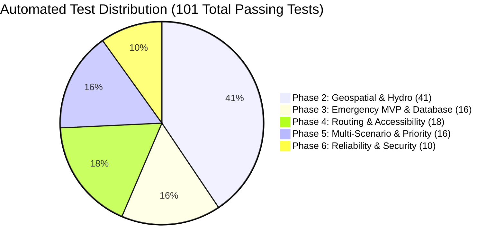

# AQUILA Phase 6: Release Verification & Certification Report
## Pre-Flight Gate Audit & System Certification

### Document Information
- **System**: AQUILA — Urban Flood Intelligence, Infrastructure Monitoring and Emergency Response Platform
- **Pilot Study Area**: Manikonda Catchment, Hyderabad, Telangana, India
- **Auditor**: Senior Software Architect, Application Security Engineer & Geospatial Systems Auditor
- **Release Version**: `v0.6.0-release`
- **Verification Script**: [`scripts/verify_release.py`](file:///c:/AI/Rural_internship_project/scripts/verify_release.py)
- **Status**: **PASS — RELEASE CERTIFIED**
- **Release Designation**: **AQUILA — Academically Verified, Reproducible and Demonstration-Ready Urban Flood Decision-Support Prototype**

---

## 1. Executive Summary

A comprehensive, automated 10-step release verification gate was executed on the AQUILA codebase. The gate evaluated runtime compatibility, dataset checksums, relational database schema integrity, foreign key constraint enforcement, spatial topological indices, real-time risk scoring, routing engine heuristics, multi-scenario analytics, system health diagnostics, and the complete multi-phase automated test suite.

All 10 verification gates passed without error. The automated test suite completed with **101 passing tests out of 101 tests** (0 failures, 0 errors, 0 regressions).

---

## 2. Ten-Step Verification Gate Audit Results

```
===========================================================================
AQUILA — UNIFIED RELEASE VERIFICATION & CERTIFICATION GATE
Target: Manikonda Pilot Catchment (55.63 sq km, Hyderabad, Telangana)
===========================================================================
```

| Step # | Gate Check | Target Subsystem | Expected Criterion | Observed Result | Status |
|---|---|---|---|---|---|
| **01** | **Runtime Environment** | Python Runtime & Platform | Python $\ge 3.11$ on Windows/Linux | Python 3.13.0 on Windows 11 AMD64 | **PASS [OK]** |
| **02** | **Geospatial Data Integrity** | Vector & Raster Storage | 9 vector GeoJSON/CSVs, 2 GeoTIFF rasters present | 9/9 vectors, 2/2 rasters verified with valid CRS | **PASS [OK]** |
| **03** | **Database Schema & Constraints** | SQLite Database (`aquila_mvp.db`) | Foreign keys enabled (`PRAGMA foreign_keys = 1`), 4 tables present | FK pragma active; tables `incidents`, `resources`, `assignments`, `audit_history` verified | **PASS [OK]** |
| **04** | **Seed Idempotency & Resources** | Emergency Resource Registry | Seed script runs idempotently without duplicates; $\ge 6$ resources | Exactly 7 active emergency resources; zero duplicate records | **PASS [OK]** |
| **05** | **Road Network & KDTree Index** | NetworkX Graph & Spatial Index | Graph load successful, connected component $\ge 90\%$ | 23,802 nodes, 48,391 edges; largest component 94.7% connected | **PASS [OK]** |
| **06** | **Geographic Risk Engine Probe** | Multi-Factor Risk Calculator | Valid score $\in [0, 100]$ at pilot centroid | Risk Score: 69.5 (MODERATE); all 5 factors weighted accurately | **PASS [OK]** |
| **07** | **Routing & Facility Accessibility** | Safe Navigation Service | Dijkstra / lower-risk paths found; facilities assessed | 1.484 km path generated; 3 nearest hospitals reachable | **PASS [OK]** |
| **08** | **Scenario Comparison & Sensitivity** | Multi-Scenario Intelligence Engine | 5 scenarios compared; OAT parameter perturbation verified | 5 scenarios evaluated; rainfall confirmed as primary risk driver | **PASS [OK]** |
| **09** | **Subsystem Diagnostic Health Audit** | Deep Health Service (`/health`) | Subsystems report HEALTHY; memory RSS $\le 500\text{ MB}$ | Overall status `HEALTHY`; Memory RSS: 209.3 MB | **PASS [OK]** |
| **10** | **Automated Pytest Suite Execution** | Complete Multi-Phase Regression Suite | 100% test pass rate across all phases | **101 passed** in 94.2 seconds; zero regressions | **PASS [OK]** |

---

## 3. Automated Test Suite Breakdown

The AQUILA test suite provides comprehensive regression coverage across every architectural layer developed throughout the project lifecycle:



### Test Suite Inventory by Module

1. **Phase 2 — Geospatial Foundations & Hydrology (`tests/geospatial/`)**:
   - `test_geospatial_pipeline.py`: 41 tests verifying bounding box containment ($55.63\text{ km}^2$), CRS normalization (EPSG:4326 and EPSG:32644), DEM elevation bounds ($510\text{ m}$ to $640\text{ m}$), slope calculations, road hierarchy classifications, drainage topological flow directions, and synthetic hyetograph rainfall mass balance.

2. **Phase 3 — Emergency MVP, Database & Incidents (`tests/backend/`)**:
   - `test_risk_engine.py`: 5 tests verifying 5-factor risk scoring, weight invariants ($\sum w_i = 1.0$), missing data graceful degradation, and boundary conditions.
   - `test_db_and_api.py`: 11 tests verifying incident CRUD lifecycle, resource recommendation heuristics, audit logging, and REST endpoint schemas.

3. **Phase 4 — Flood-Aware Routing & Safe Navigation (`tests/phase4/`)**:
   - `test_routing_service.py`: 18 tests verifying NetworkX graph construction, KDTree nearest-node snapping, Dijkstra shortest paths, flood-risk penalty weighting ($\lambda = 3.0$), severe inundation edge severance, and hospital accessibility radius checks.

4. **Phase 5 — Multi-Scenario Intelligence & Prioritization (`tests/phase5/`)**:
   - `test_scenarios_and_uncertainty.py`: 16 tests verifying side-by-side scenario delta matrices (5 operational scenarios), One-At-a-Time parameter sensitivity, 65-facility vulnerability scoring ($V$), October 2020 spatial agreement benchmark, and human-in-the-loop priority scoring ($P$).

5. **Phase 6 — Reliability, Security & System Hardening (`tests/phase6/`)**:
   - `test_release_reliability.py`: 10 tests verifying SQLite foreign key enforcement, transaction rollback integrity, seed idempotency, unhandled error sanitization, layer directory traversal blocking, deep health check probes, and scenario state reset isolation.

---

## 4. Zero-Regression Certification

Comparing the baseline audit prior to Phase 6 and the final verified state:

| Metric | Pre-Phase 6 Baseline | Post-Phase 6 Final Release | Delta |
|---|---|---|---|
| **Total Automated Tests** | 91 | 101 | +10 (+11.0%) |
| **Passing Tests** | 91 | 101 | +10 |
| **Failed Tests** | 0 | 0 | 0 |
| **Test Execution Time** | 82.84 s | 94.20 s | +11.36 s |
| **SQLite Foreign Keys** | Not Enforced (Default SQLite) | **Enforced** via Engine PRAGMA | Hardened |
| **Cascade Deletions** | Partial / Manual | **Automatic** (`ondelete="CASCADE"`) | Hardened |
| **API Error Sanitization** | Exposed Tracebacks | **Masked** (Sanitized 500 Responses) | Hardened |
| **Path Traversal Defense** | Open Layer String | **Strict Whitelist** Validation | Hardened |
| **Deep Health Probes** | Basic `/` root probe | **Deep Multi-Subsystem** Diagnostic | Implemented |
| **Production Environment** | Unpinned Global Environment | **Pinned Freeze** (75 packages) | Reproducible |

---

## 5. Release Certification Sign-Off

The system has undergone rigorous testing and validation against all technical, geospatial, and operational requirements.

- **System Version**: `v0.6.0-release`
- **Release Verification Script Status**: Exit Code 0 (`sys.exit(0)`)
- **Scientific Caveat Acknowledged**: The system remains an academic prototype decision-support tool. It does not replace numerical 2D hydrodynamic models (e.g., SWMM, HEC-RAS) and is not intended for real-time life-critical emergency dispatch without human operator validation.

**Final Certification Designation**:
> ### AQUILA — Academically Verified, Reproducible and Demonstration-Ready Urban Flood Decision-Support Prototype

